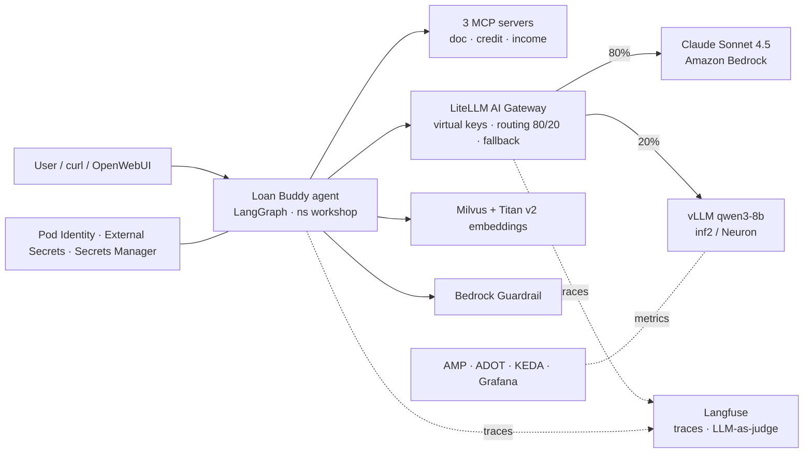
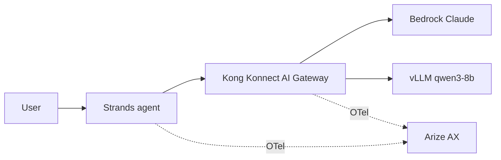

# Token Economics — Agentic AI Platforms on Amazon EKS (Workshop Modules)

Workshop modules (Track A open-source, Track B SaaS) plus run results from a live `genai-on-eks` cluster (us-west-2).

## Architecture flow (Track A)

## Track B flow

## Modules
| Module | What it covers |
|---|---|
| Intro | EKS Auto Mode infra, Bedrock, vLLM on Neuron, OpenWebUI |
| A1 | LiteLLM gateway + Langfuse observability |
| A2 | Loan Buddy multi-agent app (LangGraph + MCP) |
| A3 | Model routing, monitoring/scaling (AMP/KEDA), Langfuse evaluation |
| A4 | Security hardening, streaming tests, RAG (Milvus), Ray Serve autoscaling |
| B1–B5 | Kong Konnect + Arize AX + Strands equivalents |

## Execution results (2026-11-06)
| Module | Status | Notes |
|---|---|---|
| A1 | ✅ | LiteLLM, Langfuse, vLLM (qwen3-8b, deepseek-r1-qwen3-8b) running |
| A2 | ✅ | Agent + 3 MCP pods Running; example1.png → `COMPLETED` (model verdict HOLD) ; traces in Langfuse |
| A3 routing | ✅ | 14 Claude / 6 Qwen of 20 (~80/20); fallback to Claude verified |
| A3 monitoring | ❌ | module4 code (neuron-monitor/ADOT manifests) not in starter kit |
| A3 evaluation | ⏳ | Langfuse UI step |
| A4 | ⚠️ | Milvus, Pod Identity role/SA, ESO, Bedrock Guardrail done; RAG/streaming/v2 agent blocked (module5 code missing); ESO SecretStore needs controller AWS creds |
| A4 Ray Serve | ⏸ | Not applied — provisions extra inf2 nodes |
| Track B | ⏸ | Needs KONNECT_TOKEN + Arize keys |

## Pending modules
See [pending-modules/](pending-modules/README.md) for per-module flow diagrams, status and exact remaining steps.

## Gotchas found
- Shell default region is us-east-1 but cluster is us-west-2: `export AWS_REGION=us-west-2 AWS_DEFAULT_REGION=us-west-2 CLUSTER_NAME=$EKS_CLUSTER_NAME`
- `AGENT_KEY` (A1 virtual key) must be exported; it is not in `.env`.
- `deploy-workshop-app.sh` uses `set -e` and exits silently on region mismatch.
- Bedrock CLI: `--blocked-outputs-messaging` (not `--blocked-output-messaging`).
- External Secrets: use `external-secrets.io/v1` (v1beta1 no longer served).
- `pkill -f "port-forward.*vllm"` can kill your own shell.
