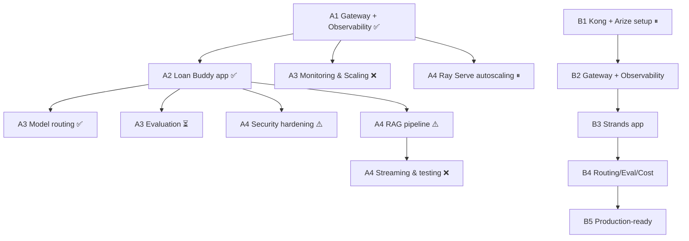

# Pending Modules — Status, Flow & Remaining Steps

Live cluster: `genai-on-eks` (us-west-2). Always start with:
```bash
export AWS_REGION=us-west-2 AWS_DEFAULT_REGION=us-west-2 CLUSTER_NAME=$EKS_CLUSTER_NAME
export AGENT_KEY=<A1 LiteLLM virtual key>
```



| File | Module |
|---|---|
| [a3-monitoring-scaling.md](a3-monitoring-scaling.md) | A3 Monitoring & Scaling |
| [a3-evaluation.md](a3-evaluation.md) | A3 Evaluation |
| [a4-security-hardening.md](a4-security-hardening.md) | A4 Security |
| [a4-rag-streaming.md](a4-rag-streaming.md) | A4 RAG + Streaming |
| [a4-ray-serve.md](a4-ray-serve.md) | A4 Ray Serve |
| [track-b.md](track-b.md) | Track B (B1–B5) |
