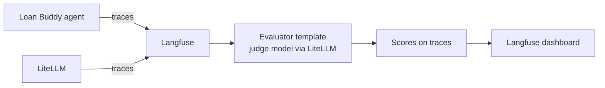

# A3 — Evaluation (Langfuse LLM-as-a-Judge)  ⏳ UI steps

**Ready:** A2 traces already in Langfuse (`litellm-acompletion` traces).
**Remaining (Langfuse UI):** add LLM connection (LiteLLM URL + key) → create evaluator from template → target traces from Loan Buddy → run on new traces → review scores.
