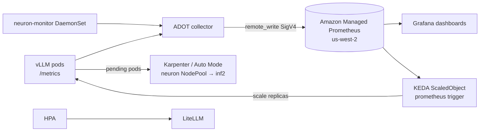

# A3 — Monitoring & Scaling  ❌ blocked



**Done:** `neuron-ls` verified (inf2.xlarge).
**Blocked:** `workshops/eks-genai-workshop/static/code/module4/monitoring/` (neuron-monitor.yaml, adot-collector.yaml) is not in the starter kit.
**Cleanup needed:** AMP workspace `ws-584a362c-2859-4eaf-b32e-459cbad9a2a0` was created in **us-east-1** (wrong region) — delete and recreate in us-west-2:
```bash
aws amp delete-workspace --workspace-id ws-584a362c-2859-4eaf-b32e-459cbad9a2a0 --region us-east-1
aws amp create-workspace --alias genai-workshop --region us-west-2
```
**Remaining (once module4 code available):** neuron-monitor → ADOT → verify AMP query → Grafana → KEDA + IAM role → ScaledObject → LiteLLM HPA → NodePool check → load test → alerts.
**Gotcha:** `pkill -f "port-forward.*vllm"` can kill your own shell — kill the port-forward PID instead.
