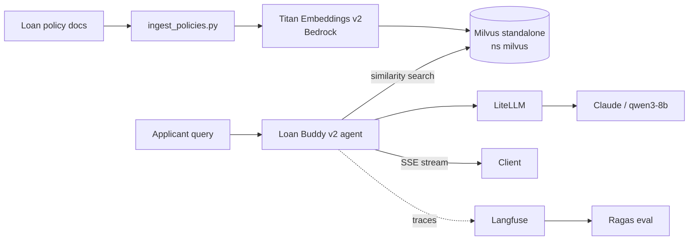

# A4 — RAG Pipeline + Streaming & Testing  ⚠️ partial

| Step | Status |
|---|---|
| Titan v2 model access | ✅ |
| Milvus install (etcd, minio, standalone) | ✅ Running |
| Ingest policies / similarity search | ❌ `ingest_policies.py` missing (module5) |
| Deploy `loan-buddy-agent-v2` | ❌ `deploy-rag-agent.sh` missing |
| Ragas eval | ❌ depends on v2 |
| Streaming agent deploy / `production_readiness_check.py` | ❌ missing (module5) |

**Unblock:** supply `workshops/eks-genai-workshop/static/code/module5/`; then run ingest → deploy v2 → patch SA (security step 4) → guardrail tests → streaming → readiness check.
