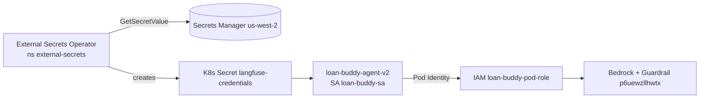

# A4 — Security Hardening  ⚠️ partial



| Step | Status |
|---|---|
| 2–3 IAM role, Pod Identity assoc (`workshop/loan-buddy-sa`), SA | ✅ |
| 4 Patch v2 deployment with SA | ❌ v2 not deployed (module5 code missing) |
| 5 ESO install | ✅ 3 pods Running |
| 6 Langfuse secret in SM (us-west-2) | ✅ — LiteLLM secret needs `$AGENT_KEY` |
| 7 SecretStore/ExternalSecret | ❌ `InvalidProviderConfig` |
| 8 Bedrock Guardrail | ✅ READY `p6uewzllhwtx` |
| 9 Guardrail tests | ❌ needs v2 agent |

**Doc fixes:**
- Use `apiVersion: external-secrets.io/v1` (v1beta1 not served).
- The heredoc is quoted → `${REGION}` stays literal; use unquoted `<<EOF` or hardcode `us-west-2`.
- `--blocked-outputs-messaging` (CLI renamed flag).

**Fix for step 7:** the ESO controller has no AWS creds and the role lacks `secretsmanager:GetSecretValue`. Reference the SA in the SecretStore so ESO assumes the pod role:
```yaml
apiVersion: external-secrets.io/v1
kind: SecretStore
metadata: { name: aws-secrets-manager, namespace: workshop }
spec:
  provider:
    aws:
      service: SecretsManager
      region: us-west-2
      auth:
        jwt:
          serviceAccountRef: { name: loan-buddy-sa }
```
and add `secretsmanager:GetSecretValue` + `DescribeSecret` on the workshop secret ARNs to `loan-buddy-pod-role`. (Pod Identity–based JWT auth may additionally require an IRSA annotation; alternative: create a Pod Identity association for the `external-secrets` SA.)
