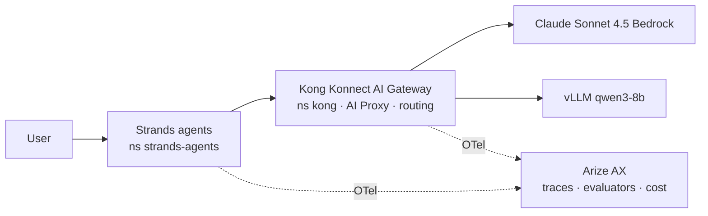

# Track B (SaaS) — B1–B5  ⏸ needs credentials

| Module | Content |
|---|---|
| B1 | Konnect control plane + data plane, Arize space/keys |
| B2 | Kong AI Proxy routes, Arize tracing, prompt engineering |
| B3 | Strands loan app (components → running app) |
| B4 | Model routing, Arize evaluation, token cost attribution |
| B5 | Monitoring/scaling, RAG, Ray Serve, security, streaming |

**Blocked:** `KONNECT_TOKEN` and Arize API key/space ID are not set. Export them, then start at `workshop-docs/track-b-saas/b1-platform-setup/`.
