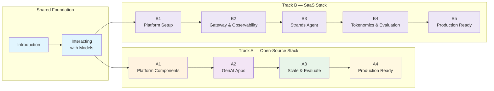

This hands-on workshop guides you through building a complete generative AI platform on Amazon EKS, from deploying your first LLM to building agentic applications.

## Built on the GenAI on EKS Starter Kit

This workshop is built on the **[AWS GenAI on EKS Starter Kit](https://github.com/aws-samples/sample-genai-on-eks-starter-kit)**, a reference architecture for deploying GenAI platforms on Amazon EKS.

After the workshop, you can:
- Deploy the same patterns in your own AWS account using the starter kit
- Customize the platform for your specific use cases
- Scale the platform to handle production request volumes
- Reuse the tested Kubernetes configurations

::alert[Everything you build in this workshop can be deployed in your own environment using the open-source starter kit.]{type="success"}

## What this workshop covers

This workshop goes beyond introductory AI tutorials. You will work with:

- A GenAI platform built on EKS Auto Mode
- Qwen 3 8B and DeepSeek R1 Qwen 3 8B running on AWS Neuron chips, and Claude Sonnet 4.5 through Amazon Bedrock
- Patterns for observability, cost tracking, and scalability
- Frameworks including LangChain, LangGraph, and Model Context Protocol
- Hands-on exercises based on real-world GenAI deployments

## Choose Your Pathway

The workshop is designed for three attendee profiles. Pick the pathway that matches the time you have and your prior exposure to the stack.

First, pick which **stack** you want to build the platform on. Both start from the shared foundation (Introduction → Interacting with Models):

| Track | Stack | Modules | Best For |
|---|---|---|---|
| **[Track A — Open-Source Stack](/track-a-opensource/)** | LiteLLM + Langfuse + LangGraph (self-hosted) | A1 → A2 → A3 → A4 | Learners who want to run and operate the gateway and observability themselves with open-source tooling. The full end-to-end journey (platform → apps → scaling → production). |
| **[Track B — SaaS Stack](/track-b-saas/)** | Kong Konnect + Arize AX + Strands (SaaS) | B1 → B2 → B3 → B4 → B5 | Learners who prefer **managed SaaS** control planes — run only a stateless gateway DataPlane in-cluster and export traces to Arize AX. The full end-to-end journey (platform → apps → tokenomics & evaluation → production) on the SaaS stack. |

Within **Track A**, pick the depth that matches your time:

| Pathway | Modules | Target Duration | Best For |
|---|---|---|---|
| **Beginner** | Interacting with Models → A1 → A2 | **~2 hours** | First-time attendees at Summits or similar time-boxed events. You deploy models, configure the gateway and observability, then run the Loan Buddy agent. |
| **Advanced** | Virtual Key shortcut → A2 → A3 → A4 | **~2 hours** | Attendees already familiar with vLLM, LiteLLM, and Langfuse. Skip to agentic applications, evaluation, A/B routing, and production hardening. |
| **Complete** | Interacting with Models → A1 → A2 → A3 → A4 | 6-7 hours | Self-paced or full-day sessions. The end-to-end journey. |

::alert[**Beginner** and **Advanced** are sized to fit within typical 2-hour event slots (e.g., AWS Summits). Pathway details — including which optional hands-on steps to skim — are on the [Introduction page](/introduction/).]{type="info"}

## Learning Path

## Workshop Overview

The workshop has a **shared foundation** that every learner completes, then splits into **two tracks** — you build the **same** Agentic AI platform + agent either way. The difference is the gateway/observability layer: **self-host it with open-source tooling (Track A)** or **consume it as managed SaaS services — Kong Konnect + Arize AX (Track B)**. *Track B means using those managed control planes, not building a SaaS product of your own.*

### Shared Foundation (both tracks)

**Introduction** — set up your AWS account/EKS cluster and the workshop environment.

**Interacting with Models**
- **Open WebUI** - Deploy a ChatGPT-style interface for model interaction
- **vLLM on AWS Neuron** - Host Qwen 3 8B and DeepSeek R1 Qwen 3 8B on Neuron
- **AWS Bedrock Integration** - Connect to Claude Sonnet 4.5 through Amazon Bedrock

::alert[**Hands-on focus**: You will use real models deployed on EKS and observe immediate results -- no simulation or mocking.]{type="success"}

### [Track A — Open-Source Stack](/track-a-opensource/) (LiteLLM + Langfuse + LangGraph)

The full end-to-end journey on self-hosted, open-source tooling:

- **A1: GenAI Platform Components** — LiteLLM unified gateway + Langfuse observability
- **A2: Building Agentic AI Applications** — LangGraph + MCP tool servers; the Loan Buddy agent
- **A3: Scaling and Evaluating the Platform** — LLM-as-a-Judge, A/B model routing, AMP/AMG monitoring, autoscaling
- **A4: Production-Ready Agentic AI Applications** — RAG with Milvus, Ragas evaluation, security hardening (Pod Identity, External Secrets, Bedrock Guardrails), SSE streaming

### [Track B — SaaS Stack](/track-b-saas/) (Kong Konnect + Arize AX + Strands)

The full end-to-end journey — the same platform and agent built on managed SaaS control planes:

- **B1: Platform Setup — Kong Konnect & Arize AX** — register the Kong Konnect control plane + DataPlane; create the Arize AX Space
- **B2: AI Gateway & Observability (Kong + Arize)** — the Bedrock `ai-proxy` route as Kong CRDs; Arize AX tracing
- **B3: Building Agentic Applications with Strands** — the Strands Loan Buddy agent via Kong → Bedrock, traced in Arize AX
- **B4: Tokenomics & Evaluation** — Arize LLM-as-a-Judge evaluation, per-tenant token/cost attribution and edge budgets (`ai-rate-limiting-advanced`), and model routing with semantic caching (Kong `ai-proxy-advanced`)
- **B5: Production Readiness & Operations** — RAG (Milvus + Bedrock Titan), security hardening (Pod Identity, External Secrets, Bedrock Guardrails at the Kong edge), streaming, AMP/Grafana monitoring, and Ray Serve autoscaling

## Technologies You Will Use

::::tabs

:::tab{label="Infrastructure"}
- **Amazon EKS Auto Mode** - Fully managed Kubernetes
- **AWS Neuron** - Purpose-built AI chips (inf2)
- **Amazon EFS** - Shared storage for models
:::

:::tab{label="AI/ML Stack"}
- **vLLM** - High-performance inference server
- **LiteLLM** - Unified LLM gateway
- **Langfuse** - LLM observability platform
- **Open WebUI** - Chat interface
- **AWS Bedrock** - Managed AI services
- **Milvus** - Vector database for RAG
- **Ragas** - RAG evaluation framework
- **Amazon Managed Prometheus/Grafana** - Infrastructure monitoring
:::

:::tab{label="Frameworks"}
- **LangChain** - LLM application framework
- **LangGraph** - Workflow orchestration
- **Model Context Protocol** - Tool integration
:::

::::

## Who Should Attend

This workshop is designed for:

- **Software Engineers** building GenAI applications
- **DevOps Engineers** deploying AI workloads on Kubernetes
- **Solution Architects** designing GenAI platforms
- **ML Engineers** working with LLMs
- **Technical Leaders** evaluating GenAI strategies

## Prerequisites

Before starting, ensure you have:

- Basic Kubernetes knowledge (`kubectl` experience)
- AWS account access or Workshop Studio event credentials
- Interest in experimenting with AI workloads

::alert[**No AI/ML expertise required.** Concepts are explained as you build.]{type="info"}

## Learning Objectives

By the end of this workshop, you will be able to:

- Deploy and interact with open-source LLMs on Amazon EKS
- Build a unified GenAI platform with comprehensive observability
- Create agents using modern frameworks
- Monitor costs and performance of AI workloads
- Compare different model deployment strategies
- Use the starter kit to deploy similar platforms in your own AWS account

## Workshop Format

- **Duration**: Beginner ~2h · Advanced ~2h · Complete 6-7h (with breaks)
- **Style**: Hands-on with guided exercises
- **Pace**: Progressive difficulty with checkpoints
- **Take Home**: Deploy the same patterns using the AWS starter kit

## Tips for Success

1. **Follow the modules in order** - Each module builds on the previous one
2. **Run the verification commands** - Confirm each step completes successfully
3. **Experiment as needed** - The environment is yours to explore
4. **Ask questions** - Instructors are available to help
5. **Take breaks** - The Complete pathway covers a substantial amount of content

## Getting Started

The workshop begins with the Introduction, where you set up your environment. From there, you progress from deploying your first model to building agentic applications.

---

**[Get Started with the Introduction →](/introduction/)**
