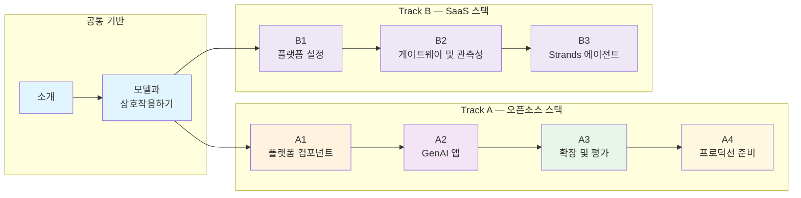

이 실습 워크샵은 첫 LLM 배포부터 Agentic AI 애플리케이션 구축까지, Amazon EKS에서 완전한 생성형 AI 플랫폼을 구축하는 과정을 안내합니다.

## GenAI on EKS Starter Kit 기반

이 워크샵은 Amazon EKS에 Agentic AI 플랫폼을 배포하기 위한 참조 아키텍처인 **[AWS GenAI on EKS Starter Kit](https://github.com/aws-samples/sample-genai-on-eks-starter-kit)** 을 기반으로 구축되었습니다.

**워크샵 이후**, 다음을 수행할 수 있습니다:
- 스타터 킷을 사용하여 자신의 AWS 계정에 동일한 패턴 배포
- 특정 사용 사례에 맞게 플랫폼 커스터마이징
- 프로덕션 수준의 AI 요청 볼륨을 처리하도록 플랫폼 확장
- 검증된 Kubernetes 구성 재사용

::alert[이 워크샵에서 구축하는 모든 것은 오픈소스 스타터 킷을 사용하여 자신의 환경에 배포할 수 있습니다.]{type="success"}

## 이 워크샵에서 다루는 내용

이 워크샵은 입문 수준의 AI 튜토리얼을 넘어 다음 내용을 다룹니다:

- **Agentic AI 플랫폼**: EKS Auto Mode 기반
- **실제 LLM**: AWS Neuron 칩에서 실행되는 Qwen 3 8B 및 DeepSeek R1 Qwen 3 8B, Amazon Bedrock을 통한 Claude Sonnet 4.5
- **최신 AI 패턴**: 관측성, 비용 추적, 확장성
- **프레임워크**: LangChain, LangGraph, Model Context Protocol
- **실습 연습**: 실제 Agentic AI 배포 사례를 반영하는 연습

## 학습 경로 선택

이 워크샵은 세 가지 참가자 유형에 맞추어 설계되었습니다. 보유한 시간과 스택에 대한 사전 경험에 맞는 경로를 선택하십시오.

먼저 플랫폼을 구축할 **스택**을 선택합니다. 두 트랙 모두 공통 기반(소개 → 모델과 상호작용하기)에서 시작합니다:

| 트랙 | 스택 | 모듈 | 권장 대상 |
|---|---|---|---|
| **[Track A — 오픈소스 스택](/track-a-opensource/)** | LiteLLM + Langfuse + LangGraph (자체 호스팅) | A1 → A2 → A3 → A4 | 게이트웨이와 관측성을 오픈소스 도구로 직접 운영하려는 학습자. 플랫폼 → 애플리케이션 → 확장 → 프로덕션까지 전체 과정을 다룹니다. |
| **[Track B — SaaS 스택](/track-b-saas/)** | Kong Konnect + Arize AX + Strands (SaaS) | B1 → B2 → B3 | **관리형 SaaS** 컨트롤 플레인을 선호하는 학습자. 클러스터에는 상태 비저장 게이트웨이 DataPlane만 실행하고 트레이스는 Arize AX로 내보냅니다. Strands SDK로 동일한 플랫폼과 에이전트를 구축합니다. |

**Track A** 내에서는 보유한 시간에 맞는 깊이를 선택합니다:

| 경로 | 모듈 | 목표 소요 시간 | 권장 대상 |
|---|---|---|---|
| **Beginner** | 모델과 상호작용하기 → A1 → A2 | **약 2시간** | Summit 등 시간 제약이 있는 이벤트의 첫 참가자. 모델을 배포하고, 게이트웨이와 관측성을 구성한 후 Loan Buddy 에이전트를 실행합니다. |
| **Advanced** | Virtual Key 단축 경로 → A2 → A3 → A4 | **약 2시간** | vLLM, LiteLLM, Langfuse에 이미 익숙한 참가자. 에이전트 애플리케이션, 평가, A/B 라우팅, 프로덕션 강화로 바로 진입합니다. |
| **Complete** | 모델과 상호작용하기 → A1 → A2 → A3 → A4 | 6-7시간 | 자기 주도 학습 또는 전일 세션. 전체 과정을 진행합니다. |

::alert[**Beginner** 및 **Advanced** 경로는 AWS Summit과 같은 일반적인 2시간 이벤트 슬롯에 맞추어 구성되었습니다. 각 경로의 상세 가이드 — 간략히 살펴보고 넘어갈 선택 실습 단계 포함 — 는 [소개 페이지](/introduction/)에서 확인할 수 있습니다.]{type="info"}

## 학습 경로

## 워크샵 개요

이 워크샵은 모든 학습자가 완료하는 **공통 기반**으로 시작한 뒤 **두 개의 트랙**으로 나뉩니다. 오픈소스 자체 호스팅 스택(Track A) 또는 관리형 SaaS 스택(Track B) 중 하나를 선택하여 동일한 Agentic AI 플랫폼을 구축합니다.

### 공통 기반 (두 트랙 공통)

**소개** — AWS 계정/EKS 클러스터와 워크샵 환경을 설정합니다.

**모델과 상호작용하기**
- **Open WebUI** - 모델 상호작용을 위한 ChatGPT와 유사한 인터페이스 배포
- **vLLM on AWS Neuron** - Neuron에서 Qwen 3 8B 및 DeepSeek R1 Qwen 3 8B 호스팅
- **AWS Bedrock Integration** - Amazon Bedrock을 통해 Claude Sonnet 4.5에 연결

::alert[**실습 집중**: 시뮬레이션이나 모킹 없이 EKS에 배포된 실제 모델을 사용하고 즉각적인 결과를 확인할 수 있습니다.]{type="success"}

### [Track A — 오픈소스 스택](/track-a-opensource/) (LiteLLM + Langfuse + LangGraph)

자체 호스팅 오픈소스 도구로 전체 과정을 진행합니다:

- **A1: GenAI 플랫폼 컴포넌트** — LiteLLM 통합 게이트웨이 + Langfuse 관측성
- **A2: Agentic AI 애플리케이션 구축** — LangGraph + MCP 도구 서버, Loan Buddy 에이전트
- **A3: 플랫폼 확장 및 평가** — LLM-as-a-Judge, A/B 모델 라우팅, AMP/AMG 모니터링, 오토스케일링
- **A4: 프로덕션 준비 애플리케이션** — Milvus 기반 RAG, Ragas 평가, 보안 강화(Pod Identity, External Secrets, Bedrock Guardrails), SSE 스트리밍

### [Track B — SaaS 스택](/track-b-saas/) (Kong Konnect + Arize AX + Strands)

관리형 SaaS 컨트롤 플레인으로 동일한 플랫폼과 에이전트를 구축합니다:

- **B1: 플랫폼 설정** — Kong Konnect 컨트롤 플레인 + DataPlane 등록, Arize AX Space 생성
- **B2: AI 게이트웨이 및 관측성** — Bedrock `ai-proxy` 라우트를 Kong CRD로 구성, Arize AX 추적
- **B3: Strands로 Agentic 애플리케이션 구축** — Kong → Bedrock 경유 Strands Loan Buddy 에이전트, Arize AX 추적

::alert[**Track B는 현재 에이전트 구축(B3)까지 제공됩니다.** 확장, 평가, 프로덕션 강화는 Track A의 A3–A4를 사용하십시오. 해당 계층은 스택과 무관하며 동일한 MCP 도구 서버를 재사용합니다. B4/B5에 해당하는 모듈은 추후 추가될 수 있습니다.]{type="info"}

## 사용할 기술

::::tabs

:::tab{label="Infrastructure"}
- **Amazon EKS Auto Mode** - 완전 관리형 Kubernetes
- **AWS Neuron** - 특수 목적 AI 칩 (inf2)
- **Amazon EFS** - 모델을 위한 공유 스토리지
:::

:::tab{label="AI/ML Stack"}
- **vLLM** - 고성능 추론 서버
- **LiteLLM** - 통합 LLM 게이트웨이
- **Langfuse** - LLM 관측성 플랫폼
- **Open WebUI** - 채팅 인터페이스
- **AWS Bedrock** - 관리형 AI 서비스
- **Milvus** - RAG를 위한 벡터 데이터베이스
- **Ragas** - RAG 평가 프레임워크
- **Amazon Managed Prometheus/Grafana** - 인프라 모니터링
:::

:::tab{label="Frameworks"}
- **LangChain** - LLM 애플리케이션 프레임워크
- **LangGraph** - 워크플로우 오케스트레이션
- **Model Context Protocol** - 도구 통합
:::

::::

## 참석 대상

이 워크샵은 다음 대상을 위해 설계되었습니다:

- **소프트웨어 엔지니어**: Agentic AI 애플리케이션 구축
- **DevOps 엔지니어**: Kubernetes에 AI 워크로드 배포
- **솔루션 아키텍트**: Agentic AI 플랫폼 설계
- **ML 엔지니어**: LLM 작업
- **기술 리더**: Agentic AI 전략 평가

## 사전 요구사항

시작하기 전에 다음을 확인하십시오:

- 기본 Kubernetes 지식 (`kubectl` 경험)
- AWS 계정 액세스 또는 Workshop Studio 이벤트 자격 증명
- AI 워크로드 실습에 대한 관심

::alert[**AI/ML 전문 지식은 필요하지 않습니다.** 구축하면서 개념을 설명합니다.]{type="info"}

## 학습 목표

이 워크샵을 마치면 다음을 수행할 수 있습니다:

- Amazon EKS에서 오픈소스 LLM 배포 및 상호작용
- 포괄적인 관측성을 갖춘 통합 Agentic AI 플랫폼 구축
- 최신 프레임워크를 사용하여 에이전트 생성
- AI 워크로드의 비용 및 성능 모니터링
- 다양한 모델 배포 전략 비교
- 스타터 킷을 사용하여 자신의 AWS 계정에 유사한 플랫폼 배포

## 워크샵 형식

- **소요 시간**: Beginner 약 2시간 · Advanced 약 2시간 · Complete 6-7시간 (휴식 포함)
- **스타일**: 가이드가 있는 실습
- **진행 속도**: 체크포인트가 있는 점진적 난이도
- **워크샵 이후**: AWS 스타터 킷을 사용하여 동일한 패턴 배포

## 성공을 위한 팁

1. **모듈을 순서대로 진행하십시오** - 각 모듈은 이전 모듈을 기반으로 구성됩니다
2. **검증 명령을 실행하십시오** - 각 단계가 성공적으로 완료되었는지 확인합니다
3. **필요에 따라 실험하십시오** - 제공된 환경에서 자유롭게 탐구할 수 있습니다
4. **질문하십시오** - 강사가 지원할 준비가 되어 있습니다
5. **휴식을 취하십시오** - Complete 경로는 다루는 내용이 많습니다

## 시작하기

워크샵은 환경을 설정하는 소개 모듈에서 시작합니다. 이후 첫 모델 배포에서 Agentic AI 애플리케이션 구축까지 단계적으로 진행합니다.

---

**[소개로 시작하기 →](/introduction/)**
