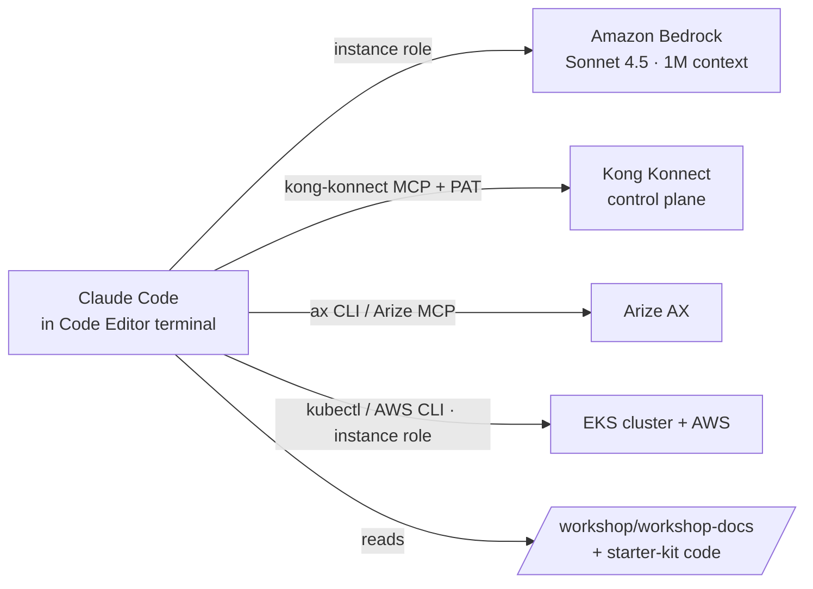

This workshop pre-installs **[Claude Code](https://docs.anthropic.com/en/docs/claude-code)** in your Code Editor terminal as an **agentic co-pilot** — an expert assistant that already understands the entire workshop and your cluster. Because it runs on the Code Editor EC2 instance (which carries an IAM role with cluster + AWS access) and is wired to **Amazon Bedrock**, the Kong and Arize skills, and a local copy of the workshop content, it can:

- **Explain and debug any step** you are on — it has the full workshop content locally
- **Query the Kong Konnect and Arize AX control planes** (the same APIs you'd use in the UI)
- **Inspect and operate the EKS cluster** (`kubectl`, logs, events) and AWS resources
- **Build, deploy, and troubleshoot** the agents, gateways, and models you create

::alert[**Everything below is pre-installed by the workshop's bootstrap** — Claude Code, the `ax` (Arize) and `anyscale` CLIs, the Kong + Arize agent skills and MCP servers, the Bedrock model config, and a local copy of the workshop docs. You only open a terminal and start it.]{type="success"}

## What's pre-installed (for reference)

The Code Editor bootstrap set all of this up so you don't have to:

| Component | What it is |
|---|---|
| **Claude Code** (`claude`) | The agentic CLI, running on **Amazon Bedrock** via the instance role (no API key to manage) |
| **Model** | **Claude Sonnet 4.5** on Bedrock (the same model Track B uses) — fast and cost-efficient, with a **1M-token context** for reasoning over the whole workshop + your code |
| **Kong skills + MCP** | `kong-konnect` plugin (skills + **MCP server**) for Kong Konnect control-plane debugging |
| **Arize docs MCP** | `arize-ax-docs` HTTP MCP (`https://arize.com/docs/mcp`) for Arize AX documentation search |
| **Arize skills** | `arize-skills` plugin (**14 skills** — evaluators, traces, spans, instrumentation, …) that drive the pre-installed `ax` CLI. **No MCP server** — Arize is queried through `ax`, not MCP |
| **`ax` CLI** | Arize CLI, pre-configured with your Space's API key |
| **`anyscale` CLI** | For the Track-adjacent Ray/Anyscale exercises |
| **Workshop docs** | A local copy of the full workshop content at **`/workshop/workshop-docs/`** |
| **`CLAUDE.md`** | A pre-seeded project guide at `/workshop/CLAUDE.md` mapping the code, docs, tools, and credentials |

## Start the co-pilot

**1. Open a new terminal** in the Code Editor (Terminal → New Terminal).

**2. Launch Claude Code from the workshop root:**

:::code{language=bash showCopyAction=true}
cd /workshop
claude
:::

On first launch it reads `/workshop/CLAUDE.md` and indexes the workshop content + starter-kit code, so it starts already knowing the layout. That's it — no login, no API key (it authenticates to Bedrock through the instance role), and **no permission prompts** — the co-pilot is pre-configured in **auto-approve mode** so it can run commands and edits without asking you to confirm each one.

### First prompts — confirm it knows *this* workshop

Try these right away to see it's grounded in the workshop (not generic):

- *"Tell me what you understand about this workshop — the tracks, the modules, and the stack."*
- *"I'm about to start Module B1. Summarize the steps and the credentials I'll need, using the workshop docs."*

You should get a **workshop-specific** answer — it has the docs + starter-kit code locally. **Keep this terminal open** and come back to it whenever a step doesn't behave as documented.

::alert[**Copying terminal output:** the Code Editor is configured with *copy-on-select* — just **select** the text and it's copied (or **right-click** to copy/paste). This avoids the "The terminal has no selection to copy" message. If you don't see it working yet, reload the window (Cmd/Ctrl+Shift+P → "Reload Window").]{type="info"}

### Confirm what's already configured

Everything is set up by the bootstrap. The **plugins and skills are installed without any keys** — you add the Kong/Arize tokens later (the "Configure it for control-plane debugging" section) only to make their **live queries** work. Verify the install:

:::code{language=bash showCopyAction=true}
claude plugin list          # kong-konnect AND arize-skills should both show "enabled"
:::

Inside a Claude session, also try:
- `/status` — confirms the model is **Claude Sonnet 4.5 on Amazon Bedrock**
- `/skills` — lists the **35 skills** from the `arize-skills` + `kong-konnect` plugins (no keys needed just to list them)
- `/mcp` — lists the connected **MCP servers**: **arize-ax-docs** (Arize docs search — no key) and **kong-konnect** (its *live* Konnect queries need `KONNECT_TOKEN`, set below). Arize *control-plane* queries (traces/evaluators) go through the **`ax` CLI + arize-skills** (needs `ARIZE_API_KEY`, also set below), not an MCP
- *"List your installed plugins, skills, and MCP servers, and what each one lets you do."* — Claude enumerates its own capabilities, proving it's wired to both control planes.

::alert[**Verify it's on Bedrock:** inside Claude Code, run `/status` — the model should show a Sonnet 4.5 Bedrock profile (no login prompt appears because it authenticates via the instance role). The same session works headless: `claude -p "your question"`.]{type="info"}

## Try it — example prompts

Paste any of these into the Claude Code prompt:

- **Debug the step you're on:** *"I'm on Module B2 Step 2 and my `ai-proxy` route returns 401. Read the module doc under /workshop/workshop-docs and my Kong resources, and tell me what's wrong."*
- **Query Kong Konnect:** *"Use the kong-konnect skill to list my control planes and the plugins attached to the loan-strands route."*
- **Inspect Arize traces:** *"Use ax to show the most recent traces in my Arize space and whether the evaluators ran."*
- **Operate the cluster:** *"Why is the qwen3-8b-neuron pod not Ready? Check its events and logs."*

## Configure it for control-plane debugging (optional)

::alert[**These tokens are created later, in [Module B1: Platform Setup](/track-b-saas/b1-platform-setup/)** — the **Kong PAT** in [Kong Setup](/track-b-saas/b1-platform-setup/kong-setup/) and the **Arize Service key + Space ID** in [Arize Setup](/track-b-saas/b1-platform-setup/arize-setup/). If you haven't done B1 yet, **skip this section for now and come back here after finishing B1** — B1 ends with a reminder to return. (Everything else in this module works today; only the *live* Kong/Arize queries need these tokens.)]{type="info"}

The **skills** work read-only out of the box. To let Claude Code drive the **Kong Konnect** and **Arize** control planes (create/inspect resources like you would in the UI), export the credentials from B1:

:::code{language=bash showCopyAction=true}
# Kong Konnect PAT (from Module B1) -- enables the kong-konnect MCP server
export KONNECT_TOKEN="PASTE_YOUR_KONNECT_PAT"   # begins with kpat_

# Arize Service key + Space ID (from Module B1) -- the ax CLI is installed; this points it at your Space.
# The Service key (Space Admin) is sufficient for ax and the Arize skill -- no separate User key needed.
export ARIZE_API_KEY="PASTE_YOUR_ARIZE_SERVICE_KEY"
export ARIZE_SPACE_ID="PASTE_YOUR_SPACE_ID"
:::

Then restart the terminal's Claude session so the MCP servers pick up the tokens.

**Prove it can reach both SaaS control planes** — after the restart, try:

- **Kong Konnect:** *"Use the kong-konnect tools to list my Konnect control planes, then show the routes and plugins on the `loan-strands` route."* → Claude should return your `kong-aws` control plane and the `ai-proxy` / `key-auth` / rate-limiting plugins.
- **Arize AX:** *"Using Arize, list the projects in my Space and the most recent traces for `loan-strands`, and tell me whether the loan-accuracy / loan-helpfulness / loan-safety evaluators have run."* → Claude should list projects like `loan-strands` and recent trace/eval status.

If both return live data, the co-pilot has full read access to Kong Konnect and Arize AX — it can now help you **debug SaaS-side issues** (missing plugins, failed evaluators, misrouted requests) the same way you would in each UI.

**Confirm the wiring with `/mcp` and `/skills`** inside the Claude session:

`/mcp` — the connected **MCP servers**: `arize-ax-docs` and `plugin:kong-konnect:kong-konnect`:

`/skills` — the **35 skills** from the `arize-skills` and `kong-konnect` plugins (evaluators, traces, instrumentation, gateway, konnect-ai-gateway, …):

## How it's wired (under the hood)

- **Model:** Claude Code uses Bedrock (`CLAUDE_CODE_USE_BEDROCK=1`, `ANTHROPIC_MODEL=global.anthropic.claude-sonnet-4-5-20250929-v1:0`, `ANTHROPIC_BETAS=context-1m-2025-08-07`) — set in `~/.claude/settings.json` by the bootstrap. Auth is the **EC2 instance role** — no keys, no login prompt.
- **Skills/MCP:** installed via `claude plugin install kong-konnect@ai-marketplace` and the Arize skills marketplace during bootstrap.
- **Context:** `/workshop/CLAUDE.md` points Claude at the local workshop docs and the starter-kit code, so it answers grounded in *this* workshop, not generic knowledge.

::alert[**This is a powerful assistant in a workshop sandbox.** It runs in **auto-approve mode** (no per-command confirmation) with the Code Editor instance role, so it can run commands and change cluster/AWS resources on its own. That's intentional for a smooth workshop in an **isolated event account** — but be deliberate with what you ask it to do (it will act without a confirmation step), and don't reuse this configuration in a production environment.]{type="warning"}

---

**Next:** continue to [Infrastructure Setup](/introduction/infra-setup/), and keep the co-pilot terminal open — reach for it whenever a step doesn't behave as documented.
