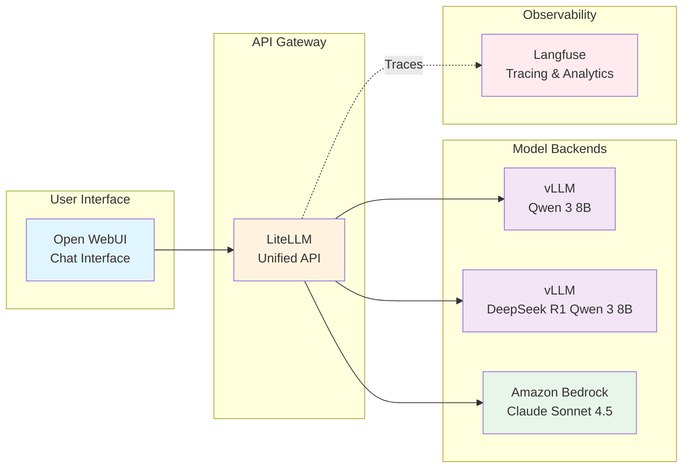
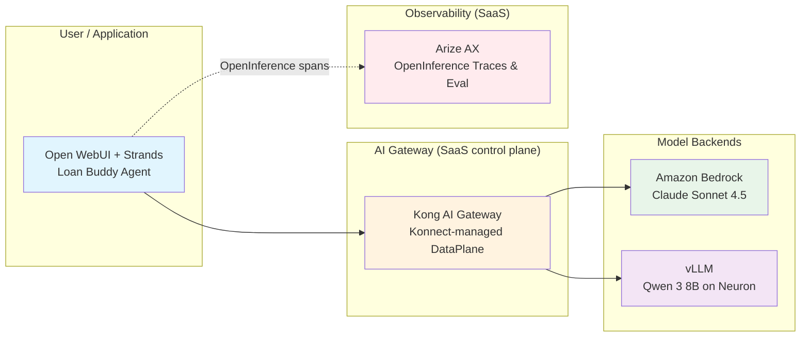

This hands-on workshop covers building a GenAI platform on Amazon EKS. You will deploy Large Language Models, create a unified AI gateway, and build AI applications, all using scalable patterns that you can deploy in your own AWS account.

## What You Will Build

By the end of this workshop, you will have a working GenAI platform running on EKS:

- **Chat with AI models** including Qwen 3 8B and DeepSeek R1 Qwen 3 8B running on AWS Neuron, plus Claude Sonnet 4.5 via Amazon Bedrock
- **Unified AI gateway** that routes requests across multiple model providers
- **Observability** that tracks each AI interaction, cost, and performance metric
- **Applications** that use the platform to solve business problems

## Your GenAI Platform Architecture

You build the **same** platform on either of two interchangeable stacks. The diagrams below show both — pick the one that matches your chosen track.

### Track A — Open-Source Stack (LiteLLM + Langfuse + LangGraph)

**Request flow (Track A):**
1. Users interact with the platform through Open WebUI
2. LiteLLM, the AI gateway, routes each request to a model backend
3. Models run on specialized hardware (Neuron chips) or through managed services (Bedrock)
4. Langfuse records traces for cost and performance monitoring

### Track B — Managed SaaS Stack (Kong AI Gateway + Arize AX + Strands)

**Request flow (Track B):**
1. Users and the Strands Loan Buddy agent call the platform through Open WebUI or the agent API
2. The Kong AI Gateway (a Konnect-managed DataPlane) authenticates each request, enforces per-tenant token/cost budgets and routing, and forwards to a model backend
3. Models run on Amazon Bedrock (Claude Sonnet 4.5) or self-hosted vLLM on Neuron
4. Arize AX records OpenInference traces for evaluation, cost attribution, and performance

## Why EKS for GenAI?

This workshop demonstrates how EKS provides a foundation for AI platforms:

::::tabs

:::tab{label="Scalability"}
**Dynamic Infrastructure**
- Auto-scaling based on AI workload demand
- Support for specialized hardware (GPUs, Neuron)
- Distributed inference capabilities
- Multi-model deployment patterns
:::

:::tab{label="Flexibility"}
**Choice and Control**
- Self-hosted open-source models
- Managed cloud services integration
- Hybrid deployment patterns
- Custom optimization strategies
:::

:::tab{label="Operations"}
**Operational Excellence**
- Observability with Langfuse
- Automated lifecycle management with Helm
- Cost optimization and tracking
- Security best practices
:::

::::

## Choose Your Track, Then Your Pathway

First pick the **stack** you want to build on (both start from this shared foundation):

- **[Track A — Open-Source Stack](/track-a-opensource/)** (LiteLLM + Langfuse + LangGraph) — the full end-to-end path (platform → apps → scaling → production). The time-based pathways below apply to Track A.
- **[Track B — SaaS Stack](/track-b-saas/)** (Kong Konnect + Arize AX + Strands) — the same platform and agent on managed SaaS, end to end (B1 → B2 → B3 → B4 → B5). Its own time-based pathways are below.

### Track A time-based pathways

Within Track A, pick one of three pathways based on your available time and prior experience. All three produce a working Loan Buddy deployment; they differ in how deep you go on platform internals versus scale and production topics.

#### Beginner — Interacting with Models → A1 → A2 (~2 hours)

Recommended for first-time attendees at time-boxed events (for example, AWS Summits). You build the platform from scratch and run the Loan Buddy agent end-to-end.

**To stay near the 2-hour target, treat these as core and skim the rest:**
- Interacting with Models: complete "Open WebUI" and "vLLM on Neuron" hands-on; skim the Bedrock section.
- Module A1: complete "LiteLLM gateway" and "Create a Virtual Key" hands-on; skim the Langfuse dashboard-building sections (traces are still collected automatically).
- Module A2: focus on running the Loan Buddy agent and observing traces in Langfuse; skim the detailed MCP tool walkthroughs.

#### Advanced — Virtual Key shortcut → A2 → A3 → A4 (~2 hours)

Recommended for attendees already familiar with vLLM, LiteLLM, and Langfuse. Skip the foundation build and start with agentic applications, evaluation, routing, and production hardening.

**Order of operations:**
1. [Create a Virtual Key (shortcut page)](./virtual-key-shortcut/) — one-page extract of the LiteLLM Virtual Key step required by Module A2.
2. [Module A2: Building Agentic AI Applications](/track-a-opensource/a2-genai-applications/) — deploy and run Loan Buddy; concentrate on `running-application` and `langgraph-mcp`.
3. [Module A3: Scaling and Evaluating the Platform](/track-a-opensource/a3-scaling-evaluating/) — LLM-as-a-Judge evaluation, A/B model routing, and AMP/AMG monitoring highlights.
4. [Module A4: Production-Ready Applications](/track-a-opensource/a4-production-ready/) — RAG with Milvus, security hardening, and streaming responses.

**To stay near the 2-hour target:** on Module A3, focus on `evaluation` and `model-routing`; treat `monitoring-scaling` as a demo read. On Module A4, complete `rag-pipeline`; treat `security-hardening` and `streaming-testing` as reference.

#### Complete — Interacting with Models → A1 → A2 → A3 → A4 (6-7 hours)

The full end-to-end path. Recommended for self-paced learners and full-day sessions. Follow each module in order without skipping.

::alert[**Which should I pick?** If this is your first time deploying LLMs on Kubernetes, start with **Track A · Beginner**. If you have already run vLLM and LiteLLM on EKS and want to move to agents and evaluation quickly, choose **Track A · Advanced**. If you have the full day, choose **Track A · Complete**. To build the platform on managed SaaS (Kong + Arize + Strands) instead, take **Track B** (its own time-based pathways are below).]{type="info"}

### Track B time-based pathways

Track B runs at the same three depths. All three stand up the Kong + Arize SaaS platform and the Strands Loan Buddy; they differ in how far you go into tokenomics, evaluation, and production hardening. (Track B has no "Virtual Key" shortcut — the Kong Konnect + Arize setup in **B1** is a prerequisite for every pathway.)

#### Beginner — Interacting with Models → B1 → B2 → B3 (~2 hours)

Recommended for first-time attendees at time-boxed events (for example, AWS Summits). You register the managed control planes, route Bedrock through Kong, and run the Strands Loan Buddy end-to-end, traced in Arize AX.

**To stay near the 2-hour target, treat these as core and skim the rest:**
- Interacting with Models: complete "Open WebUI" and "vLLM on Neuron" hands-on; skim the Bedrock section.
- Module B1: complete the Kong Konnect control-plane + DataPlane registration and the Arize AX Space/key setup.
- Module B2: complete the Bedrock `ai-proxy` route; skim the prompt-engineering deep dive.
- Module B3: focus on running the Strands Loan Buddy and observing traces in Arize AX.

#### Advanced — B1 → B3 → B4 → B5 (~2-3 hours)

Recommended for attendees already comfortable with API gateways and observability. Stand up the platform quickly (complete **B1**; skim **B2**), then go deep on the agent, tokenomics/evaluation, and production readiness.

**To stay near target:** on Module B4, focus on `evaluation` and `token-cost-attribution`; treat `model-routing` as a demo read. On Module B5, complete `rag-pipeline` and `security-hardening`; treat `monitoring-scaling`, `ray-serve-autoscaling`, and `streaming-testing` as reference.

#### Complete — Interacting with Models → B1 → B2 → B3 → B4 → B5 (6-7 hours)

The full end-to-end SaaS journey. Recommended for self-paced learners and full-day sessions. Follow each module in order without skipping.

## Your Learning Path

Modules are grouped by track and listed in the same order as the workshop menu. Complete the shared foundation, then follow your chosen track from top to bottom.

### Shared Foundation _(both tracks)_

#### **Interacting with Models**
**Run AI Models on Kubernetes**

Begin by interacting with AI models running on EKS:
- Deploy Open WebUI and run your first AI conversation
- Explore vLLM serving Qwen 3 8B on AWS Neuron hardware
- Connect to Claude Sonnet 4.5 via Amazon Bedrock and compare capabilities
- Observe your models processing requests in real time with kubectl

### Track A — Open-Source Stack _(LiteLLM + Langfuse + LangGraph)_

#### **Module A1: GenAI Platform Components** _(Beginner · Complete)_
**Build Your AI Infrastructure**

Combine individual models into a unified, observable platform:
- Explore LiteLLM as the AI gateway that routes requests across models
- Use Langfuse to track each AI interaction with detailed metrics
- Add new models to the platform through configuration
- Monitor costs, performance, and usage patterns in real time

#### **Module A2: Building Agentic AI Applications** _(All pathways)_
**From Platform to Applications**

Use the platform to build AI applications:
- Deploy "Loan Buddy", a loan processing application
- Observe how AI agents use the platform to make business decisions
- Monitor complex workflows with full traceability in Langfuse
- See how the platform supports rapid AI application development

#### **Module A3: Scaling and Evaluating the Platform** _(Advanced · Complete)_
**From Working to Verified at Scale**

Add quality and scale capabilities to the platform:
- LLM-as-a-Judge evaluation in Langfuse with `loan-accuracy` / `loan-helpfulness` / `loan-safety` scorers
- A/B weighted routing in LiteLLM to compare Claude Sonnet 4.5 vs. Qwen 3 8B
- Amazon Managed Prometheus + Grafana dashboards and HPA/Karpenter auto-scaling

#### **Module A4: Production-Ready Agentic AI Applications** _(Advanced · Complete)_
**From Prototype to Enterprise**

Make the agent compliance-ready:
- RAG pipeline with Milvus and Bedrock Titan Embeddings, evaluated with Ragas
- Security hardening: Pod Identity, External Secrets Operator, Bedrock Guardrails
- Streaming SSE responses and Pydantic-validated structured outputs

### Track B — Managed SaaS Stack _(Kong AI Gateway + Arize AX & Strands)_

The same platform and agent, built end to end on managed SaaS control planes. See the [Track B overview](/track-b-saas/) to get started.

#### **Module B1: Platform Setup — Kong Konnect & Arize AX**
**Stand Up the SaaS Control Planes**

- Register the Kong Konnect control plane and run a stateless DataPlane in-cluster
- Create the Arize AX Space and service keys for tracing

#### **Module B2: AI Gateway & Observability (Kong + Arize)**
**Route and Trace Through Managed SaaS**

- Configure the Bedrock `ai-proxy` route as Kong CRDs
- Send OpenInference traces to Arize AX and explore them

#### **Module B3: Building Agentic Applications with Strands**
**From Platform to Agent**

- Build the Strands Loan Buddy agent calling Kong → Bedrock
- Trace every decision in Arize AX

#### **Module B4: Tokenomics & Evaluation**
**From Working to Verified at Scale**

- Evaluate quality with Arize AX LLM-as-a-Judge evaluators
- Attribute tokens and cost per tenant (Kong Prometheus `consumer` metrics + Arize sessions) and enforce edge budgets with `ai-rate-limiting-advanced`
- Route across models with Kong `ai-proxy-advanced` and cut cost with semantic caching

#### **Module B5: Production Readiness & Operations**
**From Prototype to Enterprise**

- Add a RAG pipeline (Milvus + Bedrock Titan Embeddings) to the Strands agent
- Harden security: Pod Identity, External Secrets, and Bedrock Guardrails enforced at the Kong edge
- Stream responses (Strands SDK) and validate outputs with Pydantic
- Operate the platform: AMP/Grafana monitoring and Ray Serve autoscaling for self-hosted vLLM

## Built on the AWS GenAI Starter Kit

This workshop is based on the **[AWS GenAI on EKS Starter Kit](https://github.com/aws-samples/sample-genai-on-eks-starter-kit)**, a reference architecture that you can use to deploy similar platforms in your own AWS account.

**What this means for you:**
- The patterns you learn follow a maintained reference architecture
- You can deploy the same infrastructure in your own environment
- The starter kit provides Terraform, Helm charts, and documentation
- The workshop exercises map directly to the starter kit components

## Ready to Start

Whether you are building your first AI application or extending existing systems, this workshop provides hands-on experience with building and operating an AI platform on EKS.

---

**[Continue to Getting Started →](/introduction/getting-started/)**
