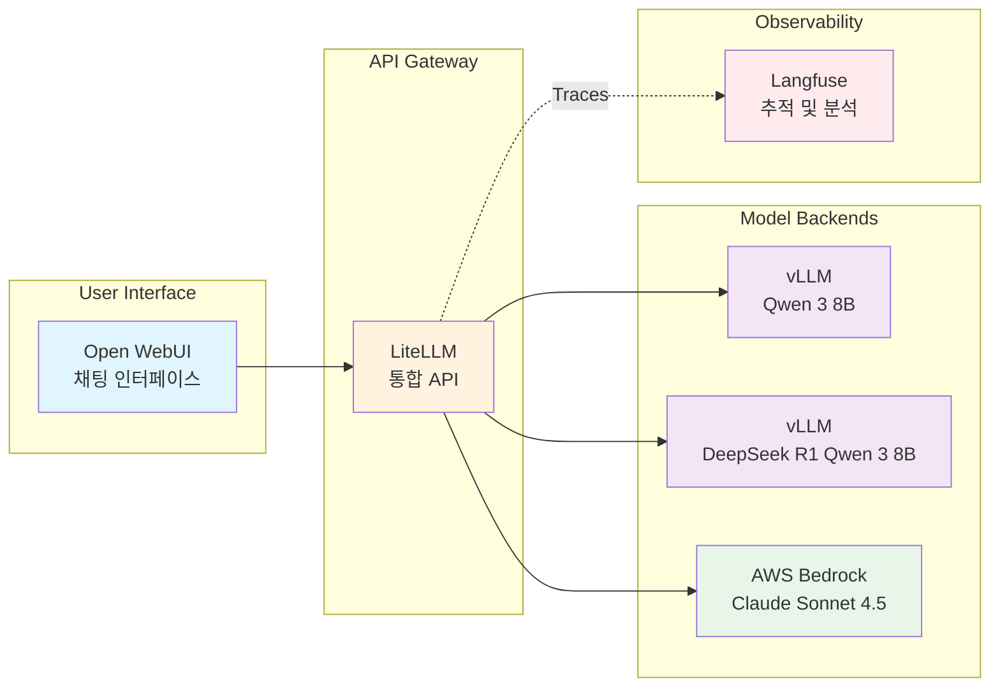

이 실습 워크샵에서는 Amazon EKS에서 Agentic AI 플랫폼을 구축합니다. 대규모 언어 모델을 배포하고, 통합 AI 게이트웨이를 구성하며, AI 애플리케이션을 구축합니다. 모든 과정은 자신의 AWS 계정에 배포할 수 있는 확장 가능한 패턴을 사용합니다.

## 구축할 것

이 워크샵을 마치면 EKS에서 동작하는 Agentic AI 플랫폼을 갖추게 됩니다:

- **AI 모델과 채팅**: AWS Neuron에서 실행되는 Qwen 3 8B 및 Bedrock을 통한 Claude Sonnet 4.5 포함
- **통합 AI 게이트웨이**: 여러 모델 제공자에 걸쳐 요청을 라우팅
- **관측성**: 모든 AI 상호작용, 비용, 성능 메트릭 추적
- **애플리케이션**: 플랫폼을 사용하여 비즈니스 문제 해결

## Agentic AI 플랫폼 아키텍처

구축할 플랫폼은 다음과 같습니다:

**요청 흐름:**
1. 사용자가 Open WebUI를 통해 플랫폼과 상호작용합니다
2. AI 게이트웨이인 LiteLLM이 각 요청을 모델 백엔드로 라우팅합니다
3. 모델은 특수 하드웨어(Neuron 칩) 또는 관리형 서비스(Bedrock)에서 실행됩니다
4. Langfuse가 비용 및 성능 모니터링을 위해 트레이스를 기록합니다

## Agentic AI를 위해 EKS를 선택하는 이유

이 워크샵에서는 EKS가 AI 플랫폼의 기반을 제공하는 방식을 확인할 수 있습니다:

::::tabs

:::tab{label="Scalability"}
**동적 인프라**
- AI 워크로드 수요에 따른 오토스케일링
- 특수 하드웨어 지원 (GPU, Neuron)
- 분산 추론 기능
- 다중 모델 배포 패턴
:::

:::tab{label="Flexibility"}
**선택과 제어**
- 자체 호스팅 오픈소스 모델
- 관리형 클라우드 서비스 통합
- 하이브리드 배포 패턴
- 커스텀 최적화 전략
:::

:::tab{label="Operations"}
**운영 우수성**
- Langfuse를 통한 관측성
- Helm을 통한 자동화된 라이프사이클 관리
- 비용 최적화 및 추적
- 보안 모범 사례
:::

::::

## 트랙 선택 후 경로 선택

먼저 어떤 **스택** 위에서 구축할지 선택하십시오 (두 트랙 모두 이 공통 기반에서 시작합니다):

- **[Track A — 오픈소스 스택](/track-a-opensource/)** (LiteLLM + Langfuse + LangGraph) — 플랫폼 → 애플리케이션 → 확장 → 프로덕션까지 이어지는 완전한 엔드투엔드 경로입니다. 아래 시간 기반 경로는 Track A에 적용됩니다.
- **[Track B — SaaS 스택](/track-b-saas/)** (Kong Konnect + Arize AX + Strands) — 관리형 SaaS 위에서 동일한 플랫폼과 에이전트를 구축합니다. B1 → B2 → B3 순서로 진행하십시오 (약 2시간).

### Track A 시간 기반 경로

Track A 내에서는 보유한 시간과 사전 경험에 따라 세 가지 경로 중 하나를 선택합니다. 세 경로 모두 동작하는 Loan Buddy 배포를 결과물로 제공하며, 플랫폼 내부 구조와 확장 및 프로덕션 주제 중 어느 쪽을 더 깊이 다루는지에 따라 차이가 있습니다.

### Beginner — 모델과 상호작용하기 → A1 → A2 (약 2시간)

AWS Summit과 같은 시간이 제한된 이벤트에 처음 참가하는 분에게 적합합니다. 플랫폼을 처음부터 구축하고 Loan Buddy 에이전트를 엔드투엔드로 실행합니다.

**2시간 목표에 맞추려면 다음을 핵심으로 진행하고, 그 외 섹션은 간략히 살펴보십시오:**
- 모델과 상호작용하기: "Open WebUI" 및 "vLLM on Neuron" 실습을 완료하고, Bedrock 섹션은 간략히 살펴봅니다.
- 모듈 A1: "LiteLLM 게이트웨이" 및 "Virtual Key 생성" 실습을 완료하고, Langfuse 대시보드 구축 섹션은 간략히 살펴봅니다 (트레이스는 자동으로 수집됩니다).
- 모듈 A2: Loan Buddy 에이전트 실행과 Langfuse 트레이스 관찰에 집중하고, 세부 MCP 도구 안내는 간략히 살펴봅니다.

### Advanced — Virtual Key 단축 경로 → A2 → A3 → A4 (약 2시간)

vLLM, LiteLLM, Langfuse에 이미 익숙한 참가자에게 적합합니다. 기반 구축 단계를 건너뛰고 에이전트 애플리케이션, 평가, 라우팅, 프로덕션 강화로 바로 진입합니다.

**진행 순서:**
1. [Virtual Key 생성 (단축 페이지)](./virtual-key-shortcut/) — 모듈 A2에 필요한 LiteLLM Virtual Key 단계만 추출한 한 페이지 가이드입니다.
2. [모듈 A2: Agentic AI 애플리케이션 구축](/track-a-opensource/a2-genai-applications/) — Loan Buddy 배포 및 실행. `running-application` 과 `langgraph-mcp` 에 집중합니다.
3. [모듈 A3: 확장 및 평가](/track-a-opensource/a3-scaling-evaluating/) — LLM-as-a-Judge 평가, A/B 모델 라우팅, AMP/AMG 모니터링 핵심 내용을 학습합니다.
4. [모듈 A4: 프로덕션 준비](/track-a-opensource/a4-production-ready/) — Milvus 기반 RAG, 보안 강화, 스트리밍 응답을 다룹니다.

**2시간 목표에 맞추려면:** 모듈 A3에서는 `evaluation` 과 `model-routing` 에 집중하고, `monitoring-scaling` 은 데모 수준으로 확인하십시오. 모듈 A4에서는 `rag-pipeline` 을 완료하고, `security-hardening` 과 `streaming-testing` 은 참고 자료로 활용하십시오.

### Complete — 모델과 상호작용하기 → A1 → A2 → A3 → A4 (6-7시간)

전체 엔드투엔드 과정입니다. 자기 주도 학습자 및 전일 세션에 적합합니다. 각 모듈을 순서대로 건너뜀 없이 진행하십시오.

::alert[**어느 경로를 선택해야 합니까?** Kubernetes에 LLM을 배포하는 것이 처음이라면 **Track A · Beginner** 로 시작하십시오. 이미 EKS에서 vLLM과 LiteLLM을 운영해 보았고 에이전트와 평가로 빠르게 진입하고 싶다면 **Track A · Advanced** 를 선택하십시오. 하루 전체 시간이 확보되어 있다면 **Track A · Complete** 로 진행하십시오. 관리형 SaaS (Kong + Arize + Strands) 위에서 플랫폼을 구축하고 싶다면 **Track B** 를 선택하십시오.]{type="info"}

## 학습 경로

### **모델과 상호작용하기** _(공통 기반)_
**Kubernetes에서 AI 모델 실행하기**

EKS에서 실행되는 AI 모델과 상호작용하며 시작합니다:
- Open WebUI를 배포하고 첫 AI 대화 실행
- AWS Neuron 하드웨어에서 Qwen 3 8B를 서빙하는 vLLM 탐색
- AWS Bedrock을 통해 Claude 4.5에 연결하고 기능 비교
- kubectl로 실시간으로 요청을 처리하는 모델 관찰

### **모듈 A1: GenAI 플랫폼 컴포넌트** _(Track A · Beginner · Complete)_
**AI 인프라 구축하기**

개별 모델을 통합되고 관측 가능한 플랫폼으로 구성합니다:
- 모델 전반에 걸쳐 요청을 라우팅하는 AI 게이트웨이인 LiteLLM 탐색
- Langfuse를 사용하여 상세한 메트릭으로 모든 AI 상호작용 추적
- 구성을 통해 플랫폼에 새 모델 추가
- 실시간으로 비용, 성능, 사용 패턴 모니터링

### **모듈 A2: Agentic AI 애플리케이션 구축하기** _(Track A · 모든 경로)_
**플랫폼에서 애플리케이션으로**

플랫폼을 사용하여 AI 애플리케이션을 구축합니다:
- 대출 처리 애플리케이션인 "Loan Buddy" 배포
- AI 에이전트가 플랫폼을 사용하여 비즈니스 결정을 내리는 방식 확인
- Langfuse에서 완전한 추적성으로 복잡한 워크플로우 실행 관찰
- 플랫폼이 신속한 AI 애플리케이션 개발을 지원하는 방식 확인

### **모듈 A3: 확장 및 평가** _(Track A · Advanced · Complete)_
**작동에서 대규모 검증까지**

플랫폼에 품질 및 확장 기능을 추가합니다:
- Langfuse의 LLM-as-a-Judge 평가 (`loan-accuracy` / `loan-helpfulness` / `loan-safety` 스코어러)
- LiteLLM의 A/B 가중치 라우팅으로 Claude Sonnet 4.5 과 Qwen 3 8B 비교
- Amazon Managed Prometheus + Grafana 대시보드 및 HPA/Karpenter 오토스케일링

### **모듈 A4: 프로덕션 준비** _(Track A · Advanced · Complete)_
**프로토타입에서 엔터프라이즈까지**

에이전트를 컴플라이언스 요건에 맞게 준비합니다:
- Milvus와 Bedrock Titan Embeddings 기반 RAG 파이프라인 구축 및 Ragas 평가
- 보안 강화: Pod Identity, External Secrets Operator, Bedrock Guardrails
- 스트리밍 SSE 응답 및 Pydantic 기반 구조화된 출력 검증

### **Track B: SaaS 스택** _(Track A의 대안)_
**관리형 SaaS에서 동일한 플랫폼 구축**

Kong Konnect + Arize AX + Strands로 플랫폼을 구축합니다:
- **B1** — Kong Konnect 제어 플레인 + DataPlane 등록; Arize AX Space 생성
- **B2** — Kong CRD로 Bedrock `ai-proxy` 라우트 구성; Arize AX 트레이싱
- **B3** — Kong → Bedrock 경로로 Strands Loan Buddy 에이전트 실행, Arize AX에서 트레이스 확인

시작하려면 [Track B 개요](/track-b-saas/)를 참조하십시오.

## AWS GenAI Starter Kit 기반

이 워크샵은 **[AWS GenAI on EKS Starter Kit](https://github.com/aws-samples/sample-genai-on-eks-starter-kit)** 을 기반으로 합니다. 이는 자신의 AWS 계정에 유사한 플랫폼을 배포하는 데 사용할 수 있는 참조 아키텍처입니다.

**이것이 의미하는 것:**
- 학습하는 패턴은 유지 관리되는 참조 아키텍처를 따릅니다
- 자신의 환경에 동일한 인프라를 배포할 수 있습니다
- 스타터 킷은 Terraform, Helm 차트, 문서를 제공합니다
- 워크샵 실습 내용은 스타터 킷 컴포넌트와 직접 대응됩니다

## 시작할 준비

첫 AI 애플리케이션을 구축하든 기존 시스템을 확장하든, 이 워크샵은 EKS에서 AI 플랫폼을 구축하고 운영하는 실습 경험을 제공합니다.

---

**[시작하기로 계속 →](/introduction/getting-started/)**
