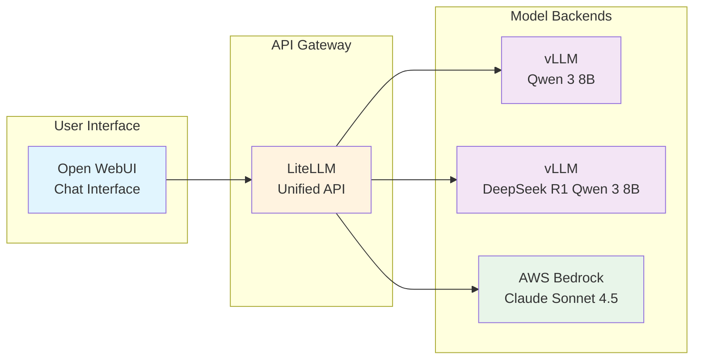

In this first hands-on module of the EKS GenAI Workshop, you will learn how to interact with Large Language Models (LLMs) through different deployment patterns on Amazon EKS. The module covers both self-hosted models running on specialized AWS hardware and cloud-managed models through AWS Bedrock.

## Learning Objectives

By the end of this module, you will:

- **Understand model deployment patterns** on Kubernetes
- **Interact with LLMs** through a chat interface (Open WebUI)
- **Deploy and optimize models** using vLLM on AWS Neuron hardware
- **Integrate cloud-managed models** via AWS Bedrock
- **Understand the Kubernetes resources** required for LLM hosting

## Module Overview

This module is structured into three progressive sections:

#### 1. [Open WebUI - Your Chat Interface](./openwebui)
Start by exploring the user interface that connects you to various LLM backends. This section covers how Open WebUI was deployed using Helm charts and configured to work with the model infrastructure.

#### 2. [vLLM - Self-Hosted Model Serving](./vllm)
Examine self-hosted LLM serving on EKS in detail. Review the Kubernetes manifests, understand Neuron optimization, and interact with Qwen 3 8B running on AWS Inferentia chips.

#### 3. [AWS Bedrock - Managed AI Services](./Bedrock)
Use fully managed AI services. Configure access to Claude Sonnet 4.5 and compare its performance with self-hosted models.

## Architecture Context

## Prerequisites Check

Before starting, verify your environment is ready:

:::code{language=bash showCopyAction=true}
# Check that all components are running
kubectl get pods -n openwebui
kubectl get pods -n vllm
kubectl get pods -n litellm

# Get the Open WebUI URL
echo "Open WebUI URL: http://$(kubectl get ingress -n openwebui openwebui -o jsonpath='{.status.loadBalancer.ingress[0].hostname}')"
:::

## Getting Started

Begin by exploring the Open WebUI interface that serves as your gateway to the language models deployed in this workshop.

::alert[**Tip**: Keep Open WebUI open in a browser tab throughout this module - you will use it to test each model backend as you explore them.]{type="info"}

---

**[Next: Open WebUI - Your Chat Interface →](./openwebui)**
