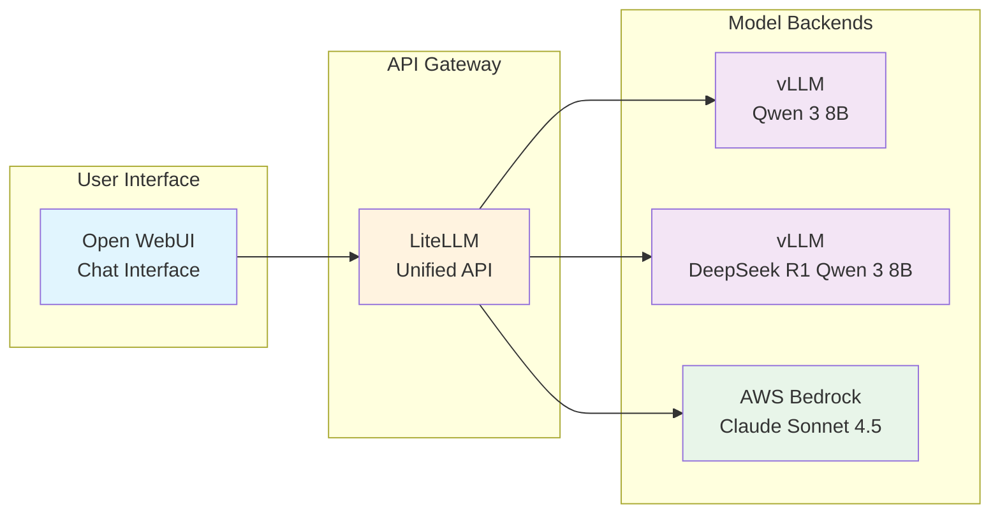

EKS Agentic AI 워크샵의 첫 번째 실습 모듈에서는 Amazon EKS에서 다양한 배포 패턴을 통해 대규모 언어 모델(LLM)과 상호작용하는 방법을 학습합니다. 이 모듈은 특수 AWS 하드웨어에서 실행되는 자체 호스팅 모델과 AWS Bedrock을 통한 클라우드 관리형 모델을 모두 다룹니다.

## 학습 목표

이 모듈을 마치면 다음을 수행할 수 있습니다:

- **Kubernetes에서의 모델 배포 패턴 이해**
- **채팅 인터페이스(Open WebUI)를 통한 LLM과의 상호작용**
- **AWS Neuron 하드웨어에서 vLLM을 사용한 모델 배포 및 최적화**
- **AWS Bedrock을 통한 클라우드 관리형 모델 통합**
- **LLM 호스팅에 필요한 Kubernetes 리소스 이해**

## 모듈 개요

이 모듈은 세 가지 섹션으로 구성되어 있습니다:

#### 1. [Open WebUI - 채팅 인터페이스](./openwebui)
다양한 LLM 백엔드에 연결하는 사용자 인터페이스를 먼저 탐색합니다. Helm 차트를 사용하여 Open WebUI를 배포하고 모델 인프라와 연동하도록 구성한 방법을 학습합니다.

#### 2. [vLLM - 자체 호스팅 모델 서빙](./vllm)
EKS에서의 자체 호스팅 LLM 서빙을 자세히 살펴봅니다. Kubernetes 매니페스트를 검토하고, Neuron 최적화를 이해하며, AWS Inferentia 칩에서 실행되는 Qwen 3 8B와 상호작용합니다.

#### 3. [AWS Bedrock - 관리형 AI 서비스](./Bedrock)
완전 관리형 AI 서비스를 사용합니다. Claude Sonnet 4.5에 대한 액세스를 구성하고 자체 호스팅 모델과 성능을 비교합니다.

## 아키텍처 컨텍스트

## 사전 요구 사항 확인

시작하기 전에 환경이 준비되었는지 확인합니다:

:::code{language=bash showCopyAction=true}
# 모든 컴포넌트가 실행 중인지 확인
kubectl get pods -n openwebui
kubectl get pods -n vllm
kubectl get pods -n litellm

# Open WebUI URL 가져오기
echo "Open WebUI URL: http://$(kubectl get ingress -n openwebui openwebui -o jsonpath='{.status.loadBalancer.ingress[0].hostname}')"
:::

## 시작하기

이 워크샵에 배포된 언어 모델에 접근하는 진입점인 Open WebUI 인터페이스를 살펴보는 것으로 시작합니다.

::alert[**팁**: 이 모듈을 진행하는 동안 브라우저 탭에 Open WebUI를 열어 두십시오. 각 모델 백엔드를 살펴보면서 테스트하는 데 사용합니다.]{type="info"}

---

**[다음: Open WebUI - 채팅 인터페이스 →](./openwebui)**
