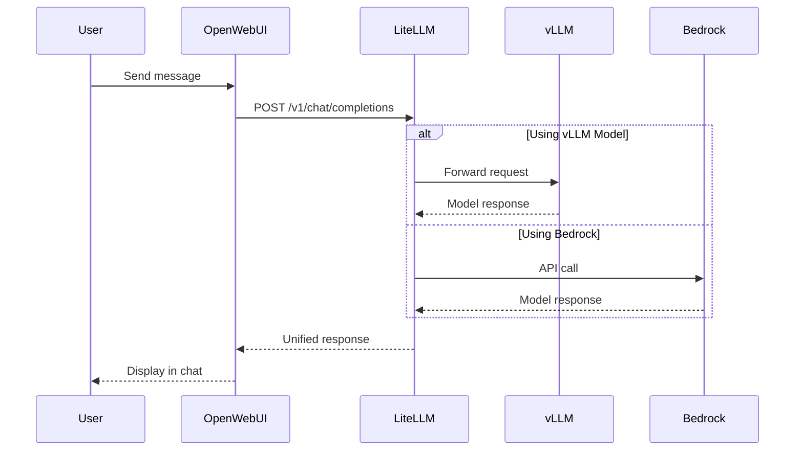

Open WebUI is a feature-rich, self-hosted web interface for interacting with Large Language Models. In this workshop, Open WebUI has been deployed to provide an intuitive chat interface that connects to multiple model backends through LiteLLM.

## What is Open WebUI?

Open WebUI (formerly known as Ollama WebUI) is an open-source project that provides:

- **Chat Interface**: Clean, responsive design similar to ChatGPT
- **Multi-Model Support**: Switch between different models
- **Conversation Management**: Save, organize, and search chat histories
- **File Uploads**: Support for documents and images (when models support it)
- **Prompt Templates**: Pre-configured prompts for common tasks
- **Multi-User Support**: Individual accounts with personalized settings

## How We Deployed Open WebUI

The official [Open WebUI Helm chart](https://github.com/open-webui/helm-charts) was used to deploy Open WebUI on the EKS Auto Mode cluster.

::alert[**Helm** is a package manager for Kubernetes that uses 'charts' as its package format. Charts are collections of YAML files that define Kubernetes resources, with support for Go template syntax to generate manifests dynamically. [Learn more about Helm →](https://helm.sh/)]{type="info"}

### Exploring the Helm Chart

You can examine the actual Helm chart configuration used in your VSC IDE:

:::code{language=bash showCopyAction=true}
# View the Open WebUI Helm chart values
cat /workshop/components/gui-app/openwebui/values.template.yaml

# Check deployed Helm releases
helm ls -A | grep openwebui
:::

### Helm Chart Configuration

The official Open WebUI Helm chart was used with custom values to integrate it with the workshop infrastructure:

:::code{language=yaml showCopyAction=true}
# values.template.yaml - Key configurations
nameOverride: openwebui

# Ingress configuration for AWS Load Balancer
ingress:
  enabled: true
  annotations:
    alb.ingress.kubernetes.io/target-type: ip
  {{#if DOMAIN}}
    alb.ingress.kubernetes.io/listen-ports: '[{"HTTPS":443}]'
  host: openwebui.{{{DOMAIN}}}
  {{else}}
  host:
  {{/if}}

# Connection to LiteLLM API Gateway
openaiBaseApiUrl: http://litellm.litellm:4000/v1
extraEnvVars:
  - name: OPENAI_API_KEY
    value: {{{LITELLM_API_KEY}}}
  # Admin account auto-provisioned at deploy time
  - name: WEBUI_ADMIN_EMAIL
    value: {{{OPENWEBUI_ADMIN_EMAIL}}}
  - name: WEBUI_ADMIN_PASSWORD
    value: {{{OPENWEBUI_ADMIN_PASSWORD}}}

# Disable local Ollama (using external models)
ollama:
  enabled: false
pipelines:
  enabled: false

# Persistent storage for conversations
persistence:
  enabled: true
  size: 100Gi

# Resource allocation
resources:
  requests:
    cpu: 1 
    memory: 2Gi
  limits:
    memory: 2Gi
:::

### Key Configuration Decisions

#### 1. **LiteLLM Integration**
Instead of connecting directly to model endpoints, Open WebUI connects to LiteLLM:
- **Unified API**: Single endpoint for all models
- **Load Balancing**: Automatic distribution across model replicas
- **Fallback Support**: Automatic switching between models

::alert[LiteLLM acts as an AI gateway, providing a unified OpenAI-compatible interface to all models. LiteLLM is explored in detail in Track A's Module A1.]{type="info"}

#### 2. **AWS Load Balancer Integration**
The ingress configuration creates an Application Load Balancer (ALB):
- **HTTPS Termination**: SSL/TLS handled at the load balancer
- **Target Type IP**: Direct pod networking for better performance
- **Custom Domain**: Accessible at `https://openwebui.${DOMAIN}`. However, in this workshop we do not have a domain thus, we just fallback on the ALB URL.

#### 3. **Persistent Storage**
100Gi of EBS storage (automatically provisioned by EKS Auto Mode) ensures:
- **Conversation History**: All chats are preserved
- **User Settings**: Preferences persist across sessions
- **Reliable Performance**: Consistent I/O performance for the application

::alert[**EKS Auto Mode** automatically provisions EBS storage for persistent volume claims once a StorageClass is configured. While you still need to create the StorageClass definition, EKS Auto Mode eliminates the need for manual CSI driver installation and node configuration.]{type="info"}

### How Open WebUI Was Deployed

The deployment process that was executed during infrastructure setup included:

::alert[**Already Completed**: The following commands were executed automatically during your environment setup. This section is for reference only.]{type="success"}

**Repository Configuration**
```bash
# Helm repository was added
helm repo add open-webui https://open-webui.github.io/helm-charts
helm repo update
```

**Installation with Custom Values**
```bash
# Open WebUI was installed with custom configuration
helm upgrade --install openwebui open-webui/open-webui \
  --namespace openwebui \
  --create-namespace \
  -f values.rendered.yaml
```

## Hands-On: Your First Chat with an LLM

This guided walkthrough covers interacting with a Large Language Model through Open WebUI.

### Step 1: Access Open WebUI

:::code{language=bash showCopyAction=true}
# Get the Open WebUI URL
echo "Open WebUI URL: http://$(kubectl get ingress -n openwebui openwebui -o jsonpath='{.status.loadBalancer.ingress[0].hostname}')"
:::

Copy the URL and open it in your browser.

### Step 2: Sign In

An admin account has already been provisioned for you during deployment (via the `WEBUI_ADMIN_EMAIL` / `WEBUI_ADMIN_PASSWORD` values in the Helm chart), so you do not need to create one.

When you access Open WebUI you will see a **Sign In** page. Log in with the pre-configured admin credentials:

- **Email**: `admin@example.com`
- **Password**: `Pass@123`

::alert[If you instead see a **"Get started"** landing page (fresh instance with no admin yet), click it and create an admin account with any name, email, and password you will remember.]{type="info"}

### Step 3: Select Your Model

Once logged in, you will see the model selection dropdown at the top:


Select **vllm/qwen3-8b-neuron** from the dropdown. You will see several options:
- **vllm/qwen3-8b-neuron** (use this one)
- **vllm/deepseek-r1-qwen3-8b-neuron** (also available)
- **bedrock/claude-4.5-sonnet** (Bedrock Model - not hosted on EKS)

### Step 4: Start Your First Conversation

1. **Click "New Chat"** (if not already in a new chat)
2. **Type your first message** in the "How can I help you today?" box
3. **Try this example**: "What is the strongest creature relative to body size?"
4. **Press Enter** or click the send button

You should see a response similar to this:


Notice how the model processes for approximately one minute and then provides a detailed, well-structured response about various insects and their relative strength.

### Step 5: Explore Response Features

After receiving your first response, explore these interface features:

- **Edit**: Hover over messages to edit them
- **Copy**: Copy the response text
- **Speak**: Have the response read aloud
- **Rate**: Rate the response quality with the thumbs up/down buttons
- **Continue Response**: Ask the model to continue its response if it was cut off
- **Regenerate**: Get a different response to the same prompt
- **Follow up**: Continue the conversation naturally

### Step 6: Try Model Comparison (Optional)

To compare how different models respond to the same question:

1. **Click the "+" button** next to the model name
2. **Select a second model** (try "vllm/deepseek-r1-qwen3-8b-neuron")
3. **Ask the same question** to both models
4. **Compare their responses** side by side

This is a useful feature for understanding model differences.

## Interface Features Deep Dive

Now that you have completed your first chat, explore the full interface:

### **Conversation Management**
- **Left Sidebar**: Browse your chat history
- **Search**: Find specific conversations
- **Export**: Download conversations as JSON, Plain Text or Markdown

### **Advanced Settings**
Click the gear icon to access:
- **Model Parameters**: Adjust temperature, max tokens, top-p
- **System Prompts**: Set default instructions for the AI
- **Valves**: Allows you to add tools & functions for your models to use

### **File Upload Capabilities**
- **Document Upload**: Upload PDFs, text files for analysis
- **Image Upload**: Share images with vision-capable models
- **Code Files**: Get help with programming projects

## Suggested Prompts to Try

Explore the model's capabilities with these examples:

::::tabs

:::tab{label="General Knowledge"}
```
Explain quantum computing in simple terms
What are the key differences between Kubernetes and Docker?
How does machine learning differ from traditional programming?
```
:::

:::tab{label="Technical Help"}
```
Write a Python function to calculate fibonacci numbers
Explain the benefits of using microservices architecture
What are Kubernetes operators and when would you use them?
```
:::

:::tab{label="Creative Tasks"}
```
Write a haiku about cloud computing
Create a story about a robot learning to code
Explain AI concepts using cooking analogies
```
:::

::::

## Architecture Integration

The following diagram shows how Open WebUI fits into the GenAI stack:



## Key Takeaways

- **Helm Deployment**: Open WebUI deployed via official Helm chart with custom values
- **LiteLLM Integration**: Connected to unified API gateway instead of direct model endpoints
- **AWS Integration**: Uses ALB for ingress and EBS for persistent storage

## What's Next?

Now that you understand the chat interface, the next section explores the model serving infrastructure behind it. You will examine vLLM in detail and see how Qwen 3 8B is served on AWS Neuron hardware.

---

**[Next: vLLM - Self-Hosted Model Serving →](../vllm)**
