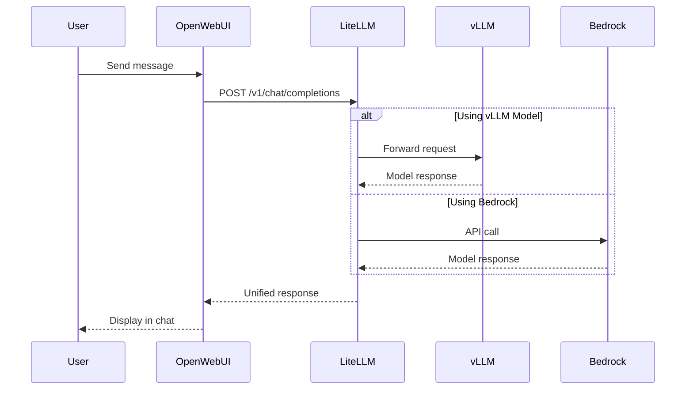

Open WebUI는 대규모 언어 모델과 상호작용하기 위한 자체 호스팅 웹 인터페이스입니다. 이 워크샵에서는 LiteLLM을 통해 여러 모델 백엔드에 연결되는 채팅 인터페이스를 제공하기 위해 Open WebUI를 배포했습니다.

## Open WebUI란 무엇입니까?

Open WebUI(이전 이름: Ollama WebUI)는 다음을 제공하는 오픈소스 프로젝트입니다.

- **채팅 인터페이스**: ChatGPT와 유사한 깔끔한 반응형 디자인
- **다중 모델 지원**: 여러 모델 간 전환
- **대화 관리**: 채팅 기록 저장, 정리 및 검색
- **파일 업로드**: 문서 및 이미지 지원(모델이 지원하는 경우)
- **프롬프트 템플릿**: 일반적인 작업을 위해 미리 구성된 프롬프트
- **다중 사용자 지원**: 개인화된 설정을 가진 개별 계정

## Open WebUI 배포 방법

공식 [Open WebUI Helm 차트](https://github.com/open-webui/helm-charts)를 사용하여 EKS Auto Mode 클러스터에 Open WebUI를 배포했습니다.

::alert[**Helm** 은 'charts'를 패키지 형식으로 사용하는 Kubernetes용 패키지 관리자입니다. Charts는 Kubernetes 리소스를 정의하는 YAML 파일 모음으로, Go 템플릿 구문을 지원하여 매니페스트를 동적으로 생성합니다. [Helm에 대해 자세히 알아보기 →](https://helm.sh/)]{type="info"}

### Helm 차트 살펴보기

VSC IDE에서 실제 사용된 Helm 차트 구성을 확인할 수 있습니다:

:::code{language=bash showCopyAction=true}
# Open WebUI Helm 차트 values 보기
cat /workshop/components/gui-app/openwebui/values.template.yaml

# 배포된 Helm 릴리스 확인
helm ls -A | grep openwebui
:::

### Helm 차트 구성

공식 Open WebUI Helm 차트에 커스텀 values를 적용하여 워크샵 인프라와 통합했습니다:

:::code{language=yaml showCopyAction=true}
# values.template.yaml - 주요 구성
nameOverride: openwebui

# AWS Load Balancer를 위한 Ingress 구성
ingress:
  enabled: true
  annotations:
    alb.ingress.kubernetes.io/target-type: ip
    alb.ingress.kubernetes.io/listen-ports: '[{"HTTPS":443}]'
  host: openwebui.${DOMAIN}

# LiteLLM API Gateway 연결
openaiBaseApiUrl: http://litellm.litellm:4000/v1
extraEnvVars:
  - name: OPENAI_API_KEY
    value: ${LITELLM_API_KEY}

# 로컬 Ollama 비활성화 (외부 모델 사용)
ollama:
  enabled: false
pipelines:
  enabled: false

# 대화를 위한 영구 스토리지
persistence:
  enabled: true
  size: 100Gi

# 리소스 할당
resources:
  requests:
    cpu: 1 
    memory: 2Gi
  limits:
    memory: 2Gi
:::

### 주요 구성 결정 사항

#### 1. **LiteLLM 통합**
Open WebUI는 모델 엔드포인트에 직접 연결하는 대신 LiteLLM에 연결합니다:
- **통합 API**: 모든 모델에 대한 단일 엔드포인트
- **로드 밸런싱**: 모델 레플리카 간 자동 분산
- **Fallback 지원**: 모델 간 자동 전환

::alert[LiteLLM은 AI 게이트웨이 역할을 하며 모든 모델에 대한 통합 OpenAI 호환 인터페이스를 제공합니다. LiteLLM에 대해서는 Track A의 모듈 A1에서 자세히 살펴보겠습니다.]{type="info"}

#### 2. **AWS Load Balancer 통합**
Ingress 구성은 Application Load Balancer(ALB)를 생성합니다:
- **HTTPS Termination**: SSL/TLS를 로드 밸런서에서 처리
- **Target Type IP**: 더 나은 성능을 위한 직접 Pod 네트워킹
- **커스텀 도메인**: `https://openwebui.${DOMAIN}`에서 액세스 가능. 하지만 이 워크샵에서는 도메인이 없으므로 ALB URL로 대체합니다.

#### 3. **영구 스토리지**
100Gi의 EBS 스토리지(EKS Auto Mode가 자동으로 프로비저닝)는 다음을 보장합니다:
- **대화 기록**: 모든 채팅이 보존됨
- **사용자 설정**: 세션 간 설정 유지
- **안정적인 성능**: 애플리케이션의 일관된 I/O 성능

::alert[**EKS Auto Mode** 는 StorageClass가 구성되면 영구 볼륨 클레임을 위한 EBS 스토리지를 자동으로 프로비저닝합니다. StorageClass 정의를 생성해야 하지만, EKS Auto Mode는 수동 CSI 드라이버 설치 및 노드 구성의 필요성을 제거합니다.]{type="info"}

### Open WebUI 배포 방법

인프라 설정 중에 실행된 배포 프로세스는 다음과 같습니다:

::alert[**이미 완료됨**: 다음 명령은 환경 설정 중에 자동으로 실행되었습니다. 이 섹션은 참고용입니다.]{type="success"}

**리포지토리 구성**
```bash
# Helm 리포지토리 추가됨
helm repo add open-webui https://open-webui.github.io/helm-charts
helm repo update
```

**커스텀 Values로 설치**
```bash
# Open WebUI가 커스텀 구성으로 설치됨
helm upgrade --install openwebui open-webui/open-webui \
  --namespace openwebui \
  --create-namespace \
  -f values.rendered.yaml
```

## 실습: LLM과의 첫 번째 채팅

이 안내에 따라 Open WebUI를 통해 대규모 언어 모델과 상호작용합니다.

### 1단계: Open WebUI 액세스

:::code{language=bash showCopyAction=true}
# Open WebUI URL 가져오기
echo "Open WebUI URL: http://$(kubectl get ingress -n openwebui openwebui -o jsonpath='{.status.loadBalancer.ingress[0].hostname}')"
:::

URL을 복사하고 브라우저에서 여십시오.

### 2단계: 계정 생성

Open WebUI에 처음 액세스하면 랜딩 페이지가 표시됩니다.


페이지 하단의 **"Get started" 버튼을 클릭** 하여 계정 생성으로 진행합니다.

관리자 계정을 생성하는 계정 설정 양식으로 이동합니다:


**계정 생성 양식 작성**:

1. **Name**: 선호하는 표시 이름 입력 (예: "Workshop User")
2. **Email**: 실제 이메일일 필요는 없습니다 (예: `workshop@example.com`)
3. **Password**: 워크샵 동안 기억할 비밀번호 선택
4. **"Create Admin Account" 클릭** 하여 설정 완료

::alert[**관리자 계정**: 이 Open WebUI 인스턴스의 첫 번째 관리자 계정을 생성하고 있습니다. 이를 통해 인터페이스 및 설정을 완전히 제어할 수 있습니다.]{type="info"}

### 3단계: 모델 선택

로그인하면 상단에 모델 선택 드롭다운이 표시됩니다:


드롭다운에서 **vllm/qwen3-8b-neuron** 을 선택합니다. 여러 옵션이 표시됩니다.
- **vllm/qwen3-8b-neuron** (이것을 사용하십시오)
- **vllm/deepseek-r1-qwen3-8b-neuron** (사용 가능)
- **bedrock/claude-4.5-sonnet** (Bedrock 모델 - EKS에서 호스팅되지 않음)

### 4단계: 첫 번째 대화 시작

1. **"New Chat" 클릭** (새 채팅이 아닌 경우)
2. **첫 메시지 입력**: "How can I help you today?" 상자에 입력
3. **이 예시를 시도해 보십시오**: "What is the strongest creature relative to body size?"
4. **Enter를 누르거나** 전송 버튼을 클릭합니다

다음과 유사한 응답이 표시됩니다.


모델이 약 1분 동안 처리한 후 여러 곤충과 그 상대적 힘에 대한 상세하고 잘 구조화된 응답을 제공하는 것을 확인할 수 있습니다.

### 5단계: 응답 기능 탐색

첫 응답을 받은 후 다음 인터페이스 기능을 탐색하십시오.

- **Edit**: 메시지 위에 마우스를 올려 편집
- **Copy**: 응답 텍스트 복사
- **Speak**: 응답을 소리내어 읽기
- **Rate**: 좋아요/싫어요 버튼으로 응답 품질 평가
- **Continue Response**: 응답이 잘린 경우 모델에게 계속하도록 요청
- **Regenerate**: 동일한 프롬프트에 대해 다른 응답 얻기
- **Follow up**: 대화를 자연스럽게 계속

### 6단계: 모델 비교 시도 (선택 사항)

같은 질문에 대해 서로 다른 모델이 어떻게 응답하는지 비교하려면:

1. 모델 이름 옆의 **"+" 버튼 클릭**
2. **두 번째 모델 선택** ("vllm/deepseek-r1-qwen3-8b-neuron" 시도)
3. 두 모델에게 **같은 질문 입력**
4. **응답을 나란히 비교**

이것은 모델 차이를 이해하는 데 유용한 기능입니다.

## 인터페이스 기능 심층 분석

첫 번째 채팅을 완료했으므로 이제 전체 인터페이스를 살펴봅니다:

### **대화 관리**
- **왼쪽 사이드바**: 채팅 기록 탐색
- **검색**: 특정 대화 찾기
- **내보내기**: 대화를 JSON, Plain Text 또는 Markdown으로 다운로드

### **고급 설정**
기어 아이콘을 클릭하여 액세스:
- **모델 파라미터**: temperature, max tokens, top-p 조정
- **시스템 프롬프트**: AI의 기본 지시사항 설정
- **Valves**: 모델이 사용할 도구 및 함수 추가 가능

### **파일 업로드 기능**
- **문서 업로드**: PDF, 텍스트 파일 분석을 위한 업로드
- **이미지 업로드**: 비전 가능 모델과 이미지 공유
- **코드 파일**: 프로그래밍 프로젝트 도움 받기

## 시도해볼 제안 프롬프트

다음 예시로 모델의 기능을 확인해 볼 수 있습니다.

::::tabs

:::tab{label="General Knowledge"}
```
양자 컴퓨팅을 간단한 용어로 설명하십시오
Kubernetes와 Docker의 주요 차이점은 무엇입니까?
머신러닝은 전통적인 프로그래밍과 어떻게 다릅니까?
```
:::

:::tab{label="Technical Help"}
```
피보나치 수를 계산하는 Python 함수를 작성하십시오
마이크로서비스 아키텍처 사용의 이점을 설명하십시오
Kubernetes operators란 무엇이며 언제 사용합니까?
```
:::

:::tab{label="Creative Tasks"}
```
클라우드 컴퓨팅에 대한 하이쿠를 작성하십시오
코딩을 배우는 로봇에 대한 이야기를 만드십시오
요리 비유를 사용하여 AI 개념을 설명하십시오
```
:::

::::

## 아키텍처 통합

다음 다이어그램은 Open WebUI가 Agentic AI 스택에 어떻게 통합되는지 보여줍니다:



## 주요 요점

- **Helm 배포**: 커스텀 values를 사용한 공식 Helm 차트로 Open WebUI 배포
- **LiteLLM 통합**: 직접 모델 엔드포인트 대신 통합 API 게이트웨이에 연결
- **AWS 통합**: Ingress를 위한 ALB와 영구 스토리지를 위한 EBS 사용

## 다음은?

채팅 인터페이스를 이해했으므로 다음 섹션에서는 그 뒤에 있는 모델 서빙 인프라를 살펴봅니다. vLLM을 자세히 검토하고 Qwen 3 8B가 AWS Neuron 하드웨어에서 어떻게 서빙되는지 확인합니다.

---

**[다음: vLLM - 자체 호스팅 모델 서빙 →](../vllm)**
