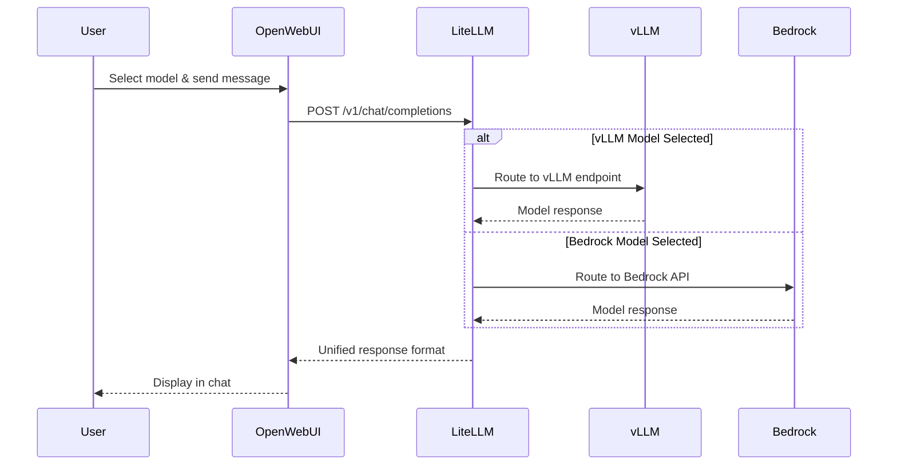

The model switching you observed in Open WebUI is handled by LiteLLM, the AI gateway that routes all model interactions in this workshop.

## Hands-On: Explore Your API Gateway

Examine how LiteLLM manages your model interactions:

### Step 1: Review Your LiteLLM Stack

Run this command to see the main components:

:::code{language=bash showCopyAction=true}
# See the LiteLLM platform components
kubectl get pods -n litellm
:::

**What to look for in your output:**

:::code{language=yaml showCopyAction=false}
# Example pattern (your specific names will vary):
NAME                       READY   STATUS    RESTARTS   AGE
litellm-*                  1/1     Running   0          *h     # ← Main API Gateway
litellm-postgresql-0       1/1     Running   0          *h     # ← Configuration Database
litellm-redis-master-0     1/1     Running   0          *h     # ← Performance Cache
:::

**Key Components:**
- **LiteLLM Pod**: The main API gateway that routes all your model requests
- **PostgreSQL**: Stores model configurations, usage data, and user settings
- **Redis**: Provides caching for improved response times

### Step 2: See Your Available Models

Check what models LiteLLM can discover and use:

:::code{language=bash showCopyAction=true}
# See your running vLLM models
kubectl get pods -n vllm -l app
:::

**What you should see:**

:::code{language=yaml showCopyAction=false}
# Your running models (available to LiteLLM):
NAME                                        READY   STATUS    
deepseek-r1-qwen3-8b-neuron-*                    1/1     Running   # ← DeepSeek model
qwen3-8b-neuron-neuron-*         1/1     Running   # ← Qwen model
:::

**Why this matters:** The workshop setup automatically discovers these running models and points LiteLLM to them using the Helm chart configuration.

### Step 3: See the Configuration in Detail

As with Open WebUI, LiteLLM is deployed using its [official Helm Chart](https://github.com/BerriAI/litellm/tree/main/deploy/charts/litellm-helm). Review how your models appear in LiteLLM's configuration:

:::code{language=bash showCopyAction=true}
# Check the model configuration
grep -A 16 "model_list:" /workshop/components/ai-gateway/litellm/values.rendered.yaml
:::

**Example of what you will see:**

:::code{language=yaml showCopyAction=false}
# How your models are configured in LiteLLM:
model_list:
  # Bedrock models (from AWS configuration)
  - model_name: bedrock/claude-4.5-sonnet
    litellm_params:
      model: bedrock/global.anthropic.claude-sonnet-4-5-20250929-v1:0
      aws_region_name: us-west-2
      
  # vLLM models (discovered automatically from running pods)
  - model_name: vllm/qwen3-8b-neuron
    litellm_params:
      model: openai/qwen3-8b-neuron
      api_key: fake-key
      api_base: http://qwen3-8b-neuron.vllm:8000/v1
  - model_name: vllm/deepseek-r1-qwen3-8b-neuron
    litellm_params:
      model: openai/deepseek-r1-qwen3-8b-neuron
      api_key: fake-key
      api_base: http://deepseek-r1-qwen3-8b-neuron.vllm:8000/v1
:::

**Key Point:** Notice how your running vLLM pods automatically become API endpoints in LiteLLM.

### Step 4: Understand the Integration System

Examine how the automatic discovery works:

:::code{language=bash showCopyAction=true}
# See the integration discovery logic
grep -A 15 "integration.*llm-model" /workshop/components/ai-gateway/litellm/index.mjs
:::

**How it works:**

:::code{language=javascript showCopyAction=false}
// LiteLLM's model discovery process:
for (const model of value.models) {
  if (model.deploy) {
    // Check if the model pod is actually running
    const result = await kubectl get pod -n ${namespace} -l app=${model.name}
    if (result.stdout.includes(model.name)) {
      // Model found! Add it to the integration
      integration["llm-model"][namespace][model.name] = true;
    }
  }
}
:::

**The Process:**
1. **Scans** Kubernetes for running model pods
2. **Verifies** each model is healthy and available
3. **Builds** an integration object with discovered models
4. **Renders** Helm templates with only available models
5. **Deploys** LiteLLM with your specific model configuration

This ensures LiteLLM only attempts to use models that are actually running.

## What is LiteLLM?

LiteLLM is an open-source proxy that provides:

- **Unified API**: Single OpenAI-compatible endpoint for all models
- **Request routing**: Routes requests to the appropriate backends
- **Persistent storage**: PostgreSQL for configuration, Redis for caching
- **Load balancing**: Distributes requests across multiple model replicas

## How LiteLLM is Deployed

The LiteLLM deployment uses the [official LiteLLM Helm Chart](https://github.com/BerriAI/litellm/tree/main/deploy/charts/litellm-helm) with a custom values template. The full values.template.yaml file can be found at `/workshop/components/ai-gateway/litellm/values.template.yaml`. The following tabs describe each section of the Helm configuration:

:::::tabs

::::tab{label="Resources & Infrastructure"}
**Main Application Resources**

The LiteLLM proxy requires adequate resources for handling multiple model requests:

:::code{language=yaml showCopyAction=true}
resources:
  requests:
    cpu: 1 
    memory: 2Gi
  limits:
    memory: 2Gi
:::

**Supporting Infrastructure**

LiteLLM runs with Redis for caching and PostgreSQL for persistence:

:::code{language=yaml showCopyAction=true}
redis:
  enabled: true
  master:
    resources: 
      requests:
        cpu: 125m
        memory: 256Mi
      limits:
        memory: 256Mi

postgresql:
  primary:
    resources: 
      requests:
        cpu: 125m
        memory: 256Mi
      limits:
        memory: 256Mi
:::

**Why This Architecture:**
- **Redis**: Caches model responses and reduces latency
- **PostgreSQL**: Stores model configurations, usage data, and user settings
- **Resource Limits**: Ensures predictable performance and prevents resource contention
::::

::::tab{label="Authentication & Security"}
**Service Account Configuration**

LiteLLM creates its own service account for secure Kubernetes operations:

:::code{language=yaml showCopyAction=true}
serviceAccount:
  create: true
:::

**Authentication Setup**

Master key and UI credentials are configured via environment variables:

:::code{language=yaml showCopyAction=true}
masterkey: {{{LITELLM_API_KEY}}}
envVars:
  UI_USERNAME: {{{LITELLM_UI_USERNAME}}}
  UI_PASSWORD: {{{LITELLM_UI_PASSWORD}}}
:::

**Security Features:**
- **Master Key**: Controls API access to the LiteLLM proxy
- **UI Authentication**: Protects the web interface with username/password
- **Template Variables**: Credentials injected securely during deployment
- **Service Account**: Follows Kubernetes security best practices
::::

::::tab{label="Observability Integration"}
**Monitoring & Tracing Setup**

LiteLLM integrates with multiple observability platforms:

:::code{language=yaml showCopyAction=true}
envVars:
  LANGFUSE_HOST: http://langfuse-web.langfuse:3000
  LANGFUSE_PUBLIC_KEY: {{{LANGFUSE_PUBLIC_KEY}}}
  LANGFUSE_SECRET_KEY: {{{LANGFUSE_SECRET_KEY}}}
  PHOENIX_API_KEY: {{{PHOENIX_API_KEY}}}
  PHOENIX_COLLECTOR_ENDPOINT: http://phoenix-svc.phoenix:4317/v1/traces
  PHOENIX_COLLECTOR_HTTP_ENDPOINT: http://phoenix-svc.phoenix:6006/v1/traces
:::

**Automatic Observability Features:**
- **Langfuse Integration** (Primary): Tracks every request, response, and cost - this is the observability platform we use throughout this workshop
- **Phoenix Support** (Pre-configured): An alternative observability platform that is pre-configured but not actively used in this workshop. In production, you can enable Phoenix alongside Langfuse for additional tracing capabilities
- **Service Discovery**: Uses Kubernetes service names for internal communication
- **Zero Configuration**: Observability works automatically once deployed

**What Gets Tracked:**
- Request/response pairs for debugging
- Token usage and costs per model
- Performance metrics and latency
- Error rates and failure patterns
::::

::::tab{label="Networking & Ingress"}
**Load Balancer Configuration**

LiteLLM uses AWS Application Load Balancer for external access:

:::code{language=yaml showCopyAction=true}
ingress:
  enabled: true
  className: {{#if DOMAIN}}shared-{{/if}}internet-facing-alb
  annotations:
    alb.ingress.kubernetes.io/target-type: ip
    {{#if DOMAIN}}
    alb.ingress.kubernetes.io/listen-ports: '[{"HTTPS":443}]'
    {{/if}}
  hosts:
    - paths:
        - path: /
          pathType: Prefix
      {{#if DOMAIN}}
      host: litellm.{{{DOMAIN}}}
      {{/if}}
:::

**Networking Features:**
- **ALB Integration**: Uses AWS Application Load Balancer
- **IP Target Type**: Direct pod networking for better performance
- **Conditional HTTPS**: HTTPS enabled when domain is configured
- **Path-Based Routing**: All traffic routed to LiteLLM proxy
- **Dynamic Configuration**: Adapts based on domain availability
::::

::::tab{label="Model Configuration"}
**Proxy Settings**

Core LiteLLM proxy configuration for model management:

:::code{language=yaml showCopyAction=true}
proxy_config:
  general_settings:
    master_key: os.environ/PROXY_MASTER_KEY
    store_model_in_db: true
    store_prompts_in_spend_logs: true
  litellm_settings:
    {{#with integration.o11y.config}}
    {{#if callbacks}}    
    callbacks: {{{callbacks}}}
    {{/if}}
    {{#if success_callback}}    
    success_callback: {{{success_callback}}}
    {{/if}}
    {{#if failure_callback}}
    failure_callback: {{{failure_callback}}}
    {{/if}}
    {{/with}}
    redact_user_api_key_info: true
    turn_off_message_logging: false
:::

**What This Actually Renders To:**

The Handlebars template above is rendered at deploy time with your observability configuration. The actual resulting config looks like:

:::code{language=yaml showCopyAction=false}
proxy_config:
  litellm_settings:
    callbacks: ["langfuse"]              # All LLM calls traced to Langfuse
    success_callback: ["langfuse"]       # Successful responses logged
    failure_callback: ["langfuse"]       # Failed requests also captured
    redact_user_api_key_info: true       # API keys hidden from traces
    turn_off_message_logging: false      # Full prompt/response logging enabled
:::

**Key Configuration Details:**
- **`callbacks: ["langfuse"]`**: A convenience shorthand that enables Langfuse for both success and failure callbacks. Setting this alone would achieve the same result as the two lines below
- **`success_callback` + `failure_callback`**: Explicitly set to `["langfuse"]` for clarity, ensuring both successful responses and errors/timeouts are traced. The Starter Kit configures all three for explicitness
- **`turn_off_message_logging: false`**: Full prompt and response content is stored in Langfuse traces, enabling detailed debugging

**Dynamic Model Registration**

Models are automatically discovered and registered via Handlebars templating:

:::code{language=yaml showCopyAction=true}
  model_list:
    # Bedrock LLM Models
    {{#each integration.bedrock.llm}}
    - model_name: bedrock/{{{name}}}
      litellm_params:
        model: bedrock/{{{model}}}
        aws_region_name: {{{@root.integration.bedrock.region}}}
    {{/each}}
    
    # vLLM Models (discovered from running pods)
    {{#each integration.llm-model.vllm}}
    - model_name: vllm/{{@key}}
      litellm_params:
        model: openai/{{@key}}
        api_key: fake-key
        api_base: http://{{@key}}.vllm:8000/v1
    {{/each}}
:::

**Supported Model Types:**
- **Bedrock**: AWS managed models (Claude, Llama, etc.)
- **vLLM**: Self-hosted models on Kubernetes
- **SGlang, TGI, Ollama**: Additional inference engines
- **TEI**: Text Embedding Inference models
::::

::::tab{label="Deployment Commands"}
**Helm Deployment Process**

::alert[**Warning**: These commands have already been executed in your workshop environment. **Do not run these commands** — they will interfere with your existing setup.]{type="warning"}

The LiteLLM deployment uses these Helm commands:

:::code{language=bash showCopyAction=true}
# Add the LiteLLM Helm repository
helm repo add litellm oci://ghcr.io/berriai/litellm-helm
helm repo update

# Deploy LiteLLM with custom values
helm upgrade --install litellm litellm/litellm-helm \
  --namespace litellm \
  --create-namespace \
  -f values.rendered.yaml

# Check deployment status
kubectl rollout status deployment/litellm -n litellm
:::

**Deployment Process:**
1. **Template Rendering**: `values.template.yaml` → `values.rendered.yaml`
2. **Integration Discovery**: System scans for running models
3. **Helm Installation**: Chart deployed with rendered values
4. **Service Startup**: LiteLLM proxy starts with discovered models

**What Happens During Deployment:**
- Service account and RBAC permissions created
- PostgreSQL and Redis deployed as dependencies
- LiteLLM proxy configured with discovered models
- Ingress/LoadBalancer exposes the service
- Observability connections established
::::

:::::

---

## How LiteLLM Handles Requests

The following diagram shows what occurs each time you switch models in Open WebUI:

## Explore the LiteLLM Web Interface

Use the LiteLLM management interface to view your models and metrics, and to test the API directly:

### Step 1: Access LiteLLM Interface

First, get the URL and credentials for your LiteLLM instance:

:::code{language=bash showCopyAction=true}
# Get LiteLLM service URL
echo "LiteLLM URL: http://$(kubectl get ingress -n litellm litellm -o jsonpath='{.status.loadBalancer.ingress[0].hostname}')"
:::

Open the URL in your browser. You'll see the LiteLLM API documentation page:

**What to notice:**
- **LiteLLM Admin Panel on /ui** link (highlighted in orange) - this is the target destination
- **LiteLLM Model Cost Map** - for cost analysis
- **LiteLLM Model Hub** - to see available models
- **Authorize** button - for API authentication

### Step 2: Access the Admin Interface

Click on **"LiteLLM Admin Panel on /ui"** to access the management interface. You'll be taken to the login page:

**Login Process:**
1. **Username**: Enter `admin` 
2. **Password**: Enter `Pass@123` 
3. **Click "Login"** to access the admin interface

### Step 3: Explore Your Models Dashboard

After logging in, click on the **Models + Endpoints** to view the models configured for LiteLLM:

**What you're seeing:**
- **"Showing 3 results"** - Your configured models
- **Model Table** with columns for Model ID, Public Model Name, Provider, and LiteLLM Model Name

**Your Models:**
- **bedrock/claude-4.5-sonnet** - AWS Bedrock model (bedrock provider)
- **vllm/qwen3-8b-neuron** - Self-hosted model (openai provider)
- **vllm/deepseek-r1-qwen3-8b-neuron** - Self-hosted model (openai provider)

**Key point:** The vLLM models show "openai" as the provider because LiteLLM presents them through an OpenAI-compatible API.

### Step 4: Monitor Usage & Costs

Click on **"Usage"** in the left sidebar to see the usage analytics:

**Usage Metrics Dashboard:**
- **Total Spend**: $0.1027 (your actual workshop usage)
- **Total Requests**: 65 requests processed
- **Successful Requests**: 63 (96.9% success rate)
- **Failed Requests**: 2 (3.1% failure rate)
- **Total Tokens**: 32,484 tokens processed
- **Average Cost per Request**: $0.0016

**What This Tells You:**
- Cost tracking is automatic and detailed
- You can monitor spending patterns over time
- Token usage indicates conversation complexity

::alert[**Cost Tracking Note**: The cost metrics shown here are primarily for Bedrock models. Self-hosted vLLM models do not have direct per-token API pricing like managed services - instead, their costs come from the underlying infrastructure (e.g., AWS Neuron `inf2` instances). In production, you can configure custom per-token costs in LiteLLM's `model_info` section using `input_cost_per_token` and `output_cost_per_token` fields to calculate an amortized cost per token based on your infrastructure spend. This enables unified cost tracking across both managed and self-hosted models in your Langfuse dashboards.]{type="info"}

### Step 5: Test Models Directly

Click on **"Playground"** to access the interactive testing interface:

**Testing Features:**
- **Model Selection**: Dropdown showing "bedrock/claude-4.5-s..." selected
- **Chat Interface**: Real conversation with the selected model
- **Configuration Options**: API Key Source, Endpoint Type, Tags, MCP Tools
- **Sample Conversation**: Shows a question about dragon etymology with detailed response

**Try This:**
1. **Select different models** from the dropdown (try switching between Bedrock and vLLM models)
2. **Ask a question** like "Explain Kubernetes in simple terms"
3. **Compare responses** from different models

### Step 6: Connect to Your Workshop Experience

Now that you have explored the LiteLLM interface, connect your observations to the workshop experience:

1. **Go back to Open WebUI** in another tab
2. **Send some messages** to different models
3. **Return to LiteLLM Usage page** and refresh
4. **Watch your metrics update** - you will see new requests, token usage, and costs appear.

**Real-time monitoring:** Every interaction in Open WebUI flows through LiteLLM, and the metrics update in real time.

This gives you visibility into how your AI gateway is performing and being used.

## Hands-On: Add a New Bedrock Model to LiteLLM

This section demonstrates adding a new Bedrock model to LiteLLM. You will add GPT-OSS-20B, a recently released model that you already have access to.

### Step 1: Discover Available GPT-OSS Models

First, check what GPT-OSS models are available in Bedrock:

:::code{language=bash showCopyAction=true}
# Check available Bedrock models you have access to
aws bedrock list-foundation-models --query "modelSummaries[?contains(modelId, 'gpt-oss')].{ModelId:modelId,ModelName:modelName}" --output table
:::

**You should see:**

:::code{language=yaml showCopyAction=false}
---------------------------------------------
|           ListFoundationModels            |
+--------------------------+----------------+
|          ModelId         |   ModelName    |
+--------------------------+----------------+
|  openai.gpt-oss-120b-1:0 |  gpt-oss-120b  |
|  openai.gpt-oss-20b-1:0  |  gpt-oss-20b   |
+--------------------------+----------------+
:::

You will add the **gpt-oss-20b** model (ModelId: `openai.gpt-oss-20b-1:0`).

### Step 2: Check Current LiteLLM Configuration

Check what Bedrock models are currently configured in LiteLLM:

:::code{language=bash showCopyAction=true}
# See current Bedrock models in LiteLLM
grep -A 3 -B 1 "model_name.*bedrock" /workshop/components/ai-gateway/litellm/values.rendered.yaml
:::

You'll notice that GPT-OSS-20B is not currently configured.

### Step 3: Add GPT-OSS-20B to the Configuration

Add the new model directly to the configuration file:

:::code{language=bash showCopyAction=true}
# Open our Values yaml file:
code /workshop/components/ai-gateway/litellm/values.rendered.yaml 
:::

**Add this YAML configuration** to the Bedrock models section in `values.rendered.yaml`:

:::code{language=yaml showCopyAction=true}
    - model_name: bedrock/gpt-oss-20b
      litellm_params:
        model: bedrock/openai.gpt-oss-20b-1:0
        aws_region_name: us-west-2
:::

Should look like this:  

### Step 4: Apply the Configuration Changes

After adding the model to the configuration file, apply the changes:

:::code{language=bash showCopyAction=true}
# Apply the updated configuration
helm upgrade litellm oci://ghcr.io/berriai/litellm-helm \
  --namespace litellm \
  -f /workshop/components/ai-gateway/litellm/values.rendered.yaml

# Wait for the deployment to complete
kubectl rollout status deployment/litellm -n litellm
:::

### Step 5: Verify the Model is Available

Once rollout has been completed, check that it has been added to LiteLLM, by going back to the **Models + Endpoints** page:

Should see **bedrock/gpt-oss-20b** amongst the models.

### Step 6: Test in Open WebUI

1. **Go back to Open WebUI**
2. **Check the model dropdown** - you should see "bedrock/gpt-oss-20b"
3. **Select GPT-OSS-20B** and send a test message
4. **Compare its responses** with other models

::alert[**Production Note**: In production environments, you'd typically use the automated integration system we explored earlier. This manual approach is useful for understanding the underlying configuration and for one-off model additions.]{type="success"}

## Hands-On: Create a Virtual Key for Module A2

In Module A2, you will build an agentic application that needs secure access to your models. Create a dedicated Virtual Key that your agent will use to access all available models.

### Step 1: Navigate to Virtual Keys

In the LiteLLM interface, click on **"Virtual Keys"** in the left sidebar:

**What you will see:**
- **"Virtual Keys"** highlighted in the sidebar (orange box)
- **"+ Create New Key"** button
- Empty results table (showing "1 - 0 of 0 results" initially)

### Step 2: Configure Your Agent Key

Click the **"+ Create New Key"** button to open the key creation dialog:

**Configure your key with these settings:**

**Key Ownership:**
- **Owned By**: Select "You" (default selection)
- **Team**: Leave as "Search or select a team" (optional)

**Key Details:**
- **Key Name**: Enter `agent-key`
- **Models**: Select all available models:
  - `bedrock/claude-4.5-sonnet`
  - `bedrock/gpt-oss-20b`
  - `vllm/qwen3-8b-neuron`
  - `vllm/deepseek-r1-qwen3-8b-neuron`
- **Key Type**: Keep as "Default"
- **Optional Settings**: Leave expanded but unchanged

Click **"Create Key"** to generate your Virtual Key.

### Step 3: Save Your API Key

A popup will appear with your newly created key:

**Security notice:**
::alert[**Important**: This is your only opportunity to copy this key. For security reasons, **you will not be able to view it again** through your LiteLLM account. If you lose this secret key, you must generate a new one.]{type="warning"}

**Save your key:**
1. Click **"Copy API Key"** button
2. Store it securely for Module A2:

:::code{language=bash showCopyAction=true}
# Save in your environment or notes
export AGENT_KEY="sk-REDACTED"  # Your actual key will be different
:::

### Step 4: Verify Key Access

Verify that your Virtual Key has access to all models:

1. Navigate to **"Playground"** in the sidebar
2. Configure the test interface:

**Test Configuration:**
- **API Key Source**: Select "Virtual Key" from dropdown
- **Key Input**: Paste your `sk-` key in the field that appears
- **Select Model**: Choose any model (e.g., "bedrock/claude-4.5-sonnet")

### Step 5: Validate Model Access

Send a test message to confirm your key works:

**What you're validating:**
- **Authentication**: Your Virtual Key is accepted
- **Model Access**: The key can access the selected model
- **Response Generation**: Models respond correctly
- **Multi-Model Support**: Try switching models to verify access to all

**Example test:**
- **Question**: "Why is most of the landmass in the world above the equator?"
- **Response**: You should see a detailed geological explanation
- **Model Used**: Shows which model responded (e.g., "global.anthropic.claude-sonnet-4-5")

::alert[Your Virtual Key is now ready for Module A2's agentic application. This key provides unified access to all your models through a single authentication token.]{type="success"}

You will use this Virtual Key in Module A2 to build an agent that can switch between models based on task requirements.

## Summary of Gateway Capabilities

Through this hands-on exploration, you worked with the following capabilities of a unified AI gateway:

- **Model switching**: Switch between any model without changing your application
- **Automatic discovery**: New models appear automatically when deployed or configured
- **Built-in observability**: Every request is tracked in Langfuse without additional setup
- **Load balancing**: Requests are distributed across available model replicas
- **Fallback support**: Automatic failover if a model becomes unavailable
- **Dynamic configuration**: Add new models through configuration updates, not code changes
- **Production features**: Authentication, caching, and persistence
- **Zero-downtime updates**: Add models without service interruption

## What's Next?

You have now explored LiteLLM as your unified AI gateway. You have seen how it:
- Automatically discovers and integrates models
- Provides a single API for all your AI services
- Enables model management and monitoring

Next, explore Langfuse, the observability platform that has been tracking each of your interactions and recording performance, cost, and usage data.

---

**[Next: Langfuse - Observability Platform →](../observability/)**
