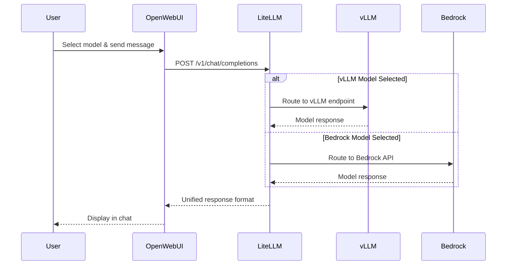

Open WebUI에서 확인한 모델 전환 기능은 LiteLLM이 처리합니다. LiteLLM은 이 워크샵의 모든 모델 상호작용을 라우팅하는 AI 게이트웨이입니다.

## 실습: API 게이트웨이 탐색

LiteLLM이 모델 상호작용을 어떻게 관리하는지 확인합니다:

### 1단계: LiteLLM 스택 확인

다음 명령을 실행하여 주요 컴포넌트를 확인합니다:

:::code{language=bash showCopyAction=true}
# LiteLLM 플랫폼 컴포넌트 확인
kubectl get pods -n litellm
:::

**출력에서 찾아볼 내용:**

:::code{language=yaml showCopyAction=false}
# 예시 패턴 (실제 이름은 다를 수 있음):
NAME                       READY   STATUS    RESTARTS   AGE
litellm-*                  1/1     Running   0          *h     # ← 주요 API 게이트웨이
litellm-postgresql-0       1/1     Running   0          *h     # ← 구성 데이터베이스
litellm-redis-master-0     1/1     Running   0          *h     # ← 성능 캐시
:::

**주요 컴포넌트:**
- **LiteLLM Pod**: 모든 모델 요청을 라우팅하는 주요 API 게이트웨이
- **PostgreSQL**: 모델 구성, 사용 데이터 및 사용자 설정 저장
- **Redis**: 응답 시간 개선을 위한 캐싱 제공

### 2단계: 사용 가능한 모델 확인

LiteLLM이 발견하고 사용할 수 있는 모델을 확인합니다:

:::code{language=bash showCopyAction=true}
# 실행 중인 vLLM 모델 확인
kubectl get pods -n vllm -l app
:::

**확인해야 할 내용:**

:::code{language=yaml showCopyAction=false}
# 실행 중인 모델 (LiteLLM에서 사용 가능):
NAME                                        READY   STATUS    
deepseek-r1-qwen3-8b-neuron-*                    1/1     Running   # ← DeepSeek 모델
qwen3-8b-neuron-neuron-*         1/1     Running   # ← Qwen 모델
:::

**중요한 이유:** 워크샵 환경은 실행 중인 모델을 자동으로 발견하고, Helm 차트 구성을 통해 LiteLLM이 해당 모델을 참조하도록 설정합니다.

### 3단계: 구성 메커니즘 확인

Open WebUI와 마찬가지로 [공식 Helm Chart](https://github.com/BerriAI/litellm/tree/main/deploy/charts/litellm-helm)를 사용하여 LiteLLM을 설정했습니다. 모델이 LiteLLM의 구성에 어떻게 나타나는지 확인하겠습니다:

:::code{language=bash showCopyAction=true}
# 모델 구성 확인
grep -A 16 "model_list:" /workshop/components/ai-gateway/litellm/values.rendered.yaml
:::

**확인할 내용의 예:**

:::code{language=yaml showCopyAction=false}
# LiteLLM에서 모델이 구성되는 방법:
model_list:
  # Bedrock 모델 (AWS 구성에서)
  - model_name: bedrock/claude-4.5-sonnet
    litellm_params:
      model: bedrock/global.anthropic.claude-sonnet-4-5-20250929-v1:0
      aws_region_name: us-west-2
      
  # vLLM 모델 (실행 중인 Pod에서 자동 발견)
  - model_name: vllm/qwen3-8b-neuron
    litellm_params:
      model: openai/qwen3-8b-neuron
      api_key: fake-key
      api_base: http://qwen3-8b-neuron.vllm:8000/v1
  - model_name: vllm/deepseek-r1-qwen3-8b-neuron
    litellm_params:
      model: openai/deepseek-r1-qwen3-8b-neuron
      api_key: fake-key
      api_base: http://deepseek-r1-qwen3-8b-neuron.vllm:8000/v1
:::

**핵심 메커니즘:** 실행 중인 vLLM Pod가 LiteLLM에서 자동으로 API 엔드포인트가 되는 것을 확인할 수 있습니다.

### 4단계: 통합 시스템 이해

자동 발견이 어떻게 작동하는지 확인하겠습니다:

:::code{language=bash showCopyAction=true}
# 통합 발견 로직 확인
grep -A 15 "integration.*llm-model" /workshop/components/ai-gateway/litellm/index.mjs
:::

**작동 방식:**

:::code{language=javascript showCopyAction=false}
// LiteLLM의 모델 발견 프로세스:
for (const model of value.models) {
  if (model.deploy) {
    // 모델 Pod가 실제로 실행 중인지 확인
    const result = await kubectl get pod -n ${namespace} -l app=${model.name}
    if (result.stdout.includes(model.name)) {
      // 모델을 찾았습니다! 통합에 추가
      integration["llm-model"][namespace][model.name] = true;
    }
  }
}
:::

**프로세스:**
1. **스캔**: Kubernetes에서 실행 중인 모델 Pod 스캔
2. **검증**: 각 모델이 정상이고 사용 가능한지 확인
3. **빌드**: 발견된 모델로 통합 객체 생성
4. **렌더링**: 사용 가능한 모델만으로 Helm 템플릿 렌더링
5. **배포**: 해당 모델 구성으로 LiteLLM 배포

이를 통해 LiteLLM은 실제로 실행 중인 모델만 사용하도록 구성됩니다.

## LiteLLM이란 무엇입니까?

LiteLLM은 다음 기능을 제공하는 오픈소스 프록시입니다:

- **통합 API**: 모든 모델을 위한 단일 OpenAI 호환 엔드포인트
- **요청 라우팅**: 적절한 백엔드로 요청 라우팅
- **영구 스토리지**: 구성 저장을 위한 PostgreSQL, 캐싱을 위한 Redis
- **로드 밸런싱**: 여러 모델 레플리카 간에 요청 분산

## LiteLLM 배포 방법

LiteLLM 배포는 커스텀 values 템플릿과 함께 [공식 LiteLLM Helm Chart](https://github.com/BerriAI/litellm/tree/main/deploy/charts/litellm-helm)를 사용합니다. 전체 values.template.yaml 파일은 `/workshop/components/ai-gateway/litellm/values.template.yaml`에서 확인할 수 있습니다. 다음 탭에서 Helm 구성의 각 섹션을 설명합니다:

:::::tabs

::::tab{label="Resources & Infrastructure"}
**주요 애플리케이션 리소스**

LiteLLM 프록시는 여러 모델 요청을 처리하기 위해 적절한 리소스가 필요합니다:

:::code{language=yaml showCopyAction=true}
resources:
  requests:
    cpu: 1 
    memory: 2Gi
  limits:
    memory: 2Gi
:::

**지원 인프라**

LiteLLM은 캐싱을 위한 Redis 및 영속성을 위한 PostgreSQL과 함께 실행됩니다:

:::code{language=yaml showCopyAction=true}
redis:
  enabled: true
  master:
    resources: 
      requests:
        cpu: 125m
        memory: 256Mi
      limits:
        memory: 256Mi

postgresql:
  primary:
    resources: 
      requests:
        cpu: 125m
        memory: 256Mi
      limits:
        memory: 256Mi
:::

**이 아키텍처를 사용하는 이유:**
- **Redis**: 모델 응답을 캐시하고 지연시간 감소
- **PostgreSQL**: 모델 구성, 사용 데이터 및 사용자 설정 저장
- **리소스 제한**: 예측 가능한 성능 보장 및 리소스 경합 방지
::::

::::tab{label="Authentication & Security"}
**서비스 계정 구성**

LiteLLM은 안전한 Kubernetes 작업을 위해 자체 서비스 계정을 생성합니다:

:::code{language=yaml showCopyAction=true}
serviceAccount:
  create: true
:::

**인증 설정**

마스터 키와 UI 자격 증명은 환경 변수를 통해 구성됩니다:

:::code{language=yaml showCopyAction=true}
masterkey: {{{LITELLM_API_KEY}}}
envVars:
  UI_USERNAME: {{{LITELLM_UI_USERNAME}}}
  UI_PASSWORD: {{{LITELLM_UI_PASSWORD}}}
:::

**보안 기능:**
- **마스터 키**: LiteLLM 프록시에 대한 API 액세스 제어
- **UI 인증**: 사용자 이름/비밀번호로 웹 인터페이스 보호
- **템플릿 변수**: 배포 중에 안전하게 자격 증명 주입
- **서비스 계정**: Kubernetes 보안 모범 사례 준수
::::

::::tab{label="Observability Integration"}
**모니터링 및 추적 설정**

LiteLLM은 여러 관측성 플랫폼과 통합됩니다:

:::code{language=yaml showCopyAction=true}
envVars:
  LANGFUSE_HOST: http://langfuse-web.langfuse:3000
  LANGFUSE_PUBLIC_KEY: {{{LANGFUSE_PUBLIC_KEY}}}
  LANGFUSE_SECRET_KEY: {{{LANGFUSE_SECRET_KEY}}}
  PHOENIX_API_KEY: {{{PHOENIX_API_KEY}}}
  PHOENIX_COLLECTOR_ENDPOINT: http://phoenix-svc.phoenix:4317/v1/traces
  PHOENIX_COLLECTOR_HTTP_ENDPOINT: http://phoenix-svc.phoenix:6006/v1/traces
:::

**자동 관측성 기능:**
- **Langfuse 통합** (주요): 모든 요청, 응답 및 비용 추적 - 이것이 이 워크샵 전체에서 사용하는 관측성 플랫폼입니다
- **Phoenix 지원** (사전 구성됨): 사전 구성되었지만 이 워크샵에서는 적극적으로 사용되지 않는 대안 관측성 플랫폼입니다. 프로덕션에서는 추가 추적 기능을 위해 Langfuse와 함께 Phoenix를 활성화할 수 있습니다
- **서비스 발견**: 내부 통신을 위해 Kubernetes 서비스 이름 사용
- **제로 구성**: 배포되면 관측성이 자동으로 작동

**추적되는 내용:**
- 디버깅을 위한 요청/응답 쌍
- 모델당 토큰 사용 및 비용
- 성능 지표 및 지연시간
- 오류율 및 실패 패턴
::::

::::tab{label="Networking & Ingress"}
**로드 밸런서 구성**

LiteLLM은 외부 액세스를 위해 AWS Application Load Balancer를 사용합니다:

:::code{language=yaml showCopyAction=true}
ingress:
  enabled: true
  className: {{#if DOMAIN}}shared-{{/if}}internet-facing-alb
  annotations:
    alb.ingress.kubernetes.io/target-type: ip
    {{#if DOMAIN}}
    alb.ingress.kubernetes.io/listen-ports: '[{"HTTPS":443}]'
    {{/if}}
  hosts:
    - paths:
        - path: /
          pathType: Prefix
      {{#if DOMAIN}}
      host: litellm.{{{DOMAIN}}}
      {{/if}}
:::

**네트워킹 기능:**
- **ALB 통합**: AWS Application Load Balancer 사용
- **IP Target Type**: 더 나은 성능을 위한 직접 Pod 네트워킹
- **조건부 HTTPS**: 도메인이 구성된 경우 HTTPS 활성화
- **경로 기반 라우팅**: 모든 트래픽이 LiteLLM 프록시로 라우팅됨
- **동적 구성**: 도메인 가용성에 따라 조정
::::

::::tab{label="Model Configuration"}
**프록시 설정**

모델 관리를 위한 핵심 LiteLLM 프록시 구성:

:::code{language=yaml showCopyAction=true}
proxy_config:
  general_settings:
    master_key: os.environ/PROXY_MASTER_KEY
    store_model_in_db: true
    store_prompts_in_spend_logs: true
  litellm_settings:
    {{#with integration.o11y.config}}
    {{#if callbacks}}    
    callbacks: {{{callbacks}}}
    {{/if}}
    {{#if success_callback}}    
    success_callback: {{{success_callback}}}
    {{/if}}
    {{#if failure_callback}}
    failure_callback: {{{failure_callback}}}
    {{/if}}
    {{/with}}
    redact_user_api_key_info: true
    turn_off_message_logging: false
:::

**실제로 렌더링되는 내용:**

위의 Handlebars 템플릿은 배포 시점에 관측성 구성으로 렌더링됩니다. 실제 결과 구성은 다음과 같습니다:

:::code{language=yaml showCopyAction=false}
proxy_config:
  litellm_settings:
    callbacks: ["langfuse"]              # 모든 LLM 호출이 Langfuse에 추적됨
    success_callback: ["langfuse"]       # 성공한 응답이 로깅됨
    failure_callback: ["langfuse"]       # 실패한 요청도 캡처됨
    redact_user_api_key_info: true       # API 키가 추적에서 숨겨짐
    turn_off_message_logging: false      # 전체 프롬프트/응답 로깅 활성화
:::

**주요 구성 세부 사항:**
- **`callbacks: ["langfuse"]`**: 성공 및 실패 콜백 모두에 대해 Langfuse를 활성화하는 편리한 약어입니다. 이것만 설정해도 아래 두 줄과 같은 결과를 얻을 수 있습니다
- **`success_callback` + `failure_callback`**: 성공한 응답과 오류/시간 초과 모두가 추적되도록 명시적으로 `["langfuse"]`로 설정합니다. Starter Kit은 명확성을 위해 세 가지 모두를 구성합니다
- **`turn_off_message_logging: false`**: 전체 프롬프트 및 응답 내용이 Langfuse 추적에 저장되어 상세한 디버깅 가능

**동적 모델 등록**

모델은 Handlebars 템플릿을 통해 자동으로 발견되고 등록됩니다:

:::code{language=yaml showCopyAction=true}
  model_list:
    # Bedrock LLM 모델
    {{#each integration.bedrock.llm}}
    - model_name: bedrock/{{{name}}}
      litellm_params:
        model: bedrock/{{{model}}}
        aws_region_name: {{{@root.integration.bedrock.region}}}
    {{/each}}
    
    # vLLM 모델 (실행 중인 Pod에서 발견)
    {{#each integration.llm-model.vllm}}
    - model_name: vllm/{{@key}}
      litellm_params:
        model: openai/{{@key}}
        api_key: fake-key
        api_base: http://{{@key}}.vllm:8000/v1
    {{/each}}
:::

**지원되는 모델 유형:**
- **Bedrock**: AWS 관리형 모델 (Claude, Llama 등)
- **vLLM**: Kubernetes의 자체 호스팅 모델
- **SGlang, TGI, Ollama**: 추가 추론 엔진
- **TEI**: Text Embedding Inference 모델
::::

::::tab{label="Deployment Commands"}
**Helm 배포 프로세스**

::alert[**경고**: 이 명령은 워크샵 환경에서 이미 실행되었습니다. 기존 설정에 영향을 줄 수 있으므로 **이 명령을 실행하지 마십시오**.]{type="warning"}

LiteLLM 배포는 다음 Helm 명령을 사용합니다:

:::code{language=bash showCopyAction=true}
# LiteLLM Helm 리포지토리 추가
helm repo add litellm oci://ghcr.io/berriai/litellm-helm
helm repo update

# 커스텀 values로 LiteLLM 배포
helm upgrade --install litellm litellm/litellm-helm \
  --namespace litellm \
  --create-namespace \
  -f values.rendered.yaml

# 배포 상태 확인
kubectl rollout status deployment/litellm -n litellm
:::

**배포 프로세스:**
1. **템플릿 렌더링**: `values.template.yaml` → `values.rendered.yaml`
2. **통합 발견**: 시스템이 실행 중인 모델 스캔
3. **Helm 설치**: 렌더링된 values로 차트 배포
4. **서비스 시작**: 발견된 모델로 LiteLLM 프록시 시작

**배포 중 발생하는 일:**
- 서비스 계정 및 RBAC 권한 생성
- 종속성으로 PostgreSQL 및 Redis 배포
- 발견된 모델로 LiteLLM 프록시 구성
- Ingress/LoadBalancer가 서비스 노출
- 관측성 연결 설정
::::

:::::

---

## LiteLLM의 요청 처리 방식

Open WebUI에서 모델을 전환할 때마다 발생하는 과정을 다음 다이어그램에서 보여줍니다:

## LiteLLM 웹 인터페이스 탐색

LiteLLM 관리 인터페이스에서 모델과 지표를 확인하고 API를 직접 테스트합니다:

### 1단계: LiteLLM 인터페이스 액세스

먼저 LiteLLM 인스턴스의 URL과 자격 증명을 가져옵니다:

:::code{language=bash showCopyAction=true}
# LiteLLM 서비스 URL 가져오기
echo "LiteLLM URL: http://$(kubectl get ingress -n litellm litellm -o jsonpath='{.status.loadBalancer.ingress[0].hostname}')"
:::

브라우저에서 URL을 엽니다. LiteLLM API 문서 페이지가 표시됩니다:

**주목할 사항:**
- **LiteLLM Admin Panel on /ui** 링크(주황색으로 강조 표시됨) - 여기로 이동합니다
- **LiteLLM Model Cost Map** - 비용 분석용
- **LiteLLM Model Hub** - 사용 가능한 모델 확인
- **Authorize** 버튼 - API 인증용

### 2단계: 관리 인터페이스 액세스

**"LiteLLM Admin Panel on /ui"** 를 클릭하여 관리 인터페이스에 액세스합니다. 로그인 페이지로 이동합니다:

**로그인 프로세스:**
1. **Username**: `admin` 입력 
2. **Password**: `Pass@123` 입력 
3. **"Login" 클릭** 하여 관리 인터페이스 액세스

### 3단계: 모델 대시보드 탐색

로그인 후 **Models + Endpoints** 를 클릭하여 LiteLLM용으로 구성된 모델을 확인합니다:

**확인할 내용:**
- **"Showing 3 results"** - 구성된 모델
- Model ID, Public Model Name, Provider, LiteLLM Model Name 열이 있는 **모델 테이블**

**구성된 모델:**
- **bedrock/claude-4.5-sonnet** - AWS Bedrock 모델 (bedrock provider)
- **vllm/qwen3-8b-neuron** - 자체 호스팅 모델 (openai provider)
- **vllm/deepseek-r1-qwen3-8b-neuron** - 자체 호스팅 모델 (openai provider)

**핵심 사항:** vLLM 모델의 provider가 "openai"로 표시되는 것은 LiteLLM이 OpenAI 호환 API를 통해 해당 모델을 제공하기 때문입니다.

### 4단계: 사용량 및 비용 모니터링

왼쪽 사이드바에서 **"Usage"** 를 클릭하여 사용량 분석을 확인합니다:

**사용량 지표 대시보드:**
- **Total Spend**: $0.1027 (실제 워크샵 사용량)
- **Total Requests**: 65개 요청 처리
- **Successful Requests**: 63 (96.9% 성공률)
- **Failed Requests**: 2 (3.1% 실패율)
- **Total Tokens**: 32,484개 토큰 처리
- **Average Cost per Request**: $0.0016

**이 지표에서 확인할 수 있는 내용:**
- 비용 추적이 자동으로 이루어지며 상세한 내역을 제공합니다
- 시간 경과에 따른 지출 패턴을 모니터링할 수 있습니다
- 토큰 사용량으로 대화의 복잡도를 파악할 수 있습니다

::alert[**비용 추적 참고**: 여기에 표시된 비용 지표는 주로 Bedrock 모델을 위한 것입니다. 자체 호스팅 vLLM 모델은 관리형 서비스와 같은 직접적인 토큰당 API 가격이 없습니다 - 대신 비용은 기본 인프라(예: AWS Neuron `inf2` 인스턴스)에서 발생합니다. 프로덕션에서는 LiteLLM의 `model_info` 섹션에서 `input_cost_per_token` 및 `output_cost_per_token` 필드를 사용하여 커스텀 토큰당 비용을 구성하여 인프라 지출을 기반으로 상각된 토큰당 비용을 계산할 수 있습니다. 이를 통해 Langfuse 대시보드에서 관리형 및 자체 호스팅 모델 모두에 걸쳐 통합 비용 추적이 가능합니다.]{type="info"}

### 5단계: 모델 직접 테스트

**"Playground"** 를 클릭하여 대화형 테스트 인터페이스에 액세스합니다:

**테스트 기능:**
- **모델 선택**: "bedrock/claude-4.5-s..." 선택을 표시하는 드롭다운
- **채팅 인터페이스**: 선택한 모델과의 실제 대화
- **구성 옵션**: API Key Source, Endpoint Type, Tags, MCP Tools
- **샘플 대화**: 상세한 응답과 함께 dragon 어원에 대한 질문 표시

**직접 시도해 보십시오:**
1. 드롭다운에서 **다른 모델 선택** (Bedrock과 vLLM 모델 간 전환)
2. "Kubernetes를 간단한 용어로 설명해 주세요"와 같은 **질문 입력**
3. 모델별 **응답 비교**

### 6단계: 워크샵 환경과 연결하여 확인

LiteLLM 인터페이스를 살펴보았으니 다음을 수행합니다:

1. 다른 탭에서 **Open WebUI로 돌아가기**
2. 여러 모델에 **메시지 보내기**
3. **LiteLLM Usage 페이지로 돌아가서** 새로고침
4. **지표 업데이트 확인** - 새 요청, 토큰 사용량 및 비용이 나타나는 것을 확인할 수 있습니다.

**실시간 모니터링:** Open WebUI에서의 모든 상호작용은 LiteLLM을 거치며, 지표는 실시간으로 업데이트됩니다.

이를 통해 AI 게이트웨이의 성능 및 사용 현황을 파악할 수 있습니다.

## 실습: LiteLLM에 새 Bedrock 모델 추가

이 섹션에서는 LiteLLM에 새 Bedrock 모델을 추가합니다. 이미 액세스 권한이 있는 GPT-OSS-20B 모델을 추가합니다.

### 1단계: 사용 가능한 GPT-OSS 모델 발견

먼저 Bedrock에서 사용 가능한 GPT-OSS 모델을 확인합니다:

:::code{language=bash showCopyAction=true}
# 액세스 권한이 있는 Bedrock 모델 확인
aws bedrock list-foundation-models --query "modelSummaries[?contains(modelId, 'gpt-oss')].{ModelId:modelId,ModelName:modelName}" --output table
:::

**확인해야 할 내용:**

:::code{language=yaml showCopyAction=false}
---------------------------------------------
|           ListFoundationModels            |
+--------------------------+----------------+
|          ModelId         |   ModelName    |
+--------------------------+----------------+
|  openai.gpt-oss-120b-1:0 |  gpt-oss-120b  |
|  openai.gpt-oss-20b-1:0  |  gpt-oss-20b   |
+--------------------------+----------------+
:::

**gpt-oss-20b** 모델(ModelId: `openai.gpt-oss-20b-1:0`)을 추가합니다.

### 2단계: 현재 LiteLLM 구성 확인

LiteLLM에 현재 구성된 Bedrock 모델을 확인합니다:

:::code{language=bash showCopyAction=true}
# LiteLLM의 현재 Bedrock 모델 확인
grep -A 3 -B 1 "model_name.*bedrock" /workshop/components/ai-gateway/litellm/values.rendered.yaml
:::

GPT-OSS-20B가 현재 구성되지 않았음을 알 수 있습니다.

### 3단계: 구성에 GPT-OSS-20B 추가

구성 파일에 새 모델을 직접 추가합니다:

:::code{language=bash showCopyAction=true}
# Values yaml 파일 열기:
code /workshop/components/ai-gateway/litellm/values.rendered.yaml 
:::

`values.rendered.yaml`의 Bedrock 모델 섹션에 **이 YAML 구성 추가**:

:::code{language=yaml showCopyAction=true}
    - model_name: bedrock/gpt-oss-20b
      litellm_params:
        model: bedrock/openai.gpt-oss-20b-1:0
        aws_region_name: us-west-2
:::

다음과 같이 보여야 합니다:  

### 4단계: 구성 변경 사항 적용

구성 파일에 모델을 추가한 후 변경 사항을 적용합니다:

:::code{language=bash showCopyAction=true}
# 업데이트된 구성 적용
helm upgrade litellm oci://ghcr.io/berriai/litellm-helm \
  --namespace litellm \
  -f /workshop/components/ai-gateway/litellm/values.rendered.yaml

# 배포가 완료될 때까지 대기
kubectl rollout status deployment/litellm -n litellm
:::

### 5단계: 모델을 사용할 수 있는지 확인

롤아웃이 완료되면 **Models + Endpoints** 페이지로 돌아가서 LiteLLM에 추가되었는지 확인합니다:

모델 중에 **bedrock/gpt-oss-20b** 가 보여야 합니다.

### 6단계: Open WebUI에서 테스트

1. **Open WebUI로 돌아가기**
2. **모델 드롭다운 확인** - "bedrock/gpt-oss-20b"가 보여야 합니다
3. **GPT-OSS-20B 선택** 하고 테스트 메시지 보내기
4. 다른 모델과 **응답 비교**

::alert[**프로덕션 참고**: 프로덕션 환경에서는 일반적으로 앞서 탐색한 자동화된 통합 시스템을 사용합니다. 이 수동 접근 방식은 기본 구성을 이해하고 일회성 모델 추가에 유용합니다.]{type="success"}

## 실습: 모듈 A2을 위한 Virtual Key 생성

모듈 A2에서는 모델에 대한 안전한 액세스가 필요한 에이전틱 애플리케이션을 구축합니다. 에이전트가 사용 가능한 모든 모델에 액세스할 때 사용할 전용 Virtual Key를 생성합니다.

### 1단계: Virtual Keys로 이동

LiteLLM 인터페이스에서 왼쪽 사이드바의 **"Virtual Keys"** 를 클릭합니다:

**확인할 내용:**
- 사이드바에서 강조 표시된(주황색 상자) **"Virtual Keys"**
- **"+ Create New Key"** 버튼
- 빈 결과 테이블 (초기에 "1 - 0 of 0 results" 표시)

### 2단계: 에이전트 키 구성

**"+ Create New Key"** 버튼을 클릭하여 키 생성 대화 상자를 엽니다:

**다음 설정으로 키 구성:**

**키 소유권:**
- **Owned By**: "You" 선택 (기본 선택)
- **Team**: "Search or select a team"으로 유지 (선택 사항)

**키 세부 정보:**
- **Key Name**: `agent-key` 입력
- **Models**: 사용 가능한 모든 모델 선택:
  - `bedrock/claude-4.5-sonnet`
  - `bedrock/gpt-oss-20b`
  - `vllm/qwen3-8b-neuron`
  - `vllm/deepseek-r1-qwen3-8b-neuron`
- **Key Type**: "Default"로 유지
- **Optional Settings**: 확장된 상태로 유지하되 변경하지 않음

**"Create Key"** 를 클릭하여 Virtual Key를 생성합니다.

### 3단계: API 키 저장

새로 생성된 키가 포함된 팝업이 나타납니다:

**보안 공지:**
::alert[**중요**: 이 키를 복사할 수 있는 유일한 기회입니다. 보안상의 이유로 LiteLLM 계정에서 **다시 확인할 수 없습니다**. 이 비밀 키를 분실하면 새 키를 생성해야 합니다.]{type="warning"}

**키 저장:**
1. **"Copy API Key"** 버튼 클릭
2. 모듈 A2을 위해 안전하게 저장:

:::code{language=bash showCopyAction=true}
# 환경 또는 메모에 저장
export AGENT_KEY="sk-REDACTED"  # 실제 키는 다를 것입니다
:::

### 4단계: 키 액세스 확인

Virtual Key가 모든 모델에 액세스할 수 있는지 확인합니다:

1. 사이드바에서 **"Playground"** 로 이동
2. 테스트 인터페이스 구성:

**테스트 구성:**
- **API Key Source**: 드롭다운에서 "Virtual Key" 선택
- **Key Input**: 나타나는 필드에 `sk-` 키 붙여넣기
- **Select Model**: 모델 선택 (예: "bedrock/claude-4.5-sonnet")

### 5단계: 모델 액세스 검증

테스트 메시지를 보내 키가 작동하는지 확인합니다:

**검증 항목:**
- **인증**: Virtual Key가 수락됨
- **모델 액세스**: 키가 선택한 모델에 액세스할 수 있음
- **응답 생성**: 모델이 올바르게 응답함
- **다중 모델 지원**: 모델을 전환하여 모든 모델에 대한 액세스 확인

**예시 테스트:**
- **질문**: "Why is most of the landmass in the world above the equator?"
- **응답**: 상세한 지질학적 설명이 표시되어야 함
- **사용된 모델**: 응답한 모델 표시 (예: "global.anthropic.claude-sonnet-4-5")

::alert[이제 Virtual Key가 모듈 A2의 에이전틱 애플리케이션을 위해 준비되었습니다. 이 키는 단일 인증 토큰을 통해 모든 모델에 대한 통합 액세스를 제공합니다.]{type="success"}

모듈 A2에서 이 Virtual Key를 사용하여 작업 요구 사항에 따라 모델 간에 전환할 수 있는 에이전트를 구축합니다.

## 게이트웨이 기능 요약

이 실습을 통해 통합 AI 게이트웨이의 다음 기능을 확인했습니다:

- **모델 전환**: 애플리케이션을 변경하지 않고 모든 모델 간 전환
- **자동 발견**: 배포되거나 구성될 때 새 모델이 자동으로 나타남
- **내장 관측성**: 추가 설정 없이 Langfuse에서 모든 요청 추적
- **로드 밸런싱**: 사용 가능한 모델 레플리카 간에 요청 분산
- **Fallback 지원**: 모델을 사용할 수 없는 경우 자동 장애 조치
- **동적 구성**: 코드 변경이 아닌 구성 업데이트를 통해 새 모델 추가
- **프로덕션 기능**: 인증, 캐싱 및 영속성
- **무중단 업데이트**: 서비스 중단 없이 모델 추가

## 다음은?

이제 통합 AI 게이트웨이로서 LiteLLM을 살펴보았습니다. 다음 내용을 확인했습니다:
- 모델을 자동으로 발견하고 통합하는 방식
- 모든 AI 서비스를 위한 단일 API 제공
- 모델 관리 및 모니터링 기능

다음으로 Langfuse를 살펴봅니다. Langfuse는 모든 상호작용을 추적하여 성능, 비용 및 사용 패턴 데이터를 기록하는 관측성 플랫폼입니다.

---

**[다음: Langfuse - 관측성 플랫폼 →](../observability/)**
