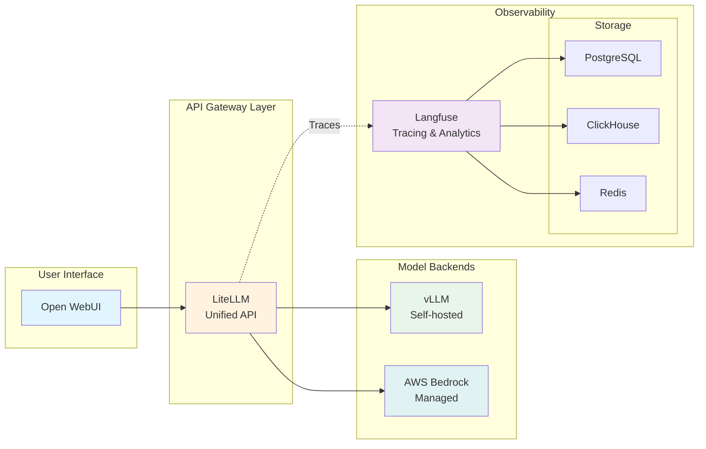

In this module, you connect the individual AI models from the previous module into a unified platform. You work with LiteLLM as a unified API gateway and Langfuse for observability, the two infrastructure components that support the GenAI applications built later in this track.

## Learning Objectives

By the end of this module, you will:

- Explore and configure LiteLLM as a unified API gateway
- Understand and use Langfuse for LLM observability and tracing
- Add new models to LiteLLM through Helm upgrades
- Explore observability features in the Langfuse UI
- Understand the integration between all platform components

## Module Architecture

The following diagram shows how the platform components work together:

## Key concepts

This module covers deployment patterns based on Helm charts and Kubernetes practices:

- **Dynamic configuration**: How Helm templates enable flexible deployments
- **Automatic integration**: How components discover and connect to each other
- **Scalable patterns**: Resource management, ingress, and security
- **Hands-on practice**: Adding new models and exploring observability features

## Module Sections

#### 1. [LiteLLM - Unified API Gateway](./ai-gateway/)
Explore LiteLLM, which provides a single API endpoint for multiple LLM providers. Learn how to:
- Configure model routing
- Add new Bedrock models through Helm
- Understand the integration templating system

#### 2. [Langfuse - Observability Platform](./observability/)
Review observability for your GenAI applications, including:
- Tracing and monitoring capabilities
- Cost tracking and analytics
- The complete observability stack

## Prerequisites Check

Before starting, verify your environment from the shared *Interacting with Models* module:

:::code{language=bash showCopyAction=true}
# Check that the foundation components are running
kubectl get pods -n openwebui
kubectl get pods -n vllm
kubectl get pods -n litellm
kubectl get pods -n langfuse

# Verify you have Bedrock access
aws bedrock list-foundation-models --query "modelSummaries[?contains(modelId, 'claude')].modelId" --output table
:::

::alert[If any components are missing, please complete the *Interacting with Models* module first.]{type="warning"}

## Getting Started

Begin by examining LiteLLM, the unified API gateway that is already running and connecting all your models.

---

**[Next: LiteLLM - Unified API Gateway →](./ai-gateway/)**
