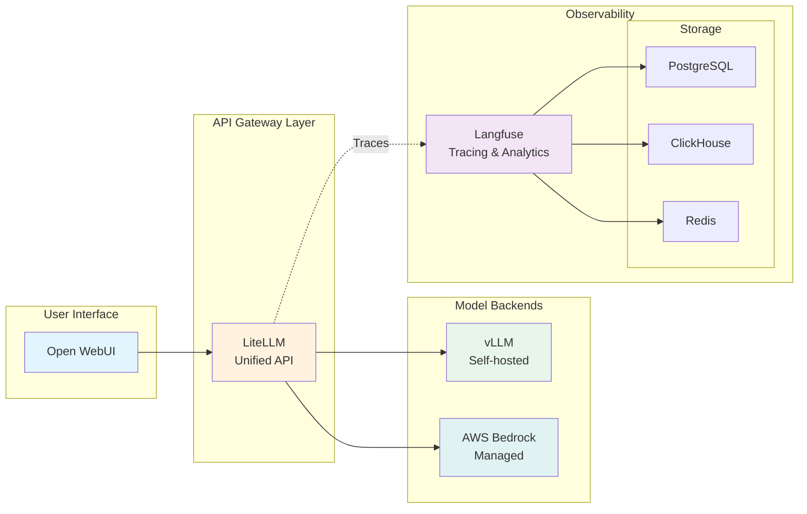

이 모듈에서는 이전 모듈에서 사용한 개별 AI 모델을 통합 플랫폼으로 연결합니다. 통합 API 게이트웨이 역할을 하는 LiteLLM과 관측성을 담당하는 Langfuse를 다루며, 이 두 컴포넌트는 이후 트랙에서 구축하는 GenAI 애플리케이션의 기반 인프라가 됩니다.

## 학습 목표

이 모듈을 마치면 다음을 수행할 수 있습니다:

- 통합 API 게이트웨이로서 LiteLLM 탐색 및 구성
- LLM 관측성 및 추적을 위한 Langfuse 이해 및 사용
- Helm 업그레이드를 통해 LiteLLM에 새 모델 추가
- Langfuse UI에서 관측성 기능 탐색
- 모든 플랫폼 컴포넌트 간의 통합 이해

## 모듈 아키텍처

플랫폼 컴포넌트가 함께 작동하는 방식은 다음과 같습니다:

## 핵심 개념

이 모듈에서는 Helm 차트와 Kubernetes 사례에 기반한 배포 패턴을 다룹니다:

- **동적 구성**: Helm 템플릿으로 유연한 배포를 구성하는 방법
- **자동 통합**: 컴포넌트가 서로를 발견하고 연결하는 방식
- **확장 가능한 패턴**: 리소스 관리, Ingress 및 보안
- **실습**: 새 모델 추가 및 관측성 기능 탐색

## 모듈 섹션

#### 1. [LiteLLM - 통합 API 게이트웨이](./ai-gateway/)
여러 LLM 제공자를 위한 단일 API 엔드포인트를 제공하는 LiteLLM을 탐색합니다. 다음을 학습합니다:
- 모델 라우팅 구성
- Helm을 통해 새 Bedrock 모델 추가
- 통합 템플릿 시스템 이해

#### 2. [Langfuse - 관측성 플랫폼](./observability/)
GenAI 애플리케이션을 위한 관측성을 살펴봅니다. 다음 내용을 다룹니다:
- 추적 및 모니터링 기능
- 비용 추적 및 분석
- 전체 관측성 스택

## 사전 요구 사항 확인

시작하기 전에 모델과 상호작용하기 모듈의 환경을 확인합니다:

:::code{language=bash showCopyAction=true}
# 파운데이션 컴포넌트가 실행 중인지 확인
kubectl get pods -n openwebui
kubectl get pods -n vllm
kubectl get pods -n litellm
kubectl get pods -n langfuse

# Bedrock 액세스 확인
aws bedrock list-foundation-models --query "modelSummaries[?contains(modelId, 'claude')].modelId" --output table
:::

::alert[컴포넌트가 누락된 경우 먼저 모델과 상호작용하기 모듈을 완료하십시오.]{type="warning"}

## 시작하기

이미 실행 중이며 모든 모델을 연결하고 있는 통합 API 게이트웨이인 LiteLLM을 살펴보는 것으로 시작합니다.

---

**[다음: LiteLLM - 통합 API 게이트웨이 →](./ai-gateway/)**
