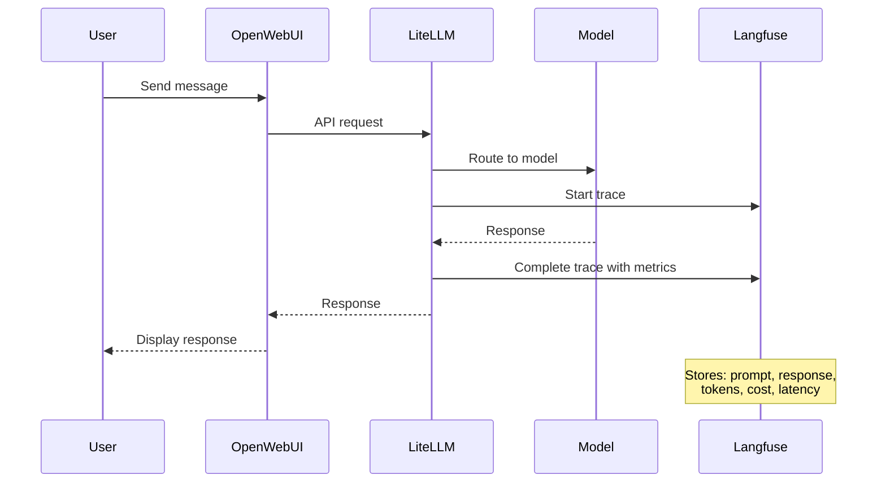

vLLM과 Bedrock 모델과 상호작용하는 동안 Langfuse는 모든 요청을 기록해 왔습니다. 프롬프트, 응답, 성능 지표 및 비용이 캡처됩니다. 이 섹션에서는 AI 사용에 대해 수집된 데이터를 살펴봅니다.

## 실습: AI 상호작용 추적 확인

Langfuse가 AI 사용에 대해 수집한 내용을 확인합니다:

### 1단계: 관측성 스택 탐색

:::code{language=bash showCopyAction=true}
# 완전한 관측성 스택 확인
kubectl get all -n langfuse
:::

다음 컴포넌트가 표시되어야 합니다:
- **langfuse-clickhouse-0**: 성능 데이터를 위한 분석 데이터베이스
- **langfuse-postgresql-0**: 추적 메타데이터를 위한 데이터베이스
- **langfuse-redis-master-0**: 캐싱 레이어
- **langfuse-s3-xxx**: 대용량 데이터를 위한 객체 스토리지
- **langfuse-web-xxx**: 주요 Langfuse 애플리케이션

### 2단계: 실제 구성 탐색

VSC IDE에서 실제 구성을 확인합니다:

:::code{language=bash showCopyAction=true}
# 실제 Langfuse Helm values 확인
cat /workshop/components/o11y/langfuse/values.template.yaml

# 완전한 스택 구성 확인
grep -A 5 "postgresql:\|clickhouse:\|redis:" /workshop/components/o11y/langfuse/values.template.yaml
:::

Langfuse가 프로젝트 설정으로 사전 구성되어 자동으로 초기화되는 것을 확인할 수 있습니다.

## Langfuse란 무엇입니까?

Langfuse는 다음 기능을 제공하는 오픈소스 LLM 관측성 플랫폼입니다:

- **추적**: 전체 컨텍스트와 함께 캡처되는 모든 LLM 상호작용
- **비용 추적**: 모든 모델에 걸친 토큰 사용량 및 비용
- **성능 분석**: 지연시간, 처리량 및 품질 지표
- **디버깅 도구**: 상세한 요청/응답 검사
- **사용량 분석**: 패턴, 트렌드 및 최적화 정보
- **다중 데이터베이스 아키텍처**: 확장을 위한 PostgreSQL + ClickHouse + Redis

## Langfuse 배포 방법

Langfuse 배포는 전체 관측성 스택과 함께 [공식 Langfuse Helm Chart](https://langfuse.com/self-hosting/deployment/kubernetes-helm)를 사용합니다. 전체 values.template.yaml 파일은 `/workshop/components/o11y/langfuse/values.template.yaml`에서 확인할 수 있습니다. 다음 탭에서 Helm 구성의 각 섹션을 설명합니다:

:::::tabs

::::tab{label="Resources & Architecture"}
**주요 애플리케이션 리소스**

Langfuse는 LLM 추적 처리 및 분석을 위해 적절한 리소스가 필요합니다:

:::code{language=yaml showCopyAction=true}
langfuse:
  resources:
    requests:
      cpu: 1 
      memory: 2Gi
    limits:
      memory: 2Gi
:::

**다중 데이터베이스 아키텍처**

Langfuse는 다중 데이터베이스 구성을 사용합니다:

:::code{language=yaml showCopyAction=true}
postgresql:  # 메타데이터 및 사용자 데이터
  auth:
    username: admin
    password: password123
  primary:
    resources: 
      requests:
        cpu: 125m
        memory: 256Mi

clickhouse:  # 분석 및 시계열 데이터
  auth:
    password: password123
  resources:
    requests:
      cpu: 1    
      memory: 3Gi

redis:  # 캐싱 및 세션
  auth:
    password: password123
  primary:
    resources: 
      requests:
        cpu: 125m
        memory: 256Mi

s3:  # 대용량 추적을 위한 객체 스토리지
  auth:
    rootPassword: password123
  resources:
    requests:
      cpu: 250m    
      memory: 256Mi
:::

**이 아키텍처를 사용하는 이유:**
- **PostgreSQL**: 최근 추적 및 사용자 관리를 위한 빠른 쿼리
- **ClickHouse**: 분석 및 대규모 집계에 최적화
- **Redis**: UI 응답성을 위한 고속 캐싱
- **S3**: 과거 추적 데이터를 위한 비용 효율적인 스토리지
::::

::::tab{label="Authentication & Initialization"}
**자동 프로젝트 설정**

Langfuse는 워크샵 프로젝트 및 사용자 계정으로 사전 구성됩니다:

:::code{language=yaml showCopyAction=true}
langfuse:
  additionalEnv:
    - name: LANGFUSE_INIT_ORG_ID
      value: my-org
    - name: LANGFUSE_INIT_PROJECT_ID
      value: my-project
    - name: LANGFUSE_INIT_PROJECT_PUBLIC_KEY
      value: {{{LANGFUSE_PUBLIC_KEY}}}
    - name: LANGFUSE_INIT_PROJECT_SECRET_KEY
      value: {{{LANGFUSE_SECRET_KEY}}}
    - name: LANGFUSE_INIT_USER_EMAIL
      value: {{{LANGFUSE_USERNAME}}}
    - name: LANGFUSE_INIT_USER_PASSWORD
      value: {{{LANGFUSE_PASSWORD}}}
:::

**초기화 기능:**
- **Organization**: 자동으로 "my-org" 조직 생성
- **프로젝트**: API 키로 "my-project" 설정
- **사용자 계정**: 워크샵 자격 증명으로 관리자 사용자 생성
- **API 키**: LiteLLM 통합을 위한 키 생성
- **제로 설정**: 즉시 사용 가능한 모든 것
::::

::::tab{label="Security Configuration"}
**인증 및 보안**

Langfuse 보안 구성:

:::code{language=yaml showCopyAction=true}
langfuse:
  salt:
    value: salt
  nextauth:
    secret:
      value: secret
:::

**데이터베이스 보안**

모든 데이터베이스가 인증으로 구성됩니다:

:::code{language=yaml showCopyAction=true}
postgresql:
  auth:
    username: admin
    password: password123

clickhouse:
  auth:
    password: password123

redis:
  auth:
    password: password123

s3:
  auth:
    rootPassword: password123
:::

**보안 기능:**
- **비밀번호 보호**: 모든 데이터베이스 컴포넌트 보안
- **NextAuth 통합**: 안전한 세션 관리
- **Salt 구성**: 비밀번호 해싱 보안
- **API 키 관리**: 안전한 키 생성 및 저장
::::

::::tab{label="Networking & Ingress"}
**로드 밸런서 구성**

Langfuse는 외부 액세스를 위해 AWS Application Load Balancer를 사용합니다:

:::code{language=yaml showCopyAction=true}
langfuse:
  ingress:
    enabled: true
    annotations:
      alb.ingress.kubernetes.io/target-type: ip
      {{#if DOMAIN}}
      alb.ingress.kubernetes.io/listen-ports: '[{"HTTPS":443}]'
      {{/if}}
    hosts:
      - paths:
          - path: /
            pathType: Prefix
        {{#if DOMAIN}}
        host: langfuse.{{{DOMAIN}}}
        {{/if}}
:::

**네트워킹 기능:**
- **ALB 통합**: AWS Application Load Balancer 사용
- **IP Target Type**: 더 나은 성능을 위한 직접 Pod 네트워킹
- **조건부 HTTPS**: 도메인이 구성된 경우 HTTPS 활성화
- **경로 기반 라우팅**: 모든 트래픽이 Langfuse 웹 인터페이스로 라우팅됨
- **동적 구성**: 도메인 가용성에 따라 조정
::::

::::tab{label="Deployment Commands"}
**Helm 배포 프로세스**

::alert[**경고**: 이 명령은 워크샵 환경에서 이미 실행되었습니다. 기존 설정에 영향을 줄 수 있으므로 **이 명령을 실행하지 마십시오**.]{type="warning"}

Langfuse 배포는 다음 Helm 명령을 사용합니다:

:::code{language=bash showCopyAction=true}
# Langfuse Helm 리포지토리 추가
helm repo add langfuse https://langfuse.github.io/langfuse-k8s
helm repo update

# 커스텀 values로 Langfuse 배포
helm upgrade --install langfuse langfuse/langfuse \
  --namespace langfuse \
  --create-namespace \
  -f values.rendered.yaml

# 배포 상태 확인
kubectl rollout status deployment/langfuse-web -n langfuse
:::

**배포 프로세스:**
1. **템플릿 렌더링**: `values.template.yaml` → `values.rendered.yaml`
2. **Helm 설치**: 렌더링된 values로 차트 배포
3. **데이터베이스 초기화**: PostgreSQL, ClickHouse, Redis, S3 설정
4. **프로젝트 설정**: 조직 및 프로젝트 자동 생성
5. **통합 준비**: LiteLLM 연결을 위한 API 키 구성

**배포 중 발생하는 일:**
- 다중 데이터베이스 스택 배포 (PostgreSQL, ClickHouse, Redis, S3)
- Langfuse 웹 애플리케이션 시작
- 조직 및 프로젝트 자동 초기화
- 워크샵 자격 증명으로 사용자 계정 생성
- Ingress/LoadBalancer가 서비스 노출
- LiteLLM 통합이 자동으로 구성됨
::::

:::::

---

## Langfuse 인터페이스 탐색

Langfuse 인터페이스에서 AI 상호작용, 지표 및 상세 추적을 확인합니다:

### 1단계: Langfuse 액세스

Langfuse 인스턴스의 URL을 가져옵니다:

:::code{language=bash showCopyAction=true}
# Langfuse URL 가져오기
echo "Langfuse URL: http://$(kubectl get ingress -n langfuse langfuse -o jsonpath='{.status.loadBalancer.ingress[0].hostname}')"
:::

브라우저에서 URL을 엽니다. Langfuse 로그인 페이지가 표시됩니다:

**로그인 프로세스:**
- **Email**: `admin@example.com`
- **Password**: `Pass@123`
- **"Sign in" 클릭** 하여 인터페이스 액세스

### 2단계: 프로젝트로 이동

로그인 후 organizations 페이지가 표시됩니다:

**수행할 작업:**
- "Provisioned Project"의 **"Go to project" 버튼 클릭**
- 모든 AI 상호작용 데이터가 있는 워크샵 프로젝트로 이동

### 3단계: AI 사용량 대시보드 탐색

이제 주요 Langfuse 대시보드가 표시됩니다:

**확인할 주요 지표:**
- **총 71개 추적 기록** - 워크샵의 모든 AI 상호작용
- **총 비용 $0.10957** - 실제 워크샵 지출
- **모델별 분석**:
  - `global.anthropic.claude-sonnet-4-5`: 20.63K 토큰, $0.106486
  - `openai.gpt-oss-20b-1:0`: 7.52K 토큰, $0.001084
- **사용 타임라인**: 시간 경과에 따른 상호작용 패턴을 보여주는 차트

**이 지표에서 확인할 수 있는 내용:**
- 대부분의 비용이 Claude 4.5 Sonnet에서 발생합니다
- GPT-OSS-20B는 토큰당 비용이 더 낮습니다
- 자체 호스팅 모델은 토큰당 비용이 없습니다
- 시간 경과에 따른 사용 패턴을 확인할 수 있습니다

### 4단계: 추적 탐색

왼쪽 사이드바에서 **"Tracing"** 을 클릭하여 모든 상호작용을 확인합니다:

**확인할 내용:**
- **완전한 추적 기록** - 지금까지의 모든 AI 대화
- **타임스탬프** - 각 상호작용이 발생한 시간
- **입력/출력 미리보기** - 대화의 스니펫
- 특정 상호작용을 찾기 위한 **검색 및 필터** 기능

**실제 대화:**
다음과 같은 질문의 추적을 볼 수 있습니다:
- "Did snakes or sea snakes come first?"
- "Where did the word dragon come from?"
- "Generate 1-3 broad tags..."

### 5단계: 개별 추적 검사

추적을 클릭하여 상세 정보를 확인합니다:

**추적 세부 정보:**
- **Trace ID**: 이 상호작용의 고유 식별자
- **Latency**: 5.91초 응답 시간
- **Total Cost**: 이 상호작용의 비용 $0.000459
- **Token Usage**: 입력 63 → 출력 1,514 토큰 (총 1,577)
- **전체 대화**: 사용자 질문 및 AI 응답 전문

오른쪽 상단의 **확장 버튼**(주황색 아이콘)을 클릭하여 더 많은 세부 정보를 확인합니다.

### 6단계: 추적 분석 심층 분석

확장된 보기는 포괄적인 추적 정보를 보여줍니다:

**고급 지표:**
- **성능 세부 정보**: 환경, 지연시간 분석
- **비용 분석**: 정확한 비용 계산
- **토큰 분석**: 입력 대 출력 토큰 사용량
- **전체 컨텍스트**: 형식이 지정된 전체 대화

### 7단계: 생성 세부 정보 분석

생성 섹션을 클릭하여 가장 깊은 수준의 세부 정보를 확인합니다:

**생성 분석:**
- **Latency**: 총 5.91초, 첫 번째 토큰까지 5.90초
- **모델**: openai.gpt-oss-20b-1:0 (실제 사용된 모델)
- **비용**: 이 생성의 비용 $0.000459
- **토큰**: 프롬프트 63 → 완료 1,514 토큰
- **추가 파라미터**: 스트림 설정, 리전, 재시도 구성

**학습할 수 있는 것:**
- 정확한 모델 성능 특성
- 상호작용당 비용 분석
- 토큰 효율성 패턴
- 응답 품질과 속도 트레이드오프

### 8단계: 새 추적이 나타나는 것 확인

이제 Open WebUI 탭으로 돌아가서 모든 모델에 메시지를 보냅니다. Langfuse에서 추적이 실시간으로 나타나는 것을 확인하십시오.

### 9단계: 커스텀 대시보드 생성

Langfuse는 AI 지표를 시각화하는 대시보드 기능을 제공합니다. 내장 대시보드를 살펴보고 커스텀 대시보드를 생성합니다.

왼쪽 사이드바에서 **"Dashboards"** 로 이동합니다:

**확인할 내용:**
- **사전 구축된 대시보드** - 바로 사용할 수 있는 세 가지 기본 대시보드:
  - **Langfuse Cost Dashboard** - LLM 비용 검토
  - **Langfuse Latency Dashboard** - 성능 최적화를 위한 지연시간 지표 모니터링
  - **Langfuse Usage Management** - 추적 전반의 사용량 지표 확인
- 오른쪽 상단의 **"+ New dashboard"** 버튼

::alert[**대시보드 목록이 비어 있습니까?** 세 가지 기본 대시보드와 curated evaluator template은 Langfuse `langfuse-worker` 파드가 최초 부팅 시 시딩합니다. Langfuse 접속이 먼저 가능해진 직후에도 worker가 아직 초기화 중이라면 목록이 몇 분간 비어 보일 수 있습니다. worker를 한 번 재시작한 후 새로고침하십시오\: `kubectl rollout restart deployment/langfuse-worker -n langfuse && kubectl rollout status deployment/langfuse-worker -n langfuse`.]{type="info"}

### Cost Dashboard 탐색

**"Langfuse Cost Dashboard"** 를 클릭하여 비용 분석을 확인합니다:

**대시보드 위젯:**
- **Total Count Traces**: 추적 27건 기록
- **Total Count Observations**: 관찰 28건 기록
- **Total costs**: 시간 경과에 따른 지출을 보여주는 선 차트 (총 $0.038)
- **Cost by Model Name**: 모델별 비용을 비교하는 막대 차트
- **Cost by Environment**: 환경별 분포를 보여주는 도넛 차트
- **Top 20 Users by Cost**: 사용자별 지출 분석
- **Top 20 Use Cases**: 추적 및 관찰별 비용 분석

### 워크샵 활동 필터링

워크샵 활동만 보려면 시간 필터를 조정합니다:

1. **"Past 7 days"** 드롭다운 클릭
2. **"Past 1 hour"** 선택
3. 최근 활동으로 대시보드 업데이트 확인:

**변경 사항:**
- **시간 범위**: 이제 "Sep 06, 25 : 11:53 - Sep 06, 25 : 12:53" 표시
- **활동 급증**: 최근 모델 상호작용이 명확하게 표시됨
- **실시간 비용**: 워크샵 세션에 대한 정확한 지출

### 자체 대시보드 생성

지연시간 중심의 커스텀 대시보드를 생성합니다. **"+ New dashboard"** 를 클릭하여 시작합니다:

생성 대화 상자에서:

**대시보드 구성:**
- **Dashboard Name**: "Latency Dashboard" 입력
- **Description**: 설명 추가 (선택 사항)
- **"Create"** 를 클릭하여 대시보드 생성

### 첫 번째 위젯 구축

새 대시보드는 비어있는 상태로 시작합니다:

**첫 번째 위젯 추가:**
1. **"+ Add Widget"** 버튼 클릭
2. 팝업에서 **"Create New Widget"** 선택

### 모델 지연시간 비교를 위한 위젯 구성

모델 간 평균 지연시간을 비교하는 위젯을 구성합니다:

**위젯 설정:**

**데이터 선택:**
- **View**: "Observations" 선택
- **Metric**: "Latency" 선택
- **Aggregation**: "Avg" 선택

**시각화:**
- **Name**: "Avg Latency by Provided Model Name (Observations)"
- **Description**: "Shows the avg latency of Observations by provided model name"
- **Chart Type**: "Vertical Bar Chart"
- **Date Range**: "Past 3 hours"
- **Breakdown Dimension**: "Provided Model Name"

**"Save Widget"** 을 클릭하여 대시보드에 추가합니다.

### 커스텀 대시보드 보기

이제 대시보드에 모델 지연시간 비교가 표시됩니다:

**위젯이 보여주는 것:**
- 로컬로 호스팅되는 Qwen 모델은 추론/사고(reasoning/thinking) 기능 때문에 Bedrock에서 제공하는 모델보다 평균 지연시간이 훨씬 높습니다.

::alert[**챌린지**: 필요한 지표를 확인할 수 있는 위젯을 추가로 생성해 보십시오. 모델별 토큰 사용량, 성공률, 시간당 비용 등을 위젯으로 추가할 수 있습니다.]{type="success"}

### 10단계: 고급 기능

Langfuse는 다음과 같은 고급 평가 기능도 지원합니다:

**LLM-as-a-Judge**: Langfuse는 AI 모델을 평가자로 사용하여 응답 품질을 자동으로 평가할 수 있습니다. 이 기능을 통해 다음을 수행할 수 있습니다:

- **자동 채점**: AI 모델로 응답 품질, 정확성 및 유용성 평가
- **일관성 평가**: 서로 다른 모델의 응답을 객관적으로 비교
- **품질 벤치마킹**: 표준화된 지표로 시간 경과에 따른 개선 추적
- **지속적인 평가**: 품질 패턴 파악을 위해 모든 상호작용을 자동으로 평가

**사용 사례:**
- **모델 비교**: 특정 작업에 대해 어떤 모델이 더 나은 응답을 제공하나요?
- **프롬프트 최적화**: 어떤 프롬프트가 더 높은 품질의 응답을 생성하나요?
- **품질 모니터링**: 모델 성능이 저하되는 시기 감지
- **A/B 테스트**: 서로 다른 모델 구성을 객관적으로 비교

[LLM-as-a-Judge에 대해 자세히 알아보기 →](https://langfuse.com/docs/evaluation/evaluation-methods/llm-as-a-judge)

## Langfuse의 추적 기록 방식

메시지를 보낼 때마다 발생하는 과정을 다음 다이어그램에서 보여줍니다:

## 애플리케이션이 Langfuse에 연결하는 방법

Langfuse는 여러 통합 경로를 지원하여 애플리케이션을 계측하는 방법에 유연성을 제공합니다:

| 통합 방법 | 작동 방식 | 이 워크샵에서 사용 |
|---|---|---|
| **LiteLLM Callbacks** | LiteLLM은 게이트웨이를 통과하는 모든 LLM 요청에 대해 자동으로 추적을 보냅니다. 애플리케이션 코드 변경이 필요 없습니다. | 모델과 상호작용하기 & 모듈 A1 - 모든 Open WebUI 대화가 자동으로 추적됨 |
| **Langfuse SDK** | 애플리케이션이 에이전트 워크플로 및 도구 호출의 세밀한 애플리케이션 수준 추적을 위해 Langfuse `CallbackHandler`를 코드에 직접 가져옵니다. | 모듈 A2 - Loan Buddy 에이전트는 `langfuse.langchain.CallbackHandler` 사용 |
| **OpenTelemetry (OTEL)** | 표준 OTEL 프로토콜은 Langfuse의 OTEL 호환 엔드포인트(`/api/public/otel/v1/traces`)로 추적을 보냅니다. 다국어 환경 또는 기존 OTEL 계측에 유용합니다. | 확장성을 위해 모듈 A2 배포에 사전 구성됨 |

**이 워크샵에서는 이중 레이어 추적 접근 방식을 사용합니다:**
1. **게이트웨이 레이어** (LiteLLM Callbacks)는 토큰 수, 비용 및 지연시간과 함께 모든 LLM API 호출을 캡처합니다
2. **애플리케이션 레이어** (Langfuse SDK)는 상위 수준 에이전트 워크플로, 도구 호출 및 의사 결정 체인을 캡처합니다

이 조합을 통해 단일 Langfuse 대시보드에서 낮은 수준의 모델 성능 데이터와 높은 수준의 애플리케이션 동작을 모두 얻을 수 있습니다.

## 확인할 수 있는 주요 정보

- **모델 성능**: 모델 간 응답 시간 비교
- **비용 분석**: 각 상호작용의 정확한 비용 확인
- **사용 패턴**: AI 상호작용 패턴 파악
- **품질 추적**: 어떤 모델이 더 나은 응답을 제공했는지 식별
- **토큰 효율성**: 어떤 프롬프트가 가장 효과적이었는지 확인

## 다음은?

이제 LiteLLM(API 게이트웨이)과 Langfuse(관측성 플랫폼)를 모두 탐색했으므로, EKS에서 실행되는 완전한 Agentic AI 플랫폼이 구성되었습니다. 

다음 모듈에서는 이 플랫폼 기반을 사용하여 에이전트, 메모리 및 고급 추론 기능을 갖춘 정교한 AI 애플리케이션을 구축합니다.

---

**[모듈 A2: Agentic AI 애플리케이션 구축으로 계속 →](/track-a-opensource/a2-genai-applications/)**
