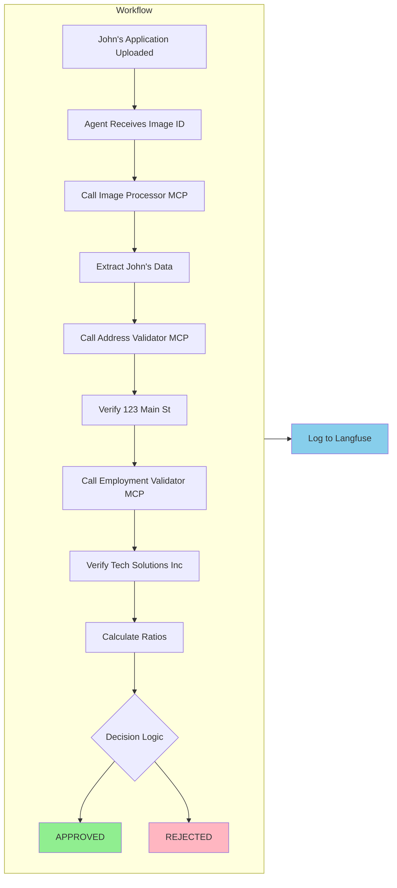

# How the Application Processes John's Loan

Now that you have seen John Michael Doe's loan application and understand the business problem, this section explains how the AI processes it. Each component in this architecture has a specialized role.

  

*The application that will be processed automatically*

## Understanding LangGraph and LangChain

Before examining the components, it is important to understand the AI frameworks that Loan Buddy uses:

### **LangGraph - The Workflow Orchestrator**

[LangGraph](https://github.com/langchain-ai/langgraph) coordinates the AI system. It:
- **Manages state** across multiple AI calls (tracks what has been done)
- **Orchestrates workflows** (determines what to do next based on results)
- **Handles errors** (retries, fallbacks, alternative paths)
- **Tracks progress** through complex multi-step processes

:::code{language=python showCopyAction=true}
# In our agent, LangGraph creates the workflow:
from langgraph.prebuilt import create_react_agent

# This creates an agent that can:
# 1. React to inputs
# 2. Use tools (MCP servers)
# 3. Maintain state across steps
# 4. Make decisions
graph = create_react_agent(model, tools, debug=True)
:::

### **LangChain - The Foundation**

[LangChain](https://github.com/langchain-ai/langchain) provides the building blocks:
- **LLM integration** (connects to Claude via your LiteLLM gateway)
- **Tool abstractions** (standardizes how AI uses external tools)
- **Memory management** (keeps context across interactions)
- **Prompt templates** (structures instructions to the AI)

:::code{language=python showCopyAction=true}
# LangChain connects to your platform:
from langchain_openai import ChatOpenAI

model = ChatOpenAI(
    model="bedrock/claude-4.5-sonnet",
    api_key=model_key,
    base_url="http://litellm.litellm.svc.cluster.local:4000"  # Your gateway!
)
:::

## The MCP Servers

**MCP (Model Context Protocol)** servers are specialized services, each responsible for one task. The following servers process John's application:

### **1. Image Processor MCP - Document Extraction**

**Function**: Extract structured data from John's loan application image

:::code{language=bash showCopyAction=true}
# Let's examine this MCP server's code:
code /workshop/workshops/eks-genai-workshop/static/code/module3/credit-validation/mcp-image-processor.py
:::

**How it works:**
1. **Receives** John's application image ID
2. **Retrieves** the image from S3 storage
3. **Uses Claude's vision capability** to read and understand the document
4. **Extracts** structured JSON data

**What it extracts from John's application:**
:::code{language=json showCopyAction=true}
{
    "name": "John Michael Doe",
    "date_of_birth": "March 15, 1985",
    "ssn_last_4": "7890",
    "email": "john.doe@email.com",
    "employer": "Tech Solutions Inc",
    "job_title": "Software Engineer",
    "annual_income": 75000,
    "address": "123 Main Street",
    "city": "Anytown",
    "state": "CA",
    "zip": "90210",
    "loan_amount": 8500,
    "loan_purpose": "Home Improvement"
}
:::

**Key insight**: The image is not sent with every AI call (which would be expensive). Instead, it is stored once in S3 and referenced by ID.

### **2. Address Validator MCP - Address Verification**

**Function**: Verify John's address is real and assess risk

:::code{language=bash showCopyAction=true}
# Examine the address validator:
code /workshop/workshops/eks-genai-workshop/static/code/module3/credit-validation/mcp-address-validator.py
:::

**What it does with "123 Main Street, Anytown, CA 90210":**
1. **Validates** the address format and ZIP code
2. **Checks** if it is residential (not a PO Box)
3. **Assesses** fraud risk indicators
4. **Verifies** ownership status (John owns the home)
5. **Calculates** stability score (4 years = high stability)

**Returns for John:**
:::code{language=python showCopyAction=true}
{
    "validation_status": "VALID",
    "is_residential": True,
    "address_type": "Single Family",
    "occupancy_status": "Owner Occupied",
    "risk_score": 15,  # Low risk
    "years_at_address": 4,
    "recommendation": "Address verified successfully. Proceed with application."
}
:::

### **3. Employment Validator MCP - Employment Verification**

**Function**: Verify John's employment and income claims

:::code{language=bash showCopyAction=true}
# Examine the employment validator:
code /workshop/workshops/eks-genai-workshop/static/code/module3/credit-validation/mcp-income-employment-validator.py
:::

**What it verifies about Tech Solutions Inc:**
1. **Employment status** (Full-time Software Engineer)
2. **Income accuracy** ($75,000 annual / $6,250 monthly)
3. **Employment duration** (3.5 years)
4. **Stability assessment** (consistent employment history)

**Returns for John:**
:::code{language=python showCopyAction=true}
{
    "validation_status": "PASSED",
    "employment_verified": True,
    "income_verified": True,
    "verified_employer": "Tech Solutions Inc",
    "verified_income": 75000,
    "employment_years": 3.5,
    "stability_score": 85,  # High stability
    "recommendation": "Employment and income verified successfully."
}
:::

## The Orchestrator: How the Agent Brings It All Together

The Loan Processing Agent coordinates the workflow. Here is how it processes John's application:

:::code{language=bash showCopyAction=true}

## Open the main agent to see the orchestration:

code /workshop/workshops/eks-genai-workshop/static/code/module3/credit-validation/credit-underwriting-agent.py
:::

Note that the instructions provided in the code are in plain English. Based on these instructions, the LLM creates the workflow described below. This reduces the effort required to translate requirements into code. As LLM capabilities improve, building systems this way becomes increasingly practical.

### **The Agent's Workflow for John:**



### **The System Prompt - The Agent's Instructions**

The agent follows instructions written in plain English:

:::code{language=python showCopyAction=true}
system_prompt = """You are a helpful AI assistant for credit underwriting.

Your task is to process credit applications by:

1. First, extract credit application data from the uploaded document
2. Then validate the extracted information using validation tools
3. Make a final credit decision based on all validation results
4. Present a comprehensive credit assessment

You have access to these MCP tools:

- extract_credit_application_data: Extract applicant information
- validate_address: Verify address information
- validate_income_employment: Verify employment and income

"""
:::

**Key Insight**: No complex programming is required -- just clear instructions in English.

## Platform Integration: How It All Connects

Examine the deployment configuration to see how the components connect:

:::code{language=bash showCopyAction=true}
# Open the deployment file:
code /workshop/workshops/eks-genai-workshop/static/code/module3/credit-validation/agentic-application-deployment.yaml
:::

### **Key Integration Points:**

::::tabs

:::tab{label="LiteLLM Gateway"}

```yaml
- name: GATEWAY_URL
  value: "http://litellm.litellm.svc.cluster.local:4000"
- name: GATEWAY_MODEL_ACCESS_KEY
  value: "your-api-key"
```
**All AI requests route through your gateway** - no direct model calls.
:::

:::tab{label="Langfuse Observability"}
```yaml
- name: LANGFUSE_URL
  value: "http://langfuse-web.langfuse.svc.cluster.local:3000"
- name: LANGFUSE_PUBLIC_KEY
  value: "your-public-key"
- name: LANGFUSE_SECRET_KEY
  value: "your-secret-key"
- name: OTEL_EXPORTER_OTLP_TRACES_ENDPOINT
  value: "http://langfuse-web.langfuse.svc.cluster.local:3000/api/public/otel/v1/traces"
- name: OTEL_EXPORTER_OTLP_HEADERS           # echo -n "public_key:secret_key" | base64
  value: "Authorization=Basic <base64-encoded-credentials>"
```

**Dual-Layer Tracing** - this application is traced at two levels:

1. **Application Layer** (Langfuse SDK): The agent uses LangChain's `CallbackHandler` to trace the entire workflow - agent reasoning, tool selection, MCP tool calls, and final decisions
2. **Gateway Layer** (LiteLLM Callbacks): Every LLM API call through LiteLLM is automatically traced with token counts, costs, and latency

**What gets captured in Langfuse:**
- Complete agent workflow from input to decision
- Each MCP tool invocation and its result (image extraction, address validation, employment verification)
- LLM reasoning steps and token usage
- End-to-end processing time and cost

::alert[**Production Tip**: MCP tool calls are captured at the agent level (input/output), but the internal execution of each MCP server (e.g., S3 image retrieval latency, validation processing time) is not individually instrumented. For production deployments, consider adding OpenTelemetry spans inside each MCP server for deeper performance visibility.]{type="info"}
:::

:::tab{label="MCP Communication"}
```yaml
- name: MCP_ADDRESS_VALIDATOR
  value: "http://mcp-address-validator:8000"
- name: MCP_EMPLOYMENT_VALIDATOR
  value: "http://mcp-employment-validator:8000"
```
**Internal Kubernetes networking** - secure and fast.
:::

:::tab{label="S3 Storage"}
```yaml
- name: S3_BUCKET_NAME
  value: "langfuse"
- name: S3_ENDPOINT_URL
  value: "http://langfuse-s3.langfuse.svc.cluster.local:9000"
```
**Images stored once** - referenced by ID for efficiency.
:::

::::

## Why This Architecture Matters

### **Separation of Concerns**
- Each MCP server has one responsibility
- The agent orchestrates but does not implement business logic
- Platform components (LiteLLM, Langfuse) handle infrastructure

### **Scalability**
- MCP servers can be scaled independently
- Multiple agents can share the same MCP servers
- Platform components handle load balancing

### **Maintainability**
- Update business rules in MCP servers without touching the agent
- Add new validation tools without changing existing code
- Observability makes debugging straightforward

### **Cost Optimization**
- Images processed once and cached
- Efficient token usage (no image in every call)
- Shared infrastructure reduces overhead

## Challenge: Extend the System

**Question**: How would you add a new validation rule that requires the monthly payment to be less than 25% of monthly income?

**Hint**: You could either:
1. Add logic to the Employment Validator MCP to check this ratio
2. Create a new "Debt Ratio Calculator" MCP server
3. Add the check to the agent's system prompt

Consider the trade-offs of each approach.

## What's Next?

Now that you understand how the components work together to process John's loan application, the next step is to deploy the application. In the next section, you will:

1. Deploy all four components to your EKS cluster
2. Process John's application
3. Watch the real-time logs as the AI makes decisions
4. Explore the complete workflow in Langfuse

---

**[Next: Deploy and Test Your Application →](../running-application/)**
