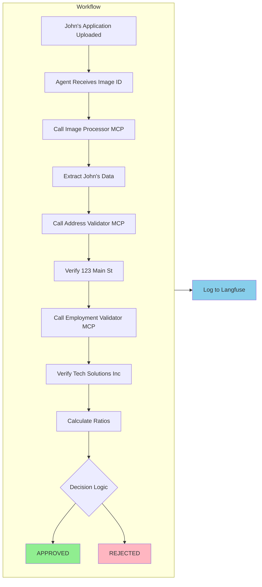

# 애플리케이션이 John의 대출을 처리하는 방식

John Michael Doe의 대출 신청서를 확인하고 비즈니스 문제를 이해했으므로, 이 섹션에서는 AI가 이를 실제로 어떻게 처리하는지 설명합니다. 이 아키텍처의 각 구성요소는 전문화된 역할을 담당합니다.

  

*자동으로 처리할 신청서*

## LangGraph와 LangChain 이해

구성요소를 살펴보기 전에 Loan Buddy가 사용하는 AI 프레임워크를 이해해야 합니다:

### **LangGraph - 워크플로우 오케스트레이터**

[LangGraph](https://github.com/langchain-ai/langgraph)는 AI 시스템을 조율합니다. 다음을 수행합니다:
- **상태 관리**: 여러 AI 호출에 걸쳐 수행된 작업을 추적합니다
- **워크플로우 오케스트레이션**: 결과에 따라 다음에 수행할 작업을 결정합니다
- **오류 처리**: 재시도, 폴백, 대체 경로를 지원합니다
- **진행 상황 추적**: 복잡한 다단계 프로세스를 추적합니다

:::code{language=python showCopyAction=true}
# 에이전트에서 LangGraph는 워크플로우를 생성합니다:
from langgraph.prebuilt import create_react_agent

# 다음을 수행할 수 있는 에이전트를 생성합니다:
# 1. 입력에 반응
# 2. 도구 사용 (MCP 서버)
# 3. 단계 간 상태 유지
# 4. 결정 내리기
graph = create_react_agent(model, tools, debug=True)
:::

### **LangChain - 기반**

[LangChain](https://github.com/langchain-ai/langchain)은 구성 요소를 제공합니다:
- **LLM 통합**: LiteLLM 게이트웨이를 통해 Claude에 연결합니다
- **도구 추상화**: AI가 외부 도구를 사용하는 방식을 표준화합니다
- **메모리 관리**: 상호작용 간 컨텍스트를 유지합니다
- **프롬프트 템플릿**: AI에 대한 지시사항을 구조화합니다

:::code{language=python showCopyAction=true}
# LangChain이 플랫폼에 연결:
from langchain_openai import ChatOpenAI

model = ChatOpenAI(
    model="bedrock/claude-4.5-sonnet",
    api_key=model_key,
    base_url="http://litellm.litellm.svc.cluster.local:4000"  # 게이트웨이!
)
:::

## MCP 서버

**MCP (Model Context Protocol)** 서버는 각각 한 가지 작업을 담당하는 전문화된 서비스입니다. 다음 서버들이 John의 신청서를 처리합니다:

### **1. Image Processor MCP - 문서 데이터 추출**

**기능**: John의 대출 신청서 이미지에서 구조화된 데이터 추출

:::code{language=bash showCopyAction=true}
# 이 MCP 서버의 코드를 검토합니다:
code /workshop/workshops/eks-genai-workshop/static/code/module3/credit-validation/mcp-image-processor.py
:::

**작동 방식:**
1. John의 신청서 이미지 ID를 **수신**합니다
2. S3 스토리지에서 이미지를 **검색**합니다
3. **Claude의 비전 기능을 사용**하여 문서를 읽고 이해합니다
4. 구조화된 JSON 데이터를 **추출**합니다

**John의 신청서에서 추출하는 내용:**
:::code{language=json showCopyAction=true}
{
    "name": "John Michael Doe",
    "date_of_birth": "March 15, 1985",
    "ssn_last_4": "7890",
    "email": "john.doe@email.com",
    "employer": "Tech Solutions Inc",
    "job_title": "Software Engineer",
    "annual_income": 75000,
    "address": "123 Main Street",
    "city": "Anytown",
    "state": "CA",
    "zip": "90210",
    "loan_amount": 8500,
    "loan_purpose": "Home Improvement"
}
:::

**핵심 인사이트**: 이미지는 모든 AI 호출과 함께 전송되지 않습니다(비용이 높기 때문입니다). 대신 S3에 한 번 저장되고 ID로 참조됩니다.

### **2. Address Validator MCP - 주소 검증**

**기능**: John의 주소가 실제 주소인지 확인하고 위험을 평가

:::code{language=bash showCopyAction=true}
# 주소 검증기 검토:
code /workshop/workshops/eks-genai-workshop/static/code/module3/credit-validation/mcp-address-validator.py
:::

**"123 Main Street, Anytown, CA 90210"에 대해 수행하는 작업:**
1. 주소 형식 및 우편번호를 **검증**합니다
2. 주거용인지(PO Box가 아닌지) **확인**합니다
3. 사기 위험 지표를 **평가**합니다
4. 소유 상태를 **검증**합니다 (John이 주택 소유)
5. 안정성 점수를 **계산**합니다 (4년 = 높은 안정성)

**John에 대한 반환값:**
:::code{language=python showCopyAction=true}
{
    "validation_status": "VALID",
    "is_residential": True,
    "address_type": "Single Family",
    "occupancy_status": "Owner Occupied",
    "risk_score": 15,  # 낮은 위험
    "years_at_address": 4,
    "recommendation": "Address verified successfully. Proceed with application."
}
:::

### **3. Employment Validator MCP - 고용 검증**

**기능**: John의 고용 및 소득 정보 확인

:::code{language=bash showCopyAction=true}
# 고용 검증기 검토:
code /workshop/workshops/eks-genai-workshop/static/code/module3/credit-validation/mcp-income-employment-validator.py
:::

**Tech Solutions Inc에 대해 확인하는 내용:**
1. **고용 상태** (정규직 Software Engineer)
2. **소득 정확성** ($75,000 연봉 / $6,250 월급)
3. **고용 기간** (3.5년)
4. **안정성 평가** (일관된 고용 이력)

**John에 대한 반환값:**
:::code{language=python showCopyAction=true}
{
    "validation_status": "PASSED",
    "employment_verified": True,
    "income_verified": True,
    "verified_employer": "Tech Solutions Inc",
    "verified_income": 75000,
    "employment_years": 3.5,
    "stability_score": 85,  # 높은 안정성
    "recommendation": "Employment and income verified successfully."
}
:::

## 오케스트레이터: 에이전트가 모든 것을 통합하는 방식

Loan Processing Agent는 워크플로우를 조율합니다. John의 신청서를 다음과 같이 처리합니다:

:::code{language=bash showCopyAction=true}

## 오케스트레이션을 보기 위해 주요 에이전트를 엽니다:

code /workshop/workshops/eks-genai-workshop/static/code/module3/credit-validation/credit-underwriting-agent.py
:::

코드에 제공된 지시사항이 평이한 영어로 작성되어 있다는 점에 주목하십시오. 이 지시사항에 따라 LLM이 아래에 설명된 워크플로우를 생성합니다. 이를 통해 요구사항을 코드로 전환하는 데 필요한 노력이 줄어듭니다. LLM의 기능이 향상됨에 따라 이러한 방식의 시스템 구축은 점점 더 실용적이 되고 있습니다.

### **John을 위한 에이전트의 워크플로우:**



### **시스템 프롬프트 - 에이전트의 지시사항**

에이전트는 평이한 영어로 작성된 지시사항을 따릅니다:

:::code{language=python showCopyAction=true}
system_prompt = """You are a helpful AI assistant for credit underwriting.

Your task is to process credit applications by:

1. First, extract credit application data from the uploaded document
2. Then validate the extracted information using validation tools
3. Make a final credit decision based on all validation results
4. Present a comprehensive credit assessment

You have access to these MCP tools:

- extract_credit_application_data: Extract applicant information
- validate_address: Verify address information
- validate_income_employment: Verify employment and income

"""
:::

**핵심 인사이트**: 복잡한 프로그래밍이 필요하지 않습니다. 영어로 작성된 명확한 지시사항이면 충분합니다.

## 플랫폼 통합: 모든 것이 연결되는 방식

배포 구성을 검토하여 구성요소가 어떻게 연결되는지 확인합니다:

:::code{language=bash showCopyAction=true}
# 배포 파일 열기:
code /workshop/workshops/eks-genai-workshop/static/code/module3/credit-validation/agentic-application-deployment.yaml
:::

### **주요 통합 지점:**

::::tabs

:::tab{label="LiteLLM Gateway"}

```yaml
- name: GATEWAY_URL
  value: "http://litellm.litellm.svc.cluster.local:4000"
- name: GATEWAY_MODEL_ACCESS_KEY
  value: "your-api-key"
```
**모든 AI 요청이 게이트웨이를 통해 라우팅됩니다** - 직접 모델 호출이 없습니다.
:::

:::tab{label="Langfuse Observability"}
```yaml
- name: LANGFUSE_URL
  value: "http://langfuse-web.langfuse.svc.cluster.local:3000"
- name: LANGFUSE_PUBLIC_KEY
  value: "your-public-key"
- name: LANGFUSE_SECRET_KEY
  value: "your-secret-key"
- name: OTEL_EXPORTER_OTLP_TRACES_ENDPOINT
  value: "http://langfuse-web.langfuse.svc.cluster.local:3000/api/public/otel/v1/traces"
- name: OTEL_EXPORTER_OTLP_HEADERS           # echo -n "public_key:secret_key" | base64
  value: "Authorization=Basic <base64-encoded-credentials>"
```

**이중 레이어 추적** - 이 애플리케이션은 두 레벨에서 추적됩니다:

1. **애플리케이션 레이어** (Langfuse SDK): 에이전트는 LangChain의 `CallbackHandler`를 사용하여 에이전트 추론, 도구 선택, MCP 도구 호출, 최종 결정 등 전체 워크플로우를 추적합니다
2. **게이트웨이 레이어** (LiteLLM Callbacks): LiteLLM을 통한 모든 LLM API 호출은 토큰 수, 비용, 지연시간과 함께 자동으로 추적됩니다

**Langfuse에서 캡처되는 내용:**
- 입력에서 결정까지 완전한 에이전트 워크플로우
- 각 MCP 도구 호출 및 결과 (이미지 추출, 주소 검증, 고용 확인)
- LLM 추론 단계 및 토큰 사용량
- 엔드투엔드 처리 시간 및 비용

::alert[**프로덕션 팁**: MCP 도구 호출은 에이전트 레벨에서 입력/출력으로 캡처되지만, 각 MCP 서버의 내부 실행(예: S3 이미지 검색 지연시간, 검증 처리 시간)은 개별적으로 계측되지 않습니다. 프로덕션 배포에서는 더 깊은 성능 가시성을 위해 각 MCP 서버 내부에 OpenTelemetry 스팬을 추가하는 것을 고려하십시오.]{type="info"}
:::

:::tab{label="MCP Communication"}
```yaml
- name: MCP_ADDRESS_VALIDATOR
  value: "http://mcp-address-validator:8000"
- name: MCP_EMPLOYMENT_VALIDATOR
  value: "http://mcp-employment-validator:8000"
```
**내부 Kubernetes 네트워킹** - 안전하고 빠릅니다.
:::

:::tab{label="S3 Storage"}
```yaml
- name: S3_BUCKET_NAME
  value: "langfuse"
- name: S3_ENDPOINT_URL
  value: "http://langfuse-s3.langfuse.svc.cluster.local:9000"
```
**이미지는 한 번 저장됩니다** - 효율성을 위해 ID로 참조합니다.
:::

::::

## 이 아키텍처가 중요한 이유

### **관심사의 분리**
- 각 MCP 서버는 하나의 책임만 담당합니다
- 에이전트는 오케스트레이션만 수행하고 비즈니스 로직을 구현하지 않습니다
- 플랫폼 구성요소(LiteLLM, Langfuse)가 인프라를 처리합니다

### **확장성**
- MCP 서버는 독립적으로 확장할 수 있습니다
- 여러 에이전트가 동일한 MCP 서버를 공유할 수 있습니다
- 플랫폼 구성요소가 로드 밸런싱을 처리합니다

### **유지보수성**
- 에이전트를 변경하지 않고 MCP 서버의 비즈니스 규칙을 업데이트할 수 있습니다
- 기존 코드를 변경하지 않고 새로운 검증 도구를 추가할 수 있습니다
- 관측성 덕분에 디버깅이 수월합니다

### **비용 최적화**
- 이미지는 한 번 처리되고 캐시됩니다
- 효율적인 토큰 사용 (모든 호출에 이미지를 포함하지 않음)
- 공유 인프라로 오버헤드를 줄입니다

## 도전 과제: 시스템 확장

**질문**: 월 지불액이 월 소득의 25% 미만이어야 한다는 새로운 검증 규칙을 어떻게 추가하시겠습니까?

**힌트**: 다음 중 하나를 선택할 수 있습니다:
1. 이 비율을 확인하는 로직을 Employment Validator MCP에 추가
2. 새로운 "Debt Ratio Calculator" MCP 서버 생성
3. 에이전트의 시스템 프롬프트에 확인 로직 추가

각 접근 방식의 장단점을 검토해 보십시오.

## 다음 단계

모든 구성요소가 John의 대출 신청서를 처리하기 위해 어떻게 함께 작동하는지 이해했으므로, 다음 단계에서는 애플리케이션을 배포합니다. 다음 섹션에서는:

1. EKS 클러스터에 네 가지 구성요소를 모두 배포합니다
2. John의 신청서를 처리합니다
3. AI가 결정을 내리는 동안 실시간 로그를 확인합니다
4. Langfuse에서 전체 워크플로우를 살펴봅니다

---

**[다음: 애플리케이션 배포 및 테스트 →](../running-application/)**
