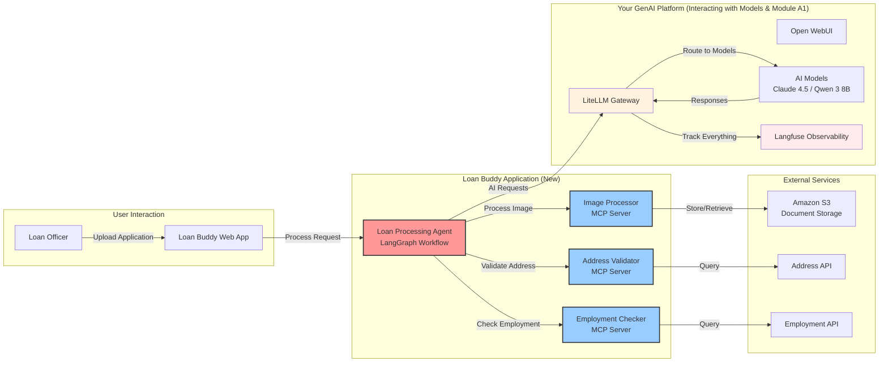

With a functional GenAI platform comprising models, a gateway, and observability in place, this module puts it to practical use. You will use your platform to build "Loan Buddy," a loan processing application that demonstrates how AI agents can automate complex business workflows.

::alert[**Platform Required**: This module builds on your GenAI platform from Interacting with Models & Module A1. Please complete those modules first if you have not already.]{type="warning"}

## Learning Objectives

By the end of this module, you will:

- **Build an AI application** using your platform from Interacting with Models & Module A1
- **Deploy agents** that make business decisions automatically
- **Use Model Context Protocol (MCP)** to give AI agents external tools and capabilities
- **Track agent workflows** in Langfuse
- **Understand application architecture** for AI agents on Kubernetes
- **Evaluate the business value** of AI automation

## Application Architecture

**Loan Buddy** automates a manual loan processing workflow using your GenAI platform.
The following diagram shows how Loan Buddy uses the platform:

**Key Integration Points:**
- **Uses your LiteLLM Gateway** from Module A1 for all AI requests
- **Tracked in Langfuse** from Module A1 for observability
- **Uses your models** from Interacting with Models (Claude 4.5 recommended)
- **Deployed on EKS** using the same patterns as previous modules

## Module Structure

This module is organized into three hands-on sections:

#### 1. [Understanding the Use Case](./usecase/)
**Business Context and Requirements**
- Review the loan processing business problem
- Understand the AI solution architecture
- Preview the application components and workflow

#### 2. [Application Components](./application-components/)
**Technical Deep Dive**
- Examine the LangGraph agent workflow
- Review MCP servers and their capabilities
- Understand how components integrate with your platform

#### 3. [Running the Application](./running-application/)
**Hands-On Deployment and Testing**
- Deploy Loan Buddy on your EKS cluster
- Test the application with sample loan documents
- Observe the complete workflow in Langfuse

## Key concepts

This module demonstrates the following AI application patterns:

- **Platform Integration**: Uses the infrastructure you built in previous modules
- **Business Value**: Addresses a concrete business problem with measurable outcomes
- **Observability**: Every agent decision is tracked and auditable
- **AI Frameworks**: LangGraph for workflow orchestration, MCP for tool integration
- **Kubernetes Native**: Deployed using the same patterns as your platform components

## Key Technologies You Will Use

::::tabs

:::tab{label="AI Frameworks"}
- **LangGraph** - Workflow orchestration for AI agents
- **LangChain** - Foundation for building AI applications
- **Model Context Protocol** - Tool integration standard
- **Pydantic** - Data validation and serialization
:::

:::tab{label="Platform Integration"}
- **Your LiteLLM Gateway** - Routes all AI requests
- **Your Langfuse Instance** - Tracks all agent activities
- **Your EKS Cluster** - Hosts the application components
- **Claude 4.5 Sonnet** - Recommended model for complex reasoning
:::

:::tab{label="Application Components"}
- **Loan Processing Agent** - Main workflow orchestrator
- **Address Validator** - MCP server for address verification
- **Employment Checker** - MCP server for employment validation
- **Image Processor** - MCP server for document analysis
:::

::::

## Expected Outcomes

By completing this module, you will have:

- A working AI application deployed on your EKS cluster
- Workflow visibility in Langfuse showing each agent decision
- Understanding of AI agent patterns for business automation
- Experience with MCP integration for extending AI capabilities
- Practical knowledge of deploying AI applications on Kubernetes

## Getting Started

Begin by understanding the business use case and how AI agents can automate loan processing workflows.

::alert[**Tip**: Keep Langfuse open in a browser tab throughout this module - you can observe your agent workflows appear in real time as the application processes loan applications.]{type="info"}

---

**[Next: Understanding the Use Case →](./usecase/)**
