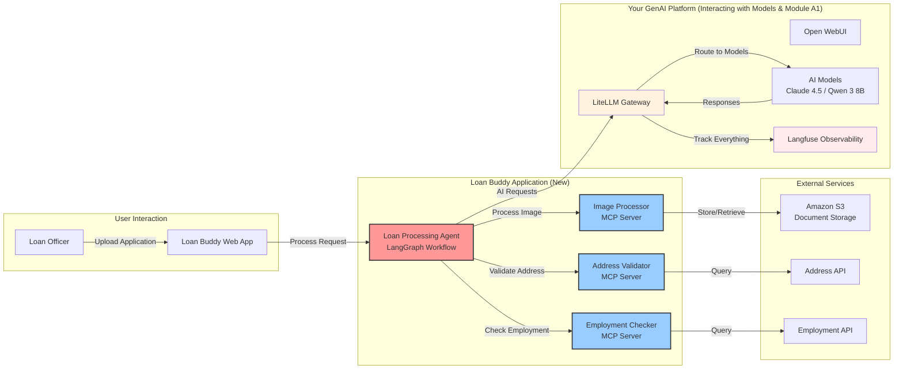

모델, 게이트웨이, 관측성을 갖춘 Agentic AI 플랫폼을 구축했으므로, 이 모듈에서는 플랫폼을 실제로 활용합니다. 플랫폼을 사용하여 "Loan Buddy"라는 대출 처리 애플리케이션을 구축하면서 AI 에이전트가 복잡한 비즈니스 워크플로우를 어떻게 자동화하는지 살펴봅니다.

::alert[**플랫폼 필요**: 이 모듈은 모델과 상호작용하기 & 모듈 A1에서 구축한 GenAI 플랫폼을 기반으로 합니다. 아직 완료하지 않았다면 먼저 해당 모듈을 완료해 주십시오.]{type="warning"}

## 학습 목표

이 모듈을 마치면 다음을 할 수 있습니다:

- 모델과 상호작용하기 & 모듈 A1에서 구축한 플랫폼을 사용하여 **AI 애플리케이션을 구축**합니다
- 비즈니스 의사결정을 자동으로 수행하는 **에이전트를 배포**합니다
- **Model Context Protocol (MCP)** 을 사용하여 AI 에이전트에 외부 도구와 기능을 제공합니다
- Langfuse에서 **에이전트 워크플로우를 추적**합니다
- Kubernetes 기반 AI 에이전트의 **애플리케이션 아키텍처를 이해**합니다
- AI 자동화의 **비즈니스 가치를 평가**합니다

## 애플리케이션 아키텍처

**Loan Buddy** 는 Agentic AI 플랫폼을 사용하여 수동 대출 처리 워크플로우를 자동화합니다.
다음 다이어그램은 Loan Buddy가 플랫폼을 사용하는 방식을 보여줍니다:

**주요 통합 지점:**
- 모든 AI 요청에 모듈 A1의 **LiteLLM Gateway를 사용**합니다
- 관측성 확보를 위해 모듈 A1의 **Langfuse에서 추적**합니다
- 모델과 상호작용하기 모듈의 **모델을 사용**합니다 (Claude 4.5 권장)
- 이전 모듈과 동일한 패턴으로 **EKS에 배포**합니다

## 모듈 구조

이 모듈은 세 가지 실습 섹션으로 구성됩니다:

#### 1. [유스케이스 이해](./usecase/)
**비즈니스 컨텍스트 및 요구사항**
- 대출 처리 비즈니스 문제 검토
- AI 솔루션 아키텍처 이해
- 애플리케이션 구성요소 및 워크플로우 미리보기

#### 2. [애플리케이션 구성요소](./application-components/)
**기술 심층 분석**
- LangGraph 에이전트 워크플로우 검토
- MCP 서버 및 기능 검토
- 구성요소가 플랫폼과 통합되는 방식 이해

#### 3. [애플리케이션 실행](./running-application/)
**실습 배포 및 테스트**
- EKS 클러스터에 Loan Buddy 배포
- 샘플 대출 문서로 애플리케이션 테스트
- Langfuse에서 전체 워크플로우 확인

## 핵심 개념

이 모듈은 다음과 같은 AI 애플리케이션 패턴을 다룹니다:

- **플랫폼 통합**: 이전 모듈에서 구축한 인프라를 사용합니다
- **비즈니스 가치**: 측정 가능한 결과로 구체적인 비즈니스 문제를 해결합니다
- **관측성**: 모든 에이전트 결정이 추적되고 감사 가능합니다
- **AI 프레임워크**: 워크플로우 오케스트레이션에 LangGraph, 도구 통합에 MCP를 사용합니다
- **Kubernetes 네이티브**: 플랫폼 구성요소와 동일한 패턴으로 배포합니다

## 사용할 주요 기술

::::tabs

:::tab{label="AI Frameworks"}
- **LangGraph** - AI 에이전트를 위한 워크플로우 오케스트레이션
- **LangChain** - AI 애플리케이션 구축 기반
- **Model Context Protocol** - 도구 통합 표준
- **Pydantic** - 데이터 검증 및 직렬화
:::

:::tab{label="Platform Integration"}
- **Your LiteLLM Gateway** - 모든 AI 요청 라우팅
- **Your Langfuse Instance** - 모든 에이전트 활동 추적
- **Your EKS Cluster** - 애플리케이션 구성요소 호스팅
- **Claude 4.5 Sonnet** - 복잡한 추론을 위한 권장 모델
:::

:::tab{label="Application Components"}
- **Loan Processing Agent** - 주요 워크플로우 오케스트레이터
- **Address Validator** - 주소 검증을 위한 MCP 서버
- **Employment Checker** - 고용 검증을 위한 MCP 서버
- **Image Processor** - 문서 분석을 위한 MCP 서버
:::

::::

## 예상 결과

이 모듈을 완료하면 다음을 갖추게 됩니다:

- EKS 클러스터에 배포된 동작하는 AI 애플리케이션
- 각 에이전트 결정을 보여주는 Langfuse 워크플로우 가시성
- 비즈니스 자동화를 위한 AI 에이전트 패턴에 대한 이해
- AI 기능 확장을 위한 MCP 통합 경험
- Kubernetes에 AI 애플리케이션을 배포하는 실무 지식

## 시작하기

먼저 비즈니스 유스케이스를 이해하고 AI 에이전트가 대출 처리 워크플로우를 어떻게 자동화하는지 살펴봅니다.

::alert[**팁**: 이 모듈을 진행하는 동안 브라우저 탭에 Langfuse를 열어두십시오. 애플리케이션이 대출 신청을 처리할 때 에이전트 워크플로우가 실시간으로 나타나는 것을 확인할 수 있습니다.]{type="info"}

---

**[다음: 유스케이스 이해 →](./usecase/)**
