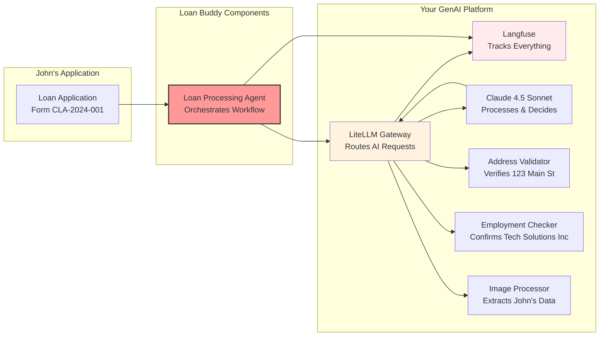

# The Manual Loan Review Problem

Consider a typical scenario: Sarah, a loan officer at Community Bank, receives a loan application from John Michael Doe at the end of the day.

 

*A typical personal loan application - Form CLA-2024-001*

To process this application manually, Sarah needs to:

- **Extract data**: Type in John's name, DOB (March 15, 1985), SSN ending in 7890
- **Verify employment**: Call Tech Solutions Inc to confirm John's Software Engineer position  
- **Validate income**: Verify the $75,000 annual income ($6,250/month)
- **Check address**: Confirm 123 Main Street, Anytown, CA 90210 is a real address
- **Assess stability**: Note he has been there 4 years, owns the home, employed 3.5 years
- **Calculate ratios**: $8,500 loan for home improvement, 36-month term, $275/month payment
- **Make decision**: Approve or deny based on all factors

This process takes 2-3 hours per application. In this module, you build an AI agent that completes it in about 2 minutes.

## Loan Buddy: An AI-Assisted Review Workflow

**Loan Buddy** uses your GenAI platform to automate the loan review process. It handles John's application as follows:

### What Loan Buddy Does:
1. **Reads the Application** using vision language models to extract all data from the image
2. **Validates Information** using external services (address verification, employment checks)
3. **Applies Business Rules** automatically (loan limits, income ratios, risk assessment)
4. **Makes Decisions** with complete audit trails in Langfuse
5. **Documents Everything** for compliance and future reference

### The Business Impact:
- **Processing Time**: 2-3 hours reduced to about 2 minutes
- **Consistency**: Same criteria applied every time, no human variance
- **Cost Savings**: Fewer manual review hours needed
- **Complete Audit Trail**: Every decision tracked and explainable in Langfuse
- **Applicant Experience**: Faster responses for applicants

## John's Application in Detail

### What Needs Processing:

::::tabs

:::tab{label="Personal Information"}
- **Full Name**: John Michael Doe
- **Date of Birth**: March 15, 1985  
- **SSN**: ***-**-7890 (last 4 digits)
- **Phone**: (555) 123-4567
- **Email**: john.doe@email.com
:::

:::tab{label="Employment Details"}
- **Employer**: Tech Solutions Inc
- **Position**: Software Engineer
- **Status**: Full-time
- **Years Employed**: 3.5 years
- **Annual Income**: $75,000
- **Monthly Income**: $6,250
:::

:::tab{label="Address Information"}
- **Street**: 123 Main Street
- **City**: Anytown, **State**: CA, **ZIP**: 90210
- **Housing Status**: Own
- **Years at Address**: 4 years
:::

:::tab{label="Loan Request"}
- **Amount**: $8,500
- **Purpose**: Home Improvement
- **Term**: 36 months
- **Estimated Payment**: $275/month
:::

::::

**The Challenge:** A bank may process hundreds of these applications weekly, each requiring manual verification of every detail.

## How Your GenAI Platform Supports This

The platform you built in Interacting with Models & Module A1 serves as the foundation for Loan Buddy:

**Key Integration Points:**
- **Uses your LiteLLM Gateway** for all AI requests (no direct model calls)
- **Tracked in Langfuse** for observability and compliance
- **Uses Claude 4.5 Sonnet** for complex reasoning and decision-making
- **Deployed on your EKS cluster** using the same patterns as previous modules

## What You Will Experience

When you deploy and test Loan Buddy with John's application, you will:

1. **Upload John's application image** -- the AI extracts his personal, employment, and loan data
2. **Watch real-time processing** -- the agent validates his address and verifies his employment at Tech Solutions Inc
3. **Observe decision-making** -- the AI calculates his debt-to-income ratio (4.4%)
4. **Explore complete traces** -- view the entire workflow in Langfuse with all tool calls and reasoning
5. **See the final decision** -- APPROVED with full justification and audit trail

## Key Insights

By the end of this module, you will understand:

- **How AI agents work** - Workflow orchestrators, not just chatbots
- **Tool integration** - How MCP servers extend AI capabilities with external data
- **Platform thinking** - How your GenAI infrastructure supports multiple applications
- **Business automation** - How AI agents reduce manual processing time
- **Observability** - Why every decision is tracked for compliance and optimization

## What's Next?

Now that you understand the business context, the next step is to examine the technical architecture. You will explore how the AI agent orchestrates the workflow and how each MCP server contributes to the decision-making process.

::alert[**Note**: In the next section, you will examine the actual code that drives this process. A few hundred lines of Python can automate hours of manual work.]{type="info"}

---

**[Next: Application Components →](../application-components/)**
