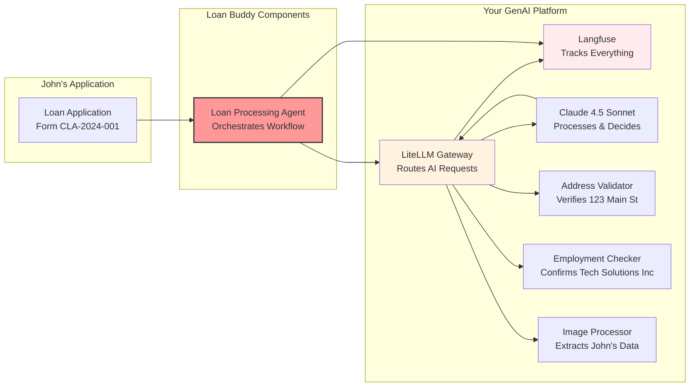

# 수동 대출 심사의 문제

일반적인 시나리오를 살펴보겠습니다. Community Bank의 대출 담당자 Sarah는 업무 마감 무렵 John Michael Doe의 대출 신청서를 접수합니다.

 

*일반적인 개인 대출 신청서 - 양식 CLA-2024-001*

이 신청서를 수동으로 처리하려면 Sarah는 다음 작업을 수행해야 합니다:

- **데이터 추출**: John의 이름, 생년월일(1985년 3월 15일), SSN 끝 7890 입력
- **고용 확인**: Tech Solutions Inc에 전화하여 John의 Software Engineer 직위 확인
- **소득 검증**: 연봉 $75,000 ($6,250/월) 확인
- **주소 검증**: 123 Main Street, Anytown, CA 90210이 실제 주소인지 확인
- **안정성 평가**: 4년 거주, 주택 소유, 3.5년 근무 사실 기록
- **비율 계산**: 주택 개선을 위한 $8,500 대출, 36개월 기간, 월 $275 상환
- **결정**: 모든 요소를 기반으로 승인 또는 거부

이 과정은 신청서 한 건당 2-3시간이 소요됩니다. 이 모듈에서는 이 작업을 약 2분 안에 완료하는 AI 에이전트를 구축합니다.

## Loan Buddy: AI 기반 심사 워크플로우

**Loan Buddy** 는 Agentic AI 플랫폼을 사용하여 대출 심사 프로세스를 자동화합니다. John의 신청서를 다음과 같이 처리합니다:

### Loan Buddy가 수행하는 작업:
1. **신청서 읽기**: 비전 언어 모델을 사용하여 이미지에서 모든 데이터를 추출합니다
2. **정보 검증**: 외부 서비스(주소 검증, 고용 확인)를 사용합니다
3. **비즈니스 규칙 적용**: 대출 한도, 소득 비율, 위험 평가를 자동으로 적용합니다
4. **결정**: Langfuse에 완전한 감사 추적을 남기며 결정을 내립니다
5. **문서화**: 규정 준수 및 향후 참조를 위해 모든 내용을 기록합니다

### 비즈니스 영향:
- **처리 시간**: 2-3시간에서 약 2분으로 단축
- **일관성**: 매번 동일한 기준 적용, 담당자별 편차 없음
- **비용 절감**: 수동 검토 시간 감소
- **완전한 감사 추적**: 모든 결정이 Langfuse에서 추적되고 설명 가능
- **신청자 경험**: 신청자에게 더 빠른 응답 제공

## John의 신청서 자세히 보기

### 처리해야 할 내용:

::::tabs

:::tab{label="Personal Information"}
- **Full Name**: John Michael Doe
- **Date of Birth**: March 15, 1985  
- **SSN**: ***-**-7890 (마지막 4자리)
- **Phone**: (555) 123-4567
- **Email**: john.doe@email.com
:::

:::tab{label="Employment Details"}
- **Employer**: Tech Solutions Inc
- **Position**: Software Engineer
- **Status**: Full-time
- **Years Employed**: 3.5년
- **Annual Income**: $75,000
- **Monthly Income**: $6,250
:::

:::tab{label="Address Information"}
- **Street**: 123 Main Street
- **City**: Anytown, **State**: CA, **ZIP**: 90210
- **Housing Status**: Own
- **Years at Address**: 4년
:::

:::tab{label="Loan Request"}
- **Amount**: $8,500
- **Purpose**: Home Improvement
- **Term**: 36개월
- **Estimated Payment**: $275/월
:::

::::

**과제:** 은행은 매주 수백 건의 이러한 신청서를 처리할 수 있으며, 각 신청서마다 모든 세부사항의 수동 검증이 필요합니다.

## GenAI 플랫폼이 이를 지원하는 방식

모델과 상호작용하기 & 모듈 A1에서 구축한 플랫폼이 Loan Buddy의 기반이 됩니다:

**주요 통합 지점:**
- 모든 AI 요청에 **LiteLLM Gateway를 사용**합니다 (직접 모델 호출 없음)
- 관측성 및 규정 준수를 위해 **Langfuse에서 추적**합니다
- 복잡한 추론 및 의사결정에 **Claude 4.5 Sonnet을 사용**합니다
- 이전 모듈과 동일한 패턴으로 **EKS 클러스터에 배포**합니다

## 실습에서 경험할 내용

John의 신청서로 Loan Buddy를 배포하고 테스트하면 다음을 확인할 수 있습니다:

1. **John의 신청서 이미지 업로드** -- AI가 개인, 고용, 대출 데이터를 추출합니다
2. **실시간 처리 관찰** -- 에이전트가 주소를 검증하고 Tech Solutions Inc의 고용 사실을 확인합니다
3. **의사결정 관찰** -- AI가 부채 대 소득 비율(4.4%)을 계산합니다
4. **전체 추적 확인** -- Langfuse에서 모든 도구 호출과 추론이 포함된 전체 워크플로우를 확인합니다
5. **최종 결정 확인** -- 완전한 근거 및 감사 추적과 함께 승인됩니다

## 핵심 인사이트

이 모듈을 마치면 다음을 이해하게 됩니다:

- **AI 에이전트 작동 방식** - 단순한 챗봇이 아닌 워크플로우 오케스트레이터
- **도구 통합** - MCP 서버가 외부 데이터로 AI 기능을 확장하는 방식
- **플랫폼 사고** - Agentic AI 인프라가 여러 애플리케이션을 지원하는 방식
- **비즈니스 자동화** - AI 에이전트가 수동 처리 시간을 줄이는 방식
- **관측성** - 규정 준수 및 최적화를 위해 모든 결정을 추적하는 이유

## 다음 단계

비즈니스 컨텍스트를 이해했으므로 다음 단계에서는 기술 아키텍처를 살펴봅니다. AI 에이전트가 워크플로우를 오케스트레이션하는 방식과 각 MCP 서버가 의사결정 프로세스에 기여하는 방식을 확인합니다.

::alert[**참고**: 다음 섹션에서는 이 프로세스를 구동하는 실제 코드를 검토합니다. 몇 백 줄의 Python 코드로 몇 시간의 수동 작업을 자동화할 수 있습니다.]{type="info"}

---

**[다음: 애플리케이션 구성요소 →](../application-components/)**
