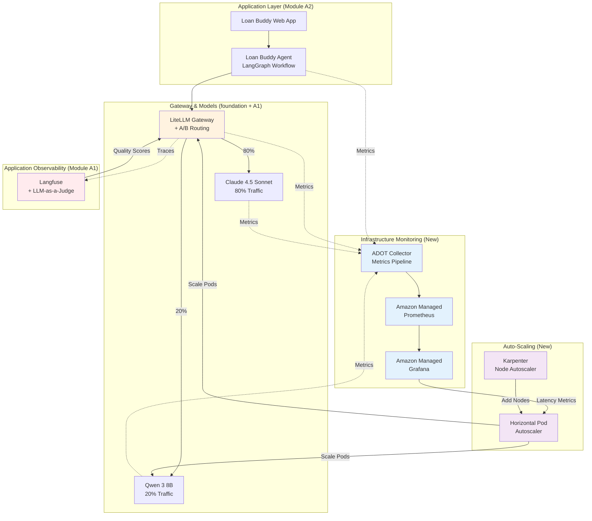

Your Loan Buddy agent is performing well, but increased usage introduces new requirements. After a successful marketing campaign, the platform must handle 1,000+ loan applications per hour while maintaining consistent quality and infrastructure health.

::alert[**Platform Required**: This module builds on the foundation plus Modules A1-A2. You'll add evaluation, routing, and monitoring capabilities to your existing GenAI platform.]{type="warning"}

## Learning Objectives

By the end of this module, you will:

- Evaluate LLM quality using Langfuse's LLM-as-a-Judge capabilities
- Implement A/B testing with weighted model routing in LiteLLM
- Monitor infrastructure with Amazon Managed Prometheus and Grafana
- Auto-scale workloads using HPA and Karpenter
- Analyze cost and quality trade-offs using evaluation data
- Build dual-layer observability for both application and infrastructure metrics

## Business Scenario: Loan Buddy at Scale

Your Loan Buddy agent has been processing loan applications for a few weeks. The bank launches a major marketing campaign promoting instant AI-powered loan decisions.

**The Challenge:**
- Application volume increased from 50/hour to 1,000+/hour overnight
- The CFO requires cost optimization without sacrificing quality
- The compliance team requires quality audits on every decision
- The infrastructure team must ensure platform reliability

**Your Task:**
Build production-grade evaluation, routing, and monitoring capabilities to handle this scale while maintaining quality and controlling costs.

## Module Architecture

The following diagram shows how the new capabilities integrate with your existing platform:

## Module Structure

This module is organized into three hands-on sections:

#### 1. [LLM Evaluation with Langfuse](./evaluation/)
**Quality Assessment and Validation**
- Understand LLM-as-a-Judge evaluation methodology
- Configure evaluation templates in Langfuse
- Run quality assessments on Loan Buddy decisions
- Build evaluation dashboards and scoring systems

#### 2. [A/B Model Routing with LiteLLM](./model-routing/)
**Cost Optimization Through Weighted Routing**
- Configure weighted traffic splitting (80/20 Claude vs Qwen)
- Compare cost vs quality trade-offs across models
- Analyze performance differences in Langfuse
- Make data-driven model selection decisions

#### 3. [Infrastructure Monitoring and Auto-Scaling](./monitoring-scaling/)
**Production-Ready Observability and Scaling**
- Deploy ADOT Collector for metrics aggregation
- Configure Amazon Managed Prometheus workspace
- Build GenAI-specific dashboards in Grafana
- Implement HPA and Karpenter for auto-scaling

## Key concepts

This module covers production-grade GenAI platform operations:

- **Quality at scale**: Automated evaluation maintains consistent quality as volume grows
- **Cost optimization**: A/B testing identifies opportunities to reduce costs by 70% or more without quality loss
- **Dual-layer observability**: Application metrics (Langfuse) and infrastructure metrics (Prometheus/Grafana)
- **Elastic infrastructure**: Auto-scaling handles traffic spikes without manual intervention
- **Data-driven decisions**: Metrics guide model selection, capacity planning, and optimization

## Key Technologies

::::tabs

:::tab{label="Evaluation & Quality"}
- **Langfuse LLM-as-a-Judge** - Automated quality evaluation
- **Evaluation Templates** - Standardized scoring criteria
- **Quality Dashboards** - Real-time quality monitoring
- **Comparative Analysis** - Model performance benchmarking
:::

:::tab{label="Routing & Optimization"}
- **LiteLLM Router** - Weighted traffic distribution
- **Model Fallbacks** - Automatic failover on errors
- **Cost Tracking** - Real-time spend monitoring
- **A/B Testing** - Statistical comparison of model variants
:::

:::tab{label="Infrastructure Monitoring"}
- **ADOT Collector** - OpenTelemetry metrics pipeline
- **Amazon Managed Prometheus (AMP)** - Scalable metrics storage
- **Amazon Managed Grafana (AMG)** - Visualization and alerting
- **Prometheus Exporters** - vLLM, LiteLLM, Neuron metrics
:::

:::tab{label="Auto-Scaling"}
- **Horizontal Pod Autoscaler (HPA)** - Pod-level scaling
- **Karpenter** - Node-level auto-provisioning
- **Custom Metrics** - Scale based on request latency
- **Cost-Aware Scaling** - Balance performance and cost
:::

::::

## Expected Outcomes

By completing this module, you will have:

- Automated quality evaluation running on every Loan Buddy decision
- A/B testing infrastructure comparing Claude 4.5 Sonnet and Qwen 3 8B
- Production monitoring with Prometheus and Grafana dashboards
- Auto-scaling infrastructure that handles traffic spikes automatically
- A cost optimization strategy backed by data showing a savings opportunity of 70% or more
- Observability across application and infrastructure layers

## Real-World Impact

This module addresses common production challenges:

| Challenge | Solution | Impact |
|-----------|----------|--------|
| **Quality at scale** | LLM-as-a-Judge evaluation | 100% automated quality auditing |
| **Cost pressure** | A/B routing with lower-cost models | 70%+ cost reduction on eligible requests |
| **Visibility gaps** | Dual-layer observability | Full system health insight |
| **Traffic spikes** | HPA + Karpenter auto-scaling | Automated capacity management |
| **Optimization** | Data-driven analysis | Evidence-based infrastructure decisions |

## Getting Started

Begin by setting up automated quality evaluation so that every Loan Buddy decision is checked against your quality standards.

::alert[**Tip**: Keep both Langfuse and Grafana open in browser tabs throughout this module. This lets you observe both layers as you work: application-level traces in Langfuse and infrastructure metrics in Grafana.]{type="info"}

---

**[Next: LLM Evaluation with Langfuse →](./evaluation/)**
