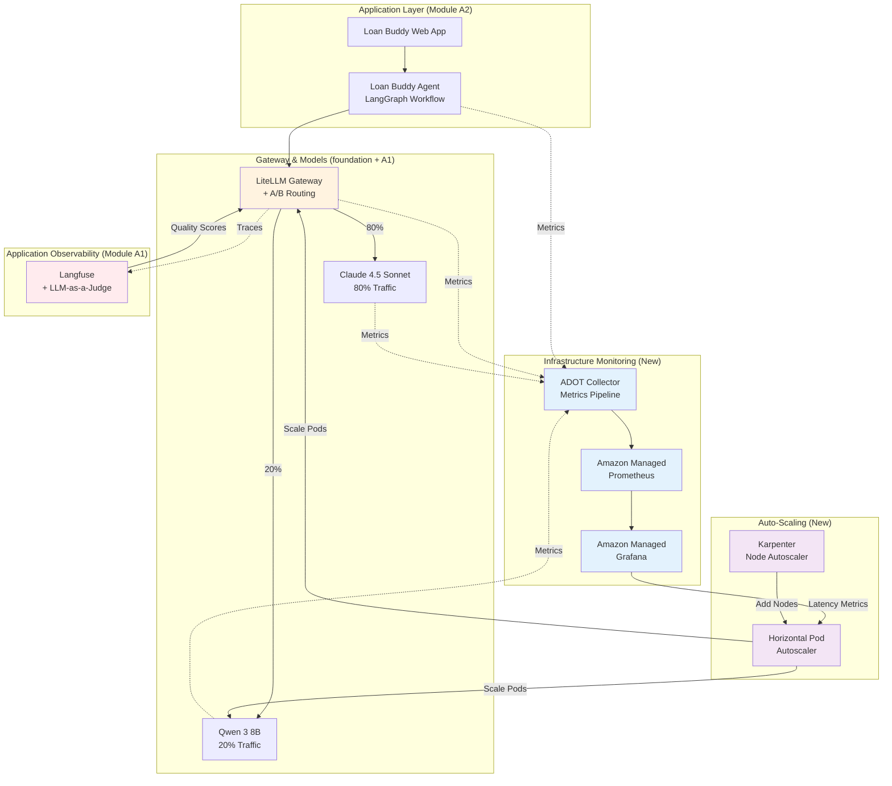

Loan Buddy 에이전트가 안정적으로 작동하고 있지만, 사용량이 증가하면서 새로운 요구 사항이 발생합니다. 마케팅 캠페인이 성공한 이후 플랫폼은 일관된 품질과 인프라 상태를 유지하면서 시간당 1,000건 이상의 대출 신청을 처리해야 합니다.

::alert[**플랫폼 필요**: 이 모듈은 공통 기반과 모듈 A1-A2를 기반으로 합니다. 기존 GenAI 플랫폼에 평가, 라우팅 및 모니터링 기능을 추가합니다.]{type="warning"}

## 학습 목표

이 모듈을 마치면 다음을 할 수 있습니다:

- Langfuse의 LLM-as-a-Judge 기능을 사용하여 LLM 품질을 평가합니다
- LiteLLM의 가중치 기반 모델 라우팅으로 A/B 테스트를 구현합니다
- Amazon Managed Prometheus 및 Grafana로 인프라를 모니터링합니다
- HPA 및 Karpenter를 사용하여 워크로드를 오토스케일링합니다
- 평가 데이터를 기반으로 비용과 품질의 트레이드오프를 분석합니다
- 애플리케이션과 인프라 메트릭을 모두 포괄하는 이중 레이어 관측성을 구축합니다

## 비즈니스 시나리오: 대규모 환경의 Loan Buddy

Loan Buddy 에이전트가 몇 주 동안 대출 신청을 처리해 왔습니다. 은행은 즉각적인 AI 기반 대출 결정을 홍보하는 대규모 마케팅 캠페인을 시작합니다.

**과제:**
- 신청 건수가 하룻밤 사이에 시간당 50건에서 1,000건 이상으로 증가
- CFO는 품질 저하 없는 비용 최적화를 요구
- 규정 준수 팀은 모든 결정에 대한 품질 감사를 요구
- 인프라 팀은 플랫폼 안정성을 보장해야 함

**수행할 작업:**
품질을 유지하고 비용을 제어하면서 이러한 규모를 처리할 수 있는 프로덕션급 평가, 라우팅 및 모니터링 기능을 구축합니다.

## 모듈 아키텍처

다음 다이어그램은 새로운 기능이 기존 플랫폼과 어떻게 통합되는지 보여줍니다:

## 모듈 구조

이 모듈은 세 가지 실습 섹션으로 구성됩니다:

#### 1. [Langfuse로 LLM 평가](./evaluation/)
**품질 평가 및 검증**
- LLM-as-a-Judge 평가 방법론 이해
- Langfuse에서 평가 템플릿 구성
- Loan Buddy 결정에 대한 품질 평가 실행
- 평가 대시보드 및 점수 시스템 구축

#### 2. [LiteLLM로 A/B 모델 라우팅](./model-routing/)
**가중치 기반 라우팅을 통한 비용 최적화**
- 가중치 기반 트래픽 분할 구성 (Claude 대 Qwen 80/20)
- 모델 간 비용과 품질 트레이드오프 비교
- Langfuse에서 성능 차이 분석
- 데이터 기반 모델 선택 결정

#### 3. [인프라 모니터링 및 오토스케일링](./monitoring-scaling/)
**프로덕션 준비 관측성 및 스케일링**
- 메트릭 집계를 위한 ADOT Collector 배포
- Amazon Managed Prometheus 워크스페이스 구성
- Grafana에서 Agentic AI 특화 대시보드 구축
- 오토스케일링을 위한 HPA 및 Karpenter 구현

## 주요 개념

이 모듈은 프로덕션급 Agentic AI 플랫폼 운영을 다룹니다:

- **대규모 환경의 품질**: 자동화된 평가를 통해 볼륨이 증가해도 일관된 품질을 유지합니다
- **비용 최적화**: A/B 테스트를 통해 품질 손실 없이 70% 이상의 비용 절감 기회를 파악합니다
- **이중 레이어 관측성**: 애플리케이션 메트릭(Langfuse)과 인프라 메트릭(Prometheus/Grafana)을 함께 수집합니다
- **탄력적 인프라**: 오토스케일링이 수동 개입 없이 트래픽 급증을 처리합니다
- **데이터 기반 결정**: 메트릭을 기반으로 모델 선택, 용량 계획 및 최적화를 수행합니다

## 주요 기술

::::tabs

:::tab{label="Evaluation & Quality"}
- **Langfuse LLM-as-a-Judge** - 자동화된 품질 평가
- **Evaluation Templates** - 표준화된 점수 기준
- **Quality Dashboards** - 실시간 품질 모니터링
- **Comparative Analysis** - 모델 성능 벤치마킹
:::

:::tab{label="Routing & Optimization"}
- **LiteLLM Router** - 가중치 트래픽 분배
- **Model Fallbacks** - 오류 시 자동 폴오버
- **Cost Tracking** - 실시간 지출 모니터링
- **A/B Testing** - 모델 변형의 통계적 비교
:::

:::tab{label="Infrastructure Monitoring"}
- **ADOT Collector** - OpenTelemetry 메트릭 파이프라인
- **Amazon Managed Prometheus (AMP)** - 확장 가능한 메트릭 스토리지
- **Amazon Managed Grafana (AMG)** - 시각화 및 알림
- **Prometheus Exporters** - vLLM, LiteLLM, Neuron 메트릭
:::

:::tab{label="Auto-Scaling"}
- **Horizontal Pod Autoscaler (HPA)** - Pod 레벨 스케일링
- **Karpenter** - 노드 레벨 자동 프로비저닝
- **Custom Metrics** - 요청 지연시간 기반 스케일
- **Cost-Aware Scaling** - 성능과 비용 균형
:::

::::

## 예상 결과

이 모듈을 완료하면 다음을 갖추게 됩니다:

- 모든 Loan Buddy 결정에 대해 실행되는 자동화된 품질 평가
- Claude 4.5 Sonnet과 Qwen 3 8B를 비교하는 A/B 테스트 인프라
- Prometheus 및 Grafana 대시보드를 활용한 프로덕션 모니터링
- 트래픽 급증을 자동으로 처리하는 오토스케일링 인프라
- 70% 이상의 절감 기회를 데이터로 뒷받침하는 비용 최적화 전략
- 애플리케이션과 인프라 레이어 전반의 관측성

## 실제 영향

이 모듈은 프로덕션 환경에서 흔히 발생하는 과제를 다룹니다:

| 과제 | 솔루션 | 영향 |
|-----------|----------|--------|
| **대규모 환경의 품질** | LLM-as-a-Judge 평가 | 100% 자동화된 품질 감사 |
| **비용 압박** | 저비용 모델로 A/B 라우팅 | 적격 요청에서 70% 이상 비용 절감 |
| **가시성 격차** | 이중 레이어 관측성 | 시스템 상태에 대한 완전한 가시성 |
| **트래픽 급증** | HPA + Karpenter 오토스케일링 | 자동화된 용량 관리 |
| **최적화** | 데이터 기반 분석 | 근거 기반 인프라 결정 |

## 시작하기

먼저 자동화된 품질 평가를 설정하여 모든 Loan Buddy 결정이 품질 표준을 충족하는지 확인합니다.

::alert[**팁**: 이 모듈을 진행하는 동안 브라우저 탭에 Langfuse와 Grafana를 모두 열어두십시오. Langfuse에서는 애플리케이션 레벨 추적을, Grafana에서는 인프라 메트릭을 확인하면서 이중 레이어 관측성을 직접 살펴볼 수 있습니다.]{type="info"}

---

**[다음: Langfuse로 LLM 평가 →](./evaluation/)**
