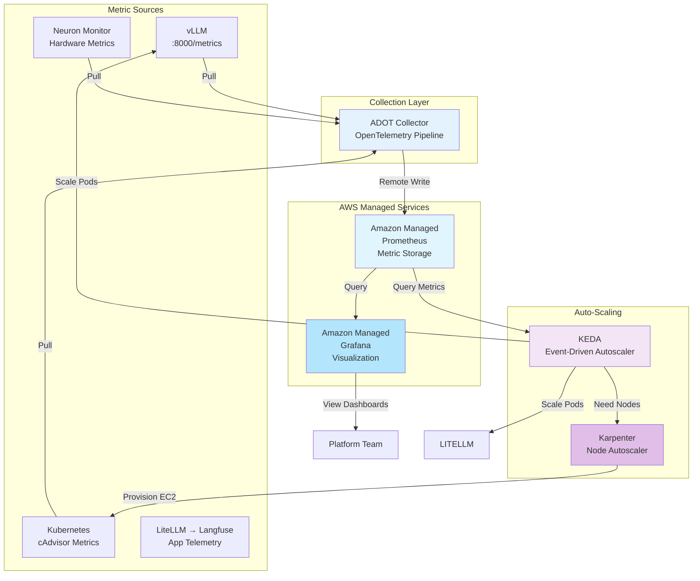

Langfuse provides visibility into application behavior, but not into the infrastructure underneath. When Qwen 3 8B suddenly takes 30 seconds instead of 6, you need to determine whether the cause is the model or the Neuron cores. When costs spike, you need to know whether Karpenter is provisioning too many nodes. This section adds production-grade infrastructure monitoring with Amazon Managed Prometheus and Grafana.

## Hands-On: Discover Your Infrastructure Metrics

First, explore what metrics your platform is already exposing:

### Step 1: Check vLLM Metrics Endpoint

vLLM exposes Prometheus metrics out of the box:

:::code{language=bash showCopyAction=true}
# Port-forward to vLLM metrics endpoint
kubectl port-forward -n vllm svc/qwen3-8b-neuron 8000:8000 &

# Fetch metrics (wait 5 seconds for port-forward to establish)
sleep 5
curl -s http://localhost:8000/metrics | head -50

# Stop port-forward
pkill -f "port-forward.*vllm"
:::

**What you will see:**

:::code{language=yaml showCopyAction=false}
# vLLM Performance Metrics:
vllm:num_requests_running 3.0
vllm:num_requests_waiting 0.0
vllm:gpu_cache_usage_perc 45.2
vllm:num_preemptions_total 0.0
vllm:prompt_tokens_total 45234.0
vllm:generation_tokens_total 123567.0
vllm:time_to_first_token_seconds 1.23
vllm:time_per_output_token_seconds 0.045
vllm:e2e_request_latency_seconds 5.67

# Model-Specific Metrics:
vllm:request_success_total{model_name="qwen3-8b-neuron"} 1247.0
vllm:request_failure_total{model_name="qwen3-8b-neuron"} 3.0
:::

**Key Metrics for GenAI:**
- **Throughput**: tokens generated per second
- **Latency**: time to first token, time per token
- **Cache Usage**: GPU/Neuron memory utilization
- **Success Rate**: successful vs failed requests
- **Queue Depth**: waiting vs running requests

### Step 2: Check Neuron Hardware Metrics from the vLLM Pod

The vLLM container ships the AWS Neuron tools (`neuron-ls`, `neuron-top`,
`neuron-monitor`) under `/opt/aws/neuron/bin`, so you can inspect the
Inferentia devices directly from the running pod — no extra install needed:

:::code{language=bash showCopyAction=true}
# List the Neuron devices and cores visible to the pod
kubectl exec -n vllm deployment/qwen3-8b-neuron -- neuron-ls
:::

::::expand{header="Check Output"}

```text
+--------+--------+--------+---------+---------+
| DEVICE | CORES  | MEMORY |   BDF   | VERSION |
+--------+--------+--------+---------+---------+
| 0      | 2      | 32 GB  | 0:00:1f | 2.28.23 |
+--------+--------+--------+---------+---------+
```

::::

`neuron-monitor` streams hardware metrics as JSON (the same source the
cluster-wide Neuron Monitor exporter publishes to Prometheus — set up in the
next section). Capture a single sample:

:::code{language=bash showCopyAction=true}
kubectl exec -n vllm deployment/qwen3-8b-neuron -- \
  bash -c 'timeout 3 neuron-monitor | head -c 600'
:::

This returns a JSON document with `neuron_runtime_data` containing per-core
`execution_stats`, `memory_used`, and `neuroncore_counters`. The cluster-wide
view of these metrics (e.g. `neuroncore_utilization_ratio` per core) is what
you will scrape into Amazon Managed Prometheus and chart in Grafana below.

**Why Neuron Metrics Matter:**
- **Utilization**: High utilization (>80%) indicates a need to scale
- **Temperature**: Thermal throttling impacts performance
- **Cost**: Under-utilized Neuron instances increase cost without benefit
- **Capacity Planning**: Track usage trends for sizing decisions

### Step 3: Understanding LiteLLM Gateway Observability

LiteLLM does **not** expose a Prometheus `/metrics` endpoint. Instead, it sends telemetry data to **Langfuse** via callbacks (configured in Module A1).

::alert[**LiteLLM Monitoring**: LiteLLM metrics (request counts, latency, cost, token usage) are collected through Langfuse callbacks, not Prometheus. To view LiteLLM gateway metrics, use the Langfuse dashboard you configured in Module A1.]{type="info"}

**What to Monitor in Langfuse:**

:::code{language=yaml showCopyAction=false}
# LiteLLM Metrics Available in Langfuse:
- Request volume by model (Bedrock vs vLLM routing)
- Latency percentiles (P50, P95, P99) per model
- Token usage (prompt tokens, completion tokens)
- Cost tracking per model and request
- Error rates and failure types
:::

**Access Langfuse Dashboard:**

:::code{language=bash showCopyAction=true}
# Get Langfuse URL from Module A1 setup
echo "View LiteLLM metrics in Langfuse:"
kubectl get ingress -n langfuse -o jsonpath='{.items[0].spec.rules[0].host}'
:::

## What is the Monitoring Stack?

You will deploy a complete observability stack for infrastructure metrics:



**Component Roles:**

| Component | Purpose | Why AWS Managed? |
|-----------|---------|------------------|
| **ADOT Collector** | Scrapes metrics from all sources, normalizes formats | Runs in your cluster |
| **Amazon Managed Prometheus (AMP)** | Stores time-series metrics at scale | No servers to manage, auto-scales, HA built-in |
| **Grafana (in-cluster)** | Visualization, dashboards, alerting | Runs in the cluster; AMP data source via SigV4 + Pod Identity (no SSO needed) |
| **KEDA** | Event-driven autoscaling with custom metrics | Native Prometheus support with SigV4 auth |
| **Karpenter** | Provisions nodes just-in-time | Faster than Cluster Autoscaler, cost-optimized |

## Hands-On: Deploy Amazon Managed Prometheus & Grafana

You will deploy this stack yourself with `kubectl` and a few `aws` CLI calls. The manifests live in the workshop repo at `/workshop/workshops/eks-genai-workshop/static/code/module4/monitoring`. Authentication to AWS uses **EKS Pod Identity** — note the ordering rule in the callout below.

::alert[**Pod Identity ordering matters**: A pod only receives Pod Identity credentials if its EKS pod identity association already exists *when the pod starts*. Always create the association **before** deploying (or restarting) the workload. If you deploy first, the pod falls back to no credentials and AWS calls fail with `NoCredentialProviders` / `no EC2 IMDS role found` — restart the pod after creating the association to fix it.]{type="warning"}

### Step 1: Set Shared Variables and Create the AMP Workspace

:::code{language=bash showCopyAction=true}
cd /workshop/workshops/eks-genai-workshop/static/code/module4/monitoring

export AWS_REGION=$(aws configure get region || echo us-east-1)
export AWS_ACCOUNT_ID=$(aws sts get-caller-identity --query Account --output text)
export CLUSTER_NAME=$(aws eks list-clusters --query 'clusters[0]' --output text)
echo "region=$AWS_REGION account=$AWS_ACCOUNT_ID cluster=$CLUSTER_NAME"

# Create the Amazon Managed Prometheus workspace (idempotent: skip if it exists)
export AMP_WORKSPACE_ID=$(aws amp list-workspaces \
  --query "workspaces[?alias=='genai-platform-metrics'].workspaceId" --output text)
if [ -z "$AMP_WORKSPACE_ID" ]; then
  export AMP_WORKSPACE_ID=$(aws amp create-workspace \
    --alias genai-platform-metrics --query workspaceId --output text)
fi

# Wait until the workspace is ACTIVE, then read its endpoint
aws amp wait workspace-active --workspace-id "$AMP_WORKSPACE_ID"
export AMP_ENDPOINT=$(aws amp describe-workspace --workspace-id "$AMP_WORKSPACE_ID" \
  --query 'workspace.prometheusEndpoint' --output text)
echo "AMP Workspace: $AMP_WORKSPACE_ID"
echo "AMP Endpoint:  $AMP_ENDPOINT"
:::

### Step 2: Deploy the Neuron Monitor DaemonSet

The `neuron-monitor` DaemonSet runs on every Inferentia node and exposes
hardware metrics (`neuroncore_utilization_ratio`, Neuron memory, errors) in
Prometheus format on port 8000:

:::code{language=bash showCopyAction=true}
kubectl apply -f neuron-monitor.yaml
kubectl rollout status daemonset/neuron-monitor -n kube-system --timeout=180s

# The command the troubleshooting guides reference now returns real pods:
kubectl get pods -n kube-system -l app=neuron-monitor -o wide
:::

::::expand{header="Check Output"}

```text
NAME                   READY   STATUS    RESTARTS   AGE   NODE
neuron-monitor-js5lp   1/1     Running   0          49s   i-0e6e941c24bf3973d
neuron-monitor-zg9st   1/1     Running   0          49s   i-0557bcfde932cfabc
```

::::

### Step 3: Deploy the ADOT Collector (scrapes vLLM + Neuron → AMP)

Create the IAM role and **Pod Identity association first**, then deploy:

:::code{language=bash showCopyAction=true}
# 1) IAM role trusted by EKS Pod Identity, with AMP remote-write permission
cat > /tmp/pi-trust.json <<'EOF'
{"Version":"2012-10-17","Statement":[{"Effect":"Allow",
  "Principal":{"Service":"pods.eks.amazonaws.com"},
  "Action":["sts:AssumeRole","sts:TagSession"]}]}
EOF
aws iam create-role --role-name adot-collector-amp \
  --assume-role-policy-document file:///tmp/pi-trust.json 2>/dev/null || true
aws iam attach-role-policy --role-name adot-collector-amp \
  --policy-arn arn:aws:iam::aws:policy/AmazonPrometheusRemoteWriteAccess

# 2) Apply the collector manifest (namespace, SA, RBAC, config, deployment),
#    substituting the AMP endpoint and region into the config
sed -e "s#__AMP_ENDPOINT__#${AMP_ENDPOINT}#" -e "s#__REGION__#${AWS_REGION}#" \
  adot-collector.yaml | kubectl apply -f -

# 3) Create the Pod Identity association for the adot-collector ServiceAccount
aws eks create-pod-identity-association --cluster-name "$CLUSTER_NAME" \
  --namespace adot --service-account adot-collector \
  --role-arn arn:aws:iam::${AWS_ACCOUNT_ID}:role/adot-collector-amp 2>/dev/null || true

# 4) Restart so the pod starts WITH the association and picks up credentials
kubectl rollout restart deployment/adot-collector -n adot
kubectl rollout status deployment/adot-collector -n adot --timeout=150s
:::

**Verify the collector started both scrape jobs and is exporting to AMP:**

:::code{language=bash showCopyAction=true}
kubectl get pods -n adot
kubectl logs -n adot deployment/adot-collector --tail=40 \
  | grep -iE "scrape job added|everything is ready|error"
:::

::::expand{header="Check Output"}

```text
adot-collector-xxxxxxxxx-xxxxx   1/1   Running   0   30s

... "Scrape job added" ... "jobName": "vllm"
... "Scrape job added" ... "jobName": "neuron-monitor"
... "Everything is ready. Begin running and processing data."
```

::::

::alert[**How scraping works**: ADOT uses Kubernetes pod service discovery. For vLLM it connects to `<pod_ip>:8000/metrics` (vLLM does not always declare a `containerPort`, so a static port is used). For Neuron it keeps only pods labeled `app=neuron-monitor` and scrapes `<pod_ip>:8000`. Both pipelines remote-write to AMP using SigV4 signed with the `adot-collector-amp` role.]{type="info"}

### Step 4: Confirm Metrics Landed in AMP

Query AMP directly (SigV4-signed by your CLI credentials) to confirm both
vLLM and Neuron metrics are being stored:

:::code{language=bash showCopyAction=true}
# Install awscurl once if needed: pip install awscurl
awscurl --service aps --region "$AWS_REGION" \
  "${AMP_ENDPOINT}api/v1/query?query=count(neuroncore_utilization_ratio)"

awscurl --service aps --region "$AWS_REGION" \
  "${AMP_ENDPOINT}api/v1/query?query=count(vllm:num_requests_running)"
:::

A non-empty `value` in the result (for example a Neuron core count of `4`, or
a vLLM series count) confirms the end-to-end pipeline is working.

### Step 5: Deploy In-Cluster Grafana and Verify the AMP Data Source

::alert[**Why in-cluster Grafana instead of Amazon Managed Grafana?** Amazon Managed Grafana requires AWS IAM Identity Center (SSO) or SAML for user sign-in. Workshop Studio accounts do not have an Identity Center instance, so AMG cannot be used here. Instead you run Grafana in the cluster and authenticate the AMP data source with SigV4 via Pod Identity. The provided `grafana.yaml` provisions the AMP data source automatically.]{type="info"}

:::code{language=bash showCopyAction=true}
# Grafana queries AMP, so it needs AMP *query* permission via Pod Identity
aws iam create-role --role-name grafana-amp-reader \
  --assume-role-policy-document file:///tmp/pi-trust.json 2>/dev/null || true
aws iam attach-role-policy --role-name grafana-amp-reader \
  --policy-arn arn:aws:iam::aws:policy/AmazonPrometheusQueryAccess

# Apply the manifest with the AMP endpoint + region substituted
sed -e "s#__AMP_ENDPOINT__#${AMP_ENDPOINT}#" -e "s#__REGION__#${AWS_REGION}#" \
  grafana.yaml | kubectl apply -f -

# Create the association BEFORE the pod needs credentials, then restart
aws eks create-pod-identity-association --cluster-name "$CLUSTER_NAME" \
  --namespace grafana --service-account grafana \
  --role-arn arn:aws:iam::${AWS_ACCOUNT_ID}:role/grafana-amp-reader 2>/dev/null || true
kubectl rollout restart deployment/grafana -n grafana
kubectl rollout status deployment/grafana -n grafana --timeout=150s
:::

**Open Grafana** with a port-forward and log in (`admin` / `admin`):

:::code{language=bash showCopyAction=true}
kubectl port-forward -n grafana svc/grafana 3000:3000
# Then browse to http://localhost:3000
:::

**In the Grafana UI:**

1. Go to **Connections → Data sources**
2. Open the pre-provisioned **Amazon Managed Prometheus** data source
3. Click **Save & test** at the bottom

**Expected Result:**
- **Data source is working**: Green success message
- **Metrics Available**: Prometheus queries return data

::alert[The `grafana.yaml` manifest provisioned the AMP data source automatically with SigV4 authentication. If you need to reconfigure it manually, use URL: `$AMP_ENDPOINT`, Auth: SigV4, Default Region: your AWS region.]{type="info"}

## Hands-On: Build GenAI Platform Dashboard

Create a comprehensive monitoring dashboard:

### Step 1: Create Dashboard

In Grafana:
1. Click **+ (Create)** → **Dashboard**
2. Click **Add new panel**

### Step 2: Add vLLM Request Rate Panel

**Panel Configuration:**

::::tabs

:::tab{label="Query"}
**Prometheus Query:**

:::code{language=promql showCopyAction=true}
# Request rate per minute
rate(vllm:request_success_total[5m]) * 60
:::

**Settings:**
- **Visualization**: Time series (Line)
- **Title**: `vLLM Request Rate (req/min)`
- **Unit**: requests/min
- **Legend**: {{model_name}}
:::

:::tab{label="Display Options"}
**Graph Settings:**
- **Fill opacity**: 10%
- **Line width**: 2
- **Point size**: 5
- **Show points**: On data points
- **Connect null values**: Always

**Axis:**
- **Y-axis min**: 0
- **Y-axis label**: Requests per Minute
:::

::::

Click **Apply** to save the panel.

### Step 3: Add Inference Latency Panel

Add another panel:

**Query:**

:::code{language=promql showCopyAction=true}
# P50, P95, P99 latencies
histogram_quantile(0.50, rate(vllm:e2e_request_latency_seconds_bucket[5m]))
histogram_quantile(0.95, rate(vllm:e2e_request_latency_seconds_bucket[5m]))
histogram_quantile(0.99, rate(vllm:e2e_request_latency_seconds_bucket[5m]))
:::

**Settings:**
- **Visualization**: Time series
- **Title**: `Inference Latency (P50/P95/P99)`
- **Unit**: seconds
- **Legend**: P50 (green), P95 (yellow), P99 (red)

### Step 4: Add Token Throughput Panel

**Query:**

:::code{language=promql showCopyAction=true}
# Tokens generated per second
rate(vllm:generation_tokens_total[5m])
:::

**Settings:**
- **Visualization**: Graph (area fill)
- **Title**: `Token Generation Throughput`
- **Unit**: tokens/sec
- **Color**: Blue gradient

### Step 5: Add Neuron Core Utilization Panel

**Query:**

:::code{language=promql showCopyAction=true}
# Neuron core utilization percentage
avg(neuroncore_utilization_ratio) by (neuron_core) * 100
:::

**Settings:**
- **Visualization**: Gauge
- **Title**: `Neuron Core Utilization`
- **Unit**: percent (0-100)
- **Thresholds**: Green (<70), Yellow (70-85), Red (>85)

### Step 6: Add GPU KV-Cache Usage Panel

**Query:**

:::code{language=promql showCopyAction=true}
# KV-cache usage percentage (fraction of cache blocks in use)
vllm:gpu_cache_usage_perc * 100
:::

**Settings:**
- **Visualization**: Stat (single value)
- **Title**: `GPU KV-Cache Usage %`
- **Unit**: percent
- **Color mode**: Value (green <70%, yellow 70-90%, red >90%)

### Step 7: Add vLLM Queue Depth Panel

**Query:**

:::code{language=promql showCopyAction=true}
# Current waiting requests (key scaling signal)
vllm:num_requests_waiting{namespace="vllm"}
:::

**Settings:**
- **Visualization**: Time series with threshold line
- **Title**: `vLLM Queue Depth (Waiting Requests)`
- **Unit**: requests
- **Threshold line**: 3 (KEDA scaling threshold)
- **Alert zone**: Red fill when >3

::alert[**Key Scaling Metric**: `num_requests_waiting` is the primary signal for vLLM autoscaling. When this exceeds 3, KEDA triggers scale-up before users experience latency degradation.]{type="info"}

### Step 8: Add Error Rate Panel

**Query:**

:::code{language=promql showCopyAction=true}
# Error rate percentage
(
  rate(vllm:request_failure_total[5m]) /
  (rate(vllm:request_success_total[5m]) + rate(vllm:request_failure_total[5m]))
) * 100
:::

**Settings:**
- **Visualization**: Time series with alert threshold
- **Title**: `Request Error Rate`
- **Unit**: percent
- **Threshold line**: 1% (red line at y=1)

### Step 9: Arrange Dashboard Layout

Organize your panels into rows using the layout below:

**Layout Structure:**
```
Row 1: [Request Rate] [Inference Latency] [Token Throughput]
Row 2: [Neuron Utilization] [GPU KV-Cache Usage] [Queue Depth]
Row 3: [Error Rate]
```

::alert[**LiteLLM Metrics**: To monitor LiteLLM gateway metrics (request distribution, routing decisions, cost per model), use the Langfuse dashboard from Module A1. LiteLLM sends telemetry via callbacks, not Prometheus.]{type="info"}

**Dashboard Settings:**
- **Title**: `GenAI Platform Monitoring`
- **Refresh**: Auto-refresh every 30s
- **Time Range**: Last 6 hours (default)
- **Save**: Click **Save dashboard** icon

## Hands-On: Configure Event-Driven Autoscaling with KEDA

Configure production-grade autoscaling using **KEDA** (Kubernetes Event-Driven Autoscaling) with vLLM's `num_requests_waiting` metric from Amazon Managed Prometheus.

::alert[**Why `num_requests_waiting`?** This is the primary production vLLM scaling metric because it is a *leading indicator* — it detects load buildup before latency increases. When requests start queuing, it is a clear signal to scale up. CPU/memory metrics are lagging indicators that only react after performance has already degraded.]{type="info"}

### Step 1: Install KEDA

KEDA extends Kubernetes with event-driven scaling capabilities and has native support for Prometheus with AWS SigV4 authentication:

:::code{language=bash showCopyAction=true}
# Add KEDA Helm repository
helm repo add kedacore https://kedacore.github.io/charts
helm repo update

# Install KEDA
helm install keda kedacore/keda \
  --namespace keda \
  --create-namespace \
  --wait

# Verify KEDA installation
kubectl get pods -n keda
:::

::::expand{header="Check Output"}

```yaml
NAME                                      READY   STATUS    RESTARTS   AGE
keda-admission-webhooks-xxxx              1/1     Running   0          30s
keda-operator-xxxx                        1/1     Running   0          30s
keda-operator-metrics-apiserver-xxxx      1/1     Running   0          30s
```

::::

### Step 2: Configure IAM for KEDA to Query AMP

KEDA needs permission to query Amazon Managed Prometheus. This uses EKS Pod Identity:

:::code{language=bash showCopyAction=true}
# Create trust policy for KEDA
cat > /tmp/keda-trust-policy.json <<'EOF'
{
  "Version": "2012-10-17",
  "Statement": [{
    "Effect": "Allow",
    "Principal": { "Service": "pods.eks.amazonaws.com" },
    "Action": ["sts:AssumeRole", "sts:TagSession"]
  }]
}
EOF

# Create IAM role with AMP query permissions
aws iam create-role \
  --role-name keda-amp-reader \
  --assume-role-policy-document file:///tmp/keda-trust-policy.json

aws iam attach-role-policy \
  --role-name keda-amp-reader \
  --policy-arn arn:aws:iam::aws:policy/AmazonPrometheusQueryAccess

# Reuse the AWS account ID and cluster name derived in Step 1
export AWS_ACCOUNT_ID=$(aws sts get-caller-identity --query Account --output text)
export EKS_CLUSTER_NAME=$CLUSTER_NAME

# Create Pod Identity association for KEDA
aws eks create-pod-identity-association \
  --cluster-name $EKS_CLUSTER_NAME \
  --namespace keda \
  --service-account keda-operator \
  --role-arn arn:aws:iam::${AWS_ACCOUNT_ID}:role/keda-amp-reader

echo "KEDA IAM configuration complete"
:::

### Step 3: Create TriggerAuthentication for AMP

KEDA uses `TriggerAuthentication` resources to specify how to authenticate to external systems:

:::code{language=yaml showCopyAction=true}
cat <<EOF | kubectl apply -f -
apiVersion: keda.sh/v1alpha1
kind: TriggerAuthentication
metadata:
  name: amp-auth
  namespace: vllm
spec:
  podIdentity:
    provider: aws
---
apiVersion: keda.sh/v1alpha1
kind: TriggerAuthentication
metadata:
  name: amp-auth
  namespace: litellm
spec:
  podIdentity:
    provider: aws
EOF
:::

### Step 4: Create ScaledObject for vLLM

Now create the KEDA `ScaledObject` that monitors `vllm:num_requests_waiting`:

:::code{language=yaml showCopyAction=true}
# Get AMP endpoint (created in the monitoring section above)
export AMP_WORKSPACE_ID=$(aws amp list-workspaces \
  --query "workspaces[?alias=='genai-platform-metrics'].workspaceId" \
  --output text)

# IMPORTANT: strip the trailing slash. The AMP endpoint ends with "/", and KEDA
# appends "/api/v1/query"; a trailing slash produces "//api/v1/query" which AMP
# rejects with HTTP 403.
export AMP_ENDPOINT=$(aws amp describe-workspace \
  --workspace-id $AMP_WORKSPACE_ID \
  --query 'workspace.prometheusEndpoint' \
  --output text | sed 's#/$##')

export AWS_REGION=$(aws configure get region || echo us-east-1)

# Create ScaledObject for vLLM
cat <<EOF | kubectl apply -f -
apiVersion: keda.sh/v1alpha1
kind: ScaledObject
metadata:
  name: vllm-scaledobject
  namespace: vllm
spec:
  scaleTargetRef:
    name: qwen3-8b-neuron
  minReplicaCount: 1
  maxReplicaCount: 5
  pollingInterval: 15
  cooldownPeriod: 300
  triggers:
    - type: prometheus
      metadata:
        serverAddress: ${AMP_ENDPOINT}
        query: avg(vllm:num_requests_waiting{namespace="vllm"})
        threshold: "3"
        awsRegion: ${AWS_REGION}
      authenticationRef:
        name: amp-auth
EOF
:::

**Configuration Explained:**

| Setting | Value | Purpose |
|---------|-------|---------|
| `threshold: "3"` | 3 waiting requests | KEDA compares the namespace-average `num_requests_waiting` (an AverageValue target) to 3 and scales up when it exceeds the threshold |
| `pollingInterval: 15` | 15 seconds | Check metrics every 15 seconds |
| `cooldownPeriod: 300` | 5 minutes | Wait 5 minutes before scaling down |
| `minReplicaCount: 1` | 1 pod | Always keep at least 1 pod running |
| `maxReplicaCount: 5` | 5 pods | Maximum 5 pods (cost control) |

::alert[**Leading vs Lagging Indicators**: `num_requests_waiting` is a leading indicator — it signals the need to scale BEFORE users experience degraded performance. CPU/memory metrics are lagging indicators that only react after the system is already struggling.]{type="info"}

### Step 5: Create HPA for LiteLLM Gateway

Since LiteLLM does not expose Prometheus metrics, this section will use CPU-based autoscaling:

:::code{language=yaml showCopyAction=true}
cat <<EOF | kubectl apply -f -
apiVersion: autoscaling/v2
kind: HorizontalPodAutoscaler
metadata:
  name: litellm-hpa
  namespace: litellm
spec:
  scaleTargetRef:
    apiVersion: apps/v1
    kind: Deployment
    name: litellm
  minReplicas: 2
  maxReplicas: 10
  metrics:
    - type: Resource
      resource:
        name: cpu
        target:
          type: Utilization
          averageUtilization: 70
  behavior:
    scaleDown:
      stabilizationWindowSeconds: 180
      policies:
        - type: Percent
          value: 50
          periodSeconds: 60
    scaleUp:
      stabilizationWindowSeconds: 0
      policies:
        - type: Percent
          value: 100
          periodSeconds: 15
EOF
:::

**LiteLLM Scaling Logic:**
- Threshold: 70% CPU utilization per pod
- Scale up: Immediately when CPU exceeds 70%
- Scale down: After 3 minutes of low CPU (stabilizationWindowSeconds: 180)

::alert[**Why CPU-based?** LiteLLM is a stateless gateway with no Prometheus metrics endpoint. CPU utilization correlates well with request load for this lightweight service. For detailed request metrics, use Langfuse (configured in Module A1).]{type="info"}

### Step 6: Verify Autoscaling Configuration

:::code{language=bash showCopyAction=true}
# Check KEDA ScaledObject for vLLM
kubectl get scaledobject -n vllm

# Check standard HPA for LiteLLM
kubectl get hpa -n litellm

# View detailed vLLM ScaledObject status
kubectl describe scaledobject vllm-scaledobject -n vllm

# View detailed LiteLLM HPA status
kubectl describe hpa litellm-hpa -n litellm
:::

::::expand{header="Check Output"}

```yaml
# KEDA ScaledObject for vLLM:
NAME                  SCALETARGETKIND    SCALETARGETNAME     MIN   MAX   TRIGGERS     READY   ACTIVE
vllm-scaledobject     apps/v1.Deployment qwen3-8b-neuron     1     5     prometheus   True    False

# Standard HPA for LiteLLM:
NAME           REFERENCE            TARGETS         MINPODS   MAXPODS   REPLICAS
litellm-hpa    Deployment/litellm   45%/70%         2         10        2

# KEDA HPA (auto-created for vLLM):
NAME                         REFERENCE                   TARGETS   MINPODS   MAXPODS   REPLICAS
keda-hpa-vllm-scaledobject   Deployment/qwen3-8b-neuron  0/3       1         5         1

# READY=True means KEDA can successfully query AMP
# ACTIVE=False means current metrics are below threshold (no scaling needed)
```

::::

## Hands-On: Understanding EKS Auto Mode Node Scaling

Your cluster is running **EKS Auto Mode**, which means Karpenter is already built-in and managing nodes automatically. You do not need to install Karpenter manually.

::alert[**EKS Auto Mode**: This cluster uses EKS Auto Mode, which includes Karpenter as a managed component. AWS handles Karpenter installation, upgrades, and configuration. Node scaling happens automatically when pods cannot be scheduled.]{type="info"}

### Step 1: Verify Existing NodePools

In EKS Auto Mode, Karpenter uses `NodePool` resources (not the older `Provisioner` CRD):

:::code{language=bash showCopyAction=true}
# List existing NodePools
kubectl get nodepools

# Describe the default NodePool
kubectl describe nodepool default

# Check EC2NodeClass (replaces AWSNodeTemplate)
kubectl get ec2nodeclass
:::

::::expand{header="Check Output"}

```yaml
# NodePool Status:
NAME      NODES   READY   AGE
default   3       3       2h

# EC2NodeClass:
NAME      READY   AGE
default   True    2h
```

::::

### Step 2: Understand Auto Mode Node Management

**How EKS Auto Mode Works:**

| Aspect | Traditional Karpenter | EKS Auto Mode |
|--------|----------------------|---------------|
| **Installation** | Manual via Helm | Built-in, AWS-managed |
| **IAM** | Manual IRSA setup | Automatic Pod Identity |
| **CRDs** | `Provisioner` + `AWSNodeTemplate` (v1alpha5) | `NodePool` + `EC2NodeClass` (v1) |
| **Upgrades** | Manual Helm upgrades | Automatic by AWS |
| **Configuration** | Full control | AWS-managed defaults + customization |

**Key Differences in EKS Auto Mode:**
- **No manual installation**: Karpenter runs as a managed component
- **Automatic upgrades**: AWS keeps Karpenter up to date
- **Simplified IAM**: Pod Identity configured automatically
- **Updated CRDs**: Uses stable `v1` APIs instead of `v1alpha5`

### Step 3: Observe Karpenter Logs

:::code{language=bash showCopyAction=true}
# View Karpenter controller logs
kubectl logs -n kube-system -l app.kubernetes.io/name=karpenter --tail=50

# Watch for provisioning events
kubectl logs -n kube-system -l app.kubernetes.io/name=karpenter -f | grep -i "provisioning\|launching\|terminating"
:::

### Step 4: Test Auto-Scaling End-to-End

Generate load to trigger KEDA autoscaling and observe how it works with Karpenter:

:::code{language=bash showCopyAction=true}
# Install hey (HTTP load generator)
kubectl run load-generator --image=williamyeh/hey:latest --restart=Never -- \
  -z 5m -c 50 -m POST \
  -H "Content-Type: application/json" \
  -d '{"model":"loan-processing","messages":[{"role":"user","content":"Evaluate this loan application: income $75000, credit 720, requesting $250000"}]}' \
  http://litellm.litellm:4000/v1/chat/completions

echo "Load test running for 5 minutes..."
echo "Watch KEDA scaling in another terminal: kubectl get scaledobject -A -w"
:::

**Expected Scaling Behavior:**

:::code{language=yaml showCopyAction=false}
# Minute 0: Baseline
- vLLM pods: 1
- LiteLLM pods: 2
- Nodes: 2 (existing)
- vLLM num_requests_waiting: 0
- LiteLLM CPU: 45%

# Minute 1: Load spike detected
- vLLM num_requests_waiting: 5 (threshold: 3)
- LiteLLM CPU: 80% (threshold: 70%)
- HPA: Scale LiteLLM to 3 pods (CPU exceeded)
- KEDA: Scale vLLM to 2 pods (queue depth exceeded)

# Minute 2: Node capacity exhausted
- Pods in Pending state (insufficient node capacity)
- Karpenter (Auto Mode): Detects pending pods
- Karpenter: Provisions 1 new node (instance type selected automatically)
- Node ready in 90-120 seconds

# Minute 3: Pods scheduled on new node
- vLLM pods: 3 (distributed across 3 nodes)
- LiteLLM pods: 4 (distributed across nodes)
- System stabilized, num_requests_waiting back to 0-1

# Minute 10: Load test ends
- KEDA: Cooldown period begins (5min for vLLM)
- HPA: Stabilization window begins (3min for LiteLLM)
- Minute 13: Scale down LiteLLM to 2 pods
- Minute 15: Scale down vLLM to 1 pod
- Minute 20: Karpenter: Mark node for consolidation
- Minute 25: Karpenter: Terminate empty node
:::

**Observe the Scaling Process:**

::::tabs

:::tab{label="Watch KEDA"}
:::code{language=bash showCopyAction=true}
# In terminal 1: Watch KEDA ScaledObjects
watch -n 2 'kubectl get scaledobject -A'

# Also watch the HPAs that KEDA creates
watch -n 2 'kubectl get hpa -A'
:::
:::

:::tab{label="Watch Pods"}
:::code{language=bash showCopyAction=true}
# In terminal 2: Watch pod scaling
watch -n 2 "kubectl get pods -A -o wide | grep -E 'vllm|litellm'"
:::
:::

:::tab{label="Watch Nodes"}
:::code{language=bash showCopyAction=true}
# In terminal 3: Watch node provisioning
watch -n 5 'kubectl get nodes'
:::
:::

:::tab{label="KEDA Logs"}
:::code{language=bash showCopyAction=true}
# In terminal 4: Watch KEDA scaling decisions
kubectl logs -n keda deployment/keda-operator --tail=50 -f | grep -i "scal"
:::
:::

:::tab{label="Karpenter Logs"}
:::code{language=bash showCopyAction=true}
# In terminal 5: Watch Karpenter node provisioning
kubectl logs -n kube-system -l app.kubernetes.io/name=karpenter -f
:::
:::

::::

## Hands-On: Add Scaling Alerts in Grafana

Configure alerts for scaling events:

### Step 1: Create Alert Rule

In Grafana:
1. Navigate to **Alerting** → **Alert rules**
2. Click **+ New alert rule**

**Alert Configuration:**

::::tabs

:::tab{label="Query & Condition"}
**Prometheus Query:**

:::code{language=promql showCopyAction=true}
# Alert when vLLM latency exceeds target for 2 minutes
avg(rate(vllm:e2e_request_latency_seconds_sum[2m]) /
    rate(vllm:e2e_request_latency_seconds_count[2m])) > 8
:::

**Settings:**
- **Alert name**: `vLLM High Latency`
- **Evaluate every**: 30s
- **For**: 2 minutes (prevents flapping)
- **Condition**: Value > 8 seconds
:::

:::tab{label="Annotations"}
**Alert Details:**
- **Summary**: `vLLM inference latency is {{$value}}s (target: 6s)`
- **Description**: `Current latency indicates need for scaling. HPA should trigger soon.`
- **Runbook URL**: Link to scaling procedures
:::

:::tab{label="Notifications"}
**Contact Points:**
- **Email**: platform-team@example.com
- **Slack**: #genai-platform-alerts
- **PagerDuty**: High-severity incidents only

**Notification Policy:**
- **Send once**: On state change (OK → Alerting)
- **Mute period**: 10 minutes after scaling event
:::

::::

### Step 2: Create Node Capacity Alert

Alert when Karpenter needs to provision nodes:

**Query:**

:::code{language=promql showCopyAction=true}
# Alert when pending pods exist for >3 minutes
sum(kube_pod_status_phase{phase="Pending",namespace=~"vllm|litellm"}) > 0
:::

**Settings:**
- **Alert name**: `Pending Pods Awaiting Nodes`
- **For**: 3 minutes
- **Description**: `Pods pending - Karpenter should provision nodes`

### Step 3: Create Cost Alert

Alert on unexpected cost spikes:

**Query:**

:::code{language=promql showCopyAction=true}
# Alert when more than 5 inf2 nodes are running
count(kube_node_info{node=~".*inf2.*"}) > 5
:::

**Settings:**
- **Alert name**: `High Node Count - Cost Alert`
- **Description**: `6+ Neuron nodes running. Daily cost >$200.`
- **Action**: Review traffic patterns and scaling policies

## Key Benefits of Infrastructure Monitoring

The exercises in this section demonstrated:

- **Full visibility**: Application metrics (Langfuse) and infrastructure metrics (Prometheus/Grafana)
- **Proactive scaling**: KEDA scales on leading indicators (queue depth) before users experience slowdowns
- **Production-grade autoscaling**: Custom metrics from AMP with SigV4 auth, not just CPU/memory
- **Cost control**: Karpenter provisions nodes just-in-time and terminates them when idle
- **Performance optimization**: Identify bottlenecks (Neuron utilization, cache hit rate)
- **Incident response**: Alerts notify the team before customers are impacted
- **Capacity planning**: Historical metrics guide infrastructure sizing decisions

## Production Best Practices

**Dashboard Design:**
- Use the **RED method**: Rate, Errors, Duration
- Show **both current state and trends** (time series + single stat)
- Set **meaningful thresholds** based on SLOs, not arbitrary numbers
- Design for **mobile viewing** (on-call engineers check dashboards on phones)

**Alert Strategy:**
- **Alert on symptoms, not causes**: "Users experiencing slow responses" rather than "CPU is 80%"
- **Reduce noise**: 5 well-designed alerts are more useful than 50 noisy alerts
- **Alert on rate of change**: Sudden spikes matter more than absolute values
- **Actionable alerts only**: Every alert should have a clear response procedure

**Scaling Configuration:**
- **Scale up aggressively**: Users do not tolerate slow responses
- **Scale down conservatively**: Avoid thrashing (scale up → down → up)
- **Cost vs performance**: Balance user experience with infrastructure cost
- **Time-based scaling**: Pre-scale before known traffic patterns (daily peaks)

## What's Next?

You have now built a production-grade GenAI platform. Across this module, you have:

- **Evaluated quality** with LLM-as-a-Judge scoring every decision
- **Optimized costs** with 80/20 A/B routing (54% cost reduction)
- **Monitored infrastructure** with AMP + in-cluster Grafana dashboards (vLLM and Neuron metrics)
- **Auto-scaled** with KEDA using vLLM queue metrics and Karpenter for elastic capacity

**Your Platform Now Has:**
- **Quality assurance**: Automated evaluation maintains consistent decisions
- **Cost efficiency**: Weighted routing reduces cost per request
- **Observability**: Dual-layer monitoring (application + infrastructure)
- **Elastic scale**: Event-driven autoscaling with leading indicators handles 10x traffic spikes
- **Resilience**: Automatic failover and self-healing

Your Loan Buddy agent is now equipped to handle production-scale traffic with quality, cost, and performance under control.

---

**[Continue to Module A4: Production-Ready Deployments →](/track-a-opensource/a4-production-ready/)**
