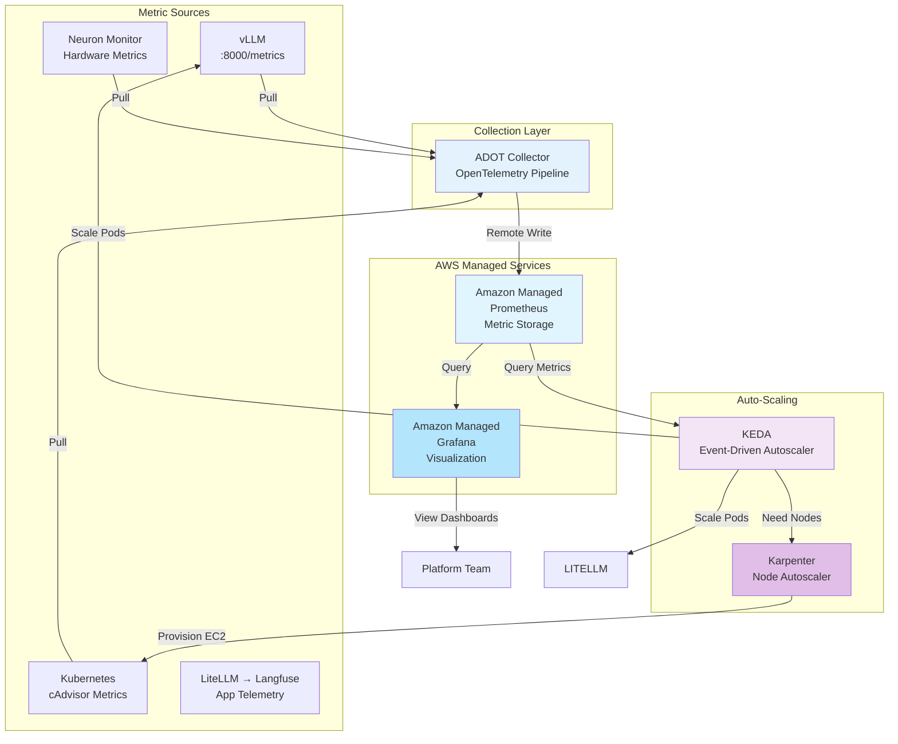

Langfuse는 애플리케이션 동작에 대한 가시성을 제공하지만, 그 아래에서 실행되는 인프라는 다루지 않습니다. Qwen 3 8B가 갑자기 6초 대신 30초가 걸린다면 원인이 모델인지 Neuron 코어인지 파악해야 하고, 비용이 급증할 때는 Karpenter가 노드를 과도하게 프로비저닝하는지 확인해야 합니다. 이 섹션에서는 Amazon Managed Prometheus 및 Grafana를 사용한 프로덕션급 인프라 모니터링을 추가합니다.

## 실습: 인프라 메트릭 확인

먼저 플랫폼이 이미 노출하고 있는 메트릭을 확인합니다:

### 단계 1: vLLM 메트릭 엔드포인트 확인

vLLM은 기본적으로 Prometheus 메트릭을 노출합니다:

:::code{language=bash showCopyAction=true}
# vLLM 메트릭 엔드포인트로 포트 포워드
kubectl port-forward -n vllm svc/qwen3-8b-neuron 8000:8000 &

# 메트릭 가져오기 (포트 포워드가 설정될 때까지 5초 대기)
sleep 5
curl -s http://localhost:8000/metrics | head -50

# 포트 포워드 중지
pkill -f "port-forward.*vllm"
:::

**보게 될 것:**

:::code{language=yaml showCopyAction=false}
# vLLM 성능 메트릭:
vllm:num_requests_running 3.0
vllm:num_requests_waiting 0.0
vllm:gpu_cache_usage_perc 45.2
vllm:num_preemptions_total 0.0
vllm:prompt_tokens_total 45234.0
vllm:generation_tokens_total 123567.0
vllm:time_to_first_token_seconds 1.23
vllm:time_per_output_token_seconds 0.045
vllm:e2e_request_latency_seconds 5.67

# 모델별 메트릭:
vllm:request_success_total{model_name="qwen3-8b-neuron"} 1247.0
vllm:request_failure_total{model_name="qwen3-8b-neuron"} 3.0
:::

**Agentic AI의 주요 메트릭:**
- **처리량**: 초당 생성된 토큰
- **지연시간**: 첫 토큰까지의 시간, 토큰당 시간
- **캐시 사용**: GPU/Neuron 메모리 활용률
- **성공률**: 성공한 요청 대 실패한 요청
- **큐 깊이**: 대기 중인 요청 대 실행 중인 요청

### 단계 2: vLLM Pod에서 Neuron 하드웨어 메트릭 확인

vLLM 컨테이너에는 AWS Neuron 도구(`neuron-ls`, `neuron-top`,
`neuron-monitor`)가 `/opt/aws/neuron/bin` 아래에 포함되어 있어, 별도 설치 없이
실행 중인 Pod에서 직접 Inferentia 디바이스를 확인할 수 있습니다:

:::code{language=bash showCopyAction=true}
# Pod에 보이는 Neuron 디바이스와 코어 목록
kubectl exec -n vllm deployment/qwen3-8b-neuron -- neuron-ls
:::

**예상 출력:**

:::code{language=text showCopyAction=false}
+--------+--------+--------+---------+---------+
| DEVICE | CORES  | MEMORY |   BDF   | VERSION |
+--------+--------+--------+---------+---------+
| 0      | 2      | 32 GB  | 0:00:1f | 2.28.23 |
+--------+--------+--------+---------+---------+
:::

`neuron-monitor`는 하드웨어 메트릭을 JSON으로 스트리밍합니다(다음 섹션에서
클러스터 차원의 Neuron Monitor exporter가 Prometheus로 발행하는 것과 동일한
소스). 단일 샘플을 캡처합니다:

:::code{language=bash showCopyAction=true}
kubectl exec -n vllm deployment/qwen3-8b-neuron -- \
  bash -c 'timeout 3 neuron-monitor | head -c 600'
:::

`neuron_runtime_data` 안에 코어별 `execution_stats`, `memory_used`,
`neuroncore_counters`가 담긴 JSON이 반환됩니다. 이 메트릭의 클러스터 차원 뷰
(예: 코어별 `neuroncore_utilization_ratio`)를 아래에서 Amazon Managed
Prometheus로 수집하고 Grafana로 시각화합니다.

**Neuron 메트릭이 중요한 이유:**
- **활용률**: 높은 활용률(>80%)은 스케일링이 필요함을 나타냅니다
- **온도**: 열 쓰로틀링이 성능에 영향을 줍니다
- **비용**: 활용도가 낮은 Neuron 인스턴스는 불필요한 비용을 발생시킵니다
- **용량 계획**: 사용 추세를 추적하여 크기 조정을 결정합니다

### 단계 3: LiteLLM Gateway 관측성 이해

LiteLLM은 Prometheus `/metrics` 엔드포인트를 노출하지 **않습니다**. 대신 콜백을 통해 **Langfuse** 로 텔레메트리 데이터를 보냅니다 (모듈 A1에서 구성).

::alert[**LiteLLM 모니터링**: LiteLLM 메트릭 (요청 수, 지연시간, 비용, 토큰 사용량)은 Prometheus가 아닌 Langfuse 콜백을 통해 수집됩니다. LiteLLM 게이트웨이 메트릭을 보려면 모듈 A1에서 구성한 Langfuse 대시보드를 사용하십시오.]{type="info"}

**Langfuse에서 모니터링할 것:**

:::code{language=yaml showCopyAction=false}
# Langfuse에서 사용 가능한 LiteLLM 메트릭:
- 모델별 요청 볼륨 (Bedrock vs vLLM 라우팅)
- 모델별 지연시간 백분위수 (P50, P95, P99)
- 토큰 사용량 (프롬프트 토큰, 완료 토큰)
- 모델 및 요청당 비용 추적
- 오류율 및 실패 유형
:::

**Langfuse 대시보드 액세스:**

:::code{language=bash showCopyAction=true}
# 모듈 A1 설정에서 Langfuse URL 가져오기
echo "Langfuse에서 LiteLLM 메트릭 보기:"
kubectl get ingress -n langfuse -o jsonpath='{.items[0].spec.rules[0].host}'
:::

## 모니터링 스택이란?

인프라 메트릭을 위한 완전한 관측성 스택을 배포합니다:



**구성요소 역할:**

| 구성요소 | 목적 | AWS Managed를 사용하는 이유? |
|-----------|---------|------------------|
| **ADOT Collector** | 모든 소스에서 메트릭 스크랩, 형식 정규화 | 클러스터에서 실행 |
| **Amazon Managed Prometheus (AMP)** | 시계열 메트릭을 대규모로 저장 | 관리할 서버 없음, 자동 스케일, 내장 HA |
| **Grafana (인-클러스터)** | 시각화, 대시보드, 알림 | 클러스터에서 실행; AMP 데이터 소스를 SigV4 + Pod Identity로 연결 (SSO 불필요) |
| **KEDA** | 사용자 정의 메트릭으로 이벤트 기반 오토스케일링 | SigV4 인증과 네이티브 Prometheus 지원 |
| **Karpenter** | 적시에 노드 프로비저닝 | Cluster Autoscaler보다 빠르고 비용 최적화됨 |

## 실습: Amazon Managed Prometheus & Grafana 배포

이 스택은 `kubectl`과 몇 개의 `aws` CLI 호출로 직접 배포합니다. 매니페스트는 워크샵 레포의 `/workshop/workshops/eks-genai-workshop/static/code/module4/monitoring`에 있습니다. AWS 인증은 **EKS Pod Identity**를 사용하며, 아래 콜아웃의 순서 규칙에 주의하십시오.

::alert[**Pod Identity 순서가 중요합니다**: Pod는 시작 시점에 EKS Pod Identity 연결이 *이미 존재*해야만 자격 증명을 받습니다. 항상 워크로드를 배포(또는 재시작)하기 **전에** 연결을 먼저 생성하십시오. 배포를 먼저 하면 Pod는 자격 증명 없이 떠서 AWS 호출이 `NoCredentialProviders` / `no EC2 IMDS role found`로 실패합니다 — 이 경우 연결 생성 후 Pod를 재시작하면 해결됩니다.]{type="warning"}

### 단계 1: 공통 변수 설정 및 AMP 워크스페이스 생성

:::code{language=bash showCopyAction=true}
cd /workshop/workshops/eks-genai-workshop/static/code/module4/monitoring

export AWS_REGION=$(aws configure get region || echo us-east-1)
export AWS_ACCOUNT_ID=$(aws sts get-caller-identity --query Account --output text)
export CLUSTER_NAME=$(aws eks list-clusters --query 'clusters[0]' --output text)
echo "region=$AWS_REGION account=$AWS_ACCOUNT_ID cluster=$CLUSTER_NAME"

# Amazon Managed Prometheus 워크스페이스 생성 (멱등: 이미 있으면 건너뜀)
export AMP_WORKSPACE_ID=$(aws amp list-workspaces \
  --query "workspaces[?alias=='genai-platform-metrics'].workspaceId" --output text)
if [ -z "$AMP_WORKSPACE_ID" ]; then
  export AMP_WORKSPACE_ID=$(aws amp create-workspace \
    --alias genai-platform-metrics --query workspaceId --output text)
fi

# 워크스페이스가 ACTIVE가 될 때까지 대기한 뒤 엔드포인트 읽기
aws amp wait workspace-active --workspace-id "$AMP_WORKSPACE_ID"
export AMP_ENDPOINT=$(aws amp describe-workspace --workspace-id "$AMP_WORKSPACE_ID" \
  --query 'workspace.prometheusEndpoint' --output text)
echo "AMP Workspace: $AMP_WORKSPACE_ID"
echo "AMP Endpoint:  $AMP_ENDPOINT"
:::

### 단계 2: Neuron Monitor DaemonSet 배포

`neuron-monitor` DaemonSet은 모든 Inferentia 노드에서 실행되며 하드웨어
메트릭(`neuroncore_utilization_ratio`, Neuron 메모리, 오류)을 포트 8000에
Prometheus 형식으로 노출합니다:

:::code{language=bash showCopyAction=true}
kubectl apply -f neuron-monitor.yaml
kubectl rollout status daemonset/neuron-monitor -n kube-system --timeout=180s

# 문제 해결 가이드가 참조하는 명령이 이제 실제 Pod를 반환합니다:
kubectl get pods -n kube-system -l app=neuron-monitor -o wide
:::

**예상 출력:**

:::code{language=text showCopyAction=false}
NAME                   READY   STATUS    RESTARTS   AGE   NODE
neuron-monitor-js5lp   1/1     Running   0          49s   i-0e6e941c24bf3973d
neuron-monitor-zg9st   1/1     Running   0          49s   i-0557bcfde932cfabc
:::

### 단계 3: ADOT 콜렉터 배포 (vLLM + Neuron 스크랩 → AMP)

IAM 역할과 **Pod Identity 연결을 먼저** 생성한 뒤 배포합니다:

:::code{language=bash showCopyAction=true}
# 1) EKS Pod Identity가 신뢰하는 IAM 역할 + AMP remote-write 권한
cat > /tmp/pi-trust.json <<'EOF'
{"Version":"2012-10-17","Statement":[{"Effect":"Allow",
  "Principal":{"Service":"pods.eks.amazonaws.com"},
  "Action":["sts:AssumeRole","sts:TagSession"]}]}
EOF
aws iam create-role --role-name adot-collector-amp \
  --assume-role-policy-document file:///tmp/pi-trust.json 2>/dev/null || true
aws iam attach-role-policy --role-name adot-collector-amp \
  --policy-arn arn:aws:iam::aws:policy/AmazonPrometheusRemoteWriteAccess

# 2) 콜렉터 매니페스트 적용 (namespace, SA, RBAC, config, deployment).
#    config에 AMP 엔드포인트와 리전을 치환
sed -e "s#__AMP_ENDPOINT__#${AMP_ENDPOINT}#" -e "s#__REGION__#${AWS_REGION}#" \
  adot-collector.yaml | kubectl apply -f -

# 3) adot-collector ServiceAccount에 대한 Pod Identity 연결 생성
aws eks create-pod-identity-association --cluster-name "$CLUSTER_NAME" \
  --namespace adot --service-account adot-collector \
  --role-arn arn:aws:iam::${AWS_ACCOUNT_ID}:role/adot-collector-amp 2>/dev/null || true

# 4) Pod가 연결이 있는 상태로 시작해 자격 증명을 받도록 재시작
kubectl rollout restart deployment/adot-collector -n adot
kubectl rollout status deployment/adot-collector -n adot --timeout=150s
:::

**콜렉터가 두 스크랩 작업을 시작하고 AMP로 내보내는지 확인:**

:::code{language=bash showCopyAction=true}
kubectl get pods -n adot
kubectl logs -n adot deployment/adot-collector --tail=40 \
  | grep -iE "scrape job added|everything is ready|error"
:::

**예상 출력:**

:::code{language=text showCopyAction=false}
adot-collector-xxxxxxxxx-xxxxx   1/1   Running   0   30s

... "Scrape job added" ... "jobName": "vllm"
... "Scrape job added" ... "jobName": "neuron-monitor"
... "Everything is ready. Begin running and processing data."
:::

::alert[**스크랩 작동 방식**: ADOT는 Kubernetes Pod 서비스 검색을 사용합니다. vLLM은 `<pod_ip>:8000/metrics`에 연결하고(vLLM이 항상 `containerPort`를 선언하지는 않으므로 정적 포트 사용), Neuron은 `app=neuron-monitor` 라벨 Pod만 유지하여 `<pod_ip>:8000`을 스크랩합니다. 두 파이프라인 모두 `adot-collector-amp` 역할로 SigV4 서명하여 AMP로 remote-write합니다.]{type="info"}

### 단계 4: 메트릭이 AMP에 적재되었는지 확인

AMP에 직접 쿼리(CLI 자격 증명으로 SigV4 서명)하여 vLLM과 Neuron 메트릭이
모두 저장되고 있는지 확인합니다:

:::code{language=bash showCopyAction=true}
# 필요 시 awscurl 설치: pip install awscurl
awscurl --service aps --region "$AWS_REGION" \
  "${AMP_ENDPOINT}api/v1/query?query=count(neuroncore_utilization_ratio)"

awscurl --service aps --region "$AWS_REGION" \
  "${AMP_ENDPOINT}api/v1/query?query=count(vllm:num_requests_running)"
:::

결과의 `value`가 비어 있지 않으면(예: Neuron 코어 수 `4`, 또는 vLLM 시리즈
수) end-to-end 파이프라인이 동작하는 것입니다.

### 단계 5: 인-클러스터 Grafana 배포 및 AMP 데이터 소스 확인

::alert[**왜 Amazon Managed Grafana 대신 인-클러스터 Grafana인가?** Amazon Managed Grafana는 사용자 로그인에 AWS IAM Identity Center(SSO) 또는 SAML이 필요합니다. Workshop Studio 계정에는 Identity Center 인스턴스가 없어 AMG를 사용할 수 없습니다. 대신 Grafana를 클러스터에서 실행하고 AMP 데이터 소스를 Pod Identity 기반 SigV4로 인증합니다. 제공된 `grafana.yaml`이 AMP 데이터 소스를 자동으로 프로비저닝합니다.]{type="info"}

:::code{language=bash showCopyAction=true}
# Grafana는 AMP에 쿼리하므로 Pod Identity로 AMP *조회* 권한이 필요
aws iam create-role --role-name grafana-amp-reader \
  --assume-role-policy-document file:///tmp/pi-trust.json 2>/dev/null || true
aws iam attach-role-policy --role-name grafana-amp-reader \
  --policy-arn arn:aws:iam::aws:policy/AmazonPrometheusQueryAccess

# AMP 엔드포인트 + 리전을 치환하여 매니페스트 적용
sed -e "s#__AMP_ENDPOINT__#${AMP_ENDPOINT}#" -e "s#__REGION__#${AWS_REGION}#" \
  grafana.yaml | kubectl apply -f -

# Pod가 자격 증명을 필요로 하기 전에 연결을 먼저 생성한 뒤 재시작
aws eks create-pod-identity-association --cluster-name "$CLUSTER_NAME" \
  --namespace grafana --service-account grafana \
  --role-arn arn:aws:iam::${AWS_ACCOUNT_ID}:role/grafana-amp-reader 2>/dev/null || true
kubectl rollout restart deployment/grafana -n grafana
kubectl rollout status deployment/grafana -n grafana --timeout=150s
:::

**port-forward로 Grafana를 열고** 로그인합니다(`admin` / `admin`):

:::code{language=bash showCopyAction=true}
kubectl port-forward -n grafana svc/grafana 3000:3000
# 그런 다음 http://localhost:3000 접속
:::

**Grafana UI에서:**

1. **Connections → Data sources** 로 이동
2. 사전 프로비저닝된 **Amazon Managed Prometheus** 데이터 소스 열기
3. 하단의 **Save & test** 클릭

**예상 결과:**
- **Data source is working**: 녹색 성공 메시지
- **Metrics Available**: Prometheus 쿼리가 데이터를 반환

::alert[`grafana.yaml` 매니페스트가 SigV4 인증으로 AMP 데이터 소스를 자동 프로비저닝했습니다. 수동 재구성이 필요한 경우 URL: `$AMP_ENDPOINT`, Auth: SigV4, Default Region: AWS 리전을 사용하십시오.]{type="info"}

## 실습: Agentic AI 플랫폼 대시보드 구축

포괄적인 모니터링 대시보드를 생성합니다:

### 단계 1: 대시보드 생성

Grafana에서:
1. **+ (Create)** → **Dashboard** 클릭
2. **Add new panel** 클릭

### 단계 2: vLLM 요청률 패널 추가

**패널 구성:**

::::tabs

:::tab{label="Query"}
**Prometheus 쿼리:**

:::code{language=promql showCopyAction=true}
# 분당 요청률
rate(vllm:request_success_total[5m]) * 60
:::

**설정:**
- **Visualization**: Time series (Line)
- **Title**: `vLLM Request Rate (req/min)`
- **Unit**: requests/min
- **Legend**: {{model_name}}
:::

:::tab{label="Display Options"}
**그래프 설정:**
- **Fill opacity**: 10%
- **Line width**: 2
- **Point size**: 5
- **Show points**: On data points
- **Connect null values**: Always

**축:**
- **Y-axis min**: 0
- **Y-axis label**: Requests per Minute
:::

::::

**Apply** 를 클릭하여 패널을 저장합니다.

### 단계 3: 추론 지연시간 패널 추가

다른 패널 추가:

**쿼리:**

:::code{language=promql showCopyAction=true}
# P50, P95, P99 지연시간
histogram_quantile(0.50, rate(vllm:e2e_request_latency_seconds_bucket[5m]))
histogram_quantile(0.95, rate(vllm:e2e_request_latency_seconds_bucket[5m]))
histogram_quantile(0.99, rate(vllm:e2e_request_latency_seconds_bucket[5m]))
:::

**설정:**
- **Visualization**: Time series
- **Title**: `Inference Latency (P50/P95/P99)`
- **Unit**: seconds
- **Legend**: P50 (녹색), P95 (노란색), P99 (빨간색)

### 단계 4: 토큰 처리량 패널 추가

**쿼리:**

:::code{language=promql showCopyAction=true}
# 초당 생성된 토큰
rate(vllm:generation_tokens_total[5m])
:::

**설정:**
- **Visualization**: Graph (area fill)
- **Title**: `Token Generation Throughput`
- **Unit**: tokens/sec
- **Color**: 파란색 그라데이션

### 단계 5: Neuron Core 활용률 패널 추가

**쿼리:**

:::code{language=promql showCopyAction=true}
# Neuron 코어 활용률 백분율
avg(neuroncore_utilization_ratio) by (neuron_core) * 100
:::

**설정:**
- **Visualization**: Gauge
- **Title**: `Neuron Core Utilization`
- **Unit**: percent (0-100)
- **Thresholds**: 녹색 (<70), 노란색 (70-85), 빨간색 (>85)

### 단계 6: GPU KV-캐시 사용률 패널 추가

**쿼리:**

:::code{language=promql showCopyAction=true}
# KV-캐시 사용률 백분율 (사용 중인 캐시 블록 비율)
vllm:gpu_cache_usage_perc * 100
:::

**설정:**
- **Visualization**: Stat (단일 값)
- **Title**: `GPU KV-Cache Usage %`
- **Unit**: percent
- **Color mode**: Value (녹색 <70%, 노란색 70-90%, 빨간색 >90%)

### 단계 7: vLLM 큐 깊이 패널 추가

**쿼리:**

:::code{language=promql showCopyAction=true}
# 현재 대기 중인 요청 (주요 스케일링 신호)
vllm:num_requests_waiting{namespace="vllm"}
:::

**설정:**
- **Visualization**: 임계값 라인이 있는 Time series
- **Title**: `vLLM Queue Depth (Waiting Requests)`
- **Unit**: requests
- **Threshold line**: 3 (KEDA 스케일링 임계값)
- **Alert zone**: >3일 때 빨간색 채우기

::alert[**주요 스케일링 메트릭**: `num_requests_waiting`은 vLLM 오토스케일링의 주요 신호입니다. 이것이 3을 초과하면 KEDA가 사용자가 지연시간 저하를 경험하기 전에 스케일업을 트리거합니다.]{type="info"}

### 단계 8: 오류율 패널 추가

**쿼리:**

:::code{language=promql showCopyAction=true}
# 오류율 백분율
(
  rate(vllm:request_failure_total[5m]) /
  (rate(vllm:request_success_total[5m]) + rate(vllm:request_failure_total[5m]))
) * 100
:::

**설정:**
- **Visualization**: 알림 임계값이 있는 Time series
- **Title**: `Request Error Rate`
- **Unit**: percent
- **Threshold line**: 1% (y=1에 빨간색 라인)

### 단계 9: 대시보드 레이아웃 정리

아래 레이아웃을 사용하여 패널을 행으로 정리합니다:

**레이아웃 구조:**
```
Row 1: [Request Rate] [Inference Latency] [Token Throughput]
Row 2: [Neuron Utilization] [GPU KV-Cache Usage] [Queue Depth]
Row 3: [Error Rate]
```

::alert[**LiteLLM 메트릭**: LiteLLM 게이트웨이 메트릭 (요청 분포, 라우팅 결정, 모델별 비용)을 모니터링하려면 모듈 A1의 Langfuse 대시보드를 사용하십시오. LiteLLM은 Prometheus가 아닌 콜백을 통해 텔레메트리를 보냅니다.]{type="info"}

**대시보드 설정:**
- **Title**: `Agentic AI Platform Monitoring`
- **Refresh**: 30초마다 자동 새로고침
- **Time Range**: 최근 6시간 (기본값)
- **Save**: **Save dashboard** 아이콘 클릭

## 실습: KEDA로 이벤트 기반 오토스케일링 구성

Amazon Managed Prometheus의 vLLM `num_requests_waiting` 메트릭으로 **KEDA** (Kubernetes Event-Driven Autoscaling)를 사용한 프로덕션급 오토스케일링을 구성합니다.

::alert[**왜 `num_requests_waiting`인가?** 이 메트릭은 *선행 지표*이기 때문에 프로덕션 vLLM 스케일링의 기본 메트릭입니다. 지연시간이 증가하기 전에 로드 증가를 감지하며, 요청이 대기열에 쌓이기 시작하면 스케일업이 필요하다는 명확한 신호입니다. CPU/메모리 메트릭은 성능이 이미 저하된 후에만 반응하는 후행 지표입니다.]{type="info"}

### 단계 1: KEDA 설치

KEDA는 Kubernetes를 이벤트 기반 스케일링 기능으로 확장하며 AWS SigV4 인증을 통한 Prometheus 네이티브 지원을 제공합니다:

:::code{language=bash showCopyAction=true}
# KEDA Helm 저장소 추가
helm repo add kedacore https://kedacore.github.io/charts
helm repo update

# KEDA 설치
helm install keda kedacore/keda \
  --namespace keda \
  --create-namespace \
  --wait

# KEDA 설치 확인
kubectl get pods -n keda
:::

**예상 출력:**

:::code{language=yaml showCopyAction=false}
NAME                                      READY   STATUS    RESTARTS   AGE
keda-admission-webhooks-xxxx              1/1     Running   0          30s
keda-operator-xxxx                        1/1     Running   0          30s
keda-operator-metrics-apiserver-xxxx      1/1     Running   0          30s
:::

### 단계 2: KEDA가 AMP를 쿼리하도록 IAM 구성

KEDA는 Amazon Managed Prometheus를 쿼리할 권한이 필요합니다. EKS Pod Identity를 사용합니다:

:::code{language=bash showCopyAction=true}
# KEDA용 신뢰 정책 생성
cat > /tmp/keda-trust-policy.json <<'EOF'
{
  "Version": "2012-10-17",
  "Statement": [{
    "Effect": "Allow",
    "Principal": { "Service": "pods.eks.amazonaws.com" },
    "Action": ["sts:AssumeRole", "sts:TagSession"]
  }]
}
EOF

# AMP 쿼리 권한이 있는 IAM 역할 생성
aws iam create-role \
  --role-name keda-amp-reader \
  --assume-role-policy-document file:///tmp/keda-trust-policy.json

aws iam attach-role-policy \
  --role-name keda-amp-reader \
  --policy-arn arn:aws:iam::aws:policy/AmazonPrometheusQueryAccess

# 단계 1에서 도출한 AWS 계정 ID와 클러스터 이름 재사용
export AWS_ACCOUNT_ID=$(aws sts get-caller-identity --query Account --output text)
export EKS_CLUSTER_NAME=$CLUSTER_NAME

# KEDA용 Pod Identity 연결 생성
aws eks create-pod-identity-association \
  --cluster-name $EKS_CLUSTER_NAME \
  --namespace keda \
  --service-account keda-operator \
  --role-arn arn:aws:iam::${AWS_ACCOUNT_ID}:role/keda-amp-reader

echo "KEDA IAM 구성 완료"
:::

### 단계 3: AMP용 TriggerAuthentication 생성

KEDA는 `TriggerAuthentication` 리소스를 사용하여 외부 시스템에 인증하는 방법을 지정합니다:

:::code{language=yaml showCopyAction=true}
cat <<EOF | kubectl apply -f -
apiVersion: keda.sh/v1alpha1
kind: TriggerAuthentication
metadata:
  name: amp-auth
  namespace: vllm
spec:
  podIdentity:
    provider: aws
---
apiVersion: keda.sh/v1alpha1
kind: TriggerAuthentication
metadata:
  name: amp-auth
  namespace: litellm
spec:
  podIdentity:
    provider: aws
EOF
:::

### 단계 4: vLLM용 ScaledObject 생성

이제 `vllm:num_requests_waiting`을 모니터링하는 KEDA `ScaledObject`를 생성합니다:

:::code{language=yaml showCopyAction=true}
# AMP 엔드포인트 가져오기 (위 모니터링 섹션에서 생성)
export AMP_WORKSPACE_ID=$(aws amp list-workspaces \
  --query "workspaces[?alias=='genai-platform-metrics'].workspaceId" \
  --output text)

# 중요: 끝의 슬래시를 제거하십시오. AMP 엔드포인트는 "/"로 끝나는데 KEDA가
# "/api/v1/query"를 덧붙여 "//api/v1/query"가 되면 AMP가 HTTP 403으로 거부합니다.
export AMP_ENDPOINT=$(aws amp describe-workspace \
  --workspace-id $AMP_WORKSPACE_ID \
  --query 'workspace.prometheusEndpoint' \
  --output text | sed 's#/$##')

export AWS_REGION=$(aws configure get region || echo us-east-1)

# vLLM용 ScaledObject 생성
cat <<EOF | kubectl apply -f -
apiVersion: keda.sh/v1alpha1
kind: ScaledObject
metadata:
  name: vllm-scaledobject
  namespace: vllm
spec:
  scaleTargetRef:
    name: qwen3-8b-neuron
  minReplicaCount: 1
  maxReplicaCount: 5
  pollingInterval: 15
  cooldownPeriod: 300
  triggers:
    - type: prometheus
      metadata:
        serverAddress: ${AMP_ENDPOINT}
        query: avg(vllm:num_requests_waiting{namespace="vllm"})
        threshold: "3"
        awsRegion: ${AWS_REGION}
      authenticationRef:
        name: amp-auth
EOF
:::

**구성 설명:**

| 설정 | 값 | 목적 |
|---------|-------|---------|
| `threshold: "3"` | 3개 대기 요청 | KEDA가 네임스페이스 평균 `num_requests_waiting`(AverageValue 타겟)을 3과 비교하여 임계값을 초과하면 스케일업 |
| `pollingInterval: 15` | 15초 | 15초마다 메트릭 확인 |
| `cooldownPeriod: 300` | 5분 | 스케일다운하기 전에 5분 대기 |
| `minReplicaCount: 1` | 1 pod | 항상 최소 1개 Pod 실행 유지 |
| `maxReplicaCount: 5` | 5 pods | 최대 5개 Pod (비용 제어) |

::alert[**선행 vs 후행 지표**: `num_requests_waiting`은 선행 지표입니다 - 사용자가 성능 저하를 경험하기 전에 스케일이 필요하다는 신호를 보냅니다. CPU/메모리 메트릭은 시스템이 이미 어려움을 겪은 후에만 반응하는 후행 지표입니다.]{type="info"}

### 단계 5: LiteLLM Gateway용 HPA 생성

LiteLLM은 Prometheus 메트릭을 노출하지 않으므로 CPU 기반 오토스케일링을 사용합니다:

:::code{language=yaml showCopyAction=true}
cat <<EOF | kubectl apply -f -
apiVersion: autoscaling/v2
kind: HorizontalPodAutoscaler
metadata:
  name: litellm-hpa
  namespace: litellm
spec:
  scaleTargetRef:
    apiVersion: apps/v1
    kind: Deployment
    name: litellm
  minReplicas: 2
  maxReplicas: 10
  metrics:
    - type: Resource
      resource:
        name: cpu
        target:
          type: Utilization
          averageUtilization: 70
  behavior:
    scaleDown:
      stabilizationWindowSeconds: 180
      policies:
        - type: Percent
          value: 50
          periodSeconds: 60
    scaleUp:
      stabilizationWindowSeconds: 0
      policies:
        - type: Percent
          value: 100
          periodSeconds: 15
EOF
:::

**LiteLLM 스케일링 로직:**
- 임계값: Pod당 CPU 활용률 70%
- 스케일업: CPU가 70%를 초과하면 즉시
- 스케일다운: 낮은 CPU 3분 후 (stabilizationWindowSeconds: 180)

::alert[**왜 CPU 기반인가?** LiteLLM은 Prometheus 메트릭 엔드포인트가 없는 상태 비저장 게이트웨이입니다. CPU 활용률은 이 경량 서비스의 요청 로드와 잘 상관관계가 있습니다. 상세한 요청 메트릭은 Langfuse를 사용하십시오 (모듈 A1에서 구성).]{type="info"}

### 단계 6: 오토스케일링 구성 확인

:::code{language=bash showCopyAction=true}
# vLLM용 KEDA ScaledObject 확인
kubectl get scaledobject -n vllm

# LiteLLM용 표준 HPA 확인
kubectl get hpa -n litellm

# 상세한 vLLM ScaledObject 상태 보기
kubectl describe scaledobject vllm-scaledobject -n vllm

# 상세한 LiteLLM HPA 상태 보기
kubectl describe hpa litellm-hpa -n litellm
:::

**예상 출력:**

:::code{language=yaml showCopyAction=false}
# vLLM용 KEDA ScaledObject:
NAME                  SCALETARGETKIND    SCALETARGETNAME     MIN   MAX   TRIGGERS     READY   ACTIVE
vllm-scaledobject     apps/v1.Deployment qwen3-8b-neuron     1     5     prometheus   True    False

# LiteLLM용 표준 HPA:
NAME           REFERENCE            TARGETS         MINPODS   MAXPODS   REPLICAS
litellm-hpa    Deployment/litellm   45%/70%         2         10        2

# vLLM용 KEDA HPA (자동 생성):
NAME                         REFERENCE                   TARGETS   MINPODS   MAXPODS   REPLICAS
keda-hpa-vllm-scaledobject   Deployment/qwen3-8b-neuron  0/3       1         5         1

# READY=True는 KEDA가 AMP를 성공적으로 쿼리할 수 있음을 의미
# ACTIVE=False는 현재 메트릭이 임계값 아래임을 의미 (스케일링 불필요)
:::

## 실습: EKS Auto Mode 노드 스케일링 이해

클러스터는 **EKS Auto Mode** 를 실행하고 있으며, 이는 Karpenter가 이미 내장되어 있고 노드를 자동으로 관리한다는 의미입니다. Karpenter를 수동으로 설치할 필요가 없습니다.

::alert[**EKS Auto Mode**: 이 클러스터는 Karpenter를 관리형 구성요소로 포함하는 EKS Auto Mode를 사용합니다. AWS가 Karpenter 설치, 업그레이드 및 구성을 처리합니다. Pod를 스케줄할 수 없을 때 노드 스케일링이 자동으로 발생합니다.]{type="info"}

### 단계 1: 기존 NodePools 확인

EKS Auto Mode에서 Karpenter는 `NodePool` 리소스를 사용합니다 (이전 `Provisioner` CRD가 아님):

:::code{language=bash showCopyAction=true}
# 기존 NodePools 나열
kubectl get nodepools

# 기본 NodePool 설명
kubectl describe nodepool default

# EC2NodeClass 확인 (AWSNodeTemplate 대체)
kubectl get ec2nodeclass
:::

**예상 출력:**

:::code{language=yaml showCopyAction=false}
# NodePool 상태:
NAME      NODES   READY   AGE
default   3       3       2h

# EC2NodeClass:
NAME      READY   AGE
default   True    2h
:::

### 단계 2: Auto Mode 노드 관리 이해

**EKS Auto Mode 작동 방식:**

| 측면 | 전통적인 Karpenter | EKS Auto Mode |
|--------|----------------------|---------------|
| **설치** | Helm을 통한 수동 | 내장, AWS 관리 |
| **IAM** | 수동 IRSA 설정 | 자동 Pod Identity |
| **CRDs** | `Provisioner` + `AWSNodeTemplate` (v1alpha5) | `NodePool` + `EC2NodeClass` (v1) |
| **업그레이드** | 수동 Helm 업그레이드 | AWS가 자동으로 |
| **구성** | 완전한 제어 | AWS 관리 기본값 + 사용자 정의 |

**EKS Auto Mode의 주요 차이점:**
- **수동 설치 없음**: Karpenter가 관리형 구성요소로 실행
- **자동 업그레이드**: AWS가 Karpenter를 최신 상태로 유지
- **단순화된 IAM**: Pod Identity가 자동으로 구성됨
- **업데이트된 CRDs**: `v1alpha5` 대신 안정적인 `v1` API 사용

### 단계 3: Karpenter 로그 관찰

:::code{language=bash showCopyAction=true}
# Karpenter 컨트롤러 로그 보기
kubectl logs -n kube-system -l app.kubernetes.io/name=karpenter --tail=50

# 프로비저닝 이벤트 관찰
kubectl logs -n kube-system -l app.kubernetes.io/name=karpenter -f | grep -i "provisioning\|launching\|terminating"
:::

### 단계 4: 엔드투엔드 오토스케일링 테스트

KEDA 오토스케일링을 트리거하고 Karpenter와 어떻게 작동하는지 관찰하기 위해 로드를 생성합니다:

:::code{language=bash showCopyAction=true}
# hey 설치 (HTTP 로드 생성기)
kubectl run load-generator --image=williamyeh/hey:latest --restart=Never -- \
  -z 5m -c 50 -m POST \
  -H "Content-Type: application/json" \
  -d '{"model":"loan-processing","messages":[{"role":"user","content":"Evaluate this loan application: income $75000, credit 720, requesting $250000"}]}' \
  http://litellm.litellm:4000/v1/chat/completions

echo "5분 동안 로드 테스트 실행 중..."
echo "다른 터미널에서 KEDA 스케일링 관찰: kubectl get scaledobject -A -w"
:::

**예상 스케일링 동작:**

:::code{language=yaml showCopyAction=false}
# 0분: 기준선
- vLLM pods: 1
- LiteLLM pods: 2
- Nodes: 2 (기존)
- vLLM num_requests_waiting: 0
- LiteLLM CPU: 45%

# 1분: 로드 급증 감지
- vLLM num_requests_waiting: 5 (임계값: 3)
- LiteLLM CPU: 80% (임계값: 70%)
- HPA: LiteLLM을 3개 Pod로 스케일 (CPU 초과)
- KEDA: vLLM을 2개 Pod로 스케일 (큐 깊이 초과)

# 2분: 노드 용량 소진
- Pending 상태의 Pod (노드 용량 부족)
- Karpenter (Auto Mode): 보류 중인 Pod 감지
- Karpenter: 새 노드 1개 프로비저닝 (인스턴스 유형 자동 선택)
- 90-120초 안에 노드 준비

# 3분: 새 노드에 Pod 스케줄됨
- vLLM pods: 3 (3개 노드에 분산)
- LiteLLM pods: 4 (노드에 분산)
- 시스템 안정화, num_requests_waiting이 0-1로 돌아옴

# 10분: 로드 테스트 종료
- KEDA: 쿨다운 기간 시작 (vLLM 5분)
- HPA: 안정화 윈도우 시작 (LiteLLM 3분)
- 13분: LiteLLM을 2개 Pod로 스케일다운
- 15분: vLLM을 1개 Pod로 스케일다운
- 20분: Karpenter: 통합을 위해 노드 표시
- 25분: Karpenter: 빈 노드 종료
:::

**스케일링 프로세스 관찰:**

::::tabs

:::tab{label="Watch KEDA"}
:::code{language=bash showCopyAction=true}
# 터미널 1: KEDA ScaledObjects 관찰
watch -n 2 'kubectl get scaledobject -A'

# KEDA가 생성하는 HPAs도 관찰
watch -n 2 'kubectl get hpa -A'
:::
:::

:::tab{label="Watch Pods"}
:::code{language=bash showCopyAction=true}
# 터미널 2: Pod 스케일링 관찰
watch -n 2 "kubectl get pods -A -o wide | grep -E 'vllm|litellm'"
:::
:::

:::tab{label="Watch Nodes"}
:::code{language=bash showCopyAction=true}
# 터미널 3: 노드 프로비저닝 관찰
watch -n 5 'kubectl get nodes'
:::
:::

:::tab{label="KEDA Logs"}
:::code{language=bash showCopyAction=true}
# 터미널 4: KEDA 스케일링 결정 관찰
kubectl logs -n keda deployment/keda-operator --tail=50 -f | grep -i "scal"
:::
:::

:::tab{label="Karpenter Logs"}
:::code{language=bash showCopyAction=true}
# 터미널 5: Karpenter 노드 프로비저닝 관찰
kubectl logs -n kube-system -l app.kubernetes.io/name=karpenter -f
:::
:::

::::

## 실습: Grafana에서 스케일링 알림 추가

스케일링 이벤트에 대한 알림 구성:

### 단계 1: 알림 규칙 생성

Grafana에서:
1. **Alerting** → **Alert rules** 로 이동
2. **+ New alert rule** 클릭

**알림 구성:**

::::tabs

:::tab{label="Query & Condition"}
**Prometheus 쿼리:**

:::code{language=promql showCopyAction=true}
# vLLM 지연시간이 2분 동안 목표를 초과하면 알림
avg(rate(vllm:e2e_request_latency_seconds_sum[2m]) /
    rate(vllm:e2e_request_latency_seconds_count[2m])) > 8
:::

**설정:**
- **Alert name**: `vLLM High Latency`
- **Evaluate every**: 30초
- **For**: 2분 (플래핑 방지)
- **Condition**: Value > 8초
:::

:::tab{label="Annotations"}
**알림 세부 정보:**
- **Summary**: `vLLM inference latency is {{$value}}s (target: 6s)`
- **Description**: `Current latency indicates need for scaling. HPA should trigger soon.`
- **Runbook URL**: 스케일링 절차 링크
:::

:::tab{label="Notifications"}
**Contact Points:**
- **Email**: platform-team@example.com
- **Slack**: #genai-platform-alerts
- **PagerDuty**: 높은 심각도 인시던트만

**알림 정책:**
- **Send once**: 상태 변경 시 (OK → Alerting)
- **Mute period**: 스케일링 이벤트 후 10분
:::

::::

### 단계 2: 노드 용량 알림 생성

Karpenter가 노드를 프로비저닝해야 할 때 알림:

**쿼리:**

:::code{language=promql showCopyAction=true}
# 3분 이상 보류 중인 Pod가 있으면 알림
sum(kube_pod_status_phase{phase="Pending",namespace=~"vllm|litellm"}) > 0
:::

**설정:**
- **Alert name**: `Pending Pods Awaiting Nodes`
- **For**: 3분
- **Description**: `Pods pending - Karpenter should provision nodes`

### 단계 3: 비용 알림 생성

예상치 못한 비용 급증 시 알림:

**쿼리:**

:::code{language=promql showCopyAction=true}
# 5개 이상의 inf2 노드가 실행 중일 때 알림
count(kube_node_info{node=~".*inf2.*"}) > 5
:::

**설정:**
- **Alert name**: `High Node Count - Cost Alert`
- **Description**: `6+ Neuron nodes running. Daily cost >$200.`
- **Action**: 트래픽 패턴 및 스케일링 정책 검토

## 인프라 모니터링의 주요 이점

이 섹션의 실습을 통해 다음을 확인했습니다:

- **완전한 가시성**: 애플리케이션 메트릭(Langfuse)과 인프라 메트릭(Prometheus/Grafana)
- **사전 스케일링**: KEDA가 선행 지표(큐 깊이)를 기반으로 사용자가 속도 저하를 경험하기 전에 스케일링
- **프로덕션급 오토스케일링**: CPU/메모리뿐만 아니라 SigV4 인증을 통한 AMP의 사용자 정의 메트릭
- **비용 제어**: Karpenter가 적시에 노드를 프로비저닝하고 유휴 시 종료
- **성능 최적화**: 병목 지점 식별 (Neuron 활용률, 캐시 적중률)
- **인시던트 대응**: 고객이 영향을 받기 전에 팀에 알림
- **용량 계획**: 과거 메트릭이 인프라 크기 조정 결정을 안내

## 프로덕션 모범 사례

**대시보드 디자인:**
- **RED 방법** 사용: Rate, Errors, Duration
- **현재 상태와 추세 모두** 표시 (시계열 + 단일 통계)
- 임의의 숫자가 아닌 SLO를 기반으로 **의미 있는 임계값** 설정
- **모바일 보기를 고려한 디자인** (당직 엔지니어가 휴대폰으로 대시보드 확인)

**알림 전략:**
- **원인이 아닌 증상에 대해 알림**: "CPU가 80%"가 아니라 "사용자가 느린 응답을 경험"
- **노이즈 줄이기**: 50개의 소음성 알림보다 잘 설계된 5개의 알림이 유용
- **변화율에 대해 알림**: 급격한 급증이 절대값보다 중요
- **실행 가능한 알림만 구성**: 모든 알림에는 명확한 대응 절차가 있어야 함

**스케일링 구성:**
- **적극적인 스케일업**: 사용자는 느린 응답을 허용하지 않음
- **보수적인 스케일다운**: 쓰래싱 방지 (스케일업 → 다운 → 업)
- **비용 대 성능**: 사용자 경험과 인프라 비용의 균형
- **시간 기반 스케일링**: 알려진 트래픽 패턴(일일 피크) 전에 미리 스케일링

## 다음 단계

이제 프로덕션급 Agentic AI 플랫폼을 구축했습니다. 이 모듈 전체에서 다음을 수행했습니다:

- **품질 평가**: LLM-as-a-Judge로 모든 결정 채점
- **비용 최적화**: 80/20 A/B 라우팅 (54% 비용 절감)
- **인프라 모니터링**: AMP + 인-클러스터 Grafana 대시보드 (vLLM 및 Neuron 메트릭)
- **오토스케일링**: vLLM 큐 메트릭을 사용하는 KEDA와 탄력적 용량을 위한 Karpenter

**이제 플랫폼이 갖춘 것:**
- **품질 보증**: 자동화된 평가가 일관된 결정을 유지
- **비용 효율성**: 가중치 기반 라우팅이 요청당 비용을 절감
- **관측성**: 이중 레이어 모니터링 (애플리케이션 + 인프라)
- **탄력적 스케일**: 선행 지표 기반 이벤트 기반 오토스케일링이 10배 트래픽 급증 처리
- **복원력**: 자동 폴오버 및 자체 복구

Loan Buddy 에이전트는 이제 품질, 비용, 성능이 제어된 상태에서 프로덕션 규모의 트래픽을 처리할 수 있습니다.

---

**[모듈 A4: 프로덕션 준비 배포로 계속 →](/track-a-opensource/a4-production-ready/)**
