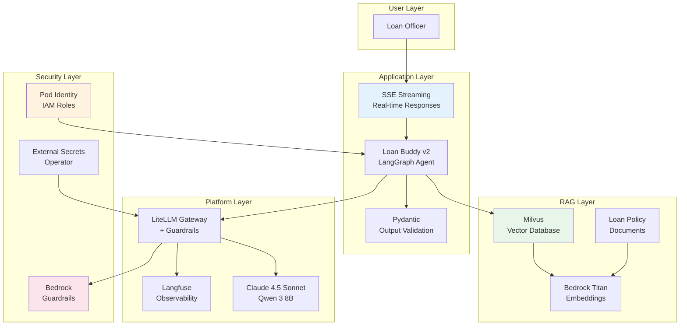

The Loan Buddy agent from Module A3 is evaluated, scaled, and monitored. Before approving it for production, the compliance team requires three additional capabilities\: **document-aware decisions** (RAG with policy documents), **proper security** (no hardcoded secrets, proper IAM), and **real-time responses** (streaming). This module addresses each of these requirements.

## What You Will Learn

By the end of this module, you will:
- Build a **RAG pipeline** with Milvus vector database and Bedrock Titan Embeddings
- Evaluate RAG quality using **Ragas** (faithfulness, answer relevancy, context precision)
- Harden security with **Pod Identity**, **External Secrets Operator**, and **Bedrock Guardrails**
- Implement **streaming responses** (SSE) for real-time agent output
- Validate outputs with **Pydantic** structured schemas
- Complete a **production readiness checklist**

## Production Architecture

The following diagram shows the Loan Buddy v2 architecture with all production components:

## Module Sections

#### 1. [Building a RAG Pipeline with Milvus](./rag-pipeline)
Deploy the Milvus vector database, ingest loan policy documents, and add document-aware decision making to Loan Buddy. Evaluate RAG quality using Ragas metrics.

#### 2. [Security Hardening for Production](./security-hardening)
Replace hardcoded secrets with External Secrets Operator, configure Pod Identity for proper IAM, and add Bedrock Guardrails for content safety.

#### 3. [Streaming Responses and Production Testing](./streaming-testing)
Implement SSE streaming for real-time responses, add Pydantic output validation, and complete the production readiness checklist.

## Building on Previous Modules

This module builds on the components from earlier modules:

| From Module | What You Use | What You Add |
|-------------|-------------|-------------|
| **Interacting with Models** | vLLM + Bedrock models | Bedrock Titan Embeddings for RAG |
| **Module A1** | LiteLLM gateway + Langfuse | Guardrails integration + RAG traces |
| **Module A2** | Loan Buddy agent + MCP servers | RAG retrieval + streaming + security |
| **Module A3** | Evaluation + monitoring | Ragas RAG evaluation metrics |

::alert[**Prerequisites**: Ensure Modules 1-4 are complete. You need the Loan Buddy agent running, Langfuse accessible, and the AMP/AMG dashboards from Module A3.]{type="warning"}

---

**Proceed to the first section to begin building the RAG pipeline.**
