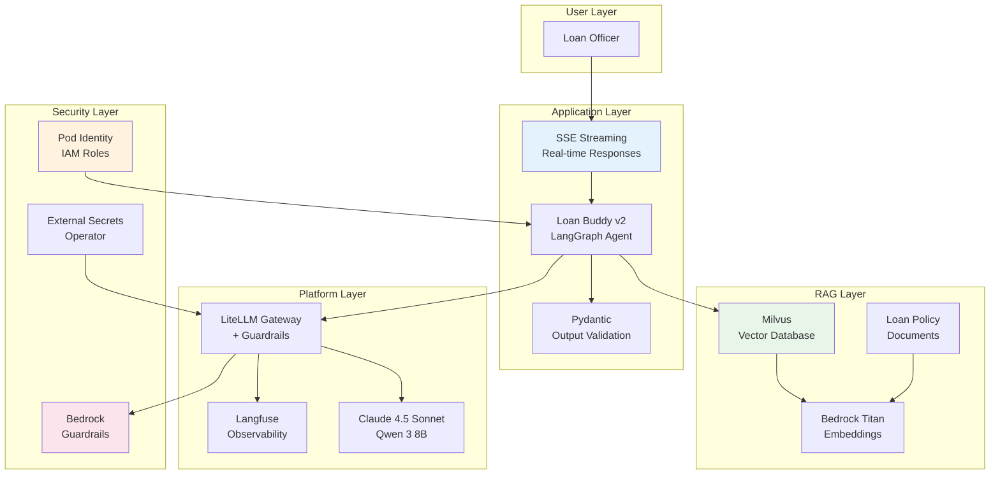

모듈 A3에서 Loan Buddy 에이전트의 평가, 확장, 모니터링을 완료했습니다. 컴플라이언스 팀은 프로덕션 승인 전에 세 가지 기능을 추가로 요구합니다\: **문서 기반 의사결정** (정책 문서 RAG), **적절한 보안** (하드코딩된 시크릿 없음, 적절한 IAM), **실시간 응답** (스트리밍). 이 모듈에서는 이 세 가지 요구사항을 각각 다룹니다.

## 학습 내용

이 모듈을 마치면 다음을 수행할 수 있습니다:
- Milvus 벡터 데이터베이스와 Bedrock Titan Embeddings로 **RAG 파이프라인** 구축
- **Ragas** 를 사용한 RAG 품질 평가 (충실도, 답변 관련성, 컨텍스트 정밀도)
- **Pod Identity**, **External Secrets Operator**, **Bedrock Guardrails** 로 보안 강화
- 실시간 에이전트 출력을 위한 **스트리밍 응답** (SSE) 구현
- **Pydantic** 구조화된 스키마로 출력 검증
- **프로덕션 준비 체크리스트** 완료

## 프로덕션 아키텍처

다음 다이어그램은 모든 프로덕션 컴포넌트가 포함된 Loan Buddy v2 아키텍처를 보여줍니다:

## 모듈 섹션

#### 1. [Milvus를 사용한 RAG 파이프라인 구축](./rag-pipeline)
Milvus 벡터 데이터베이스를 배포하고, 대출 정책 문서를 수집하며, Loan Buddy에 문서 기반 의사결정 기능을 추가합니다. Ragas 메트릭을 사용하여 RAG 품질을 평가합니다.

#### 2. [프로덕션을 위한 보안 강화](./security-hardening)
하드코딩된 시크릿을 External Secrets Operator로 교체하고, 적절한 IAM을 위한 Pod Identity를 구성하며, 콘텐츠 안전성을 위해 Bedrock Guardrails를 추가합니다.

#### 3. [스트리밍 응답 및 프로덕션 테스트](./streaming-testing)
실시간 응답을 위한 SSE 스트리밍을 구현하고, Pydantic 출력 검증을 추가하며, 프로덕션 준비 체크리스트를 완료합니다.

## 이전 모듈 활용

이 모듈은 이전 모듈에서 구축한 컴포넌트를 기반으로 합니다:

| 모듈 출처 | 사용하는 것 | 추가하는 것 |
|-------------|-------------|-------------|
| **모델과 상호작용하기** | vLLM + Bedrock 모델 | RAG를 위한 Bedrock Titan Embeddings |
| **모듈 A1** | LiteLLM 게이트웨이 + Langfuse | Guardrails 통합 + RAG 트레이스 |
| **모듈 A2** | Loan Buddy 에이전트 + MCP 서버 | RAG 검색 + 스트리밍 + 보안 |
| **모듈 A3** | 평가 + 모니터링 | Ragas RAG 평가 메트릭 |

::alert[**사전 요구사항**: 모델과 상호작용하기 모듈과 모듈 A1-A3가 완료되었는지 확인하십시오. Loan Buddy 에이전트가 실행 중이고, Langfuse에 액세스 가능하며, 모듈 A3의 AMP/AMG 대시보드가 필요합니다.]{type="warning"}

---

**첫 번째 섹션으로 이동하여 RAG 파이프라인 구축을 시작하십시오.**
