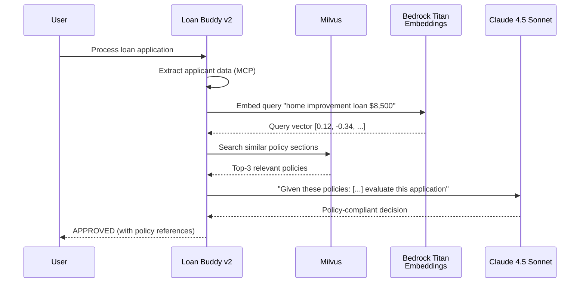

The shared *Interacting with Models* module introduced a simple RAG demonstration with Open WebUI's knowledge base. This section builds a production-grade RAG pipeline using Milvus as the vector database. Loan Buddy retrieves relevant loan policy documents before making credit decisions, which is the capability the compliance team requires.

## Hands-On: Deploy Your Vector Database

### Step 1: Explore the RAG Components

Start by checking the current state of the components to be deployed:

:::code{language=bash showCopyAction=true}
# Check current state - no vector database yet
kubectl get pods -n milvus 2>/dev/null || echo "Milvus namespace not found - we'll create it!"

# Verify Bedrock Titan Embeddings access (for converting text → vectors)
aws bedrock list-foundation-models --query "modelSummaries[?contains(modelId, 'titan-embed')]" --output table
:::

## What is Milvus?

[Milvus](https://milvus.io/) is a high-performance, cloud-native vector database built for scalable similarity search and AI applications. It fits the EKS-based platform for the following reasons:

- **Cloud-Native**: Designed for Kubernetes with Helm deployment support
- **High Performance**: Handles billions of vectors with millisecond search latency
- **Multiple Index Types**: IVF_FLAT, HNSW, and more for different accuracy/speed trade-offs
- **Rich Filtering**: Combine vector similarity search with metadata filtering
- **LangChain Integration**: Native support via the `langchain-milvus` package

## How RAG Enhances Loan Buddy



### Step 2: Deploy Milvus on EKS

:::code{language=bash showCopyAction=true}
# Add Milvus Helm repository
helm repo add milvus https://zilliztech.github.io/milvus-helm/
helm repo update

# Deploy Milvus standalone mode (suitable for workshop)
# NOTE: the current milvus-helm chart (>= 4.2 / appVersion 2.6.x) renames the
# bundled Pulsar sub-chart to `pulsarv3` and defaults standalone to the embedded
# `woodpecker` message queue. The legacy `--set pulsar.enabled=false` flag is
# silently ignored on these charts, so we disable `pulsarv3` and select
# woodpecker explicitly to keep this a lightweight standalone deployment.
helm install milvus milvus/milvus \
  --namespace milvus \
  --create-namespace \
  --set cluster.enabled=false \
  --set standalone.enabled=true \
  --set standalone.resources.requests.cpu=500m \
  --set standalone.resources.requests.memory=1Gi \
  --set standalone.resources.limits.memory=2Gi \
  --set etcd.replicaCount=1 \
  --set minio.mode=standalone \
  --set pulsarv3.enabled=false \
  --set standalone.messageQueue=woodpecker \
  --set woodpecker.enabled=true \
  --wait --timeout 420s
:::

### Step 3: Verify the Deployment

:::code{language=bash showCopyAction=true}
# Check all Milvus components are running
kubectl get pods -n milvus

# Expected output:
# milvus-standalone-xxx    1/1   Running
# milvus-etcd-0            1/1   Running
# milvus-minio-xxx         1/1   Running
:::

You should see three main components:
- **milvus-standalone**: The vector database engine
- **milvus-etcd**: Metadata storage for collections and indexes
- **milvus-minio**: Object storage for vector data persistence

### Step 4: Explore the Helm Configuration

:::::tabs

::::tab{label="Resources"}
**Milvus Standalone Configuration**

:::code{language=yaml showCopyAction=false}
standalone:
  enabled: true
  resources:
    requests:
      cpu: 500m
      memory: 1Gi
    limits:
      memory: 2Gi
  persistence:
    enabled: true
    storageClass: "efs-sc"
    size: 10Gi
:::

- **Standalone Mode**: Single instance suitable for workshop and small-scale production
- **EFS Storage**: Shared filesystem for persistent vector data
- **Resource Limits**: Balanced for workshop environment
::::

::::tab{label="Networking"}
**Service Configuration**

:::code{language=yaml showCopyAction=false}
service:
  type: ClusterIP
  port: 19530          # gRPC port for vector operations
  nodePort: null
  annotations: {}

standalone:
  extraEnv:
    - name: MILVUS_LOG_LEVEL
      value: "info"
:::

- **Port 19530**: Standard Milvus gRPC endpoint for vector operations
- **ClusterIP**: Internal access only — the agent connects within the cluster
- **Connection URI**: `http://milvus.milvus.svc.cluster.local:19530`
::::

::::tab{label="Storage Backend"}
**MinIO Object Storage**

:::code{language=yaml showCopyAction=false}
minio:
  mode: standalone
  resources:
    requests:
      cpu: 100m
      memory: 256Mi
  persistence:
    enabled: true
    size: 10Gi
:::

- **MinIO**: Provides S3-compatible object storage for vector data files
- **Standalone Mode**: Single instance for workshop use
- **Persistent Storage**: Data survives pod restarts
::::

:::::

## Ingest Loan Policy Documents

### Step 5: Prepare Policy Documents

:::code{language=bash showCopyAction=true}
# Navigate to the module 5 code directory
cd /workshop/workshops/eks-genai-workshop/static/code/module5/rag-pipeline

# View the loan policy documents
ls -la policies/
:::

**Sample Policy Documents:**
- `home-improvement-policy.md` — Rules for home improvement loans ($5K-$50K)
- `personal-loan-policy.md` — Rules for personal loans ($1K-$25K)
- `income-requirements.md` — Minimum income and DTI ratio requirements
- `risk-assessment-guidelines.md` — Risk scoring criteria and thresholds

### Step 6: Run the Document Ingestion Pipeline

:::code{language=bash showCopyAction=true}
# Install the ingestion dependencies into an isolated virtualenv.
# IMPORTANT: pin pymilvus to the 2.5 line. langchain-milvus' Milvus.from_documents()
# still uses the ORM-style Collection API under the hood, which fails with a
# "should create connection first" error on pymilvus >= 2.6. The retrieval agent
# (credit-underwriting-agent-v2.py) uses the native MilvusClient API and is fine
# on 2.6, but this one-off ingestion step needs 2.5.x.
python3 -m venv .ingest-venv
source .ingest-venv/bin/activate
pip install --quiet langchain-milvus langchain-aws langchain-text-splitters \
  "pymilvus>=2.5,<2.6"

# Port-forward Milvus for local access
kubectl port-forward svc/milvus -n milvus 19530:19530 &

# Run the ingestion script
python3 ingest_policies.py
:::

**What the ingestion script does:**

:::code{language=python showCopyAction=false}
from langchain_milvus import Milvus
from langchain_aws import BedrockEmbeddings
from langchain_text_splitters import RecursiveCharacterTextSplitter

# 1. Load and chunk policy documents
splitter = RecursiveCharacterTextSplitter(
    chunk_size=500,
    chunk_overlap=50,
    separators=["\n## ", "\n### ", "\n\n", "\n", " "]
)
chunks = splitter.split_documents(documents)

# 2. Create embeddings using Bedrock Titan
embeddings = BedrockEmbeddings(
    model_id="amazon.titan-embed-text-v2:0",
    region_name=os.environ["AWS_REGION"]
)

# 3. Store in Milvus. drop_old=True makes re-runs idempotent.
Milvus.from_documents(
    documents=chunks,
    embedding=embeddings,
    connection_args={"uri": "http://milvus.milvus.svc.cluster.local:19530"},
    collection_name="loan_policies",
    drop_old=True,
    auto_id=True,
)

print(f"Ingested {len(chunks)} policy chunks into Milvus")
:::

Chunk count depends on policy file content; ~22 with the policies shipped in this workshop:

::::expand{header="Check Output"}

```text
Loading 4 policy documents...
Splitting into chunks: 22 chunks created
Generating embeddings via Bedrock Titan...
Storing in Milvus collection 'loan_policies'...
Ingested 22 policy chunks into Milvus
```

::::

### Step 7: Verify the Vector Store

:::code{language=bash showCopyAction=true}
# Test a similarity search
python3 -c "
from langchain_milvus import Milvus
from langchain_aws import BedrockEmbeddings
import os

embeddings = BedrockEmbeddings(
    model_id='amazon.titan-embed-text-v2:0',
    region_name=os.environ['AWS_REGION']
)

vectorstore = Milvus(
    embedding_function=embeddings,
    connection_args={'uri': 'http://localhost:19530'},
    collection_name='loan_policies'
)

results = vectorstore.similarity_search('home improvement loan requirements', k=3)
for i, doc in enumerate(results):
    print(f'--- Result {i+1} ---')
    print(doc.page_content[:200])
    print()
"
:::

The output shows the three most relevant policy sections for home improvement loans, which is the context Loan Buddy needs.

## Enhance Loan Buddy with RAG

### Step 8: Deploy Loan Buddy v2 (RAG-Enhanced)

:::code{language=bash showCopyAction=true}
# View the enhanced agent code
code /workshop/workshops/eks-genai-workshop/static/code/module5/rag-pipeline/credit-underwriting-agent-v2.py

# Deploy Loan Buddy v2
cd /workshop/workshops/eks-genai-workshop/static/code/module5/rag-pipeline
./deploy-rag-agent.sh
:::

**Key changes in the RAG-enhanced agent:**

:::code{language=python showCopyAction=false}
from langchain_aws import BedrockEmbeddings
from pymilvus import MilvusClient

# Embeddings + native Milvus client are created once and reused across requests.
embeddings = BedrockEmbeddings(model_id="amazon.titan-embed-text-v2:0", region_name=AWS_REGION)
milvus_client = MilvusClient(uri=MILVUS_URI)

# New: RAG retrieval tool added to the agent
@tool
def retrieve_loan_policies(query: str) -> str:
    """Retrieve relevant loan policy sections from the vector database."""
    query_vector = embeddings.embed_query(query)
    results = milvus_client.search(
        collection_name="loan_policies",
        data=[query_vector],
        limit=3,
        output_fields=["text", "source"],
    )
    hits = results[0] if results else []
    if not hits:
        return "No matching loan policies found."
    return "\n\n".join(
        f"[Policy: {hit['entity'].get('source', 'unknown')}]\n{hit['entity'].get('text', '')}"
        for hit in hits
    )

# Updated system prompt
system_prompt = """You are a credit underwriting AI assistant.
Before making any decision, ALWAYS retrieve relevant loan policies
using the retrieve_loan_policies tool. Your decisions must cite
specific policy sections to ensure compliance."""
:::

### Step 9: Test RAG-Enhanced Loan Processing

:::code{language=bash showCopyAction=true}
# Port-forward the v2 agent
kubectl port-forward service/loan-buddy-agent-v2 8081:8080 -n workshop &

# Process John's application with policy awareness
curl -X POST -F "image_file=@./example1.png" \
  http://localhost:8081/api/process_credit_application_with_upload \
  | jq '.'
:::

**Differences from Module A2:**
- The agent now retrieves policy documents before making decisions
- The credit assessment cites specific policy sections
- Decisions comply with documented policies and include documented reasoning

### Step 10: View RAG Traces in Langfuse

Open your Langfuse dashboard and find the new traces. Each trace includes:

- **Retrieval step**: The `retrieve_loan_policies` tool call with the search query
- **Retrieved documents**: The top-3 policy sections returned from Milvus
- **Policy-aware reasoning**: The LLM using policy context in its decision
- **Cited decision**: Final assessment with policy references

::alert[**Compare with Module A2**: Open a Module A2 trace and a Module A4 trace side-by-side. Notice how the v2 agent's reasoning is grounded in specific policy documents, while the v1 agent relied solely on the LLM's training data.]{type="success"}

## Evaluate RAG Quality with Ragas

With the RAG pipeline in place, the next step is to measure its quality. [Ragas](https://docs.ragas.io/) is a widely used framework for evaluating RAG pipelines with quantitative metrics.

### Step 11: Run Ragas Evaluation

:::code{language=bash showCopyAction=true}
# Run the Ragas evaluation script
python3 evaluate_rag.py
:::

**What Ragas measures:**

:::code{language=python showCopyAction=false}
from ragas import evaluate, EvaluationDataset
from ragas.metrics import (
    faithfulness,        # Is the answer grounded in retrieved context?
    answer_relevancy,    # Is the answer relevant to the question?
    context_precision,   # Are the retrieved docs relevant?
    context_recall       # Did we retrieve all necessary information?
)
from ragas.llms import LangchainLLMWrapper
from ragas.embeddings import LangchainEmbeddingsWrapper

# A small, fixed evaluation set keeps scores reproducible. Each entry pairs a
# loan question with a reference answer grounded in the policy documents.
samples = []
for item in EVAL_SET:
    # Retrieve top-3 policy contexts from Milvus, then ask the judge LLM to
    # answer using ONLY that context.
    docs = vectorstore.similarity_search(item["question"], k=3)
    contexts = [d.page_content for d in docs]
    answer = judge.invoke(
        f"Answer using ONLY the policy context.\n\nContext:\n"
        + "\n\n".join(contexts)
        + f"\n\nQuestion: {item['question']}"
    ).content
    samples.append({
        "user_input": item["question"],
        "retrieved_contexts": contexts,
        "response": answer,
        "reference": item["reference"],
    })

dataset = EvaluationDataset.from_list(samples)

# Wrap the gateway-routed judge LLM and Titan embeddings for Ragas.
judge_llm = LangchainLLMWrapper(judge)
judge_emb = LangchainEmbeddingsWrapper(embeddings)

results = evaluate(
    dataset=dataset,
    metrics=[faithfulness, answer_relevancy, context_precision, context_recall],
    llm=judge_llm,
    embeddings=judge_emb,
)

print(results)
:::

### Understanding Ragas Metrics

| Metric | What It Measures | Target Score | Why It Matters |
|--------|------------------|-------------|----------------|
| **Faithfulness** | Is the decision grounded in retrieved policies? | > 0.85 | Prevents hallucinated policy references |
| **Answer Relevancy** | Is the assessment relevant to the loan application? | > 0.90 | Ensures focused decision-making |
| **Context Precision** | Are the retrieved policies relevant to this application type? | > 0.80 | Measures retrieval quality |
| **Context Recall** | Were all relevant policies retrieved? | > 0.75 | Ensures no critical policy is missed |

### Step 12: Interpret the Ragas Scores

`evaluate_rag.py` prints the aggregated metric scores to the console:

```
=== Ragas RAG Evaluation Results ===
{'faithfulness': 0.92, 'answer_relevancy': 0.94, 'context_precision': 0.85, 'context_recall': 0.80}
```

Use the scores to decide where to tune the pipeline:

1. Compare each score against the targets in the table above
2. Re-run after changing `chunk_size` or the system prompt to see the impact
3. Track scores across different retrieval configurations to find the best setup

::alert[**Optimization Tip**: If context_precision is low, try adjusting the `chunk_size` in the ingestion pipeline. If faithfulness is low, strengthen the system prompt to require explicit policy citations.]{type="info"}

## Key Takeaways

- **Milvus** provides production-grade vector storage with Kubernetes-native deployment
- **Bedrock Titan Embeddings** convert text to vectors without managing embedding models
- **RAG** grounds agent decisions in actual policy documents, enabling compliance
- **Ragas** provides quantitative metrics to measure and improve RAG pipeline quality
- **Langfuse integration** provides end-to-end visibility from retrieval to decision

---

**[Next: Security Hardening for Production →](../security-hardening)**
