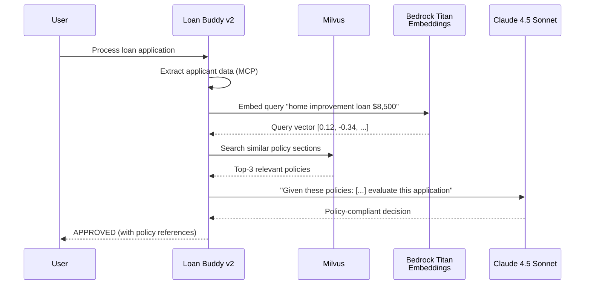

공유 *모델과 상호작용하기* 모듈에서는 Open WebUI의 지식 베이스로 간단한 RAG 데모를 살펴보았습니다. 이 섹션에서는 Milvus를 벡터 데이터베이스로 사용하여 프로덕션 수준의 RAG 파이프라인을 구축합니다. Loan Buddy는 신용 결정을 내리기 전에 관련 대출 정책 문서를 검색하며, 이는 컴플라이언스 팀이 요구하는 기능입니다.

## 실습: 벡터 데이터베이스 배포

### Step 1: RAG 컴포넌트 탐색

먼저 배포할 컴포넌트의 현재 상태를 확인합니다:

:::code{language=bash showCopyAction=true}
# 현재 상태 확인 - 아직 벡터 데이터베이스 없음
kubectl get pods -n milvus 2>/dev/null || echo "Milvus namespace not found - we'll create it!"

# Bedrock Titan Embeddings 액세스 확인 (텍스트 → 벡터 변환용)
aws bedrock list-foundation-models --query "modelSummaries[?contains(modelId, 'titan-embed')]" --output table
:::

## Milvus란?

[Milvus](https://milvus.io/)는 확장 가능한 유사도 검색과 AI 애플리케이션을 위해 설계된 고성능 클라우드 네이티브 벡터 데이터베이스입니다. 다음과 같은 이유로 EKS 기반 플랫폼에 적합합니다:

- **클라우드 네이티브**: Helm 배포를 지원하는 Kubernetes 기반 설계
- **고성능**: 밀리초 수준의 검색 지연 시간으로 수십억 개의 벡터 처리
- **다양한 인덱스 타입**: 정확도/속도 트레이드오프에 따라 IVF_FLAT, HNSW 등 선택 가능
- **풍부한 필터링**: 벡터 유사도 검색과 메타데이터 필터링 결합
- **LangChain 통합**: `langchain-milvus` 패키지를 통한 네이티브 지원

## RAG가 Loan Buddy를 향상시키는 방법



### Step 2: EKS에 Milvus 배포

:::code{language=bash showCopyAction=true}
# Milvus Helm 리포지토리 추가
helm repo add milvus https://zilliztech.github.io/milvus-helm/
helm repo update

# Milvus 독립 실행형 모드 배포 (워크샵에 적합)
# 참고: 최신 milvus-helm 차트(4.2 이상 / appVersion 2.6.x)는 번들 Pulsar
# 서브차트 이름을 `pulsarv3`로 변경했고, standalone 기본 메시지 큐를 내장형
# `woodpecker`로 사용합니다. 이 차트에서는 기존 `--set pulsar.enabled=false`
# 플래그가 조용히 무시되므로, `pulsarv3`를 비활성화하고 woodpecker를 명시적으로
# 선택해 가벼운 standalone 배포를 유지합니다.
helm install milvus milvus/milvus \
  --namespace milvus \
  --create-namespace \
  --set cluster.enabled=false \
  --set standalone.enabled=true \
  --set standalone.resources.requests.cpu=500m \
  --set standalone.resources.requests.memory=1Gi \
  --set standalone.resources.limits.memory=2Gi \
  --set etcd.replicaCount=1 \
  --set minio.mode=standalone \
  --set pulsarv3.enabled=false \
  --set standalone.messageQueue=woodpecker \
  --set woodpecker.enabled=true \
  --wait --timeout 420s
:::

### Step 3: 배포 확인

:::code{language=bash showCopyAction=true}
# 모든 Milvus 컴포넌트가 실행 중인지 확인
kubectl get pods -n milvus

# 예상 출력:
# milvus-standalone-xxx    1/1   Running
# milvus-etcd-0            1/1   Running
# milvus-minio-xxx         1/1   Running
:::

세 가지 주요 컴포넌트가 표시됩니다:
- **milvus-standalone**: 벡터 데이터베이스 엔진
- **milvus-etcd**: 컬렉션 및 인덱스용 메타데이터 스토리지
- **milvus-minio**: 벡터 데이터 지속성을 위한 객체 스토리지

### Step 4: Helm 구성 탐색

:::::tabs

::::tab{label="Resources"}
**Milvus Standalone 구성**

:::code{language=yaml showCopyAction=false}
standalone:
  enabled: true
  resources:
    requests:
      cpu: 500m
      memory: 1Gi
    limits:
      memory: 2Gi
  persistence:
    enabled: true
    storageClass: "efs-sc"
    size: 10Gi
:::

- **Standalone 모드**: 워크샵 및 소규모 프로덕션에 적합한 단일 인스턴스
- **EFS 스토리지**: 영구 벡터 데이터를 위한 공유 파일시스템
- **리소스 제한**: 워크샵 환경에 맞게 균형 조정
::::

::::tab{label="Networking"}
**서비스 구성**

:::code{language=yaml showCopyAction=false}
service:
  type: ClusterIP
  port: 19530          # gRPC port for vector operations
  nodePort: null
  annotations: {}

standalone:
  extraEnv:
    - name: MILVUS_LOG_LEVEL
      value: "info"
:::

- **Port 19530**: 벡터 작업을 위한 표준 Milvus gRPC 엔드포인트
- **ClusterIP**: 내부 액세스만 — 에이전트가 클러스터 내에서 연결
- **Connection URI**: `http://milvus.milvus.svc.cluster.local:19530`
::::

::::tab{label="Storage Backend"}
**MinIO 객체 스토리지**

:::code{language=yaml showCopyAction=false}
minio:
  mode: standalone
  resources:
    requests:
      cpu: 100m
      memory: 256Mi
  persistence:
    enabled: true
    size: 10Gi
:::

- **MinIO**: 벡터 데이터 파일을 위한 S3 호환 객체 스토리지 제공
- **Standalone 모드**: 워크샵 사용을 위한 단일 인스턴스
- **영구 스토리지**: Pod 재시작 후에도 데이터 유지
::::

:::::

## 대출 정책 문서 수집

### Step 5: 정책 문서 준비

:::code{language=bash showCopyAction=true}
# module 5 코드 디렉토리로 이동
cd /workshop/workshops/eks-genai-workshop/static/code/module5/rag-pipeline

# 대출 정책 문서 보기
ls -la policies/
:::

**샘플 정책 문서:**
- `home-improvement-policy.md` — 주택 개선 대출 규칙 ($5K-$50K)
- `personal-loan-policy.md` — 개인 대출 규칙 ($1K-$25K)
- `income-requirements.md` — 최소 소득 및 DTI 비율 요구사항
- `risk-assessment-guidelines.md` — 위험 점수 기준 및 임계값

### Step 6: 문서 수집 파이프라인 실행

:::code{language=bash showCopyAction=true}
# 수집 의존성을 격리된 virtualenv에 설치합니다.
# 중요: pymilvus는 2.5 계열로 고정하세요. langchain-milvus의
# Milvus.from_documents()는 내부적으로 ORM 스타일 Collection API를 사용하는데,
# pymilvus >= 2.6에서는 "should create connection first" 오류로 실패합니다.
# 검색 에이전트(credit-underwriting-agent-v2.py)는 native MilvusClient API를
# 사용하므로 2.6에서도 정상이지만, 이 일회성 수집 단계는 2.5.x가 필요합니다.
python3 -m venv .ingest-venv
source .ingest-venv/bin/activate
pip install --quiet langchain-milvus langchain-aws langchain-text-splitters \
  "pymilvus>=2.5,<2.6"

# 로컬 액세스를 위한 Milvus 포트 포워딩
kubectl port-forward svc/milvus -n milvus 19530:19530 &

# 수집 스크립트 실행
python3 ingest_policies.py
:::

**수집 스크립트가 수행하는 작업:**

:::code{language=python showCopyAction=false}
from langchain_milvus import Milvus
from langchain_aws import BedrockEmbeddings
from langchain_text_splitters import RecursiveCharacterTextSplitter

# 1. Load and chunk policy documents
splitter = RecursiveCharacterTextSplitter(
    chunk_size=500,
    chunk_overlap=50,
    separators=["\n## ", "\n### ", "\n\n", "\n", " "]
)
chunks = splitter.split_documents(documents)

# 2. Create embeddings using Bedrock Titan
embeddings = BedrockEmbeddings(
    model_id="amazon.titan-embed-text-v2:0",
    region_name=os.environ["AWS_REGION"]
)

# 3. Store in Milvus. drop_old=True makes re-runs idempotent.
Milvus.from_documents(
    documents=chunks,
    embedding=embeddings,
    connection_args={"uri": "http://milvus.milvus.svc.cluster.local:19530"},
    collection_name="loan_policies",
    drop_old=True,
    auto_id=True,
)

print(f"Ingested {len(chunks)} policy chunks into Milvus")
:::

**예상 출력 (청크 수는 정책 파일 내용에 따라 달라지며, 이 워크샵에 포함된 정책 기준 약 22개입니다):**
```
Loading 4 policy documents...
Splitting into chunks: 22 chunks created
Generating embeddings via Bedrock Titan...
Storing in Milvus collection 'loan_policies'...
Ingested 22 policy chunks into Milvus
```

### Step 7: 벡터 스토어 확인

:::code{language=bash showCopyAction=true}
# 유사도 검색 테스트
python3 -c "
from langchain_milvus import Milvus
from langchain_aws import BedrockEmbeddings
import os

embeddings = BedrockEmbeddings(
    model_id='amazon.titan-embed-text-v2:0',
    region_name=os.environ['AWS_REGION']
)

vectorstore = Milvus(
    embedding_function=embeddings,
    connection_args={'uri': 'http://localhost:19530'},
    collection_name='loan_policies'
)

results = vectorstore.similarity_search('home improvement loan requirements', k=3)
for i, doc in enumerate(results):
    print(f'--- Result {i+1} ---')
    print(doc.page_content[:200])
    print()
"
:::

출력에는 주택 개선 대출과 가장 관련성이 높은 상위 3개 정책 섹션이 표시되며, 이것이 Loan Buddy가 필요로 하는 컨텍스트입니다.

## RAG로 Loan Buddy 향상

### Step 8: Loan Buddy v2 (RAG 향상) 배포

:::code{language=bash showCopyAction=true}
# 향상된 에이전트 코드 보기
code /workshop/workshops/eks-genai-workshop/static/code/module5/rag-pipeline/credit-underwriting-agent-v2.py

# Loan Buddy v2 배포
cd /workshop/workshops/eks-genai-workshop/static/code/module5/rag-pipeline
./deploy-rag-agent.sh
:::

**RAG 향상 에이전트의 주요 변경 사항:**

:::code{language=python showCopyAction=false}
from langchain_aws import BedrockEmbeddings
from pymilvus import MilvusClient

# Embeddings + native Milvus client are created once and reused across requests.
embeddings = BedrockEmbeddings(model_id="amazon.titan-embed-text-v2:0", region_name=AWS_REGION)
milvus_client = MilvusClient(uri=MILVUS_URI)

# New: RAG retrieval tool added to the agent
@tool
def retrieve_loan_policies(query: str) -> str:
    """Retrieve relevant loan policy sections from the vector database."""
    query_vector = embeddings.embed_query(query)
    results = milvus_client.search(
        collection_name="loan_policies",
        data=[query_vector],
        limit=3,
        output_fields=["text", "source"],
    )
    hits = results[0] if results else []
    if not hits:
        return "No matching loan policies found."
    return "\n\n".join(
        f"[Policy: {hit['entity'].get('source', 'unknown')}]\n{hit['entity'].get('text', '')}"
        for hit in hits
    )

# Updated system prompt
system_prompt = """You are a credit underwriting AI assistant.
Before making any decision, ALWAYS retrieve relevant loan policies
using the retrieve_loan_policies tool. Your decisions must cite
specific policy sections to ensure compliance."""
:::

### Step 9: RAG 향상 대출 처리 테스트

:::code{language=bash showCopyAction=true}
# v2 에이전트 포트 포워딩
kubectl port-forward service/loan-buddy-agent-v2 8081:8080 -n workshop &

# 정책 인식을 통한 John의 신청서 처리
curl -X POST -F "image_file=@./example1.png" \
  http://localhost:8081/api/process_credit_application_with_upload \
  | jq '.'
:::

**모듈 A2와의 차이점:**
- 에이전트가 결정을 내리기 전에 정책 문서를 검색합니다
- 신용 평가가 특정 정책 섹션을 인용합니다
- 결정이 문서화된 정책을 준수하며 문서화된 근거를 포함합니다

### Step 10: Langfuse에서 RAG 트레이스 보기

Langfuse 대시보드를 열고 새 트레이스를 확인하십시오. 각 트레이스에는 다음이 포함됩니다:

- **검색 단계**: 검색 쿼리와 함께 `retrieve_loan_policies` 도구 호출
- **검색된 문서**: Milvus에서 반환된 상위 3개 정책 섹션
- **정책 인식 추론**: 의사결정에 정책 컨텍스트를 사용하는 LLM
- **인용된 결정**: 정책 참조가 포함된 최종 평가

::alert[**모듈 A2와 비교**: 모듈 A2 트레이스와 모듈 A4 트레이스를 나란히 열어보십시오. v2 에이전트의 추론이 특정 정책 문서에 기반한 반면, v1 에이전트는 LLM의 학습 데이터에만 의존한 것을 확인할 수 있습니다.]{type="success"}

## Ragas로 RAG 품질 평가

RAG 파이프라인이 구축되었으므로 다음 단계는 품질 측정입니다. [Ragas](https://docs.ragas.io/)는 정량적 메트릭으로 RAG 파이프라인을 평가하는 데 널리 사용되는 프레임워크입니다.

### Step 11: Ragas 평가 실행

:::code{language=bash showCopyAction=true}
# Ragas 평가 스크립트 실행
python3 evaluate_rag.py
:::

**Ragas가 측정하는 것:**

:::code{language=python showCopyAction=false}
from ragas import evaluate, EvaluationDataset
from ragas.metrics import (
    faithfulness,        # Is the answer grounded in retrieved context?
    answer_relevancy,    # Is the answer relevant to the question?
    context_precision,   # Are the retrieved docs relevant?
    context_recall       # Did we retrieve all necessary information?
)
from ragas.llms import LangchainLLMWrapper
from ragas.embeddings import LangchainEmbeddingsWrapper

# 작고 고정된 평가 세트를 사용하면 점수가 재현 가능합니다. 각 항목은
# 정책 문서에 기반한 참조 답변과 대출 질문을 한 쌍으로 묶습니다.
samples = []
for item in EVAL_SET:
    # Milvus에서 상위 3개 정책 컨텍스트를 검색한 다음, 판정 LLM에게
    # 해당 컨텍스트만 사용하여 답하도록 요청합니다.
    docs = vectorstore.similarity_search(item["question"], k=3)
    contexts = [d.page_content for d in docs]
    answer = judge.invoke(
        f"Answer using ONLY the policy context.\n\nContext:\n"
        + "\n\n".join(contexts)
        + f"\n\nQuestion: {item['question']}"
    ).content
    samples.append({
        "user_input": item["question"],
        "retrieved_contexts": contexts,
        "response": answer,
        "reference": item["reference"],
    })

dataset = EvaluationDataset.from_list(samples)

# 게이트웨이로 라우팅된 판정 LLM과 Titan 임베딩을 Ragas용으로 래핑합니다.
judge_llm = LangchainLLMWrapper(judge)
judge_emb = LangchainEmbeddingsWrapper(embeddings)

results = evaluate(
    dataset=dataset,
    metrics=[faithfulness, answer_relevancy, context_precision, context_recall],
    llm=judge_llm,
    embeddings=judge_emb,
)

print(results)
:::

### Ragas 메트릭 이해

| 메트릭 | 측정 내용 | 목표 점수 | 중요한 이유 |
|--------|------------------|-------------|----------------|
| **Faithfulness** | 결정이 검색된 정책에 기반하고 있는가? | > 0.85 | 환각된 정책 참조 방지 |
| **Answer Relevancy** | 평가가 대출 신청서와 관련이 있는가? | > 0.90 | 집중된 의사결정 보장 |
| **Context Precision** | 검색된 정책이 이 신청 유형과 관련이 있는가? | > 0.80 | 검색 품질 측정 |
| **Context Recall** | 모든 관련 정책을 검색했는가? | > 0.75 | 중요한 정책이 누락되지 않도록 보장 |

### Step 12: Ragas 점수 해석

`evaluate_rag.py`는 집계된 메트릭 점수를 콘솔에 출력합니다:

```
=== Ragas RAG Evaluation Results ===
{'faithfulness': 0.92, 'answer_relevancy': 0.94, 'context_precision': 0.85, 'context_recall': 0.80}
```

점수를 활용하여 파이프라인을 어디에서 튜닝할지 결정하십시오:

1. 각 점수를 위 표의 목표값과 비교
2. `chunk_size`나 시스템 프롬프트를 변경한 후 다시 실행하여 영향 확인
3. 다양한 검색 구성에 걸쳐 점수를 추적하여 최적 구성 탐색

::alert[**최적화 팁**: context_precision이 낮으면 수집 파이프라인의 `chunk_size`를 조정해 보십시오. faithfulness가 낮으면 명시적인 정책 인용을 요구하도록 시스템 프롬프트를 강화하십시오.]{type="info"}

## 핵심 요점

- **Milvus** 는 Kubernetes 네이티브 배포로 프로덕션 수준의 벡터 스토리지를 제공합니다
- **Bedrock Titan Embeddings** 는 임베딩 모델을 직접 관리하지 않고 텍스트를 벡터로 변환합니다
- **RAG** 는 에이전트의 결정을 실제 정책 문서에 근거하도록 하여 컴플라이언스를 지원합니다
- **Ragas** 는 RAG 파이프라인 품질을 측정하고 개선하기 위한 정량적 메트릭을 제공합니다
- **Langfuse 통합** 은 검색부터 결정까지 엔드투엔드 가시성을 제공합니다

---

**[다음: 프로덕션을 위한 보안 강화 →](../security-hardening)**
