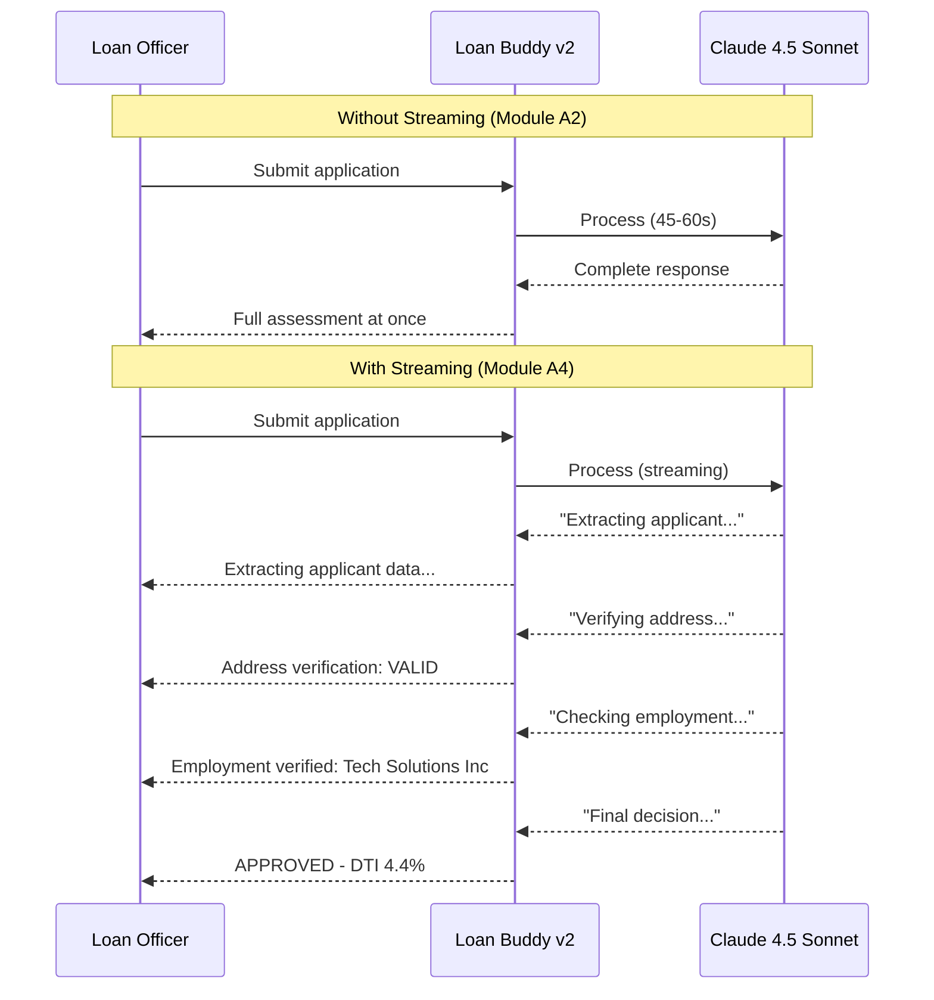

This section covers the remaining production requirements\: **real-time streaming responses** so loan officers see results as they are generated, **structured output validation** so every decision follows a strict schema, and a **production readiness checklist** to confirm the application is ready for release.

## Hands-On: Enable Streaming Responses

### Step 1: Understand the UX Difference

In Module A2, the agent processed John's application and returned the entire result at once — the loan officer waited 45-60 seconds with no feedback. With streaming, each part of the assessment appears as it is generated:



### Step 2: Deploy the Streaming Endpoint

:::code{language=bash showCopyAction=true}
# View the streaming agent code
code /workshop/workshops/eks-genai-workshop/static/code/module5/streaming/credit-underwriting-agent-streaming.py

# Deploy the streaming version
cd /workshop/workshops/eks-genai-workshop/static/code/module5/streaming
./deploy-streaming-agent.sh
:::

**Key streaming implementation:**

:::code{language=python showCopyAction=false}
from fastapi import FastAPI
from fastapi.responses import StreamingResponse
from langchain_openai import ChatOpenAI

app = FastAPI()

@app.post("/api/process_credit_application_stream")
async def process_application_stream(image_file: UploadFile):
    """Process loan application with SSE streaming."""

    async def event_generator():
        # Stream agent events as Server-Sent Events
        async for event in graph.astream_events(
            {"messages": [HumanMessage(content=prompt)]},
            config={"callbacks": callbacks},
            version="v2"
        ):
            kind = event["event"]

            if kind == "on_tool_start":
                tool_name = event["name"]
                yield f"data: {json.dumps({'type': 'tool_start', 'tool': tool_name})}\n\n"

            elif kind == "on_tool_end":
                yield f"data: {json.dumps({'type': 'tool_result', 'tool': event['name'], 'status': 'complete'})}\n\n"

            elif kind == "on_chat_model_stream":
                content = event["data"]["chunk"].content
                if content:
                    yield f"data: {json.dumps({'type': 'token', 'content': content})}\n\n"

        yield f"data: {json.dumps({'type': 'done'})}\n\n"

    return StreamingResponse(
        event_generator(),
        media_type="text/event-stream"
    )
:::

### Step 3: Test Streaming

:::code{language=bash showCopyAction=true}
# Port-forward the streaming agent
kubectl port-forward service/loan-buddy-agent-streaming 8082:8080 -n workshop &

# Test with streaming output (--no-buffer for real-time display)
curl --no-buffer -X POST -F "image_file=@./example1.png" \
  http://localhost:8082/api/process_credit_application_stream
:::

**The command produces real-time output similar to the following:**
```
data: {"type": "tool_start", "tool": "extract_credit_application_data"}
data: {"type": "tool_result", "tool": "extract_credit_application_data", "status": "complete"}
data: {"type": "token", "content": "Based"}
data: {"type": "token", "content": " on"}
data: {"type": "token", "content": " the"}
data: {"type": "token", "content": " extracted"}
...
data: {"type": "tool_start", "tool": "retrieve_loan_policies"}
data: {"type": "tool_result", "tool": "retrieve_loan_policies", "status": "complete"}
data: {"type": "token", "content": "According"}
data: {"type": "token", "content": " to"}
data: {"type": "token", "content": " policy"}
...
data: {"type": "done"}
```

::alert[**Real-Time Output**: Each `data:` line appears as the LLM generates it. Tool call events show when the agent is extracting data, validating addresses, checking employment, and retrieving policies, giving the loan officer full visibility into the process.]{type="success"}

---

## Structured Output Validation with Pydantic

### Step 4: Define the Credit Decision Schema

Every credit decision must follow a strict format for compliance:

:::code{language=python showCopyAction=false}
from enum import Enum
from typing import List

from pydantic import BaseModel, Field, field_validator, ValidationInfo

class DecisionStatus(str, Enum):
    APPROVED = "APPROVED"
    REJECTED = "REJECTED"
    MANUAL_REVIEW = "MANUAL_REVIEW"

class PolicyReference(BaseModel):
    policy_name: str = Field(description="Name of the referenced policy document")
    section: str = Field(description="Specific section cited")
    relevance: str = Field(description="Why this policy applies")

class CreditDecision(BaseModel):
    """Structured credit underwriting decision."""
    applicant_name: str
    loan_amount: float = Field(gt=0)
    loan_purpose: str
    # debt_to_income_ratio MUST be declared before `decision` so it is already
    # validated and present in info.data when validate_decision_consistency runs.
    debt_to_income_ratio: float = Field(ge=0.0)
    decision: DecisionStatus
    confidence_score: float = Field(ge=0.0, le=1.0)
    risk_factors: List[str]
    policy_references: List[PolicyReference] = Field(min_length=1)
    reasoning: str = Field(min_length=50)

    @field_validator("decision")
    @classmethod
    def validate_decision_consistency(cls, v: DecisionStatus, info: ValidationInfo) -> DecisionStatus:
        """Ensure high-risk DTI ratios cannot be auto-approved.

        debt_to_income_ratio is declared before decision, so it is already
        validated and present in info.data when this runs.
        """
        dti = info.data.get("debt_to_income_ratio", 0)
        # Accept both ratio (0.43) and percentage (43) styles defensively.
        threshold = 0.43 if dti <= 1 else 43
        if dti > threshold and v == DecisionStatus.APPROVED:
            raise ValueError(f"DTI ratio {dti} exceeds 43% threshold - cannot auto-approve")
        return v
:::

### Step 5: Integrate Validation in the Agent

:::code{language=python showCopyAction=false}
# The agent's final step validates output against the schema
def validate_and_format_decision(raw_output: str) -> CreditDecision:
    """Parse and validate the LLM's credit decision."""
    try:
        decision = CreditDecision.model_validate_json(raw_output)
        logger.info(f"Valid decision: {decision.decision} for {decision.applicant_name}")
        return decision
    except ValidationError as e:
        logger.error(f"Invalid decision format: {e}")
        # Return for manual review if validation fails
        return CreditDecision(
            applicant_name="Unknown",
            loan_amount=0,
            loan_purpose="Unknown",
            decision=DecisionStatus.MANUAL_REVIEW,
            confidence_score=0.0,
            debt_to_income_ratio=0.0,
            risk_factors=["Output validation failed"],
            policy_references=[PolicyReference(
                policy_name="System",
                section="Validation",
                relevance="Auto-generated due to validation failure"
            )],
            reasoning=f"Agent output failed schema validation: {str(e)[:200]}"
        )
:::

### Step 6: Test Validation

:::code{language=bash showCopyAction=true}
# Process an application and verify structured output
curl -s -X POST -F "image_file=@./example1.png" \
  http://localhost:8082/api/process_credit_application_with_upload \
  | python3 -c "
import sys, json
data = json.load(sys.stdin)
assessment = data.get('credit_assessment', {})
print('=== Structured Decision ===')
print(f'Decision: {assessment.get(\"decision\", \"N/A\")}')
print(f'Confidence: {assessment.get(\"confidence_score\", \"N/A\")}')
print(f'DTI Ratio: {assessment.get(\"debt_to_income_ratio\", \"N/A\")}')
print(f'Policy References: {len(assessment.get(\"policy_references\", []))}')
print(f'Risk Factors: {assessment.get(\"risk_factors\", [])}')
"
:::

---

## Production Readiness Checklist

### Step 7: Verify All Production Requirements

Complete the following checklist to confirm Loan Buddy v2 is production-ready:

:::code{language=bash showCopyAction=true}
# Run the production readiness verification script
cd /workshop/workshops/eks-genai-workshop/static/code/module5/streaming
python3 production_readiness_check.py
:::

**Manual verification:**

::::tabs

:::tab{label="Security"}
**Security Requirements**

:::code{language=bash showCopyAction=true}
# 1. Pod Identity configured (not copied SA)
echo "=== Pod Identity ==="
aws eks list-pod-identity-associations --cluster-name $CLUSTER_NAME \
  --query "associations[?namespace=='workshop']" --output table

# 2. No hardcoded secrets in deployments
echo "=== Secret Check ==="
kubectl get deployment -n workshop -o yaml | grep -c "password\|secret_key\|api_key" || echo "0 hardcoded secrets found"

# 3. External Secrets synced
echo "=== External Secrets ==="
kubectl get externalsecret -n workshop -o wide

# 4. Guardrails active
echo "=== Bedrock Guardrails ==="
aws bedrock list-guardrails --query "guardrails[?name=='loan-buddy-guardrail'].status" --output text
:::
:::

:::tab{label="Reliability"}
**Reliability Requirements**

:::code{language=bash showCopyAction=true}
# 1. Health checks configured
echo "=== Health Probes ==="
kubectl get deployment loan-buddy-agent-v2 -n workshop \
  -o jsonpath='{.spec.template.spec.containers[0].livenessProbe}' | jq '.'

# 2. Resource limits set
echo "=== Resource Limits ==="
kubectl get deployment loan-buddy-agent-v2 -n workshop \
  -o jsonpath='{.spec.template.spec.containers[0].resources}' | jq '.'

# 3. Replicas running
echo "=== Replicas ==="
kubectl get deployment -n workshop -o wide
:::
:::

:::tab{label="Observability"}
**Observability Requirements**

:::code{language=bash showCopyAction=true}
# 1. Langfuse tracing active (application-level)
echo "=== Langfuse Traces ==="
kubectl logs deployment/loan-buddy-agent-v2 -n workshop --tail=5 | grep -i "langfuse\|trace"

# 2. AMP metrics flowing (infrastructure-level)
echo "=== Prometheus Metrics ==="
kubectl get pods -n prometheus-system -o wide 2>/dev/null || echo "Check AMP workspace in AWS Console"

# 3. Ragas evaluation configured
echo "=== RAG Evaluation ==="
python3 -c "from ragas import evaluate; print('Ragas available')" 2>/dev/null || echo "Ragas not installed"
:::
:::

:::tab{label="Data & RAG"}
**Data Pipeline Requirements**

:::code{language=bash showCopyAction=true}
# 1. Milvus vector DB running
echo "=== Milvus Status ==="
kubectl get pods -n milvus

# 2. Policy documents ingested
echo "=== Vector Collection ==="
python3 -c "
from pymilvus import connections, Collection
connections.connect(uri='http://localhost:19530')
col = Collection('loan_policies')
print(f'Documents in Milvus: {col.num_entities}')
" 2>/dev/null || echo "Port-forward Milvus first: kubectl port-forward svc/milvus -n milvus 19530:19530"

# 3. Embeddings model accessible
echo "=== Bedrock Embeddings ==="
aws bedrock list-foundation-models \
  --query "modelSummaries[?contains(modelId, 'titan-embed-text-v2')].modelId" \
  --output text 2>/dev/null | grep -q titan-embed-text-v2 && echo "Titan Embeddings OK" || echo "Check Bedrock access"
:::
:::

::::

### Production Readiness Summary

| Category | Requirement | Status |
|----------|-------------|--------|
| **Security** | Pod Identity (no copied SA) | Module A4 |
| **Security** | External Secrets (no hardcoded creds) | Module A4 |
| **Security** | Bedrock Guardrails (content safety) | Module A4 |
| **Reliability** | Health probes configured | Module A4 |
| **Reliability** | Resource limits set | Module A2 |
| **Reliability** | HPA auto-scaling | Module A3 |
| **Observability** | Langfuse tracing (app-level) | Module A1 |
| **Observability** | AMP/AMG monitoring (infra-level) | Module A3 |
| **Observability** | Ragas RAG evaluation | Module A4 |
| **Data** | Milvus vector database | Module A4 |
| **Data** | Policy document ingestion | Module A4 |
| **Quality** | LLM-as-a-Judge evaluation | Module A3 |
| **Quality** | A/B model routing | Module A3 |
| **Quality** | Pydantic output validation | Module A4 |

::alert[Every row in this table is now complete. Loan Buddy v2 is production-ready: secured, monitored, evaluated, and validated.]{type="success"}

---

## What You've Built

In Module A4, you extended Loan Buddy from a workshop prototype into a production-ready application:

1. **RAG Pipeline** — Milvus vector DB + Bedrock Titan Embeddings → policy-aware decisions
2. **RAG Evaluation** — Ragas metrics (faithfulness, relevancy, precision, recall) → measurable quality
3. **Pod Identity** — Dedicated IAM roles per pod → least-privilege security
4. **External Secrets** — AWS Secrets Manager integration → no hardcoded credentials
5. **Bedrock Guardrails** — Content filtering + PII anonymization → compliance controls
6. **Streaming** — SSE real-time responses → immediate feedback for loan officers
7. **Structured Validation** — Pydantic schemas → consistent, auditable decisions

**Sarah the loan officer can now process applications in real time, with policy-compliant decisions, complete audit trails, and enterprise-grade security.**

---

**[Next: Workshop Summary and Next Steps →](../../summary/)**
