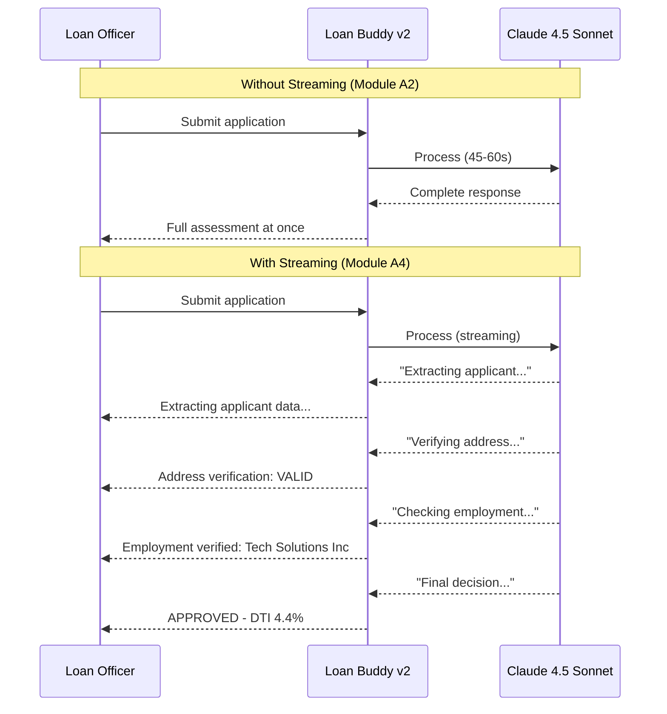

이 섹션에서는 남은 프로덕션 요구사항을 다룹니다\: 대출 담당자가 결과를 생성되는 대로 확인할 수 있는 **실시간 스트리밍 응답**, 모든 결정이 엄격한 스키마를 따르도록 하는 **구조화된 출력 검증**, 애플리케이션의 출시 준비 여부를 확인하는 **프로덕션 준비 체크리스트** 입니다.

## 실습: 스트리밍 응답 활성화

### Step 1: UX 차이 이해

모듈 A2에서는 에이전트가 John의 신청서를 처리하고 전체 결과를 한 번에 반환했습니다. 대출 담당자는 아무 피드백 없이 45-60초를 기다려야 했습니다. 스트리밍을 사용하면 평가의 각 부분이 생성되는 대로 표시됩니다:



### Step 2: 스트리밍 엔드포인트 배포

:::code{language=bash showCopyAction=true}
# 스트리밍 에이전트 코드 보기
code /workshop/workshops/eks-genai-workshop/static/code/module5/streaming/credit-underwriting-agent-streaming.py

# 스트리밍 버전 배포
cd /workshop/workshops/eks-genai-workshop/static/code/module5/streaming
./deploy-streaming-agent.sh
:::

**주요 스트리밍 구현:**

:::code{language=python showCopyAction=false}
from fastapi import FastAPI
from fastapi.responses import StreamingResponse
from langchain_openai import ChatOpenAI

app = FastAPI()

@app.post("/api/process_credit_application_stream")
async def process_application_stream(image_file: UploadFile):
    """Process loan application with SSE streaming."""

    async def event_generator():
        # Stream agent events as Server-Sent Events
        async for event in graph.astream_events(
            {"messages": [HumanMessage(content=prompt)]},
            config={"callbacks": callbacks},
            version="v2"
        ):
            kind = event["event"]

            if kind == "on_tool_start":
                tool_name = event["name"]
                yield f"data: {json.dumps({'type': 'tool_start', 'tool': tool_name})}\n\n"

            elif kind == "on_tool_end":
                yield f"data: {json.dumps({'type': 'tool_result', 'tool': event['name'], 'status': 'complete'})}\n\n"

            elif kind == "on_chat_model_stream":
                content = event["data"]["chunk"].content
                if content:
                    yield f"data: {json.dumps({'type': 'token', 'content': content})}\n\n"

        yield f"data: {json.dumps({'type': 'done'})}\n\n"

    return StreamingResponse(
        event_generator(),
        media_type="text/event-stream"
    )
:::

### Step 3: 스트리밍 테스트

:::code{language=bash showCopyAction=true}
# 스트리밍 에이전트 포트 포워딩
kubectl port-forward service/loan-buddy-agent-streaming 8082:8080 -n workshop &

# 스트리밍 출력으로 테스트 (실시간 표시를 위한 --no-buffer)
curl --no-buffer -X POST -F "image_file=@./example1.png" \
  http://localhost:8082/api/process_credit_application_stream
:::

**명령을 실행하면 다음과 유사한 실시간 출력이 표시됩니다:**
```
data: {"type": "tool_start", "tool": "extract_credit_application_data"}
data: {"type": "tool_result", "tool": "extract_credit_application_data", "status": "complete"}
data: {"type": "token", "content": "Based"}
data: {"type": "token", "content": " on"}
data: {"type": "token", "content": " the"}
data: {"type": "token", "content": " extracted"}
...
data: {"type": "tool_start", "tool": "retrieve_loan_policies"}
data: {"type": "tool_result", "tool": "retrieve_loan_policies", "status": "complete"}
data: {"type": "token", "content": "According"}
data: {"type": "token", "content": " to"}
data: {"type": "token", "content": " policy"}
...
data: {"type": "done"}
```

::alert[**실시간 출력**: 각 `data:` 줄은 LLM이 생성하는 대로 나타납니다. 도구 호출 이벤트는 에이전트가 데이터를 추출하고, 주소를 검증하고, 고용을 확인하고, 정책을 검색하는 시점을 보여주어 대출 담당자에게 프로세스에 대한 완전한 가시성을 제공합니다.]{type="success"}

---

## Pydantic을 사용한 구조화된 출력 검증

### Step 4: 신용 결정 스키마 정의

모든 신용 결정은 컴플라이언스를 위해 엄격한 형식을 따라야 합니다:

:::code{language=python showCopyAction=false}
from enum import Enum
from typing import List

from pydantic import BaseModel, Field, field_validator, ValidationInfo

class DecisionStatus(str, Enum):
    APPROVED = "APPROVED"
    REJECTED = "REJECTED"
    MANUAL_REVIEW = "MANUAL_REVIEW"

class PolicyReference(BaseModel):
    policy_name: str = Field(description="Name of the referenced policy document")
    section: str = Field(description="Specific section cited")
    relevance: str = Field(description="Why this policy applies")

class CreditDecision(BaseModel):
    """Structured credit underwriting decision."""
    applicant_name: str
    loan_amount: float = Field(gt=0)
    loan_purpose: str
    # debt_to_income_ratio는 decision보다 먼저 선언되어야 합니다. 그래야
    # validate_decision_consistency가 실행될 때 info.data에 이미 검증된 값이 존재합니다.
    debt_to_income_ratio: float = Field(ge=0.0)
    decision: DecisionStatus
    confidence_score: float = Field(ge=0.0, le=1.0)
    risk_factors: List[str]
    policy_references: List[PolicyReference] = Field(min_length=1)
    reasoning: str = Field(min_length=50)

    @field_validator("decision")
    @classmethod
    def validate_decision_consistency(cls, v: DecisionStatus, info: ValidationInfo) -> DecisionStatus:
        """Ensure high-risk DTI ratios cannot be auto-approved.

        debt_to_income_ratio가 decision보다 먼저 선언되므로 이 검증기가 실행될 때
        info.data에 이미 검증되어 존재합니다.
        """
        dti = info.data.get("debt_to_income_ratio", 0)
        # 비율(0.43)과 백분율(43) 표기를 모두 방어적으로 처리합니다.
        threshold = 0.43 if dti <= 1 else 43
        if dti > threshold and v == DecisionStatus.APPROVED:
            raise ValueError(f"DTI ratio {dti} exceeds 43% threshold - cannot auto-approve")
        return v
:::

### Step 5: 에이전트에 검증 통합

:::code{language=python showCopyAction=false}
# The agent's final step validates output against the schema
def validate_and_format_decision(raw_output: str) -> CreditDecision:
    """Parse and validate the LLM's credit decision."""
    try:
        decision = CreditDecision.model_validate_json(raw_output)
        logger.info(f"Valid decision: {decision.decision} for {decision.applicant_name}")
        return decision
    except ValidationError as e:
        logger.error(f"Invalid decision format: {e}")
        # Return for manual review if validation fails
        return CreditDecision(
            applicant_name="Unknown",
            loan_amount=0,
            loan_purpose="Unknown",
            decision=DecisionStatus.MANUAL_REVIEW,
            confidence_score=0.0,
            debt_to_income_ratio=0.0,
            risk_factors=["Output validation failed"],
            policy_references=[PolicyReference(
                policy_name="System",
                section="Validation",
                relevance="Auto-generated due to validation failure"
            )],
            reasoning=f"Agent output failed schema validation: {str(e)[:200]}"
        )
:::

### Step 6: 검증 테스트

:::code{language=bash showCopyAction=true}
# 신청서 처리 및 구조화된 출력 확인
curl -s -X POST -F "image_file=@./example1.png" \
  http://localhost:8082/api/process_credit_application_with_upload \
  | python3 -c "
import sys, json
data = json.load(sys.stdin)
assessment = data.get('credit_assessment', {})
print('=== Structured Decision ===')
print(f'Decision: {assessment.get(\"decision\", \"N/A\")}')
print(f'Confidence: {assessment.get(\"confidence_score\", \"N/A\")}')
print(f'DTI Ratio: {assessment.get(\"debt_to_income_ratio\", \"N/A\")}')
print(f'Policy References: {len(assessment.get(\"policy_references\", []))}')
print(f'Risk Factors: {assessment.get(\"risk_factors\", [])}')
"
:::

---

## 프로덕션 준비 체크리스트

### Step 7: 모든 프로덕션 요구사항 확인

다음 체크리스트를 완료하여 Loan Buddy v2가 프로덕션 준비 상태인지 확인하십시오:

:::code{language=bash showCopyAction=true}
# 프로덕션 준비 확인 스크립트 실행
cd /workshop/workshops/eks-genai-workshop/static/code/module5/streaming
python3 production_readiness_check.py
:::

**수동 확인:**

::::tabs

:::tab{label="Security"}
**보안 요구사항**

:::code{language=bash showCopyAction=true}
# 1. Pod Identity 구성됨 (복사된 SA 아님)
echo "=== Pod Identity ==="
aws eks list-pod-identity-associations --cluster-name $CLUSTER_NAME \
  --query "associations[?namespace=='workshop']" --output table

# 2. 배포에 하드코딩된 시크릿 없음
echo "=== Secret Check ==="
kubectl get deployment -n workshop -o yaml | grep -c "password\|secret_key\|api_key" || echo "0 hardcoded secrets found"

# 3. External Secrets 동기화됨
echo "=== External Secrets ==="
kubectl get externalsecret -n workshop -o wide

# 4. Guardrails 활성화됨
echo "=== Bedrock Guardrails ==="
aws bedrock list-guardrails --query "guardrails[?name=='loan-buddy-guardrail'].status" --output text
:::
:::

:::tab{label="Reliability"}
**안정성 요구사항**

:::code{language=bash showCopyAction=true}
# 1. 헬스 체크 구성됨
echo "=== Health Probes ==="
kubectl get deployment loan-buddy-agent-v2 -n workshop \
  -o jsonpath='{.spec.template.spec.containers[0].livenessProbe}' | jq '.'

# 2. 리소스 제한 설정됨
echo "=== Resource Limits ==="
kubectl get deployment loan-buddy-agent-v2 -n workshop \
  -o jsonpath='{.spec.template.spec.containers[0].resources}' | jq '.'

# 3. 레플리카 실행 중
echo "=== Replicas ==="
kubectl get deployment -n workshop -o wide
:::
:::

:::tab{label="Observability"}
**관측성 요구사항**

:::code{language=bash showCopyAction=true}
# 1. Langfuse 트레이싱 활성화됨 (애플리케이션 수준)
echo "=== Langfuse Traces ==="
kubectl logs deployment/loan-buddy-agent-v2 -n workshop --tail=5 | grep -i "langfuse\|trace"

# 2. AMP 메트릭 흐름 (인프라 수준)
echo "=== Prometheus Metrics ==="
kubectl get pods -n prometheus-system -o wide 2>/dev/null || echo "Check AMP workspace in AWS Console"

# 3. Ragas 평가 구성됨
echo "=== RAG Evaluation ==="
python3 -c "from ragas import evaluate; print('Ragas available')" 2>/dev/null || echo "Ragas not installed"
:::
:::

:::tab{label="Data & RAG"}
**데이터 파이프라인 요구사항**

:::code{language=bash showCopyAction=true}
# 1. Milvus 벡터 DB 실행 중
echo "=== Milvus Status ==="
kubectl get pods -n milvus

# 2. 정책 문서 수집됨
echo "=== Vector Collection ==="
python3 -c "
from pymilvus import connections, Collection
connections.connect(uri='http://localhost:19530')
col = Collection('loan_policies')
print(f'Documents in Milvus: {col.num_entities}')
" 2>/dev/null || echo "Port-forward Milvus first: kubectl port-forward svc/milvus -n milvus 19530:19530"

# 3. Embeddings 모델 액세스 가능
echo "=== Bedrock Embeddings ==="
aws bedrock list-foundation-models \
  --query "modelSummaries[?contains(modelId, 'titan-embed-text-v2')].modelId" \
  --output text 2>/dev/null | grep -q titan-embed-text-v2 && echo "Titan Embeddings OK" || echo "Check Bedrock access"
:::
:::

::::

### 프로덕션 준비 요약

| 카테고리 | 요구사항 | 상태 |
|----------|-------------|--------|
| **보안** | Pod Identity (복사된 SA 없음) | 모듈 A4 |
| **보안** | External Secrets (하드코딩된 자격 증명 없음) | 모듈 A4 |
| **보안** | Bedrock Guardrails (콘텐츠 안전성) | 모듈 A4 |
| **안정성** | 헬스 프로브 구성됨 | 모듈 A4 |
| **안정성** | 리소스 제한 설정됨 | 모듈 A2 |
| **안정성** | HPA 자동 확장 | 모듈 A3 |
| **관측성** | Langfuse 트레이싱 (앱 수준) | 모듈 A1 |
| **관측성** | AMP/AMG 모니터링 (인프라 수준) | 모듈 A3 |
| **관측성** | Ragas RAG 평가 | 모듈 A4 |
| **데이터** | Milvus 벡터 데이터베이스 | 모듈 A4 |
| **데이터** | 정책 문서 수집 | 모듈 A4 |
| **품질** | LLM-as-a-Judge 평가 | 모듈 A3 |
| **품질** | A/B 모델 라우팅 | 모듈 A3 |
| **품질** | Pydantic 출력 검증 | 모듈 A4 |

::alert[이 표의 모든 행이 이제 완료되었습니다. Loan Buddy v2는 보안, 모니터링, 평가, 검증을 모두 갖춘 프로덕션 준비 상태입니다.]{type="success"}

---

## 구축한 것

모듈 A4에서 Loan Buddy를 워크샵 프로토타입에서 프로덕션 준비 애플리케이션으로 확장했습니다:

1. **RAG 파이프라인** — Milvus 벡터 DB + Bedrock Titan Embeddings → 정책 기반 의사결정
2. **RAG 평가** — Ragas 메트릭 (충실도, 관련성, 정밀도, 재현율) → 측정 가능한 품질
3. **Pod Identity** — Pod별 전용 IAM 역할 → 최소 권한 보안
4. **External Secrets** — AWS Secrets Manager 통합 → 하드코딩된 자격 증명 없음
5. **Bedrock Guardrails** — 콘텐츠 필터링 + PII 익명화 → 컴플라이언스 제어
6. **스트리밍** — SSE 실시간 응답 → 대출 담당자에게 즉각적인 피드백 제공
7. **구조화된 검증** — Pydantic 스키마 → 일관되고 감사 가능한 결정

**대출 담당자 Sarah는 이제 정책을 준수하는 결정, 완전한 감사 추적, 엔터프라이즈급 보안을 갖추고 신청서를 실시간으로 처리할 수 있습니다.**

---

**[다음: 워크샵 요약 및 다음 단계 →](../../summary/)**
