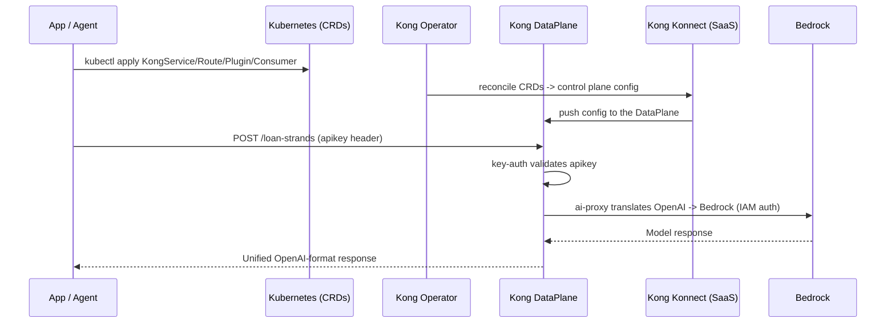

In the Track B stack, model access is provided by **Kong AI Gateway**, which routes every model interaction directly to Amazon Bedrock. This is the Track B stack equivalent of the LiteLLM module: same role (a unified, governed entry point to your models), different technology (Kong's `ai-proxy` plugin on **Kong Operator 2.x**, managed with **native Kubernetes CRDs**).

::alert[This is the **Track B Stack** version of the [LiteLLM AI Gateway page](/track-a-opensource/a1-genai-components/ai-gateway/). It mirrors that page section-for-section so you can compare the two gateways directly. Prerequisite: the [Kong API Gateway Setup](/track-b-saas/b1-platform-setup/kong-setup/) is complete -- Kong Operator 2.x installed, control plane `kong-aws`, and a `dataplane` running with Bedrock Pod Identity.]{type="info"}

::alert[**Kong Operator 2.x (not the old KGO/decK model).** Because Kong Operator 2.0+ bundles the Kong Ingress Controller, you configure the gateway with **native Kubernetes CRDs** (`KongService`, `KongRoute`, `KongPlugin`, `KongConsumer`) applied with `kubectl apply` -- GitOps-native, no `decK`. The CRDs are reconciled to your Konnect control plane and appear (read-only) in the Konnect UI.]{type="success"}

::alert[**Interactive zsh note:** if pasting a block fails with `parse error near ')'` or `command not found: #`, run `setopt interactive_comments` once -- zsh does not treat `#` as a comment by default.]{type="info"}

## Hands-On: Explore Your API Gateway

Examine how Kong manages your model interactions:

### Step 1: Review Your Kong Stack

You already confirmed the operator and DataPlane are healthy in this module's [Prerequisites Check](../#prerequisites-check). Here the goal is different — to see the **DataPlane pod** that proxies your traffic (`kong` namespace) and understand the two-namespace split the rest of B2 builds on:

:::code{language=bash showCopyAction=true}
kubectl get pods -n kong
:::

::::expand{header="Check Output"}

```text
# namespace kong (the data plane that proxies traffic):
NAME                                         READY   STATUS    RESTARTS   AGE
dataplane-dataplane-xxxxx-xxxxxxxxx-xxxxx    1/1     Running   0          70m
```

The operator itself lives in the `kong-system` namespace (verified in the Prerequisites Check).

::::

**Key Components:**
- **Kong DataPlane** (`kong` ns): the proxy that receives requests and calls Amazon Bedrock via the `ai-proxy` plugin
- **Kong Operator 2.x** (`kong-system` ns): the operator + bundled ingress controller that reconciles your CRDs into gateway config
- **Kong Konnect (SaaS)**: the control plane at [cloud.konghq.com](https://cloud.konghq.com) — stores config + serves the UI; there is no self-hosted control plane pod or database

::alert[**Architecture vs LiteLLM**: LiteLLM ships its own Postgres + Redis in-cluster and is configured by a Helm values file. Kong keeps **configuration in Kubernetes CRDs** (reconciled to Konnect) and runs only a stateless DataPlane. You change the gateway by editing YAML and `kubectl apply` — not by editing a pod's config file.]{type="info"}

### Step 2: Confirm Bedrock Access (Pod Identity)

The Kong DataPlane calls Bedrock through the `ai-proxy` plugin using an IAM role via **EKS Pod Identity** -- no LLM API keys are stored. The `kaigateway-podid-sa` service account (created in [Module B1: Platform Setup](/track-b-saas/b1-platform-setup/kong-setup/)) must be associated with an IAM role that grants `bedrock:InvokeModel`.

**2a. Confirm the DataPlane runs as `kaigateway-podid-sa`:**

:::code{language=bash showCopyAction=true}
export CLUSTER_NAME="${EKS_CLUSTER_NAME:-genai-on-eks}"
export AWS_REGION="${AWS_REGION:-us-east-1}"

kubectl get pods -n kong -o jsonpath='{range .items[*]}{.metadata.name}{"\t"}{.spec.serviceAccountName}{"\n"}{end}' | grep dataplane
:::

::::expand{header="Check Output"}

```text
dataplane-dataplane-xxxxx-xxxxxxxxx-xxxxx      kaigateway-podid-sa
```

::::

**2b. Associate the service account with a Bedrock-enabled IAM role (EKS Pod Identity).** The workshop's shared setup provisions a Bedrock role (`genai-on-eks-<region>-litellm`, which grants `bedrock:InvokeModel`); associate it with the Kong service account:

:::code{language=bash showCopyAction=true}
BEDROCK_ROLE_ARN=$(aws iam get-role --role-name ${CLUSTER_NAME}-${AWS_REGION}-litellm --query 'Role.Arn' --output text)

# Idempotent: only create the association if one doesn't already exist for this SA.
if aws eks list-pod-identity-associations --cluster-name "$CLUSTER_NAME" --region "$AWS_REGION" \
     --namespace kong --query "associations[?serviceAccount=='kaigateway-podid-sa'].associationId" \
     --output text | grep -q .; then
  echo "✅ Pod Identity association for kaigateway-podid-sa already exists — skipping"
else
  aws eks create-pod-identity-association \
    --cluster-name "$CLUSTER_NAME" --region "$AWS_REGION" \
    --namespace kong --service-account kaigateway-podid-sa \
    --role-arn "$BEDROCK_ROLE_ARN"
fi
:::

::::expand{header="Check Output"}

```json
{
    "association": {
        "clusterName": "genai-on-eks",
        "namespace": "kong",
        "serviceAccount": "kaigateway-podid-sa",
        "roleArn": "arn:aws:iam::xxxxxxxxxxxx:role/genai-on-eks-us-east-1-litellm",
        "associationId": "a-xxxxxxxxxxxxxxxxx"
    }
}
```

::::

::alert[If this returns `ResourceInUseException ... association already exists`, it is already set up -- skip to **2d**. Reusing the LiteLLM role keeps the workshop simple; in production, use a **dedicated least-privilege** Bedrock role for the gateway.]{type="info"}

**2c. Restart the DataPlane so it picks up the credentials** (a pod only receives Pod Identity credentials at startup, so an already-running DataPlane must be restarted after the association is created):

:::code{language=bash showCopyAction=true}
kubectl rollout restart deployment -n kong
kubectl rollout status deployment -n kong --timeout=150s
:::

**2d. Verify the association exists** (the list must be **non-empty**):

:::code{language=bash showCopyAction=true}
aws eks list-pod-identity-associations --cluster-name "$CLUSTER_NAME" --region "$AWS_REGION" \
  --namespace kong --query 'associations[*].{sa:serviceAccount,roleArn:roleArn}' --output table
:::

::::expand{header="Check Output"}

```text
--------------------------------------
|    ListPodIdentityAssociations     |
+----------------------+-------------+
|         sa           |   roleArn   |
+----------------------+-------------+
|  kaigateway-podid-sa |  None       |
+----------------------+-------------+
```

::::

::alert[**The list MUST have a row for `kaigateway-podid-sa`.** An **empty list** (`"associations": []`) means the DataPlane has no Bedrock credentials and every `/loan-strands` call later fails with `failed to get credentials: none of the providers succeeded, no credentials available`. The `roleArn` showing `None` is normal (the *list* API omits it — the association is still present); the **empty list** is the real failure.]{type="warning"}

**Why this matters:** Just as LiteLLM's pod uses Pod Identity for Bedrock, the Kong DataPlane uses service account `kaigateway-podid-sa` associated with an IAM role granting `bedrock:InvokeModel` (created for you by the workshop environment setup). Requests are authenticated to Bedrock automatically.

## What is Kong AI Gateway?

Kong AI Gateway is a set of AI-specific plugins on top of the Kong Gateway proxy that provides:

- **Universal API**: One OpenAI-compatible endpoint (`ai-proxy`) fronting 17+ providers including **Amazon Bedrock**
- **Multi-Model Routing**: `ai-proxy-advanced` load-balances and semantically routes across models
- **Governance at the Edge**: `key-auth`, rate limiting, prompt guard, and PII sanitization as plugins
- **Kubernetes-native config**: routes/plugins/consumers are CRDs (`kubectl apply`), reconciled to Konnect

## Step 3: Configure the Bedrock Route (Kubernetes CRDs)

This is the core difference from LiteLLM. In the default stack, the model config is a **pre-rendered Helm values file** baked into the LiteLLM pod. Here, you **author Kubernetes CRDs and `kubectl apply` them** — Kong Operator reconciles them to the `kong-aws` control plane and the DataPlane serves them.

You will create five resources for the `/loan-strands` route:

| Resource | Kind | Purpose |
|---|---|---|
| ai-proxy plugin | `KongPlugin` | translate OpenAI ↔ Bedrock (Claude Sonnet 4.5) |
| key-auth plugin | `KongPlugin` | require the `apikey` header |
| service | `KongService` | the route's logical service (ai-proxy replaces the real upstream) |
| route | `KongRoute` | path `/loan-strands`, with both plugins attached via annotation |
| consumer + key | `KongConsumer` + `KongCredentialAPIKey` | the identity + API key your app uses |

**3a. Create the two plugins (`ai-proxy` + `key-auth`):**

:::code{language=bash showCopyAction=true}
cat <<'EOF' | kubectl apply -f -
apiVersion: configuration.konghq.com/v1
kind: KongPlugin
metadata:
  name: ai-proxy-loan-strands
  namespace: kong
plugin: ai-proxy
config:
  route_type: llm/v1/chat
  auth:
    param_name: allow_override
    param_value: "false"
    param_location: body
  model:
    provider: bedrock
    name: global.anthropic.claude-sonnet-4-5-20250929-v1:0
    options:
      bedrock:
        aws_region: us-east-1
---
apiVersion: configuration.konghq.com/v1
kind: KongPlugin
metadata:
  name: key-auth-loan-strands
  namespace: kong
plugin: key-auth
config:
  key_names:
  - apikey
  hide_credentials: true
EOF
:::

::::expand{header="Check Output"}

```text
kongplugin.configuration.konghq.com/ai-proxy-loan-strands created
kongplugin.configuration.konghq.com/key-auth-loan-strands created
```

::::

::alert[**Where to see these:** these `KongPlugin` objects now exist in Kubernetes (`kubectl get kongplugin -n kong`), but they will **not** appear in the Konnect UI yet. A plugin only reconciles to the control plane once it is **attached to a Service/Route/Consumer** — which happens in Step 3b (the route's `konghq.com/plugins` annotation). You will see them in the Konnect **Plugins** view after Step 3d. At this point they are just unattached definitions waiting to be bound.]{type="info"}

**3b. Create the Service and Route** (the route attaches both plugins via the `konghq.com/plugins` annotation, and binds to the `kong-aws` control plane via `controlPlaneRef`):

:::code{language=bash showCopyAction=true}
cat <<'EOF' | kubectl apply -f -
apiVersion: configuration.konghq.com/v1alpha1
kind: KongService
metadata:
  name: loan-strands-bedrock
  namespace: kong
spec:
  name: loan-strands-bedrock
  host: localhost
  port: 32000
  controlPlaneRef:
    type: konnectNamespacedRef
    konnectNamespacedRef:
      name: kong-aws
---
apiVersion: configuration.konghq.com/v1alpha1
kind: KongRoute
metadata:
  name: loan-strands-route
  namespace: kong
  annotations:
    konghq.com/plugins: ai-proxy-loan-strands,key-auth-loan-strands
spec:
  name: loan-strands-route
  protocols:
  - http
  - https
  paths:
  - /loan-strands
  serviceRef:
    type: namespacedRef
    namespacedRef:
      name: loan-strands-bedrock
EOF
:::

::::expand{header="Check Output"}

```text
kongservice.configuration.konghq.com/loan-strands-bedrock created
kongroute.configuration.konghq.com/loan-strands-route created
```

::::

::alert[**What you've done so far:** in 3a you defined two plugins (`ai-proxy` → Bedrock, `key-auth`); in 3b you created the **Service** (`loan-strands-bedrock`) and **Route** (`/loan-strands`) and attached both plugins to the route via the `konghq.com/plugins` annotation. That is the complete request path — a client hitting `/loan-strands` is now authenticated by `key-auth` and proxied to Amazon Bedrock by `ai-proxy`. Kong Operator reconciles all of this to the `kong-aws` control plane automatically.]{type="success"}

**See it in the Konnect UI →** Open [cloud.konghq.com](https://cloud.konghq.com) → **Gateway Manager** → **`kong-aws`** → **Gateway Services**. The service `loan-strands-bedrock` now appears:


Open the service's **Routes** tab (or the **Routes** view) to see `loan-strands-route` with path `/loan-strands`:


::alert[These Service and Route entries are **read-only** in the Konnect UI — they are owned by the Kubernetes CRDs you just applied. To change them, edit the YAML and re-apply (`kubectl apply`). That is the GitOps guarantee.]{type="info"}

Because the route carries the `konghq.com/plugins` annotation, its plugins reconcile at the same time. Open the **Plugins** tab (or the route's Plugins view) — both `ai-proxy` (open it to see `provider: bedrock` + the Claude model id) and `key-auth` are now attached:


::alert[**The `ai-proxy` plugin makes Kong speak the OpenAI Chat Completions API on the front and Amazon Bedrock on the back** — the gateway does the translation. `allow_override: false` means the client cannot change the model; Kong pins Claude Sonnet 4.5, controlling model + cost at the edge. The DataPlane authenticates to Bedrock with its IAM role — the client never needs AWS credentials.]{type="success"}

**3c. Create the Consumer and its API key:**

:::code{language=bash showCopyAction=true}
cat <<'EOF' | kubectl apply -f -
apiVersion: configuration.konghq.com/v1
kind: KongConsumer
metadata:
  name: loan-strands-agent
  namespace: kong
  annotations:
    kubernetes.io/ingress.class: kong
username: loan-strands-agent
spec:
  controlPlaneRef:
    type: konnectNamespacedRef
    konnectNamespacedRef:
      name: kong-aws
---
apiVersion: configuration.konghq.com/v1alpha1
kind: KongCredentialAPIKey
metadata:
  name: loan-strands-apikey
  namespace: kong
spec:
  consumerRef:
    name: loan-strands-agent
  key: loan-strands-key-123
EOF
:::

::::expand{header="Check Output"}

```text
kongconsumer.configuration.konghq.com/loan-strands-agent created
kongcredentialapikey.configuration.konghq.com/loan-strands-apikey created
```

::::

::alert[**What this does:** the **`KongConsumer`** is a named client identity, and the **`KongCredentialAPIKey`** issues it an API key (`loan-strands-key-123`). Because the route from Step 3b has the `key-auth` plugin attached, only requests carrying this key in the `apikey` header will be allowed through to Bedrock. This is the Kong analog to a LiteLLM Virtual Key — a named identity with its own credential and (optionally) its own rate limits.]{type="success"}

**See it in the Konnect UI →** In the same control plane, open **Consumers** (left nav under **API Gateway → Control planes → `kong-aws` → Consumers**). `loan-strands-agent` now appears — note the `k8s-kind:KongConsumer` / `k8s-namespace:kong` tags showing it is owned by the Kubernetes CRD:


**3d. Verify everything programmed to Konnect** (`PROGRAMMED: True` means the CRD reconciled to the control plane):

:::code{language=bash showCopyAction=true}
kubectl get kongservice,kongroute,kongconsumer,kongcredentialapikey -n kong
kubectl get kongplugin -n kong
:::

::::expand{header="Check Output"}

```text
NAME                                                        HOST        PROTOCOL   PROGRAMMED   AGE
kongservice.configuration.konghq.com/loan-strands-bedrock   localhost              True         12m

NAME                                                    PROGRAMMED   AGE
kongroute.configuration.konghq.com/loan-strands-route   True         12m

NAME                                                       USERNAME             AGE     PROGRAMMED
kongconsumer.configuration.konghq.com/loan-strands-agent   loan-strands-agent   4m32s   True

NAME                                                                PROGRAMMED   AGE
kongcredentialapikey.configuration.konghq.com/loan-strands-apikey   True         4m31s

NAME                    PLUGIN-TYPE   AGE    PROGRAMMED
ai-proxy-loan-strands   ai-proxy      117s
key-auth-loan-strands   key-auth      117s
prometheus-metrics      prometheus    28h
```

::::

::alert[The Service, Route, Consumer, and APIKey all show **`PROGRAMMED: True`** — the route is live. The `KongPlugin` rows show a **blank `PROGRAMMED` column**, which is normal: a `KongPlugin` reports programmed status only through the entity it is attached to (the route), not on its own. Since the route is `PROGRAMMED: True` with both plugins in its `konghq.com/plugins` annotation, they are active. (You may also see a **`prometheus-metrics`** plugin — that is the cluster-wide Kong metrics plugin used later in **Module B4** for token/cost tracking; if present it is expected, not something you created here.)]{type="info"}

::alert[**Note:** even though config is Kubernetes-native (CRDs), it still reconciles to Konnect — so you keep the full Konnect UI + analytics. Everything you applied appears there (read-only, since the CRDs own it).]{type="info"}

## How Kong Processes Requests



## Step 4: Test the Gateway

Get the DataPlane proxy endpoint and test the route:

:::code{language=bash showCopyAction=true}
export KONG_PROXY="http://$(kubectl get svc -n kong proxy1 -o jsonpath='{.status.loadBalancer.ingress[0].hostname}')"
echo "Kong proxy: $KONG_PROXY"
:::

::::expand{header="Check Output"}

```text
Kong proxy: http://k8s-kong-proxy1-xxxxxxxxxx-xxxxxxxxxxxxxxxx.elb.us-east-1.amazonaws.com
```

::::

**Without a key → HTTP 401 (key-auth working):**

:::code{language=bash showCopyAction=true}
curl -s -o /dev/null -w "no-key: HTTP %{http_code}\n" -X POST "$KONG_PROXY/loan-strands" \
  -H "Content-Type: application/json" -d '{"messages":[{"role":"user","content":"hi"}]}'
:::

::::expand{header="Check Output"}

```text
no-key: HTTP 401
```

::::

The `key-auth` plugin rejected the request because no `apikey` header was supplied — the expected behavior.

**With the consumer key → Bedrock Claude answers:**

:::code{language=bash showCopyAction=true}
curl -s -X POST "$KONG_PROXY/loan-strands" \
  -H "Content-Type: application/json" -H "apikey: loan-strands-key-123" \
  -d '{"messages":[{"role":"user","content":"Explain Kubernetes in simple terms"}]}' \
  | python3 -c "import sys,json;print(json.load(sys.stdin)['choices'][0]['message']['content'])"
:::

The `apikey` is accepted, Kong proxies to Bedrock, and Claude Sonnet 4.5 responds (content will vary):

::::expand{header="Check Output"}

```text
# Kubernetes in Simple Terms

**Kubernetes is like a smart manager for containerized applications.**

## The Basic Idea

Think of Kubernetes as an **automated system that runs and manages your applications**
across multiple computers. It handles the boring, repetitive tasks so you don't have to.

## What Kubernetes Does:

1. **Deployment** - Runs your containers across a cluster of computers
2. **Scaling** - Automatically adds or removes copies based on demand
3. **Self-healing** - Restarts failed containers automatically
4. **Load balancing** - Distributes traffic evenly across your app copies
5. **Updates** - Rolls out new versions without downtime

...(truncated)...

**Bottom line:** Kubernetes automates the complex work of running modern applications at scale.
```

::::

::alert[**The full Track B stack gateway is now working:** an OpenAI-format request → Kong `/loan-strands` → `key-auth` → `ai-proxy` → Amazon Bedrock (Claude Sonnet 4.5) → OpenAI-format response — all configured with `kubectl apply` CRDs, no LiteLLM and no LLM API keys in the client.]{type="success"}

::alert[The OpenAI-style path suffix also works: `POST $KONG_PROXY/loan-strands/v1/chat/completions`. OpenAI SDK clients that append `/v1/chat/completions` to a base URL of `$KONG_PROXY/loan-strands` therefore work unchanged — this is how the Strands agent in Module B3 connects.]{type="info"}

::alert[**Tool-calling works too.** The CRD-configured `ai-proxy` correctly translates OpenAI `tools` ↔ Bedrock `toolConfig`, so agent tool calls (the Strands Loan Buddy in Module B3) function through this route.]{type="success"}

## Hands-On: Add a New Bedrock Model

Unlike LiteLLM (edit Helm values), you add a route by editing YAML and `kubectl apply`. Add a second model on its own path (e.g. `/loan-strands-nova`):

:::code{language=bash showCopyAction=true}
cat <<'EOF' | kubectl apply -f -
apiVersion: configuration.konghq.com/v1
kind: KongPlugin
metadata:
  name: ai-proxy-nova
  namespace: kong
plugin: ai-proxy
config:
  route_type: llm/v1/chat
  auth:
    param_name: allow_override
    param_value: "false"
    param_location: body
  model:
    provider: bedrock
    name: amazon.nova-micro-v1:0
    options:
      bedrock:
        aws_region: us-east-1
---
apiVersion: configuration.konghq.com/v1alpha1
kind: KongService
metadata:
  name: loan-strands-nova
  namespace: kong
spec:
  name: loan-strands-nova
  host: localhost
  port: 32000
  controlPlaneRef:
    type: konnectNamespacedRef
    konnectNamespacedRef:
      name: kong-aws
---
apiVersion: configuration.konghq.com/v1alpha1
kind: KongRoute
metadata:
  name: loan-strands-nova-route
  namespace: kong
  annotations:
    konghq.com/plugins: ai-proxy-nova
spec:
  name: loan-strands-nova-route
  protocols:
  - http
  - https
  paths:
  - /loan-strands-nova
  serviceRef:
    type: namespacedRef
    namespacedRef:
      name: loan-strands-nova
EOF
:::

::::expand{header="Check Output"}

```text
kongplugin.configuration.konghq.com/ai-proxy-nova created
kongservice.configuration.konghq.com/loan-strands-nova created
kongroute.configuration.konghq.com/loan-strands-nova-route created
```

::::

::alert[**Two things that MUST be right for `provider: bedrock`** (both were common mistakes):<br>1. **Include the `auth:` block** (`allow_override`) — the `ai-proxy` plugin fails Kong's schema validation without it. A failed plugin leaves its `KongPluginBinding` at `PROGRAMMED: False`, so it never intercepts and the request falls through to the placeholder upstream → **HTTP 502 "An invalid response was received from the upstream server"** (which shows client-side as `KeyError: 'choices'`). Check with `kubectl get kongpluginbinding -n kong`.<br>2. **Use the correct model id** — `amazon.nova-micro-v1:0` (not `us.amazon.nova-micro-v1:0`).]{type="warning"}

Verify the new plugin bound successfully (`PROGRAMMED: True`):

:::code{language=bash showCopyAction=true}
kubectl get kongpluginbinding -n kong | grep nova
:::

::::expand{header="Check Output"}

```text
ai-proxy-nova-xxxxx           KongPlugin    ai-proxy-nova           True         3m16s
```

::::

Test it (no key-auth on this one, so no header needed):

:::code{language=bash showCopyAction=true}
curl -s -X POST "$KONG_PROXY/loan-strands-nova" \
  -H "Content-Type: application/json" \
  -d '{"messages":[{"role":"user","content":"Say hello from Nova in 5 words"}]}' \
  | python3 -c "import sys,json;print(json.load(sys.stdin)['choices'][0]['message']['content'])"
:::

::::expand{header="Check Output — Amazon Nova Micro responds — content will vary"}

```text
Nova says hi!
```

::::

The new `/loan-strands-nova` route reaches a *different* Bedrock model (Amazon Nova Micro) than `/loan-strands` (Claude Sonnet 4.5) — you can add models by applying additional CRDs.

::alert[**Production Note:** for A/B routing across models on a *single* path, use the `ai-proxy-advanced` plugin with weighted targets. For GitOps, commit these CRD manifests to Git and let Argo CD / Flux apply them.]{type="success"}

## The Consumer Key for Module B3

Module B3's Strands Loan Buddy agent authenticates to the gateway with the consumer key you created in Step 3c. Save it for that module:

:::code{language=bash showCopyAction=true}
export LOAN_STRANDS_KONG_KEY="loan-strands-key-123"
:::

Validate it once more:

:::code{language=bash showCopyAction=true}
curl -s -X POST "$KONG_PROXY/loan-strands" \
  -H "Content-Type: application/json" -H "apikey: $LOAN_STRANDS_KONG_KEY" \
  -d '{"messages":[{"role":"user","content":"Why is most of the landmass in the world above the equator?"}]}' \
  | python3 -c "import sys,json;print(json.load(sys.stdin)['choices'][0]['message']['content'][:300])"
:::

::::expand{header="Check Output"}

```text
# It's largely coincidence, not design

The distribution of land masses is primarily due to **plate tectonics** - the movement of Earth's crustal plates over hundreds of millions of years. Continents have drifted randomly across the globe, and their current positions just happen to result in more la
```

::::

::alert[The response is truncated to the first 300 characters (`[:300]`) and the exact wording will vary per run — the point is that the `apikey` is accepted and Kong proxies the request to Bedrock (Claude Sonnet 4.5).]{type="info"}

## Key Benefits

- **Kubernetes-native config**: routes/plugins/consumers are CRDs applied with `kubectl` — GitOps-ready, no decK
- **Universal API**: one OpenAI-compatible endpoint fronting Amazon Bedrock (and 17+ providers)
- **Gateway-controlled models**: `allow_override: false` pins the model + cost at the edge
- **Governance as plugins**: key-auth and rate limiting composed on the route via annotation
- **Konnect UI + analytics**: CRD-managed entities appear (read-only) in the Konnect UI
- **No LLM keys in apps**: the DataPlane authenticates to Bedrock via IAM (Pod Identity)
- **Tool-calling support**: `ai-proxy` translates OpenAI `tools` ↔ Bedrock `toolConfig` for agents

::alert[**Do not delete the `/loan-strands` route yet.** Modules **B3, B4, and B5** all send traffic through this route (the Strands agent, token/cost attribution, model routing, caching). Teardown of these CRDs is deferred to the end of Track B — see the **Cleanup** section on the [Workshop Summary](/summary/) page.]{type="info"}

## What's Next?

You have configured Kong AI Gateway with **native Kubernetes CRDs** — the production, GitOps-friendly model. Next, set up Arize AX — the observability platform that traces your agent's full workflow, the Track B stack counterpart to Langfuse.

---

**[Next: Arize AX - Observability Platform →](../observability-arize/)**
