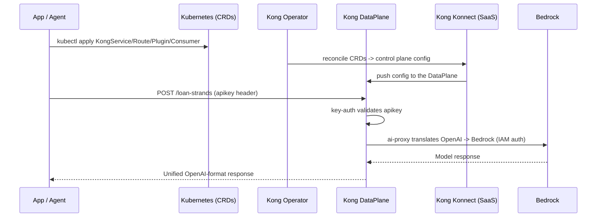

대안 스택에서 모델 액세스는 모든 모델 상호작용을 Amazon Bedrock으로 직접 라우팅하는 **Kong AI Gateway** 가 담당합니다. 이 페이지는 LiteLLM 모듈의 대안 스택 버전입니다. 역할은 동일하지만(모델에 대한 통합되고 거버넌스가 적용된 진입점), 기술이 다릅니다(**Kong Operator 2.x** 위의 Kong `ai-proxy` 플러그인, **네이티브 Kubernetes CRD** 로 관리).

::alert[이 페이지는 [LiteLLM AI Gateway 페이지](/track-a-opensource/a1-genai-components/ai-gateway/)의 **대안 스택** 버전입니다. 두 게이트웨이를 직접 비교할 수 있도록 해당 페이지를 섹션별로 미러링합니다. 사전 요구 사항: [Kong API Gateway 설정](/track-b-saas/b1-platform-setup/kong-setup/) 완료 -- Kong Operator 2.x 설치, 컨트롤 플레인 `kong-aws`, 그리고 Bedrock Pod Identity와 함께 실행 중인 `dataplane`.]{type="info"}

::alert[**Kong Operator 2.x (구식 KGO/decK 모델 아님).** Kong Operator 2.0+는 Kong Ingress Controller를 번들로 포함하므로 게이트웨이를 `kubectl apply`로 적용하는 **네이티브 Kubernetes CRD** (`KongService`, `KongRoute`, `KongPlugin`, `KongConsumer`)로 구성합니다 -- GitOps 네이티브 방식이며 `decK`가 필요 없습니다. CRD는 Konnect 컨트롤 플레인으로 조정(reconcile)되며 Konnect UI에 (읽기 전용으로) 표시됩니다.]{type="success"}

::alert[**대화형 zsh 참고:** 블록을 붙여넣을 때 `parse error near ')'` 또는 `command not found: #` 오류가 발생하면 `setopt interactive_comments`를 한 번 실행하십시오 -- zsh는 기본적으로 `#`을 주석으로 처리하지 않습니다.]{type="info"}

## 실습: API 게이트웨이 탐색

Kong이 모델 상호작용을 어떻게 관리하는지 확인합니다:

### 1단계: Kong 스택 확인

이 컴포넌트들이 정상인지는 이 모듈의 [사전 요구사항 확인](../#prerequisites-check)에서 이미 확인했습니다. 여기서는 목적이 다릅니다 — 트래픽을 프록시하는 **DataPlane Pod**(`kong` 네임스페이스)를 직접 보고, B2의 나머지가 기반으로 삼는 두 네임스페이스 구조를 이해하는 것입니다:

:::code{language=bash showCopyAction=true}
kubectl get pods -n kong
:::

**출력에서 찾아볼 내용:**

:::code{language=text showCopyAction=false}
# namespace kong (the data plane that proxies traffic):
NAME                                        READY   STATUS    RESTARTS   AGE
dataplane-dataplane-xxxxx-xxxxxxxxx-xxxxx   1/1     Running   0          *h
:::

Operator 자체는 `kong-system` 네임스페이스에 있습니다(사전 요구사항 확인에서 검증됨).

**주요 컴포넌트:**
- **Kong DataPlane** (`kong` 네임스페이스): 요청을 수신하고 `ai-proxy` 플러그인을 통해 Amazon Bedrock을 호출하는 프록시
- **Kong Operator 2.x** (`kong-system` 네임스페이스): CRD를 게이트웨이 구성으로 조정하는 Operator + 번들 Ingress Controller
- **Kong Konnect (SaaS)**: [cloud.konghq.com](https://cloud.konghq.com)의 컨트롤 플레인 — 구성을 저장하고 UI를 제공합니다. 자체 호스팅 컨트롤 플레인 Pod나 데이터베이스가 없습니다

::alert[**LiteLLM과의 아키텍처 비교**: LiteLLM은 자체 Postgres + Redis를 클러스터 내에 배포하고 Helm values 파일로 구성됩니다. Kong은 **구성을 Kubernetes CRD에** 유지하고(Konnect로 조정됨) 상태 비저장 DataPlane만 실행합니다. 게이트웨이를 변경하려면 YAML을 편집하고 `kubectl apply`를 실행합니다 — Pod의 구성 파일을 편집하는 것이 아닙니다.]{type="info"}

### 2단계: Bedrock 액세스 확인 (Pod Identity)

Kong DataPlane은 EKS Pod Identity를 통해 IAM 역할을 사용하여 Bedrock을 호출합니다 -- LLM API 키가 저장되지 않습니다.

:::code{language=bash showCopyAction=true}
export CLUSTER_NAME="${EKS_CLUSTER_NAME:-genai-on-eks}"
export AWS_REGION="${AWS_REGION:-us-east-1}"

# The DataPlane pod runs as a service account associated with a Bedrock IAM role
kubectl get pods -n kong -o jsonpath='{range .items[*]}{.metadata.name}{"\t"}{.spec.serviceAccountName}{"\n"}{end}' | grep dataplane

# Confirm the Pod Identity association: SA to an IAM role with bedrock:InvokeModel
aws eks list-pod-identity-associations --cluster-name "$CLUSTER_NAME" --region "$AWS_REGION" \
  --namespace kong --query 'associations[*].{sa:serviceAccount,roleArn:roleArn}' --output table
:::

**중요한 이유:** LiteLLM의 Pod가 Bedrock을 위해 Pod Identity를 사용하는 것처럼, Kong DataPlane은 `bedrock:InvokeModel` 권한을 부여하는 IAM 역할과 연결된 서비스 계정 `kaigateway-podid-sa`를 사용합니다(이 연결은 워크샵 환경 설정에 의해 자동으로 생성됩니다). 요청은 Bedrock에 자동으로 인증됩니다.

::alert[테이블 출력에서 `roleArn` 열이 비어 보이는 경우 동일한 명령을 `--output json`으로 실행하여 전체 역할 ARN을 확인하십시오 -- 이는 표시상의 문제일 뿐 연결(association)은 존재합니다.]{type="info"}

## Kong AI Gateway란 무엇입니까?

Kong AI Gateway는 Kong Gateway 프록시 위에 구축된 AI 전용 플러그인 세트로, 다음을 제공합니다:

- **범용 API**: **Amazon Bedrock** 을 포함한 17개 이상의 제공자를 위한 단일 OpenAI 호환 엔드포인트(`ai-proxy`)
- **다중 모델 라우팅**: `ai-proxy-advanced`가 모델 간 로드 밸런싱 및 시맨틱 라우팅 수행
- **엣지에서의 거버넌스**: `key-auth`, 속도 제한, 프롬프트 가드, PII 새니타이제이션을 플러그인으로 제공
- **Kubernetes 네이티브 구성**: 라우트/플러그인/컨슈머는 CRD(`kubectl apply`)이며 Konnect로 조정됨

## 3단계: Bedrock 라우트 구성 (Kubernetes CRD)

이것이 LiteLLM과의 핵심 차이점입니다. 기본 스택에서 모델 구성은 LiteLLM Pod에 포함된 **사전 렌더링된 Helm values 파일** 입니다. 여기서는 **Kubernetes CRD를 작성하고 `kubectl apply`로 적용합니다** — Kong Operator가 이를 `kong-aws` 컨트롤 플레인으로 조정하고 DataPlane이 이를 서비스합니다.

`/loan-strands` 라우트를 위해 다섯 개의 리소스를 생성합니다:

| 리소스 | Kind | 목적 |
|---|---|---|
| ai-proxy 플러그인 | `KongPlugin` | OpenAI ↔ Bedrock 변환 (Claude Sonnet 4.5) |
| key-auth 플러그인 | `KongPlugin` | `apikey` 헤더 요구 |
| 서비스 | `KongService` | 라우트의 논리적 서비스 (ai-proxy가 실제 업스트림을 대체) |
| 라우트 | `KongRoute` | 경로 `/loan-strands`, 어노테이션을 통해 두 플러그인 연결 |
| 컨슈머 + 키 | `KongConsumer` + `KongCredentialAPIKey` | 애플리케이션이 사용하는 아이덴티티 + API 키 |

**3a. 두 개의 플러그인 생성 (`ai-proxy` + `key-auth`):**

:::code{language=bash showCopyAction=true}
cat <<'EOF' | kubectl apply -f -
apiVersion: configuration.konghq.com/v1
kind: KongPlugin
metadata:
  name: ai-proxy-loan-strands
  namespace: kong
plugin: ai-proxy
config:
  route_type: llm/v1/chat
  auth:
    param_name: allow_override
    param_value: "false"
    param_location: body
  model:
    provider: bedrock
    name: global.anthropic.claude-sonnet-4-5-20250929-v1:0
    options:
      bedrock:
        aws_region: us-east-1
---
apiVersion: configuration.konghq.com/v1
kind: KongPlugin
metadata:
  name: key-auth-loan-strands
  namespace: kong
plugin: key-auth
config:
  key_names:
  - apikey
  hide_credentials: true
EOF
:::

**예상 출력:**

:::code{language=text showCopyAction=false}
kongplugin.configuration.konghq.com/ai-proxy-loan-strands created
kongplugin.configuration.konghq.com/key-auth-loan-strands created
:::

::alert[**확인 위치:** 이 `KongPlugin` 객체들은 이제 Kubernetes에 존재하지만(`kubectl get kongplugin -n kong`), 아직 Konnect UI에는 **표시되지 않습니다**. 플러그인은 **Service/Route/Consumer에 연결(attach)** 된 후에만 컨트롤 플레인으로 조정됩니다 — 이는 3b단계(라우트의 `konghq.com/plugins` 어노테이션)에서 수행됩니다. 3d단계 이후 Konnect **Plugins** 뷰에서 확인할 수 있습니다. 현재 시점에서는 바인딩을 기다리는 연결되지 않은 정의일 뿐입니다.]{type="info"}

**3b. Service와 Route 생성** (라우트는 `konghq.com/plugins` 어노테이션을 통해 두 플러그인을 연결하고, `controlPlaneRef`를 통해 `kong-aws` 컨트롤 플레인에 바인딩됩니다):

:::code{language=bash showCopyAction=true}
cat <<'EOF' | kubectl apply -f -
apiVersion: configuration.konghq.com/v1alpha1
kind: KongService
metadata:
  name: loan-strands-bedrock
  namespace: kong
spec:
  name: loan-strands-bedrock
  host: localhost
  port: 32000
  controlPlaneRef:
    type: konnectNamespacedRef
    konnectNamespacedRef:
      name: kong-aws
---
apiVersion: configuration.konghq.com/v1alpha1
kind: KongRoute
metadata:
  name: loan-strands-route
  namespace: kong
  annotations:
    konghq.com/plugins: ai-proxy-loan-strands,key-auth-loan-strands
spec:
  name: loan-strands-route
  protocols:
  - http
  - https
  paths:
  - /loan-strands
  serviceRef:
    type: namespacedRef
    namespacedRef:
      name: loan-strands-bedrock
EOF
:::

**예상 출력:**

:::code{language=text showCopyAction=false}
kongservice.configuration.konghq.com/loan-strands-bedrock created
kongroute.configuration.konghq.com/loan-strands-route created
:::

::alert[**지금까지 수행한 작업:** 3a에서 두 개의 플러그인(`ai-proxy` → Bedrock, `key-auth`)을 정의했고, 3b에서 **Service**(`loan-strands-bedrock`)와 **Route**(`/loan-strands`)를 생성하고 `konghq.com/plugins` 어노테이션을 통해 두 플러그인을 라우트에 연결했습니다. 이것이 완전한 요청 경로입니다 — 이제 `/loan-strands`에 도달하는 클라이언트는 `key-auth`로 인증되고 `ai-proxy`에 의해 Amazon Bedrock으로 프록시됩니다. Kong Operator가 이 모든 것을 `kong-aws` 컨트롤 플레인으로 자동 조정합니다.]{type="success"}

**Konnect UI에서 확인 →** [cloud.konghq.com](https://cloud.konghq.com) → **Gateway Manager** → **`kong-aws`** → **Gateway Services** 를 엽니다. 서비스 `loan-strands-bedrock`이 표시됩니다:

서비스의 **Routes** 탭(또는 **Routes** 뷰)을 열어 경로 `/loan-strands`를 가진 `loan-strands-route`를 확인합니다:

::alert[이 Service와 Route 항목은 Konnect UI에서 **읽기 전용** 입니다 — 방금 적용한 Kubernetes CRD가 이를 소유하고 있기 때문입니다. 변경하려면 YAML을 편집하고 다시 적용(`kubectl apply`)하십시오. 이것이 GitOps가 보장하는 것입니다.]{type="info"}

라우트에 `konghq.com/plugins` 어노테이션이 있으므로 플러그인도 동시에 조정됩니다. **Plugins** 탭(또는 라우트의 Plugins 뷰)을 엽니다 — `ai-proxy`(열어서 `provider: bedrock` + Claude 모델 ID 확인)와 `key-auth` 모두 연결되어 있습니다:

::alert[**`ai-proxy` 플러그인은 Kong이 프론트에서는 OpenAI Chat Completions API를, 백엔드에서는 Amazon Bedrock을 사용하도록 만듭니다** — 게이트웨이가 변환을 수행합니다. `allow_override: false`는 클라이언트가 모델을 변경할 수 없음을 의미합니다; Kong이 Claude Sonnet 4.5을 고정하여 엣지에서 모델 + 비용을 제어합니다. DataPlane은 IAM 역할로 Bedrock에 인증합니다 — 클라이언트에는 AWS 자격 증명이 전혀 필요하지 않습니다.]{type="success"}

**3c. Consumer와 API 키 생성:**

:::code{language=bash showCopyAction=true}
cat <<'EOF' | kubectl apply -f -
apiVersion: configuration.konghq.com/v1
kind: KongConsumer
metadata:
  name: loan-strands-agent
  namespace: kong
  annotations:
    kubernetes.io/ingress.class: kong
username: loan-strands-agent
spec:
  controlPlaneRef:
    type: konnectNamespacedRef
    konnectNamespacedRef:
      name: kong-aws
---
apiVersion: configuration.konghq.com/v1alpha1
kind: KongCredentialAPIKey
metadata:
  name: loan-strands-apikey
  namespace: kong
spec:
  consumerRef:
    name: loan-strands-agent
  key: loan-strands-key-123
EOF
:::

**예상 출력:**

:::code{language=text showCopyAction=false}
kongconsumer.configuration.konghq.com/loan-strands-agent created
kongcredentialapikey.configuration.konghq.com/loan-strands-apikey created
:::

::alert[**이것이 수행하는 작업:** **`KongConsumer`** 는 이름이 지정된 클라이언트 아이덴티티이고, **`KongCredentialAPIKey`** 는 여기에 API 키(`loan-strands-key-123`)를 발급합니다. 3b단계의 라우트에 `key-auth` 플러그인이 연결되어 있으므로 `apikey` 헤더에 이 키를 포함한 요청만 Bedrock으로 통과됩니다. 이는 LiteLLM Virtual Key에 대응하는 Kong의 개념입니다 — 자체 자격 증명과 (선택적으로) 자체 속도 제한을 가진 이름이 지정된 아이덴티티입니다.]{type="success"}

**Konnect UI에서 확인 →** 동일한 컨트롤 플레인에서 **Consumers** 를 엽니다(왼쪽 탐색의 **API Gateway → Control planes → `kong-aws` → Consumers**). `loan-strands-agent`가 표시됩니다 — Kubernetes CRD가 소유하고 있음을 나타내는 `k8s-kind:KongConsumer` / `k8s-namespace:kong` 태그를 확인하십시오:

**3d. 모든 것이 Konnect로 프로그래밍되었는지 확인** (`PROGRAMMED: True`는 CRD가 컨트롤 플레인으로 조정되었음을 의미합니다):

:::code{language=bash showCopyAction=true}
kubectl get kongservice,kongroute,kongconsumer,kongcredentialapikey -n kong
kubectl get kongplugin -n kong
:::

**예상 출력:**

:::code{language=text showCopyAction=false}
NAME                                                        HOST        PROTOCOL   PROGRAMMED   AGE
kongservice.configuration.konghq.com/loan-strands-bedrock   localhost              True         12m

NAME                                                    PROGRAMMED   AGE
kongroute.configuration.konghq.com/loan-strands-route   True         12m

NAME                                                       USERNAME             AGE     PROGRAMMED
kongconsumer.configuration.konghq.com/loan-strands-agent   loan-strands-agent   4m32s   True

NAME                                                                PROGRAMMED   AGE
kongcredentialapikey.configuration.konghq.com/loan-strands-apikey   True         4m31s

NAME                    PLUGIN-TYPE   AGE   PROGRAMMED
ai-proxy-loan-strands   ai-proxy      20m
key-auth-loan-strands   key-auth      20m
:::

::alert[Service, Route, Consumer, APIKey 모두 **`PROGRAMMED: True`** 를 표시합니다 — 라우트가 활성 상태입니다. 두 개의 `KongPlugin` 행은 **`PROGRAMMED` 열이 비어** 있는데, 이는 정상입니다: `KongPlugin`은 자체적으로가 아니라 연결된 엔티티(라우트)를 통해서만 프로그래밍 상태를 보고합니다. 라우트가 `konghq.com/plugins` 어노테이션에 두 플러그인을 포함한 채 `PROGRAMMED: True`이므로 플러그인은 활성 상태입니다.]{type="info"}

::alert[**참고:** 구성이 Kubernetes 네이티브(CRD)이더라도 여전히 Konnect로 조정됩니다 — 따라서 전체 Konnect UI + 분석 기능을 그대로 사용할 수 있습니다. 적용한 모든 것이 거기에 표시됩니다(CRD가 소유하므로 읽기 전용).]{type="info"}

## Kong의 요청 처리 방식

## 4단계: 게이트웨이 테스트

DataPlane 프록시 엔드포인트를 가져와 라우트를 테스트합니다:

:::code{language=bash showCopyAction=true}
export KONG_PROXY="http://$(kubectl get svc -n kong proxy1 -o jsonpath='{.status.loadBalancer.ingress[0].hostname}')"
echo "Kong proxy: $KONG_PROXY"
:::

**키 없이 → HTTP 401 (key-auth 작동 중):**

:::code{language=bash showCopyAction=true}
curl -s -o /dev/null -w "no-key: HTTP %{http_code}\n" -X POST "$KONG_PROXY/loan-strands" \
  -H "Content-Type: application/json" -d '{"messages":[{"role":"user","content":"hi"}]}'
:::

**예상 출력:**

:::code{language=text showCopyAction=false}
no-key: HTTP 401
:::

`apikey` 헤더가 제공되지 않았기 때문에 `key-auth` 플러그인이 요청을 거부했습니다 — 의도된 동작입니다.

**컨슈머 키와 함께 → Bedrock Claude가 응답:**

:::code{language=bash showCopyAction=true}
curl -s -X POST "$KONG_PROXY/loan-strands" \
  -H "Content-Type: application/json" -H "apikey: loan-strands-key-123" \
  -d '{"messages":[{"role":"user","content":"Explain Kubernetes in simple terms"}]}' \
  | python3 -c "import sys,json;print(json.load(sys.stdin)['choices'][0]['message']['content'])"
:::

**예상 출력** (`apikey`가 수락되고 Kong이 Bedrock으로 프록시하며 Claude Sonnet 4.5이 응답합니다 — 내용은 다를 수 있습니다):

:::code{language=text showCopyAction=false}
# Kubernetes in Simple Terms

**Kubernetes is like a smart manager for containerized applications.**

## The Basic Idea

Think of Kubernetes as an **automated system that runs and manages your applications**
across multiple computers. It handles the boring, repetitive tasks so you don't have to.

## What Kubernetes Does:

1. **Deployment** - Runs your containers across a cluster of computers
2. **Scaling** - Automatically adds or removes copies based on demand
3. **Self-healing** - Restarts failed containers automatically
4. **Load balancing** - Distributes traffic evenly across your app copies
5. **Updates** - Rolls out new versions without downtime

...(truncated)...

**Bottom line:** Kubernetes automates the complex work of running modern applications at scale.
:::

::alert[**대안 스택 게이트웨이가 완전히 작동합니다:** OpenAI 형식 요청 → Kong `/loan-strands` → `key-auth` → `ai-proxy` → Amazon Bedrock (Claude Sonnet 4.5) → OpenAI 형식 응답 — 모두 `kubectl apply` CRD로 구성되었으며, LiteLLM도 없고 클라이언트에 LLM API 키도 없습니다.]{type="success"}

::alert[OpenAI 스타일 경로 접미사도 작동합니다: `POST $KONG_PROXY/loan-strands/v1/chat/completions`. 따라서 base URL `$KONG_PROXY/loan-strands`에 `/v1/chat/completions`를 붙이는 OpenAI SDK 클라이언트는 변경 없이 작동합니다 — 모듈 B3의 Strands 에이전트가 이 방식으로 연결됩니다.]{type="info"}

::alert[**도구 호출(tool-calling)도 작동합니다.** CRD로 구성된 `ai-proxy`는 OpenAI `tools` ↔ Bedrock `toolConfig`를 올바르게 변환하므로 에이전트 도구 호출(모듈 B3의 Strands Loan Buddy)이 이 라우트를 통해 작동합니다.]{type="success"}

## 실습: 새 Bedrock 모델 추가

LiteLLM(Helm values 편집)과 달리 YAML을 편집하고 `kubectl apply`하여 라우트를 추가합니다. 별도의 경로에 두 번째 모델을 추가합니다(예: `/loan-strands-nova`):

:::code{language=bash showCopyAction=true}
cat <<'EOF' | kubectl apply -f -
apiVersion: configuration.konghq.com/v1
kind: KongPlugin
metadata:
  name: ai-proxy-nova
  namespace: kong
plugin: ai-proxy
config:
  route_type: llm/v1/chat
  auth:
    param_name: allow_override
    param_value: "false"
    param_location: body
  model:
    provider: bedrock
    name: amazon.nova-micro-v1:0
    options:
      bedrock:
        aws_region: us-east-1
---
apiVersion: configuration.konghq.com/v1alpha1
kind: KongService
metadata:
  name: loan-strands-nova
  namespace: kong
spec:
  name: loan-strands-nova
  host: localhost
  port: 32000
  controlPlaneRef:
    type: konnectNamespacedRef
    konnectNamespacedRef:
      name: kong-aws
---
apiVersion: configuration.konghq.com/v1alpha1
kind: KongRoute
metadata:
  name: loan-strands-nova-route
  namespace: kong
  annotations:
    konghq.com/plugins: ai-proxy-nova
spec:
  name: loan-strands-nova-route
  protocols:
  - http
  - https
  paths:
  - /loan-strands-nova
  serviceRef:
    type: namespacedRef
    namespacedRef:
      name: loan-strands-nova
EOF
:::

**예상 출력:**

:::code{language=text showCopyAction=false}
kongplugin.configuration.konghq.com/ai-proxy-nova created
kongservice.configuration.konghq.com/loan-strands-nova created
kongroute.configuration.konghq.com/loan-strands-nova-route created
:::

::alert[**`provider: bedrock`에서 반드시 지켜야 할 두 가지** (둘 다 흔한 실수였습니다): 1. **`auth:` 블록(`allow_override`)을 포함하십시오** — 이것이 없으면 `ai-proxy` 플러그인이 Kong의 스키마 검증에 실패합니다. 실패한 플러그인은 `KongPluginBinding`을 `PROGRAMMED: False` 상태로 남기므로 요청을 가로채지 못하고 플레이스홀더 업스트림으로 넘어갑니다 → **HTTP 502 "An invalid response was received from the upstream server"** (클라이언트 측에서는 `KeyError: 'choices'`로 표시됨). `kubectl get kongpluginbinding -n kong`으로 확인하십시오. 2. **올바른 모델 ID를 사용하십시오** — `amazon.nova-micro-v1:0` (`us.amazon.nova-micro-v1:0` 아님).]{type="warning"}

새 플러그인이 성공적으로 바인딩되었는지 확인합니다(`PROGRAMMED: True`):

:::code{language=bash showCopyAction=true}
kubectl get kongpluginbinding -n kong | grep nova
:::

테스트합니다(이 라우트에는 key-auth가 없으므로 헤더가 필요 없습니다):

:::code{language=bash showCopyAction=true}
curl -s -X POST "$KONG_PROXY/loan-strands-nova" \
  -H "Content-Type: application/json" \
  -d '{"messages":[{"role":"user","content":"Say hello from Nova in 5 words"}]}' \
  | python3 -c "import sys,json;print(json.load(sys.stdin)['choices'][0]['message']['content'])"
:::

**예상 출력** (Amazon Nova Micro가 응답합니다 — 내용은 다를 수 있습니다):

:::code{language=text showCopyAction=false}
Nova says hi!
:::

새로운 `/loan-strands-nova` 라우트는 `/loan-strands`(Claude Sonnet 4.5)와 *다른* Bedrock 모델(Amazon Nova Micro)에 도달합니다 — CRD를 추가로 적용하는 것만으로 모델을 추가할 수 있습니다.

::alert[**프로덕션 참고:** *단일* 경로에서 여러 모델에 대한 A/B 라우팅을 하려면 가중치 타겟과 함께 `ai-proxy-advanced` 플러그인을 사용하십시오. GitOps를 위해서는 이 CRD 매니페스트를 Git에 커밋하고 Argo CD / Flux가 적용하도록 하십시오.]{type="success"}

## 모듈 B3을 위한 Consumer 키

모듈 B3의 Strands Loan Buddy 에이전트는 3c단계에서 생성한 컨슈머 키로 게이트웨이에 인증합니다. 해당 모듈을 위해 저장하십시오:

:::code{language=bash showCopyAction=true}
export LOAN_STRANDS_KONG_KEY="loan-strands-key-123"
:::

한 번 더 검증합니다:

:::code{language=bash showCopyAction=true}
curl -s -X POST "$KONG_PROXY/loan-strands" \
  -H "Content-Type: application/json" -H "apikey: $LOAN_STRANDS_KONG_KEY" \
  -d '{"messages":[{"role":"user","content":"Why is most of the landmass in the world above the equator?"}]}' \
  | python3 -c "import sys,json;print(json.load(sys.stdin)['choices'][0]['message']['content'][:300])"
:::

## 주요 이점

- **Kubernetes 네이티브 구성**: 라우트/플러그인/컨슈머는 `kubectl`로 적용되는 CRD — GitOps 준비 완료, decK 불필요
- **범용 API**: Amazon Bedrock(및 17개 이상의 제공자)을 위한 단일 OpenAI 호환 엔드포인트
- **게이트웨이가 제어하는 모델**: `allow_override: false`가 엣지에서 모델 + 비용을 고정
- **플러그인으로서의 거버넌스**: 어노테이션을 통해 라우트에 key-auth 및 속도 제한 구성
- **Konnect UI + 분석**: CRD로 관리되는 엔티티가 Konnect UI에 (읽기 전용으로) 표시됨
- **앱에 LLM 키 없음**: DataPlane이 IAM(Pod Identity)을 통해 Bedrock에 인증
- **도구 호출 지원**: `ai-proxy`가 에이전트를 위해 OpenAI `tools` ↔ Bedrock `toolConfig` 변환

## 정리 (선택 사항)

이 라우트만 제거하려면 (Operator/컨트롤 플레인은 그대로 유지):

:::code{language=bash showCopyAction=true}
kubectl delete kongroute loan-strands-route -n kong
kubectl delete kongservice loan-strands-bedrock -n kong
kubectl delete kongplugin ai-proxy-loan-strands key-auth-loan-strands -n kong
kubectl delete kongcredentialapikey loan-strands-apikey -n kong
kubectl delete kongconsumer loan-strands-agent -n kong
:::

## 다음 단계

**네이티브 Kubernetes CRD** 로 Kong AI Gateway를 구성했습니다 — 프로덕션에 적합한 GitOps 친화적 모델입니다. 다음으로 에이전트의 전체 워크플로를 추적하는 관측성 플랫폼이자 Langfuse의 대안 스택 대응 솔루션인 Arize AX를 설정합니다.

---

**[다음: Arize AX - 관측성 플랫폼 →](../observability-arize/)**
