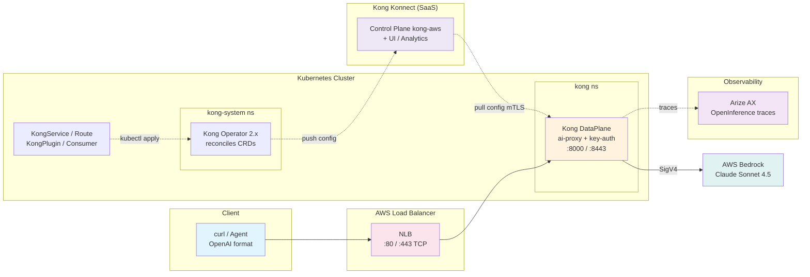

This is the **Track B Stack** version of Track A's Module A1. It covers the same goal — consolidating individual AI models behind a unified platform — but instead of **LiteLLM** (gateway) and **Langfuse** (observability), you use **Kong AI Gateway** (via Kong Operator 2.x + Kong Konnect) and **Arize AX** (SaaS observability). All components are configured using production, Kubernetes-native patterns.

::alert[This module runs **in parallel** with Track A's LiteLLM + Langfuse platform (Module A1) — nothing here modifies the default stack. Complete [Module B1: Platform Setup](/track-b-saas/b1-platform-setup/) first (Kong Operator 2.x + control plane `kong-aws`, and an Arize AX Space + Service key).]{type="info"}

## Learning Objectives

By the end of this module, you will:

- **Configure Kong AI Gateway** to route chat completions directly to Amazon Bedrock via the `ai-proxy` plugin
- **Use native Kubernetes CRDs** (`KongService`, `KongRoute`, `KongPlugin`, `KongConsumer`) to manage gateway config with `kubectl apply` — no decK
- **Secure the gateway** with `key-auth` and per-consumer credentials
- **Send OpenInference traces to Arize AX** and explore spans, sessions, and LLM-as-a-Judge evaluation
- **Understand the architecture** — Operator, DataPlane, and Konnect control plane, and how a request flows to Bedrock and back

## Module Architecture

The following diagram shows how the Track B stack components work together:

## Key concepts

This module uses **production, GitOps-native patterns** with a SaaS-managed control plane:

- **Kubernetes-native config**: routes/plugins/consumers are CRDs applied with `kubectl` — versionable in Git, reconciled continuously
- **Gateway-controlled models**: `allow_override: false` pins the model + cost at the edge
- **No keys in the client**: the DataPlane authenticates to Bedrock via EKS Pod Identity (IAM), never a static key
- **SaaS UI + analytics**: CRD-managed entities appear (read-only) in the Kong Konnect UI
- **Managed observability**: Arize AX (SaaS) replaces the self-hosted Langfuse stack

## Module Sections

#### 1. [Kong AI Gateway - Unified API Gateway](./ai-gateway-kong/)
Configure Kong AI Gateway with native Kubernetes CRDs. Learn how to:
- Route chat completions to Amazon Bedrock via the `ai-proxy` plugin
- Secure the route with `key-auth` + a consumer credential
- Add new Bedrock models by applying more CRDs

#### 2. [Arize AX - Observability Platform](./observability-arize/)
Use SaaS observability for your GenAI applications. This section covers:
- OpenInference tracing of agent + LLM + tool spans
- LLM-as-a-Judge evaluation
- How Arize AX compares to Langfuse

## Prerequisites Check

Before starting, verify the Kong and Arize setup from [Module B1: Platform Setup](/track-b-saas/b1-platform-setup/) is in place:

:::code{language=bash showCopyAction=true}
# Kong Operator 2.x + DataPlane running
kubectl get pods -n kong-system
kubectl get dataplane -n kong

# Konnect control plane programmed
kubectl get konnectgatewaycontrolplane kong-aws -n kong

# Arize credentials installed (for the observability section)
kubectl get secret arize-credentials -n arize

# Bedrock access
aws bedrock list-foundation-models --region us-east-1 --query "modelSummaries[?contains(modelId, 'claude')].modelId" --output table
:::

::alert[If the DataPlane is not `READY: True` or the control plane is not `PROGRAMMED: True`, complete the [Kong API Gateway Setup](/track-b-saas/b1-platform-setup/kong-setup/) first. If `arize-credentials` is missing, complete the [Arize AX Setup](/track-b-saas/b1-platform-setup/arize-setup/).]{type="warning"}

## How this maps to Track A's Module A1

| Track A · Module A1 (LiteLLM + Langfuse) | Track B · Module B2 (Kong + Arize) |
|---|---|
| LiteLLM unified gateway (Helm values file) | Kong `ai-proxy` route via **Kubernetes CRDs** (`kubectl apply`) |
| Configured by editing `values.rendered.yaml` | Configured by `KongService`/`KongRoute`/`KongPlugin` CRDs |
| LiteLLM Virtual Key (`sk-...`) | Kong Consumer + key-auth credential (`apikey` header) |
| Langfuse traces (self-hosted UI) | Arize AX spans (app.arize.com, SaaS) |
| LiteLLM callbacks → Langfuse | OpenInference SDK → Arize AX |
| ALB via ingress | NLB via LoadBalancer Service |

## Getting Started

Begin by configuring Kong AI Gateway, a unified, SaaS-managed gateway to Amazon Bedrock.

---

**[Next: Kong AI Gateway - Unified API Gateway →](./ai-gateway-kong/)**
