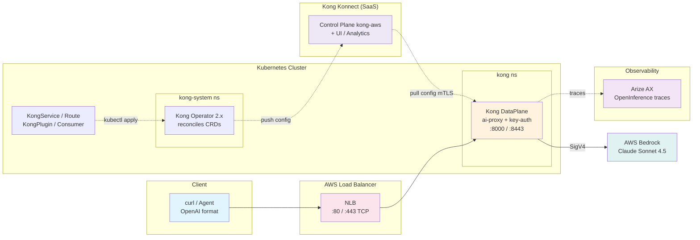

이 모듈은 Track A 모듈 A1의 **대안 스택** 버전입니다. 개별 AI 모델을 통합 플랫폼으로 구성한다는 목표는 동일하지만, **LiteLLM**(게이트웨이)과 **Langfuse**(관측성) 대신 **Kong AI Gateway**(Kong Operator 2.x + Kong Konnect 기반)와 **Arize AX**(SaaS 관측성)를 사용합니다. 모든 컴포넌트는 프로덕션 수준의 Kubernetes 네이티브 방식으로 구성합니다.

::alert[이 모듈은 Track A의 LiteLLM + Langfuse 플랫폼(모듈 A1)과 **병렬로** 실행됩니다 — 여기서 수행하는 어떤 작업도 기본 스택을 수정하지 않습니다. 먼저 [Kong 및 Arize 인프라 설정](/track-b-saas/b1-platform-setup/)을 완료하십시오 (Kong Operator 2.x + 컨트롤 플레인 `kong-aws`, 그리고 Arize AX Space + Service 키).]{type="info"}

## 학습 목표

이 모듈을 마치면 다음을 수행할 수 있습니다:

- **Kong AI Gateway 구성**: `ai-proxy` 플러그인을 통해 채팅 완성 요청을 Amazon Bedrock으로 직접 라우팅
- **네이티브 Kubernetes CRD 사용**: `KongService`, `KongRoute`, `KongPlugin`, `KongConsumer`로 게이트웨이 구성을 `kubectl apply`로 관리 — decK 불필요
- **게이트웨이 보안**: `key-auth`와 컨슈머별 자격 증명으로 게이트웨이 보호
- **Arize AX로 OpenInference 트레이스 전송**: 스팬, 세션, LLM-as-a-Judge 평가 확인
- **아키텍처 이해**: Operator, DataPlane, Konnect 컨트롤 플레인, 그리고 요청이 Bedrock을 거쳐 반환되는 흐름

## 모듈 아키텍처

다음 다이어그램은 대안 스택 컴포넌트가 함께 작동하는 방식을 보여줍니다:

## 핵심 개념

이 모듈은 SaaS 관리형 컨트롤 플레인과 함께 **프로덕션 수준의 GitOps 네이티브 패턴** 을 사용합니다:

- **Kubernetes 네이티브 구성**: 라우트/플러그인/컨슈머는 `kubectl`로 적용되는 CRD입니다 — Git에서 버전 관리 가능하며 지속적으로 조정(reconcile)됩니다
- **게이트웨이가 제어하는 모델**: `allow_override: false`가 엣지에서 모델 + 비용을 고정합니다
- **클라이언트에 키 없음**: DataPlane은 정적 키가 아닌 EKS Pod Identity(IAM)를 통해 Bedrock에 인증합니다
- **SaaS UI + 분석**: CRD로 관리되는 엔티티가 Kong Konnect UI에 (읽기 전용으로) 표시됩니다
- **관리형 관측성**: Arize AX(SaaS)가 자체 호스팅 Langfuse 스택을 대체합니다

## 모듈 섹션

#### 1. [Kong AI Gateway - 통합 API 게이트웨이](./ai-gateway-kong/)
네이티브 Kubernetes CRD로 Kong AI Gateway를 구성합니다. 다음을 학습합니다:
- `ai-proxy` 플러그인을 통해 채팅 완성 요청을 Amazon Bedrock으로 라우팅
- `key-auth` + 컨슈머 자격 증명으로 라우트 보호
- CRD를 추가로 적용하여 새 Bedrock 모델 추가

#### 2. [Arize AX - 관측성 플랫폼](./observability-arize/)
GenAI 애플리케이션을 위한 SaaS 관측성를 사용합니다. 이 섹션에서는 다음을 다룹니다:
- 에이전트 + LLM + 도구 스팬의 OpenInference 트레이싱
- LLM-as-a-Judge 평가
- Arize AX와 Langfuse의 비교

## 사전 요구 사항 확인

시작하기 전에 [대안 스택 인프라 설정](/track-b-saas/b1-platform-setup/)의 Kong 및 Arize 설정이 완료되었는지 확인합니다:

:::code{language=bash showCopyAction=true}
# Kong Operator 2.x + DataPlane running
kubectl get pods -n kong-system
kubectl get dataplane -n kong

# Konnect control plane programmed
kubectl get konnectgatewaycontrolplane kong-aws -n kong

# Arize credentials installed (for the observability section)
kubectl get secret arize-credentials -n arize

# Bedrock access
aws bedrock list-foundation-models --region us-east-1 --query "modelSummaries[?contains(modelId, 'claude')].modelId" --output table
:::

::alert[DataPlane이 `READY: True`가 아니거나 컨트롤 플레인이 `PROGRAMMED: True`가 아닌 경우 먼저 [Kong API Gateway 설정](/track-b-saas/b1-platform-setup/kong-setup/)을 완료하십시오. `arize-credentials`가 없는 경우 [Arize AX 설정](/track-b-saas/b1-platform-setup/arize-setup/)을 완료하십시오.]{type="warning"}

## Track A의 모듈 A1과의 매핑

| Track A · 모듈 A1 (LiteLLM + Langfuse) | Track B · 모듈 B2 (Kong + Arize) |
|---|---|
| LiteLLM 통합 게이트웨이 (Helm values 파일) | **Kubernetes CRD** 를 통한 Kong `ai-proxy` 라우트 (`kubectl apply`) |
| `values.rendered.yaml` 편집으로 구성 | `KongService`/`KongRoute`/`KongPlugin` CRD로 구성 |
| LiteLLM Virtual Key (`sk-...`) | Kong Consumer + key-auth 자격 증명 (`apikey` 헤더) |
| Langfuse 트레이스 (자체 호스팅 UI) | Arize AX 스팬 (app.arize.com, SaaS) |
| LiteLLM 콜백 → Langfuse | OpenInference SDK → Arize AX |
| ingress를 통한 ALB | LoadBalancer Service를 통한 NLB |

## 시작하기

Amazon Bedrock으로 향하는 통합 SaaS 관리형 게이트웨이인 Kong AI Gateway 구성부터 시작합니다.

---

**[다음: Kong AI Gateway - 통합 API 게이트웨이 →](./ai-gateway-kong/)**
