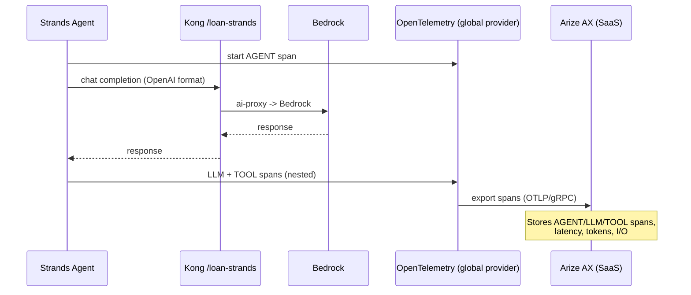

In the default stack, **Langfuse** tracked every LLM interaction. In the Track B stack, **Arize AX** plays that role — a SaaS observability and evaluation platform. Your agents emit **OpenInference** spans (an OpenTelemetry-based semantic convention for LLM apps) directly to Arize AX at [app.arize.com](https://app.arize.com), where you inspect prompts, responses, latency, tokens, and run evaluations.

::alert[This is the **Track B Stack** version of the [Langfuse Observability page](/track-a-opensource/a1-genai-components/observability/). It mirrors that page section-for-section so you can compare the two platforms. Prerequisite: an Arize AX **Space** + **Service** API key from the [Arize AX Setup](/track-b-saas/b1-platform-setup/arize-setup/).]{type="info"}

## Hands-On: Confirm Your Observability Backend

Unlike Langfuse (a multi-database stack running in your cluster), Arize AX is **SaaS** — there is nothing to run in-cluster. The only in-cluster footprint is a **credentials Secret** that agents use to export traces.

### Step 1: Confirm the Arize Credentials

:::code{language=bash showCopyAction=true}
# The only in-cluster resource for Arize: the credentials Secret
kubectl get secret arize-credentials -n arize
kubectl get secret arize-credentials -n arize -o jsonpath='{.data.ARIZE_OTLP_ENDPOINT}' | base64 -d; echo
:::

::::expand{header="Check Output"}

```text
NAME                TYPE     DATA   AGE
arize-credentials   Opaque   3      17h
https://otlp.arize.com/v1
```

::::

**What's in the Secret:**
- **ARIZE_API_KEY**: the Service key (`ak-...`) used to authenticate trace ingestion
- **ARIZE_SPACE_ID**: which Arize Space the traces land in
- **ARIZE_OTLP_ENDPOINT**: the OpenTelemetry collector endpoint (`https://otlp.arize.com/v1`)

### Step 2: Understand the Integration Model

There is no cluster config file to inspect (as there was for Langfuse's Helm values) — Arize is configured entirely in the **application** via a few lines of SDK code plus the Secret above. Agents call `arize.otel.register()`, which builds the OTLP exporter, attaches the API key + Space ID, and sets the **global** OpenTelemetry tracer provider:

:::code{language=python showCopyAction=true}
from arize.otel import register

register(
    space_id=os.environ["ARIZE_SPACE_ID"],   # from the arize-credentials Secret
    api_key=os.environ["ARIZE_API_KEY"],      # Service key (ak-...)
    project_name="loan-strands",
    set_global_tracer_provider=True,
)
# Strands (and any OpenInference-instrumented framework) auto-uses the global
# provider — the agent's full trace flows to Arize with no per-call wiring.
:::

## What is Arize AX?

Arize AX is a SaaS LLM observability + evaluation platform that provides:

- **OpenInference Tracing**: every LLM/agent/tool span captured with full context, via OpenTelemetry
- **Span Kinds**: purpose-built views for AGENT, LLM, CHAIN, TOOL, and RETRIEVER spans
- **Performance Analytics**: latency, throughput, token, and cost metrics
- **Debugging Tools**: detailed request/response and tool-call inspection
- **LLM-as-a-Judge & Evals**: online + offline evaluation with datasets and experiments
- **Fully Managed**: no databases to run — Arize hosts the storage, UI, and analytics

## How Arize AX is Integrated

Where Langfuse ships a Helm chart + PostgreSQL/ClickHouse/Redis/S3, Arize AX is a hosted service reached over OpenTelemetry. The following tabs describe each part of the integration:

:::::tabs

::::tab{label="SaaS vs Self-Hosted"}
**No in-cluster stack**

Arize AX runs entirely in Arize's cloud. Compared to Langfuse:

:::code{language=text showCopyAction=false}
Langfuse (default)                 Arize AX (Track B)
------------------------           ----------------------------
langfuse-web           (pod)       (none — SaaS)
langfuse-worker        (pod)       (none — SaaS)
langfuse-postgresql    (pod)       (none — SaaS)
langfuse-clickhouse    (pod)       (none — SaaS)
langfuse-redis         (pod)       (none — SaaS)
langfuse-s3/minio      (pod)       (none — SaaS)
                                   arize-credentials  (Secret only)
:::

**Why this matters:**
- **Zero ops burden**: no databases, no disk sizing (recall the Langfuse ClickHouse-disk issue), no upgrades
- **Only footprint**: one Kubernetes Secret holding the Service key + Space ID
::::

::::tab{label="Credentials"}
**The `arize-credentials` Secret**

Provisioned by the starter kit's `o11y/arize` component (or created directly). It carries exactly what the SDK needs:

:::code{language=yaml showCopyAction=true}
apiVersion: v1
kind: Secret
metadata:
  name: arize-credentials
  namespace: arize
stringData:
  ARIZE_API_KEY: "ak-...(72-char Service key)"
  ARIZE_SPACE_ID: "U3BhY2U6..."
  ARIZE_OTLP_ENDPOINT: "https://otlp.arize.com/v1"
:::

**Security notes:**
- Use the **Service** key (persistent, for automated systems) — **not** the user key (returns `PERMISSION_DENIED` for ingestion)
- Agents mount these via `secretKeyRef` (see Module B3) — no keys baked into images
::::

::::tab{label="Instrumentation"}
**OpenInference SDK → global OTEL provider**

The application (not the cluster) is instrumented. One `register()` call wires everything:

:::code{language=python showCopyAction=true}
from arize.otel import register

register(
    space_id=os.environ["ARIZE_SPACE_ID"],
    api_key=os.environ["ARIZE_API_KEY"],
    project_name="loan-strands",
    set_global_tracer_provider=True,
)
:::

**What gets traced automatically:**
- **AGENT** spans — the top-level agent run
- **LLM** spans — each Bedrock call (through Kong)
- **TOOL** spans — each MCP tool invocation (image / address / employment)
- **CHAIN** spans — intermediate steps

Because it sets the *global* provider, OpenInference-instrumented frameworks (like Strands) emit spans with no extra per-call code.
::::

::::tab{label="Transport"}
**OpenTelemetry over gRPC to Arize**

Traces leave the agent as OTLP:

:::code{language=text showCopyAction=false}
Collector Endpoint : otlp.arize.com/v1
Transport          : gRPC
Auth headers       : authorization / api_key / arize-space-id
:::

**Networking:**
- Outbound HTTPS/gRPC from the agent pod to `otlp.arize.com` (:443)
- No inbound exposure, no ingress/ALB needed for Arize itself
- Requires egress connectivity to Arize's cloud
::::

:::::

---

## Where You Use Arize AX in the Rest of Track B

Arize is now wired to your platform. You use it hands-on in the modules that actually produce data — there is nothing to open in the Arize UI yet, because no agent traces exist until you deploy the Strands Loan Buddy in Module B3.

- **[Module B3 — Loan Buddy on Strands](/track-b-saas/b3-genai-applications-strands/):** the agent emits its full **AGENT → LLM → TOOL** span tree to the `loan-strands` project; you explore a real trace (and its `session.id` grouping) there.
- **[Module B4 — Evaluation](/track-b-saas/b4-scaling-evaluating/evaluation/):** build **LLM-as-a-Judge** evaluators (accuracy, helpfulness, safety) that score every agent decision automatically — the SaaS counterpart to Track A's Langfuse evaluation.
- **[Module B5 — Monitoring & Scaling](/track-b-saas/b5-production-ready/monitoring-scaling/):** build **Arize dashboards** over your trace metrics (latency / token / cost by span kind), alongside the Grafana infrastructure view.

::alert[Want to confirm trace ingestion right now, before B3? Run the one-span smoke test in [Arize AX Setup → Step 6](/track-b-saas/b1-platform-setup/arize-setup/).]{type="info"}


## How Arize AX Captures Traces

The following diagram shows what occurs each time the Strands agent runs:



## How Applications Connect to Arize AX

| Integration Method | How It Works | Used In This Workshop |
|---|---|---|
| **OpenInference SDK (app-level)** | The agent calls `arize.otel.register()` to set the global OTEL provider; instrumented frameworks emit AGENT/LLM/TOOL spans automatically. | Module B3 — the Strands Loan Buddy agent (full agent trace). **Primary path.** |
| **Kong OpenTelemetry plugin (gateway-level)** | Kong's `opentelemetry` plugin exports the gateway hop to an OTLP endpoint. Adds the Kong span alongside the app spans. | Optional — gateway-hop tracing (see Module B2 gateway page). |
| **Direct OTLP** | Any OpenTelemetry SDK can export to `otlp.arize.com` with the Space ID + key headers. | Any polyglot/non-Python service. |

**Recommended approach:** the **app-level OpenInference** path (Path 1) provides the most detailed, full-agent trace — the gateway plugin (Path 2) is a supplement, not a replacement.

## Key Insights You Can Discover

- **Agent Workflow**: see the full AGENT → LLM → TOOL span tree for each run
- **Model Performance**: latency and token usage per Bedrock call
- **Tool Behavior**: exactly what each MCP tool received and returned
- **Quality Tracking**: LLM-as-a-Judge scores on accuracy, helpfulness, safety
- **Session Analysis**: follow multi-step interactions grouped by session

## What's Next?

You now have the Track B stack platform complete: **Kong AI Gateway** (routing to Bedrock via CRDs) and **Arize AX** (observability via OpenInference). Next, use this platform to build an agentic application — the **Strands Loan Buddy**, which calls Bedrock through Kong and traces its full workflow in Arize AX.

---

**[Continue to Module B3: Loan Buddy on Strands →](/track-b-saas/b3-genai-applications-strands/)**
