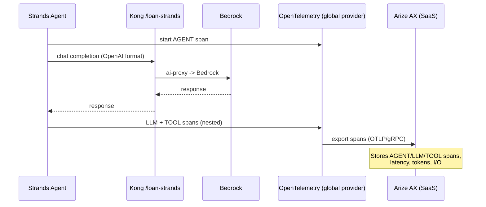

기본 스택에서는 **Langfuse** 가 모든 LLM 상호작용을 추적했습니다. 대안 스택에서는 **Arize AX** 가 그 역할을 수행합니다 — SaaS 관측성 및 평가 플랫폼입니다. 에이전트는 **OpenInference** 스팬(LLM 앱을 위한 OpenTelemetry 기반 시맨틱 컨벤션)을 [app.arize.com](https://app.arize.com)의 Arize AX로 직접 내보내며, 여기서 프롬프트, 응답, 지연시간, 토큰을 검사하고 평가를 실행할 수 있습니다.

::alert[이 페이지는 [Langfuse 관측성 페이지](/track-a-opensource/a1-genai-components/observability/)의 **대안 스택** 버전입니다. 두 플랫폼을 비교할 수 있도록 해당 페이지를 섹션별로 미러링합니다. 사전 요구 사항: [Arize AX 설정](/track-b-saas/b1-platform-setup/arize-setup/)의 Arize AX **Space** + **Service** API 키.]{type="info"}

## 실습: 관측성 백엔드 확인

Langfuse(클러스터에서 실행되는 다중 데이터베이스 스택)와 달리 Arize AX는 **SaaS** 입니다 — 클러스터 내에서 실행할 것이 없습니다. 유일한 클러스터 내 리소스는 에이전트가 트레이스를 내보내는 데 사용하는 **자격 증명 Secret** 입니다.

### 1단계: Arize 자격 증명 확인

:::code{language=bash showCopyAction=true}
# The only in-cluster resource for Arize: the credentials Secret
kubectl get secret arize-credentials -n arize
kubectl get secret arize-credentials -n arize -o jsonpath='{.data.ARIZE_OTLP_ENDPOINT}' | base64 -d; echo
:::

**예상 출력:**

:::code{language=text showCopyAction=false}
NAME                TYPE     DATA   AGE
arize-credentials   Opaque   3      *h
https://otlp.arize.com
:::

**Secret에 포함된 내용:**
- **ARIZE_API_KEY**: 트레이스 수집(ingestion) 인증에 사용되는 Service 키(`ak-...`)
- **ARIZE_SPACE_ID**: 트레이스가 저장될 Arize Space
- **ARIZE_OTLP_ENDPOINT**: OpenTelemetry 컬렉터 엔드포인트 (`https://otlp.arize.com`, gRPC)

### 2단계: 통합 모델 이해

검사할 클러스터 구성 파일이 없습니다(Langfuse의 Helm values와 달리) — Arize는 위의 Secret과 몇 줄의 SDK 코드를 통해 전적으로 **애플리케이션** 에서 구성됩니다. 에이전트가 `arize.otel.register()`를 호출하면 OTLP 익스포터가 빌드되고 API 키 + Space ID가 첨부되며 **전역** OpenTelemetry 트레이서 프로바이더가 설정됩니다:

:::code{language=python showCopyAction=true}
from arize.otel import register

register(
    space_id=os.environ["ARIZE_SPACE_ID"],   # from the arize-credentials Secret
    api_key=os.environ["ARIZE_API_KEY"],      # Service key (ak-...)
    project_name="loan-strands",
    set_global_tracer_provider=True,
)
# Strands (and any OpenInference-instrumented framework) auto-uses the global
# provider — the agent's full trace flows to Arize with no per-call wiring.
:::

## Arize AX란 무엇입니까?

Arize AX는 다음을 제공하는 SaaS LLM 관측성 + 평가 플랫폼입니다:

- **OpenInference 트레이싱**: OpenTelemetry를 통해 모든 LLM/에이전트/도구 스팬을 전체 컨텍스트와 함께 캡처
- **스팬 종류(Span Kinds)**: AGENT, LLM, CHAIN, TOOL, RETRIEVER 스팬에 특화된 뷰
- **성능 분석**: 지연시간, 처리량, 토큰 및 비용 지표
- **디버깅 도구**: 상세한 요청/응답 및 도구 호출 검사
- **LLM-as-a-Judge & 평가**: 데이터셋과 실험을 활용한 온라인 + 오프라인 평가
- **완전 관리형**: 실행할 데이터베이스 없음 — Arize가 스토리지, UI, 분석을 호스팅

## Arize AX 통합 방법

Langfuse가 Helm 차트 + PostgreSQL/ClickHouse/Redis/S3를 제공하는 반면, Arize AX는 OpenTelemetry를 통해 접근하는 호스팅 서비스입니다. 다음 탭에서 통합의 각 부분을 설명합니다:

:::::tabs

::::tab{label="SaaS vs 자체 호스팅"}
**클러스터 내 스택 없음**

Arize AX는 전적으로 Arize의 클라우드에서 실행됩니다. Langfuse와 비교하면:

:::code{language=text showCopyAction=false}
Langfuse (default)                 Arize AX (alternative)
------------------------           ----------------------------
langfuse-web           (pod)       (none — SaaS)
langfuse-worker        (pod)       (none — SaaS)
langfuse-postgresql    (pod)       (none — SaaS)
langfuse-clickhouse    (pod)       (none — SaaS)
langfuse-redis         (pod)       (none — SaaS)
langfuse-s3/minio      (pod)       (none — SaaS)
                                   arize-credentials  (Secret only)
:::

**중요한 이유:**
- **운영 부담 제로**: 데이터베이스 없음, 디스크 사이징 없음(Langfuse의 ClickHouse 디스크 이슈를 기억하십시오), 업그레이드 없음
- **유일한 리소스**: Service 키 + Space ID를 담은 Kubernetes Secret 하나
::::

::::tab{label="자격 증명"}
**`arize-credentials` Secret**

Starter Kit의 `o11y/arize` 컴포넌트에 의해 프로비저닝됩니다(또는 직접 생성). SDK에 필요한 것을 정확히 담고 있습니다:

:::code{language=yaml showCopyAction=true}
apiVersion: v1
kind: Secret
metadata:
  name: arize-credentials
  namespace: arize
stringData:
  ARIZE_API_KEY: "ak-...(72-char Service key)"
  ARIZE_SPACE_ID: "U3BhY2U6..."
  ARIZE_OTLP_ENDPOINT: "https://otlp.arize.com"
:::

**보안 참고 사항:**
- **Service** 키(영구적, 자동화 시스템용)를 사용하십시오 — 사용자 키는 사용하지 마십시오(수집 시 `PERMISSION_DENIED` 반환)
- 에이전트는 `secretKeyRef`를 통해 이를 마운트합니다(모듈 B3 참고) — 이미지에 키를 포함하지 않음
::::

::::tab{label="인스트루멘테이션"}
**OpenInference SDK → 전역 OTEL 프로바이더**

인스트루멘테이션은 (클러스터가 아닌) 애플리케이션에 적용됩니다. `register()` 호출 하나가 모든 것을 연결합니다:

:::code{language=python showCopyAction=true}
from arize.otel import register

register(
    space_id=os.environ["ARIZE_SPACE_ID"],
    api_key=os.environ["ARIZE_API_KEY"],
    project_name="loan-strands",
    set_global_tracer_provider=True,
)
:::

**자동으로 추적되는 내용:**
- **AGENT** 스팬 — 최상위 에이전트 실행
- **LLM** 스팬 — 각 Bedrock 호출 (Kong 경유)
- **TOOL** 스팬 — 각 MCP 도구 호출 (이미지 / 주소 / 재직 확인)
- **CHAIN** 스팬 — 중간 단계

*전역* 프로바이더를 설정하기 때문에 OpenInference로 인스트루멘테이션된 프레임워크(예: Strands)는 호출별 추가 코드 없이 스팬을 내보냅니다.
::::

::::tab{label="전송"}
**gRPC를 통한 OpenTelemetry → Arize**

트레이스는 OTLP로 에이전트를 떠납니다:

:::code{language=text showCopyAction=false}
Collector Endpoint : otlp.arize.com
Transport          : gRPC
Auth headers       : authorization / api_key / arize-space-id
:::

**네트워킹:**
- 에이전트 Pod에서 `otlp.arize.com`(:443)으로의 아웃바운드 HTTPS/gRPC
- 인바운드 노출 없음, Arize 자체를 위한 ingress/ALB 불필요
- Arize 클라우드로의 이그레스(egress) 연결 필요
::::

:::::

---

## Arize AX 인터페이스 탐색

Arize AX 인터페이스를 사용하여 트레이스, 스팬 및 평가를 확인합니다.

### 1단계: Arize AX 액세스

[app.arize.com](https://app.arize.com)을 열고 로그인한 다음 **Space** (Space ID가 `arize-credentials` Secret에 있는 것)를 선택합니다:

**주목할 사항:**
- **Tracing Projects** (왼쪽 탐색) — `project_name`으로 그룹화되어 트레이스가 저장되는 곳
- **Evaluators / Datasets / Experiments** — Arize AX의 평가 도구 (Track A의 모듈 A3 평가에 대응하는 SaaS 버전)
- **Space 선택기** (왼쪽 상단) — `ARIZE_SPACE_ID`와 일치해야 함

### 2단계: 트레이스 전송 후 찾기

아직 트레이스를 생성하지 않았다면 빠른 스모크 테스트 스팬 하나를 전송합니다(`pip`/`python`이 어긋나지 않도록 이식 가능한 venv 사용):

:::code{language=bash showCopyAction=true}
python3 -m venv /tmp/arize-venv
/tmp/arize-venv/bin/pip install -q arize-otel openinference-instrumentation opentelemetry-sdk
/tmp/arize-venv/bin/python - <<'PY'
import os
from arize.otel import register
tp = register(space_id=os.environ["ARIZE_SPACE_ID"], api_key=os.environ["ARIZE_API_KEY"],
              project_name="alt-stack-smoketest", set_global_tracer_provider=True)
from opentelemetry import trace
with trace.get_tracer("smoke").start_as_current_span("hello-arize"):
    print("sent a span to Arize AX")
if hasattr(tp, "force_flush"): tp.force_flush()
PY
:::

**Tracing Projects → `alt-stack-smoketest` → Traces** 를 열어 스팬이 나타나는지 확인합니다:

**보이는 내용:**
- **트레이스 / 스팬 목록** — Start Time, Kind, Name, Input, Output
- 각 스팬의 **타임스탬프 + 지연시간**
- 뷰를 좁히기 위한 **필터 바** 와 시간 범위 선택기(오른쪽 상단)

### 3단계: 에이전트 트레이스 탐색 (모듈 B3 이후)

모듈 B3에서 Strands Loan Buddy를 실행한 후 프로젝트 **`loan-strands`** → **Traces** 를 엽니다. 각 대출 신청은 중첩된 트레이스를 생성합니다:

- **AGENT 스팬** (`loan-buddy`) — 최상위 실행, `loan-processing`, `strands` 태그 지정
- **LLM 스팬** — Kong을 통한 각 Bedrock (Claude Sonnet 4.5) 호출, 토큰 수 + 지연시간 포함
- **TOOL 스팬** — 각 MCP 호출: 이미지 추출, 주소 검증, 재직 검증
- **전체 I/O** — 스팬별 프롬프트, 응답, 도구 인자/결과

### 4단계: 세션

동일한 `session.id`를 공유하는 트레이스(Loan Buddy는 `session.id = loan-buddy`로 설정)는 **Sessions** 아래에 그룹화되어 다단계 상호작용을 처음부터 끝까지 따라갈 수 있습니다 — 관련 Langfuse 트레이스를 그룹화하는 것에 대응하는 Arize의 기능입니다.

### 5단계: 평가 (LLM-as-a-Judge)

Arize AX는 **온라인** 및 **오프라인** 평가를 지원합니다:

- **자동화된 점수 부여** — LLM judge가 정확성, 유용성, 안전성을 평가
- **Datasets + Experiments** — 골든 테스트 케이스를 큐레이션하고 반복 가능한 평가 실행
- **시간 경과 추적** — 실행 및 모델 전반에 걸친 품질 추세

이는 Track A의 Langfuse LLM-as-a-Judge 평가(모듈 A3)에 대응하는 SaaS 스택 버전입니다.

### 6단계: 커스텀 대시보드 생성

Langfuse의 대시보드와 마찬가지로 Arize AX에서도 트레이스 데이터 위에 커스텀 대시보드를 구축할 수 있습니다. **Dashboards** (왼쪽 탐색) → **+ New Dashboard** 로 이동한 다음 템플릿을 선택하거나 빈 상태로 시작합니다.

**LLM 중심 대시보드 템플릿:**
- **Tracing Project Overview** — 트레이스 볼륨/오류, 지연시간(평균 + 분포), 모델별 토큰 수 및 비용, 평가 점수 추세
- **Token Tracking and Latency** — 토큰 수, 요청 볼륨, 지연시간

**차트로 표시할 수 있는 지표:**
- **지연시간** — P50 / P95 (p95는 `APPROX_QUANTILE`로 커스텀 지표 추가)
- **토큰 사용량** — 시간 경과에 따른 프롬프트 / 완성 / 전체
- **비용** — 시간 경과에 따른 비용 (비용 추적이 구성된 경우)
- **트레이스 / 스팬 수** 및 요청 볼륨
- **오류율** (커스텀 지표 백분율)
- **평가 점수** — 환각, 관련성, QA 정확성 추세

**분류(Breakdowns)** — 모든 지표를 **모델**, **환경**, **메타데이터**, **스팬 속성** 별로 그룹화 (예: `attributes.openinference.span.kind`별 지연시간으로 AGENT vs LLM vs TOOL 스팬 지연시간 비교).

**위젯 유형:** Time Series, Distribution, Statistic, Pivot Table, Scatter Plot, Text, Experiment. 예를 들어 Agent/LLM/Retriever/Tool 스팬 종류별 평균 지연시간의 **Pivot Table** 을 만들거나 토큰 수와 지연시간의 상관관계를 보는 **Scatter Plot** 을 만들 수 있습니다.

**스팬 종류별 지연시간 위젯 만들기 (Langfuse 지연시간 대시보드를 미러링):**
1. **Dashboards → + New Dashboard →** 이름을 `Loan Buddy Quality Monitoring`으로 지정
2. **+ Add Widget → Pivot Table** (또는 Time Series)
3. **Metric:** Latency (Average) · **Group by:** `attributes.openinference.span.kind`
4. **Save** — 이제 AGENT, LLM, TOOL 스팬이 어떻게 비교되는지 볼 수 있습니다

::alert[**상호작용성:** 전역 필터 + 시간 범위가 모든 위젯에 적용됩니다(위젯별 재정의 허용); 데이터 포인트를 클릭하면 필터링된 기저 트레이스로 이동합니다. 대시보드는 PDF로, 위젯 데이터는 CSV로 내보낼 수 있으며 URL로 공유하거나 GraphQL API로 쿼리할 수 있습니다.]{type="success"}

::alert[**Arize vs Langfuse 대시보드:** 둘 다 트레이스 지표 위에 커스텀 위젯을 구축할 수 있습니다. Arize는 스팬 종류 인식 분류(AGENT/LLM/TOOL/RETRIEVER), Pivot Table + Scatter Plot 위젯 유형, 평가 점수 추세 위젯을 추가로 제공합니다 — Strands Loan Buddy가 생성하는 다중 스팬 에이전트 트레이스에 자연스럽게 어울립니다.]{type="info"}

## Arize AX의 트레이스 수집 방식

다음 다이어그램은 Strands 에이전트가 실행될 때마다 발생하는 과정을 보여줍니다:

## 애플리케이션이 Arize AX에 연결하는 방법

| 통합 방법 | 작동 방식 | 이 워크샵에서의 사용 |
|---|---|---|
| **OpenInference SDK (앱 레벨)** | 에이전트가 `arize.otel.register()`를 호출하여 전역 OTEL 프로바이더를 설정; 인스트루멘테이션된 프레임워크가 AGENT/LLM/TOOL 스팬을 자동으로 내보냄. | 모듈 B3 — Strands Loan Buddy 에이전트 (전체 에이전트 트레이스). **주요 경로.** |
| **Kong OpenTelemetry 플러그인 (게이트웨이 레벨)** | Kong의 `opentelemetry` 플러그인이 게이트웨이 홉을 OTLP 엔드포인트로 내보냄. 앱 스팬과 함께 Kong 스팬 추가. | 선택 사항 — 게이트웨이 홉 트레이싱 (모듈 B2 게이트웨이 페이지 참고). |
| **직접 OTLP** | 모든 OpenTelemetry SDK가 Space ID + 키 헤더와 함께 `otlp.arize.com`으로 내보낼 수 있음. | 모든 폴리글랏/비 Python 서비스. |

**권장 접근 방식:** **앱 레벨 OpenInference** 경로(경로 1)가 가장 상세한 전체 에이전트 트레이스를 제공합니다 — 게이트웨이 플러그인(경로 2)은 보완 수단이지 대체 수단이 아닙니다.

## 확인할 수 있는 주요 인사이트

- **에이전트 워크플로**: 각 실행에 대한 전체 AGENT → LLM → TOOL 스팬 트리 확인
- **모델 성능**: Bedrock 호출별 지연시간 및 토큰 사용량
- **도구 동작**: 각 MCP 도구가 수신하고 반환한 내용을 정확히 확인
- **품질 추적**: 정확성, 유용성, 안전성에 대한 LLM-as-a-Judge 점수
- **세션 분석**: 세션별로 그룹화된 다단계 상호작용 추적

## 다음 단계

이제 대안 스택 플랫폼이 완성되었습니다: **Kong AI Gateway** (CRD를 통한 Bedrock 라우팅)와 **Arize AX** (OpenInference를 통한 관측성). 다음으로 이 플랫폼을 사용하여 에이전틱 애플리케이션을 구축합니다 — Kong을 통해 Bedrock을 호출하고 전체 워크플로를 Arize AX에서 추적하는 **Strands Loan Buddy** 입니다.

---

**[모듈 B3으로 계속: Strands 기반 Loan Buddy →](/track-b-saas/b3-genai-applications-strands/)**
