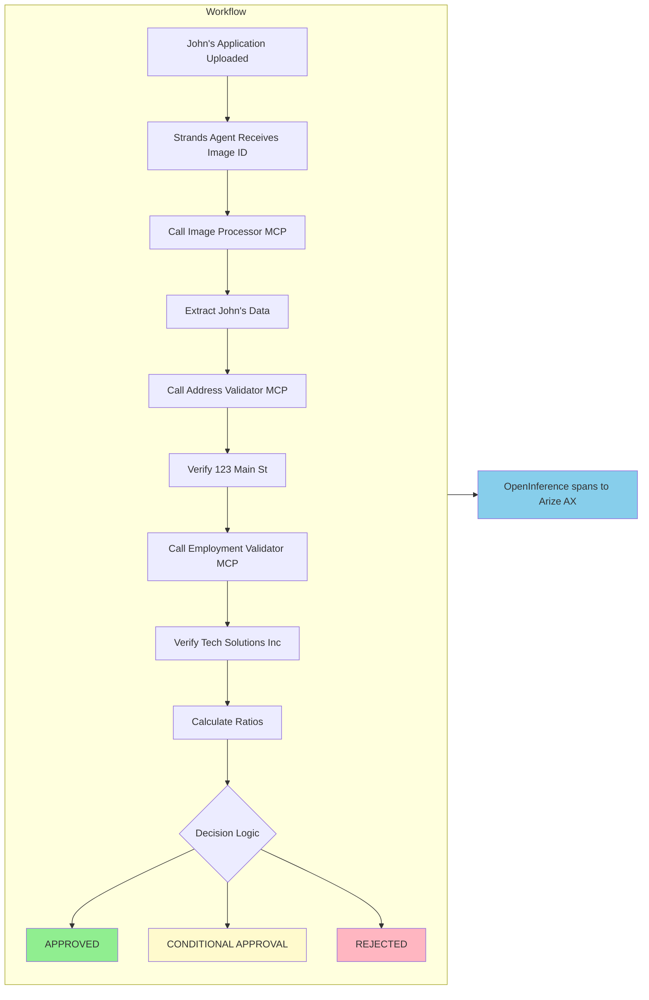

# How the Application Processes John's Loan

Now that you have seen John Michael Doe's loan application and understand the business problem, this section explains how the application processes it. Each component has a specialized role.


*The application that will be processed automatically*

## Understanding the Strands Agents SDK

Before examining the components, it is important to understand the framework used by the Track B stack Loan Buddy:

### **Strands Agents SDK - The Orchestrator**

[Strands Agents](https://github.com/strands-agents/sdk-python) is a lightweight, **model-first** agent SDK. Unlike LangGraph (which builds an explicit graph), Strands gives the model a set of tools and lets it drive the loop:

- **Manages the agent loop** (the model decides which tool to call next)
- **Integrates tools** (including MCP servers) with minimal glue code
- **Maintains conversation state** across tool calls
- **Emits OpenTelemetry spans** automatically (via OpenInference) — no per-call tracing code

:::code{language=python showCopyAction=true}
# In our agent, Strands creates the agent from a model + tools:
from strands import Agent
from strands.tools.mcp.mcp_client import MCPClient

agent = Agent(
    model=model,               # points at Kong /loan-strands (below)
    system_prompt=SYSTEM_PROMPT,
    tools=tools,               # loaded from the MCP servers
)
result = agent(user_prompt)    # the model drives the tool-calling loop
:::

### **The Model Client - Connecting to Kong → Bedrock**

Strands' `LiteLLMModel` treats the Kong `/loan-strands` route as an OpenAI-compatible endpoint. Kong's `ai-proxy` translates to Bedrock, so the agent never speaks Bedrock's native API and never holds Bedrock credentials:

:::code{language=python showCopyAction=true}
from strands.models.litellm import LiteLLMModel

model = LiteLLMModel(
    client_args={
        "base_url": f"{KONG_BASE_URL}/v1",          # http://<kong-proxy-lb>/loan-strands/v1
        "api_key": "unused",                          # Kong injects Bedrock auth via IAM
        "default_headers": {"apikey": KONG_API_KEY},  # Kong key-auth credential (sent on every request)
    },
    model_id=KONG_MODEL_ID,                           # openai/bedrock-claude (routing string)
    params={"max_tokens": 5000, "temperature": 0},
)
:::

## MCP Servers Explained

**MCP (Model Context Protocol)** servers are specialized services, each responsible for one task. These are the **same three MCP servers** the default Loan Buddy uses — MCP is framework-agnostic, so Strands connects to them unchanged.

### **1. Image Processor MCP**

**Job**: Extract structured data from John's loan application image

:::code{language=bash showCopyAction=true}
# Examine this MCP server's code:
code /workshop/workshops/eks-genai-workshop/static/code/module3/credit-validation/mcp-image-processor.py
:::

**How it works:**
1. **Receives** John's application image ID
2. **Retrieves** the image from S3 storage
3. **Uses Claude's vision capability** (through Kong → Bedrock) to read the document
4. **Extracts** structured JSON data

**What it extracts from John's application:**
:::code{language=json showCopyAction=true}
{
    "name": "John Michael Doe",
    "date_of_birth": "March 15, 1985",
    "ssn_last_4": "7890",
    "email": "john.doe@email.com",
    "employer": "Tech Solutions Inc",
    "job_title": "Software Engineer",
    "annual_income": 75000,
    "address": "123 Main Street",
    "city": "Anytown",
    "state": "CA",
    "zip": "90210",
    "loan_amount": 8500,
    "loan_purpose": "Home Improvement"
}
:::

**Note**: The image is not sent with every AI call, which would increase cost. Instead, it is stored once in S3 and referenced by ID.

### **2. Address Validator MCP**

**Job**: Verify John's address is real and assess risk

**What it does with "123 Main Street, Anytown, CA 90210":**
1. **Validates** the address format and ZIP code
2. **Checks** if it is residential (not a PO Box)
3. **Assesses** fraud risk indicators
4. **Verifies** ownership status (John owns the home)
5. **Calculates** stability score (4 years = high stability)

**Returns for John:**
:::code{language=python showCopyAction=true}
{
    "validation_status": "VALID",
    "is_residential": True,
    "address_type": "Single Family",
    "occupancy_status": "Owner Occupied",
    "risk_score": 15,  # Low risk
    "years_at_address": 4,
    "recommendation": "Address verified successfully. Proceed with application."
}
:::

### **3. Employment Validator MCP**

**Job**: Verify John's employment and income claims

**What it verifies about Tech Solutions Inc:**
1. **Employment status** (Full-time Software Engineer)
2. **Income accuracy** ($75,000 annual / $6,250 monthly)
3. **Employment duration** (3.5 years)
4. **Stability assessment** (consistent employment history)

**Returns for John:**
:::code{language=python showCopyAction=true}
{
    "validation_status": "PASSED",
    "employment_verified": True,
    "income_verified": True,
    "verified_employer": "Tech Solutions Inc",
    "verified_income": 75000,
    "employment_years": 3.5,
    "stability_score": 85,  # High stability
    "recommendation": "Employment and income verified successfully."
}
:::

## How the Agent Coordinates the Components

The Strands Loan Processing Agent coordinates the workflow. Its instructions are written in plain English; the model uses them to decide which MCP tool to call next.

### **The Agent's Workflow for John:**



### **The System Prompt - The Agent's Instructions**

The agent follows instructions written in plain English:

:::code{language=python showCopyAction=true}
SYSTEM_PROMPT = """You are a helpful AI assistant for credit underwriting and loan processing.

Your task is to process credit applications by:
1. First, extract credit application data from the uploaded document using the image processing tools
2. Then validate the extracted information using income, employment, and address validation tools
3. Make a final credit decision based on all validation results
4. Present a comprehensive credit assessment

You have access to MCP tools for extraction and validation. Pass the field 'image_id' to the
tools; they fetch the image from S3.
"""
:::

**Note**: No graph wiring is required — only instructions in English and a set of tools. The Strands model drives the loop.

## Platform Integration: How It All Connects

The agent's deployment wires it to Kong, Arize, the MCP servers, and S3. Examine the deployment template:

:::code{language=bash showCopyAction=true}
code /workshop/examples/strands-agents/loan-buddy-agent/agent.template.yaml
:::

### **Key Integration Points:**

::::tabs

:::tab{label="Kong AI Gateway"}
```yaml
- name: KONG_BASE_URL
  value: "http://<kong-proxy-lb>/loan-strands"   # the route from Module B2
- name: KONG_API_KEY
  value: "loan-strands-key-123"                    # sent as the 'apikey' header
- name: KONG_MODEL_ID
  value: "openai/bedrock-claude"
```
**All AI requests route through Kong** — `ai-proxy` translates to Bedrock and signs with the DataPlane's IAM role. No LLM keys in the agent.
:::

:::tab{label="Arize AX Observability"}
```yaml
- name: ARIZE_API_KEY
  valueFrom:
    secretKeyRef: { name: arize-credentials, key: ARIZE_API_KEY }
- name: ARIZE_SPACE_ID
  valueFrom:
    secretKeyRef: { name: arize-credentials, key: ARIZE_SPACE_ID }
- name: ARIZE_PROJECT_NAME
  value: "loan-strands"
```

**Full-agent tracing** — the agent calls `arize.otel.register(set_global_tracer_provider=True)` at startup. Strands then emits OpenInference spans automatically:

- **AGENT** span — the top-level run
- **LLM** spans — each Bedrock call through Kong (tokens + latency)
- **TOOL** spans — each MCP call (image / address / employment)

::alert[**Credentials via Secret**: the Arize Service key + Space ID are mounted from the `arize-credentials` Secret (created in the Arize setup) — never baked into the image.]{type="info"}
:::

:::tab{label="MCP Communication"}
```yaml
- name: MCP_IMAGE_PROCESSOR
  value: "http://mcp-image-processor.workshop:8000"
- name: MCP_ADDRESS_VALIDATOR
  value: "http://mcp-address-validator.workshop:8000"
- name: MCP_EMPLOYMENT_VALIDATOR
  value: "http://mcp-employment-validator.workshop:8000"
```
**Internal Kubernetes networking** over MCP (SSE) — the same servers as the default stack.
:::

:::tab{label="S3 Storage"}
```yaml
- name: S3_BUCKET_NAME
  value: "genai-on-eks-bucket-langfuse-..."
- name: AWS_REGION
  value: "us-east-1"
```
**Images stored once** in S3, referenced by ID. The agent's service account has S3 access via EKS Pod Identity — **it needs S3 but NOT Bedrock IAM** (Bedrock is reached through Kong).
:::

::::

## Why This Architecture Matters

### **Separation of Concerns**
- Each MCP server is responsible for a single task
- The Strands agent orchestrates but does not implement business logic
- Platform components (Kong, Arize) handle gateway + observability

### **Scalability**
- MCP servers scale independently
- Multiple agents can share the same MCP servers and the same Kong route
- Kong handles load balancing and rate limiting at the edge

### **Maintainability**
- Update business rules in MCP servers without touching the agent
- Add new validation tools without changing existing code
- Full OpenInference traces make debugging straightforward

### **Cost Optimization**
- Images processed once and cached in S3
- Efficient token usage (no image in every call)
- Kong pins the model, controlling cost at the edge

## Challenge: Extend the System

**Question**: How would you add a new validation rule that requires the monthly payment to be less than 25% of monthly income?

**Hint**: You could either:
1. Add logic to the Employment Validator MCP to check this ratio
2. Create a new "Debt Ratio Calculator" MCP server
3. Add the check to the agent's system prompt

Consider the trade-offs of each approach.

## What's Next?

Now that you understand how all the components work together, the next step is to deploy and test the application. In the next section, you will:

1. Deploy the Strands agent + MCP servers to your EKS cluster
2. Process John's actual application
3. Follow the real-time logs as the agent makes decisions
4. Explore the complete workflow in Arize AX

---

**[Next: Deploy and Test Your Application →](../running-application/)**
