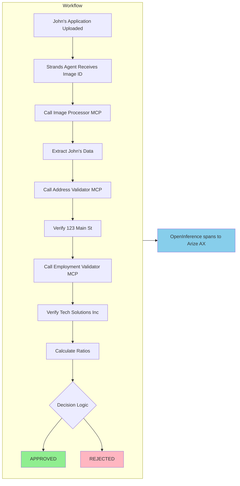

# 애플리케이션이 John의 대출을 처리하는 방식

이제 John Michael Doe의 대출 신청서를 확인하고 비즈니스 문제를 이해했으므로, 이 섹션에서는 애플리케이션이 신청서를 실제로 어떻게 처리하는지 설명합니다. 각 구성요소는 전문화된 역할을 담당합니다.


*자동으로 처리할 신청서*

## Strands Agents SDK 이해

구성요소를 살펴보기 전에 대안 스택 Loan Buddy가 사용하는 프레임워크를 이해하는 것이 중요합니다:

### **Strands Agents SDK - 오케스트레이터**

[Strands Agents](https://github.com/strands-agents/sdk-python)는 경량의 **model-first** 에이전트 SDK입니다. 명시적 그래프를 구축하는 LangGraph와 달리, Strands는 모델에 도구 세트를 제공하고 모델이 루프를 주도하게 합니다:

- **에이전트 루프 관리** — 모델이 다음에 호출할 도구를 결정합니다
- **도구 통합** — 최소한의 연결 코드로 MCP 서버를 포함한 도구를 통합합니다
- **대화 상태 유지** — 도구 호출 간 대화 상태를 유지합니다
- **OpenTelemetry 스팬 자동 생성** — OpenInference를 통해 자동 생성되므로 호출별 추적 코드가 필요하지 않습니다

:::code{language=python showCopyAction=true}
# In our agent, Strands creates the agent from a model + tools:
from strands import Agent
from strands.tools.mcp.mcp_client import MCPClient

agent = Agent(
    model=model,               # points at Kong /loan-strands (below)
    system_prompt=SYSTEM_PROMPT,
    tools=tools,               # loaded from the MCP servers
)
result = agent(user_prompt)    # the model drives the tool-calling loop
:::

### **모델 클라이언트 - Kong → Bedrock 연결**

Strands의 `LiteLLMModel`은 Kong `/loan-strands` 라우트를 OpenAI 호환 엔드포인트로 취급합니다. Kong의 `ai-proxy`가 Bedrock으로 변환하므로 에이전트는 Bedrock의 네이티브 API를 직접 사용하지 않으며 AWS 자격 증명도 보유하지 않습니다:

:::code{language=python showCopyAction=true}
from strands.models.litellm import LiteLLMModel

model = LiteLLMModel(
    client_args={
        "base_url": f"{KONG_BASE_URL}/v1",          # http://<kong-proxy-lb>/loan-strands/v1
        "api_key": "unused",                          # Kong injects Bedrock auth via IAM
        "default_headers": {"apikey": KONG_API_KEY},  # Kong key-auth credential (sent on every request)
    },
    model_id=KONG_MODEL_ID,                           # openai/bedrock-claude (routing string)
    params={"max_tokens": 5000, "temperature": 0},
)
:::

## MCP 서버 설명

**MCP (Model Context Protocol)** 서버는 각각 한 가지 작업을 담당하는 전문화된 서비스입니다. 이는 기본 Loan Buddy가 사용하는 것과 **동일한 세 개의 MCP 서버** 입니다 — MCP는 프레임워크에 독립적이므로 Strands는 변경 없이 그대로 연결합니다.

### **1. Image Processor MCP**

**작업**: John의 대출 신청서 이미지에서 구조화된 데이터 추출

:::code{language=bash showCopyAction=true}
# Examine this MCP server's code (starter-kit repo):
code ~/.../sample-genai-on-eks-starter-kit/workshops/eks-genai-workshop/static/code/module3/credit-validation/mcp-image-processor.py
:::

**작동 방식:**
1. **수신** — John의 신청서 이미지 ID를 받습니다
2. **검색** — S3 스토리지에서 이미지를 가져옵니다
3. **Claude의 비전 기능 사용** — Kong → Bedrock을 통해 문서를 읽습니다
4. **추출** — 구조화된 JSON 데이터를 추출합니다

**John의 신청서에서 추출하는 내용:**
:::code{language=json showCopyAction=true}
{
    "name": "John Michael Doe",
    "date_of_birth": "March 15, 1985",
    "ssn_last_4": "7890",
    "email": "john.doe@email.com",
    "employer": "Tech Solutions Inc",
    "job_title": "Software Engineer",
    "annual_income": 75000,
    "address": "123 Main Street",
    "city": "Anytown",
    "state": "CA",
    "zip": "90210",
    "loan_amount": 8500,
    "loan_purpose": "Home Improvement"
}
:::

**참고**: 이미지는 모든 AI 호출과 함께 전송되지 않습니다. 그렇게 하면 비용이 증가하기 때문입니다. 대신 S3에 한 번 저장되고 ID로 참조됩니다.

### **2. Address Validator MCP**

**작업**: John의 주소가 실제인지 확인하고 위험 평가

**"123 Main Street, Anytown, CA 90210"에 대해 수행하는 작업:**
1. **검증** — 주소 형식 및 우편번호를 검증합니다
2. **확인** — 주거용 주소인지 확인합니다 (PO Box 아님)
3. **평가** — 사기 위험 지표를 평가합니다
4. **검증** — 소유 상태를 확인합니다 (John이 주택 소유)
5. **계산** — 안정성 점수를 계산합니다 (4년 거주 = 높은 안정성)

**John에 대한 반환값:**
:::code{language=python showCopyAction=true}
{
    "validation_status": "VALID",
    "is_residential": True,
    "address_type": "Single Family",
    "occupancy_status": "Owner Occupied",
    "risk_score": 15,  # Low risk
    "years_at_address": 4,
    "recommendation": "Address verified successfully. Proceed with application."
}
:::

### **3. Employment Validator MCP**

**작업**: John의 고용 및 소득 정보 확인

**Tech Solutions Inc에 대해 확인하는 내용:**
1. **고용 상태** (정규직 Software Engineer)
2. **소득 정확성** ($75,000 연봉 / $6,250 월급)
3. **고용 기간** (3.5년)
4. **안정성 평가** (일관된 고용 이력)

**John에 대한 반환값:**
:::code{language=python showCopyAction=true}
{
    "validation_status": "PASSED",
    "employment_verified": True,
    "income_verified": True,
    "verified_employer": "Tech Solutions Inc",
    "verified_income": 75000,
    "employment_years": 3.5,
    "stability_score": 85,  # High stability
    "recommendation": "Employment and income verified successfully."
}
:::

## 에이전트가 구성요소를 조율하는 방식

Strands Loan Processing Agent가 워크플로우를 조율합니다. 지시사항은 평이한 영어로 작성되며, 모델은 이를 기반으로 다음에 호출할 MCP 도구를 결정합니다.

### **John을 위한 에이전트의 워크플로우:**



### **시스템 프롬프트 - 에이전트의 지시사항**

에이전트는 평이한 영어로 작성된 지시사항을 따릅니다:

:::code{language=python showCopyAction=true}
SYSTEM_PROMPT = """You are a helpful AI assistant for credit underwriting and loan processing.

Your task is to process credit applications by:
1. First, extract credit application data from the uploaded document using the image processing tools
2. Then validate the extracted information using income, employment, and address validation tools
3. Make a final credit decision based on all validation results
4. Present a comprehensive credit assessment

You have access to MCP tools for extraction and validation. Pass the field 'image_id' to the
tools; they fetch the image from S3.
"""
:::

**참고**: 그래프 연결이 필요하지 않습니다 — 영어로 된 지시사항과 도구 세트만 있으면 됩니다. Strands 모델이 루프를 주도합니다.

## 플랫폼 통합: 모든 것이 연결되는 방식

에이전트의 배포는 Kong, Arize, MCP 서버, S3와 연결됩니다. 배포 템플릿을 검토하십시오:

:::code{language=bash showCopyAction=true}
code ~/.../sample-genai-on-eks-starter-kit/examples/strands-agents/loan-buddy-agent/agent.template.yaml
:::

### **주요 통합 지점:**

::::tabs

:::tab{label="Kong AI Gateway"}
```yaml
- name: KONG_BASE_URL
  value: "http://<kong-proxy-lb>/loan-strands"   # the route from Module B2
- name: KONG_API_KEY
  value: "loan-strands-key-123"                    # sent as the 'apikey' header
- name: KONG_MODEL_ID
  value: "openai/bedrock-claude"
```
**모든 AI 요청이 Kong을 통해 라우팅됩니다** — `ai-proxy`가 Bedrock으로 변환하고 DataPlane의 IAM 역할로 서명합니다. 에이전트에 LLM 키가 없습니다.
:::

:::tab{label="Arize AX Observability"}
```yaml
- name: ARIZE_API_KEY
  valueFrom:
    secretKeyRef: { name: arize-credentials, key: ARIZE_API_KEY }
- name: ARIZE_SPACE_ID
  valueFrom:
    secretKeyRef: { name: arize-credentials, key: ARIZE_SPACE_ID }
- name: ARIZE_PROJECT_NAME
  value: "loan-strands"
```

**전체 에이전트 추적** — 에이전트는 시작 시 `arize.otel.register(set_global_tracer_provider=True)`를 호출합니다. 이후 Strands가 OpenInference 스팬을 자동으로 생성합니다:

- **AGENT** 스팬 — 최상위 실행
- **LLM** 스팬 — Kong을 통한 각 Bedrock 호출 (토큰 + 지연시간)
- **TOOL** 스팬 — 각 MCP 호출 (이미지 / 주소 / 고용)

::alert[**Secret을 통한 자격 증명**: Arize Service 키 + Space ID는 `arize-credentials` Secret (Arize 설정에서 생성)에서 마운트됩니다 — 이미지에 포함되지 않습니다.]{type="info"}
:::

:::tab{label="MCP Communication"}
```yaml
- name: MCP_IMAGE_PROCESSOR
  value: "http://mcp-image-processor:8400"
- name: MCP_ADDRESS_VALIDATOR
  value: "http://mcp-address-validator:5300"
- name: MCP_EMPLOYMENT_VALIDATOR
  value: "http://mcp-employment-validator:5200"
```
**내부 Kubernetes 네트워킹** — MCP (SSE)를 통해 통신하며, 기본 스택과 동일한 서버입니다.
:::

:::tab{label="S3 Storage"}
```yaml
- name: S3_BUCKET_NAME
  value: "genai-on-eks-bucket-langfuse-..."
- name: AWS_REGION
  value: "us-east-1"
```
**이미지는 S3에 한 번 저장되고** ID로 참조됩니다. 에이전트의 서비스 계정은 EKS Pod Identity를 통해 S3에 접근합니다 — **S3 권한은 필요하지만 Bedrock IAM은 필요하지 않습니다** (Bedrock은 Kong을 통해 접근).
:::

::::

## 이 아키텍처가 중요한 이유

### **관심사의 분리**
- 각 MCP 서버는 한 가지 작업만 담당합니다
- Strands 에이전트는 오케스트레이션만 수행하고 비즈니스 로직을 구현하지 않습니다
- 플랫폼 구성요소(Kong, Arize)가 게이트웨이와 관측성을 처리합니다

### **확장성**
- MCP 서버는 독립적으로 확장할 수 있습니다
- 여러 에이전트가 동일한 MCP 서버와 동일한 Kong 라우트를 공유할 수 있습니다
- Kong이 엣지에서 로드 밸런싱과 속도 제한을 처리합니다

### **유지보수성**
- 에이전트를 변경하지 않고 MCP 서버의 비즈니스 규칙을 업데이트할 수 있습니다
- 기존 코드를 변경하지 않고 새로운 검증 도구를 추가할 수 있습니다
- 완전한 OpenInference 추적으로 디버깅이 수월해집니다

### **비용 최적화**
- 이미지는 한 번 처리되고 S3에 캐시됩니다
- 효율적인 토큰 사용 (모든 호출에 이미지를 포함하지 않음)
- Kong이 모델을 고정하여 엣지에서 비용을 제어합니다

## 도전 과제: 시스템 확장

**질문**: 월 상환액이 월 소득의 25% 미만이어야 한다는 새로운 검증 규칙을 어떻게 추가하시겠습니까?

**힌트**: 다음 중 하나를 선택할 수 있습니다:
1. 이 비율을 확인하는 로직을 Employment Validator MCP에 추가
2. 새로운 "Debt Ratio Calculator" MCP 서버 생성
3. 에이전트의 시스템 프롬프트에 확인 항목 추가

각 접근 방식의 장단점을 검토해 보십시오.

## 다음은 무엇입니까?

이제 모든 구성요소가 함께 작동하는 방식을 이해했으므로, 다음 단계에서는 애플리케이션을 배포하고 테스트합니다. 다음 섹션에서는:

1. EKS 클러스터에 Strands 에이전트 + MCP 서버 배포
2. John의 실제 신청서 처리
3. 에이전트가 결정을 내리는 과정을 실시간 로그로 확인
4. Arize AX에서 전체 워크플로우 탐색

---

**[다음: 애플리케이션 배포 및 테스트 →](../running-application/)**
