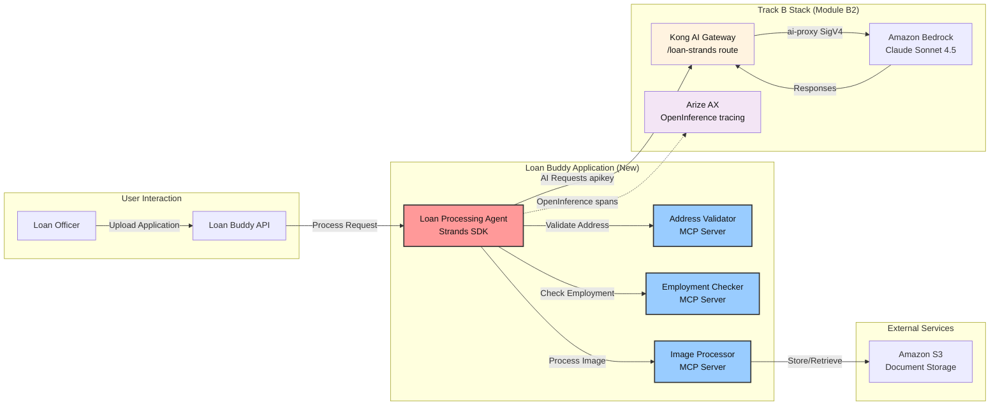

With the Track B stack platform in place — **Kong AI Gateway** (routing to Bedrock via CRDs) and **Arize AX** (observability) — this module puts it to practical use. You will build "Loan Buddy," the same loan-processing application as Track A's Module A2, but implemented with the **Strands Agents SDK**, calling Bedrock **through Kong**, and traced in **Arize AX**.

::alert[**Platform Required**: This module builds on the Track B stack from Module B2 (Kong `/loan-strands` route + Arize credentials). Complete [Module B2](/track-b-saas/b2-ai-gateway-observability/) first if you have not already.]{type="warning"}

## Learning Objectives

By the end of this module, you will:

- Build an AI application using the Track B stack platform (Kong + Arize)
- Deploy an agent built with the Strands Agents SDK (instead of LangChain/LangGraph)
- Use Model Context Protocol (MCP) to give the agent external tools — the *same* 3 MCP servers as the default stack
- Trace agent workflows in Arize AX with full OpenInference traces (AGENT / LLM / TOOL spans)
- Understand agentic application architecture on Kubernetes with a SaaS gateway and observability
- Review the business outcomes of automating a manual loan-review process

## Application Architecture

**Loan Buddy** automates manual loan processing steps with an AI agent. The following diagram shows how the Strands version uses the Track B stack platform:

**Key Integration Points:**
- **Uses your Kong AI Gateway** (`/loan-strands` route) from Module B2 for all AI requests
- **Traced in Arize AX** from Module B2 for complete observability
- **Uses Amazon Bedrock** (Claude Sonnet 4.5) via Kong's `ai-proxy`
- **Deployed on EKS** using the starter-kit `./cli` example pattern

## Module Structure

This module is organized into three hands-on sections:

### 1. [Understanding the Use Case](./usecase/)
**Business Context and Requirements**
- Review the loan processing business problem
- Understand the AI solution architecture
- Preview the application components and workflow

### 2. [Application Components](./application-components/)
**Technical Deep Dive**
- Examine the Strands agent workflow
- Review the MCP servers and their capabilities
- Understand how components integrate with Kong + Arize

### 3. [Running the Application](./running-application/)
**Hands-On Deployment and Testing**
- Deploy Loan Buddy (Strands) on your EKS cluster
- Test the application with sample loan documents
- Observe the complete workflow in Arize AX

## Key concepts

This module demonstrates agentic AI patterns on the Track B stack:

- **Platform Integration**: Uses the Kong + Arize infrastructure you built in Module B2
- **Business Value**: Automates a manual loan-review process with measurable outcomes
- **Complete Observability**: Every agent decision traced in Arize AX (AGENT/LLM/TOOL spans)
- **AI Frameworks**: Strands Agents SDK for orchestration, MCP for tool integration
- **Kubernetes Native**: Deployed with the same starter-kit patterns as your platform components

## Key Technologies You Will Use

::::tabs

:::tab{label="AI Frameworks"}
- **Strands Agents SDK** - Lightweight, model-first agent orchestration
- **LiteLLM model client** - points the Strands agent at the Kong OpenAI-compatible endpoint
- **Model Context Protocol** - Tool integration standard (same MCP servers as default)
- **OpenInference** - OpenTelemetry-based tracing for agents
:::

:::tab{label="Platform Integration"}
- **Your Kong AI Gateway** - `/loan-strands` route proxies all AI requests to Bedrock
- **Your Arize AX Space** - traces all agent activities
- **Your EKS Cluster** - hosts the application components
- **Claude Sonnet 4.5** - the reasoning model, pinned by Kong's `ai-proxy`
:::

:::tab{label="Application Components"}
- **Loan Processing Agent** - Strands-based workflow orchestrator
- **Address Validator** - MCP server for address verification
- **Employment Checker** - MCP server for employment validation
- **Image Processor** - MCP server for document analysis
:::

::::

## Expected Outcomes

By completing this module, you will have:

- A working Strands application deployed on your EKS cluster
- Complete workflow visibility in Arize AX showing every agent decision
- An understanding of agentic patterns with the Strands SDK
- Experience with MCP integration through a SaaS gateway (Kong → Bedrock)
- Practical knowledge of deploying agentic applications on Kubernetes with SaaS observability

## Getting Started

Begin with the business use case to see how the agent automates the loan-processing workflow.

::alert[**Tip**: Keep Arize AX open in a browser tab throughout this module — you will observe your agent workflows appear as OpenInference traces as the application processes loan applications.]{type="info"}

---

**[Next: Understanding the Use Case →](./usecase/)**
