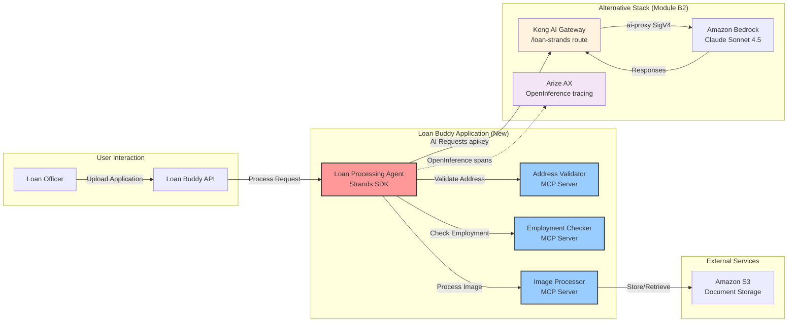

대안 스택 플랫폼 — **Kong AI Gateway** (CRD를 통해 Bedrock으로 라우팅)와 **Arize AX** (관측성) — 가 준비되었으므로 이 모듈에서는 이를 실제로 활용합니다. Track A의 모듈 A2와 동일한 대출 처리 애플리케이션인 "Loan Buddy"를 구축하되, **Strands Agents SDK** 로 구현하고, **Kong을 통해** Bedrock을 호출하며, **Arize AX** 에서 추적합니다.

::alert[**플랫폼 필요**: 이 모듈은 모듈 B2의 대안 스택(Kong `/loan-strands` 라우트 + Arize 자격 증명)을 기반으로 합니다. 아직 완료하지 않았다면 [모듈 B2](/track-b-saas/b2-ai-gateway-observability/)를 먼저 완료하십시오.]{type="warning"}

## 학습 목표

이 모듈을 마치면 다음을 수행할 수 있습니다:

- 대안 스택 플랫폼(Kong + Arize)을 사용하여 AI 애플리케이션 구축
- Strands Agents SDK로 구축된 에이전트 배포 (LangChain/LangGraph 대신)
- Model Context Protocol (MCP)을 사용하여 에이전트에 외부 도구 제공 — 기본 스택과 *동일한* 3개 MCP 서버 사용
- Arize AX에서 완전한 OpenInference 추적(AGENT / LLM / TOOL 스팬)으로 에이전트 워크플로우 추적
- SaaS 게이트웨이와 관측성을 갖춘 Kubernetes 환경에서 Agentic 애플리케이션 아키텍처 이해
- 수동 대출 검토 프로세스 자동화의 비즈니스 성과 확인

## 애플리케이션 아키텍처

**Loan Buddy** 는 AI 에이전트로 수동 대출 처리 단계를 자동화합니다. 다음 다이어그램은 Strands 버전이 대안 스택 플랫폼을 사용하는 방식을 보여줍니다:

**주요 통합 지점:**
- **모듈 B2의 Kong AI Gateway 사용** — 모든 AI 요청이 `/loan-strands` 라우트를 통과합니다
- **모듈 B2의 Arize AX에서 추적** — 완전한 관측성을 확보합니다
- **Amazon Bedrock 사용** (Claude Sonnet 4.5) — Kong의 `ai-proxy`를 통해 호출합니다
- **EKS에 배포** — starter-kit의 `./cli` 예제 패턴을 사용합니다

## 모듈 구조

이 모듈은 세 개의 실습 섹션으로 구성됩니다:

#### 1. [유스케이스 이해](./usecase/)
**비즈니스 컨텍스트 및 요구사항**
- 대출 처리 비즈니스 문제 검토
- AI 솔루션 아키텍처 이해
- 애플리케이션 구성요소 및 워크플로우 미리보기

#### 2. [애플리케이션 구성요소](./application-components/)
**기술 심층 분석**
- Strands 에이전트 워크플로우 검토
- MCP 서버 및 기능 확인
- 구성요소가 Kong + Arize와 통합되는 방식 이해

#### 3. [애플리케이션 실행](./running-application/)
**실습 배포 및 테스트**
- EKS 클러스터에 Loan Buddy (Strands) 배포
- 샘플 대출 문서로 애플리케이션 테스트
- Arize AX에서 전체 워크플로우 확인

## 핵심 개념

이 모듈은 대안 스택 기반의 Agentic AI 패턴을 다룹니다:

- **플랫폼 통합**: 모듈 B2에서 구축한 Kong + Arize 인프라 사용
- **비즈니스 가치**: 측정 가능한 결과와 함께 수동 대출 검토 프로세스 자동화
- **완전한 관측성**: 모든 에이전트 결정이 Arize AX에서 추적됨 (AGENT/LLM/TOOL 스팬)
- **AI 프레임워크**: 오케스트레이션을 위한 Strands Agents SDK, 도구 통합을 위한 MCP
- **Kubernetes 네이티브**: 플랫폼 구성요소와 동일한 starter-kit 패턴으로 배포

## 사용할 주요 기술

::::tabs

:::tab{label="AI Frameworks"}
- **Strands Agents SDK** - 경량, model-first 에이전트 오케스트레이션
- **LiteLLM model client** - Strands 에이전트를 Kong의 OpenAI 호환 엔드포인트에 연결
- **Model Context Protocol** - 도구 통합 표준 (기본 스택과 동일한 MCP 서버)
- **OpenInference** - 에이전트를 위한 OpenTelemetry 기반 추적
:::

:::tab{label="Platform Integration"}
- **Kong AI Gateway** - `/loan-strands` 라우트가 모든 AI 요청을 Bedrock으로 프록시
- **Arize AX Space** - 모든 에이전트 활동 추적
- **EKS 클러스터** - 애플리케이션 구성요소 호스팅
- **Claude Sonnet 4.5** - Kong의 `ai-proxy`로 고정된 추론 모델
:::

:::tab{label="Application Components"}
- **Loan Processing Agent** - Strands 기반 워크플로우 오케스트레이터
- **Address Validator** - 주소 검증을 위한 MCP 서버
- **Employment Checker** - 고용 검증을 위한 MCP 서버
- **Image Processor** - 문서 분석을 위한 MCP 서버
:::

::::

## 예상 결과

이 모듈을 완료하면 다음을 갖추게 됩니다:

- EKS 클러스터에 배포된 정상 작동하는 Strands 애플리케이션
- 모든 에이전트 결정을 보여주는 Arize AX의 완전한 워크플로우 가시성
- Strands SDK를 사용한 Agentic 패턴에 대한 이해
- SaaS 게이트웨이(Kong → Bedrock)를 통한 MCP 통합 경험
- SaaS 관측성과 함께 Kubernetes에 Agentic 애플리케이션을 배포하는 실무 지식

## 시작하기

먼저 비즈니스 유스케이스를 통해 에이전트가 대출 처리 워크플로우를 자동화하는 방식을 확인합니다.

::alert[**팁**: 이 모듈을 진행하는 동안 브라우저 탭에 Arize AX를 열어두십시오. 애플리케이션이 대출 신청을 처리할 때 에이전트 워크플로우가 OpenInference 추적으로 나타나는 것을 확인할 수 있습니다.]{type="info"}

---

**[다음: 유스케이스 이해 →](./usecase/)**
