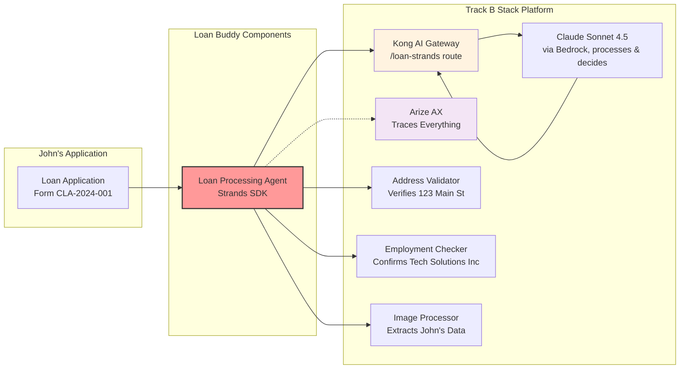

# The Manual Loan Review Problem

Consider a loan officer at a bank — Sarah — who receives a personal loan application from an applicant named John Michael Doe.

*A typical personal loan application - Form CLA-2024-001*

To process this application manually, Sarah needs to:

- **Extract data**: Type in John's name, DOB (March 15, 1985), SSN ending in 7890
- **Verify employment**: Call Tech Solutions Inc to confirm John's Software Engineer position
- **Validate income**: Verify the $75,000 annual income ($6,250/month)
- **Check address**: Confirm 123 Main Street, Anytown, CA 90210 is a real address
- **Assess stability**: Note he has been there 4 years, owns the home, employed 3.5 years
- **Calculate ratios**: $8,500 loan for home improvement, 36-month term, $275/month payment
- **Make decision**: Approve or deny based on all factors

This manual process typically takes 2-3 hours per application. In this module, you deploy an agent that performs the same steps in about 2 minutes.

## The Loan Buddy Application

**Loan Buddy** uses the Track B stack platform (Kong + Arize + Strands) to automate the loan review process. For John's application, it performs the following steps:

### What Loan Buddy Does:
1. **Reads the application** using vision language models to extract all data from the image
2. **Validates information** using external services (address verification, employment checks)
3. **Applies business rules** automatically (loan limits, income ratios, risk assessment)
4. **Makes decisions** with complete audit trails in Arize AX
5. **Documents everything** for compliance and future reference

### The Business Impact:
- **Processing time**: Reduced from 2-3 hours to about 2 minutes
- **Consistency**: The same criteria are applied to every application
- **Cost savings**: Fewer manual review hours needed
- **Complete audit trail**: Every decision traced and explainable in Arize AX
- **Applicant experience**: Faster responses for applicants

## John's Application in Detail

### What Needs Processing:

::::tabs

:::tab{label="Personal Information"}
- **Full Name**: John Michael Doe
- **Date of Birth**: March 15, 1985
- **SSN**: ***-**-7890 (last 4 digits)
- **Phone**: (555) 123-4567
- **Email**: john.doe@email.com
:::

:::tab{label="Employment Details"}
- **Employer**: Tech Solutions Inc
- **Position**: Software Engineer
- **Status**: Full-time
- **Years Employed**: 3.5 years
- **Annual Income**: $75,000
- **Monthly Income**: $6,250
:::

:::tab{label="Address Information"}
- **Street**: 123 Main Street
- **City**: Anytown, **State**: CA, **ZIP**: 90210
- **Housing Status**: Own
- **Years at Address**: 4 years
:::

:::tab{label="Loan Request"}
- **Amount**: $8,500
- **Purpose**: Home Improvement
- **Term**: 36 months
- **Estimated Payment**: $275/month
:::

::::

**The challenge:** A bank may process hundreds of these applications weekly, each requiring manual verification of every detail.

## How the Track B Stack Platform Supports This

The platform you built in Module B2 serves as the foundation for Loan Buddy:

**Key Integration Points:**
- **Uses your Kong `/loan-strands` route** for all AI requests (no direct model calls, no LLM keys in the app)
- **Traced in Arize AX** for complete observability and compliance
- **Uses Claude Sonnet 4.5** (via Bedrock, pinned by Kong's `ai-proxy`) for complex reasoning
- **Deployed on your EKS cluster** using the Track B stack patterns

## What You Will Do

When you deploy and test Loan Buddy with John's application, you will:

1. **Upload John's application image** -- the agent extracts all personal, employment, and loan data
2. **Follow the processing in real time** -- the agent validates the address and verifies employment at Tech Solutions Inc
3. **Observe the decision-making** -- the agent calculates the debt-to-income ratio (4.4%)
4. **Explore the complete traces** -- view the entire workflow in Arize AX with all tool calls and reasoning
5. **Review the final decision** -- an approval with full justification and audit trail

## Key concepts

By the end of this module, you will understand:

- How AI agents work as workflow orchestrators, not just chat interfaces
- How MCP servers extend agent capabilities with external data
- How the Kong + Arize infrastructure supports multiple applications on one platform
- How agent automation replaces a repetitive manual review process
- Why observability matters — every decision is traced for compliance and optimization

## What's Next?

Now that you understand the business context and how John's loan can be processed in minutes instead of hours, the next step is to examine the technical architecture. You will explore how the Strands agent orchestrates the workflow and how each MCP server contributes to the decision-making process.

::alert[**Note**: In the next section, you will examine the actual code that drives this process. A few hundred lines of Python automate hours of manual work.]{type="info"}

---

**[Next: Application Components →](../application-components/)**
