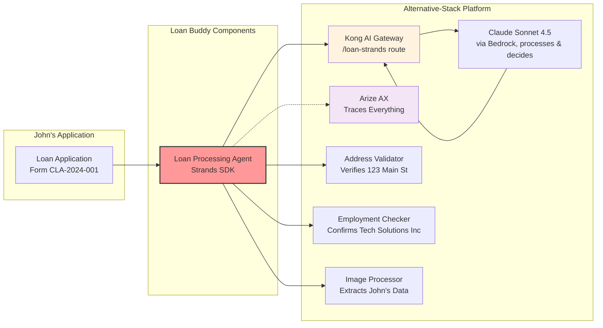

# 수동 대출 검토 문제

은행 대출 담당자 Sarah가 John Michael Doe라는 신청자의 개인 대출 신청서를 접수한 상황을 가정합니다.

*일반적인 개인 대출 신청서 - 양식 CLA-2024-001*

이 신청서를 수동으로 처리하려면 Sarah는 다음 작업을 수행해야 합니다:

- **데이터 추출**: John의 이름, 생년월일(1985년 3월 15일), SSN 끝 7890 입력
- **고용 확인**: Tech Solutions Inc에 전화하여 John의 Software Engineer 직위 확인
- **소득 검증**: 연봉 $75,000 ($6,250/월) 확인
- **주소 검증**: 123 Main Street, Anytown, CA 90210이 실제 주소인지 확인
- **안정성 평가**: 4년 거주, 주택 소유, 3.5년 근무 사실 기록
- **비율 계산**: 주택 개선을 위한 $8,500 대출, 36개월 기간, 월 $275 상환
- **결정 내리기**: 모든 요소를 기반으로 승인 또는 거부

이 수동 프로세스는 신청서당 일반적으로 2-3시간이 소요됩니다. 이 모듈에서는 동일한 단계를 약 2분 안에 수행하는 에이전트를 배포합니다.

## Loan Buddy 애플리케이션

**Loan Buddy** 는 대안 스택 플랫폼(Kong + Arize + Strands)을 사용하여 대출 검토 프로세스를 자동화합니다. John의 신청서에 대해 다음 단계를 수행합니다:

### Loan Buddy가 수행하는 작업:
1. **신청서 읽기** — 비전 언어 모델을 사용하여 이미지에서 모든 데이터 추출
2. **정보 검증** — 외부 서비스 사용 (주소 검증, 고용 확인)
3. **비즈니스 규칙 적용** — 자동 적용 (대출 한도, 소득 비율, 위험 평가)
4. **결정 내리기** — Arize AX에 완전한 감사 추적 기록
5. **모든 내용 문서화** — 규정 준수 및 향후 참조용

### 비즈니스 영향:
- **처리 시간**: 2-3시간에서 약 2분으로 단축
- **일관성**: 모든 신청서에 동일한 기준 적용
- **비용 절감**: 수동 검토 시간 감소
- **완전한 감사 추적**: 모든 결정이 Arize AX에서 추적되고 설명 가능
- **신청자 경험**: 더 빠른 응답 제공

## John의 신청서 자세히 보기

### 처리해야 할 내용:

::::tabs

:::tab{label="Personal Information"}
- **Full Name**: John Michael Doe
- **Date of Birth**: March 15, 1985
- **SSN**: ***-**-7890 (마지막 4자리)
- **Phone**: (555) 123-4567
- **Email**: john.doe@email.com
:::

:::tab{label="Employment Details"}
- **Employer**: Tech Solutions Inc
- **Position**: Software Engineer
- **Status**: Full-time
- **Years Employed**: 3.5년
- **Annual Income**: $75,000
- **Monthly Income**: $6,250
:::

:::tab{label="Address Information"}
- **Street**: 123 Main Street
- **City**: Anytown, **State**: CA, **ZIP**: 90210
- **Housing Status**: Own
- **Years at Address**: 4년
:::

:::tab{label="Loan Request"}
- **Amount**: $8,500
- **Purpose**: Home Improvement
- **Term**: 36개월
- **Estimated Payment**: $275/월
:::

::::

**과제:** 은행은 매주 수백 건의 이러한 신청서를 처리할 수 있으며, 각 신청서는 모든 세부사항에 대한 수동 검증이 필요합니다.

## 대안 스택 플랫폼이 이를 지원하는 방법

모듈 B2에서 구축한 플랫폼이 Loan Buddy의 기반이 됩니다:

**주요 통합 지점:**
- **Kong `/loan-strands` 라우트 사용** — 모든 AI 요청이 이 라우트를 통과합니다 (직접 모델 호출 없음, 앱에 LLM 키 없음)
- **Arize AX에서 추적** — 완전한 관측성 및 규정 준수 확보
- **Claude Sonnet 4.5 사용** (Bedrock을 통해, Kong의 `ai-proxy`로 고정) — 복잡한 추론 수행
- **EKS 클러스터에 배포** — 대안 스택 패턴 사용

## 수행할 작업

John의 신청서로 Loan Buddy를 배포하고 테스트하면서 다음을 수행합니다:

1. **John의 신청서 이미지 업로드** — 에이전트가 모든 개인, 고용, 대출 데이터를 추출합니다
2. **실시간 처리 확인** — 에이전트가 주소를 검증하고 Tech Solutions Inc에서의 고용을 확인합니다
3. **의사결정 관찰** — 에이전트가 부채 대 소득 비율(4.4%)을 계산합니다
4. **완전한 추적 탐색** — Arize AX에서 모든 도구 호출 및 추론이 포함된 전체 워크플로우를 확인합니다
5. **최종 결정 검토** — 완전한 근거와 감사 추적이 포함된 승인 결과를 확인합니다

## 핵심 개념

이 모듈을 마치면 다음을 이해하게 됩니다:

- AI 에이전트가 단순한 채팅 인터페이스가 아닌 워크플로우 오케스트레이터로 작동하는 방식
- MCP 서버가 외부 데이터로 에이전트 기능을 확장하는 방법
- Kong + Arize 인프라가 하나의 플랫폼에서 여러 애플리케이션을 지원하는 방식
- 에이전트 자동화가 반복적인 수동 검토 프로세스를 대체하는 방법
- 관측성이 중요한 이유 — 규정 준수 및 최적화를 위해 모든 결정이 추적됩니다

## 다음은 무엇입니까?

이제 비즈니스 컨텍스트와 John의 대출이 몇 시간이 아닌 몇 분 안에 처리될 수 있다는 점을 이해했으므로, 다음 단계에서는 기술 아키텍처를 살펴봅니다. Strands 에이전트가 워크플로우를 오케스트레이션하는 방식과 각 MCP 서버가 의사결정 프로세스에 기여하는 방식을 확인합니다.

::alert[**참고**: 다음 섹션에서는 이 프로세스를 구동하는 실제 코드를 검토합니다. 몇 백 줄의 Python 코드가 몇 시간의 수동 작업을 자동화합니다.]{type="info"}

---

**[다음: 애플리케이션 구성요소 →](../application-components/)**
