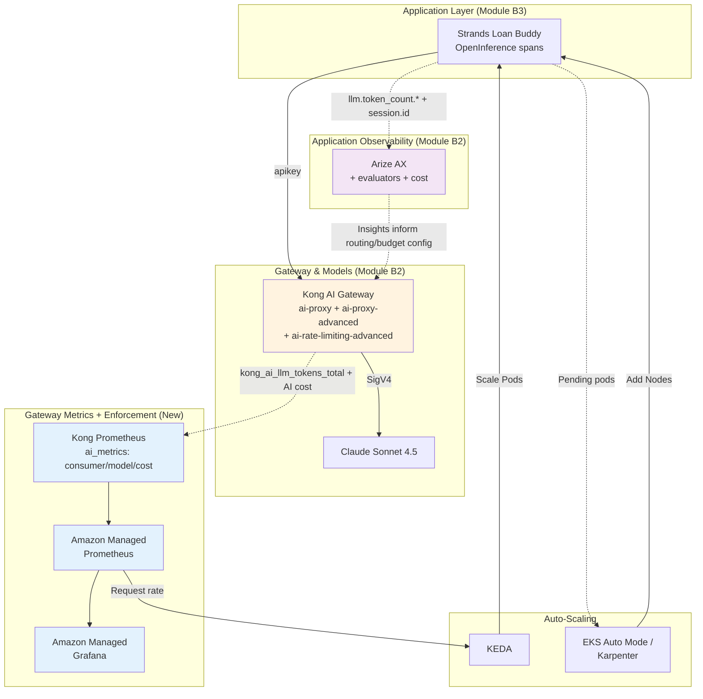

Your Strands Loan Buddy agent is performing well, but success brings new challenges. The bank's marketing campaign was highly effective, and you now need to handle 1,000+ loan applications per hour while ensuring consistent quality, attributing spend per team, and maintaining infrastructure health — all on the **Kong + Arize SaaS stack**.

::alert[**Platform Required**: This module builds on the shared foundation plus Modules B1-B3 (Kong AI Gateway, Arize AX, and the Strands Loan Buddy agent). You'll add evaluation, token/cost attribution, and routing on the SaaS stack.]{type="warning"}

::alert[**This is the SaaS-stack counterpart to [Track A's Module A3](/track-a-opensource/a3-scaling-evaluating/).** It covers evaluation, cost control, and routing with Kong and Arize instead of LiteLLM and Langfuse (Track B places infrastructure monitoring + auto-scaling in Module B5). Where a capability is stronger, weaker, or genuinely different on this stack, each page calls it out.]{type="info"}

## Learning Objectives

By the end of this module, you will:

- 🎯 **Evaluate LLM quality** using Arize AX evaluators (LLM-as-a-Judge on your OpenInference traces)
- 💰 **Attribute tokens & cost per tenant** with Kong's Prometheus `consumer` metrics and Arize sessions
- 🚦 **Enforce per-tenant token/cost budgets** at the edge with `ai-rate-limiting-advanced` (a Track-B-only capability)
- 🔀 **Route across models** with Kong `ai-proxy-advanced` (weighted, cost-aware `lowest-usage`, latency-aware, semantic) and cut cost with **semantic caching**

*(Infrastructure monitoring + auto-scaling with AMP/Grafana/KEDA are covered in [Module B5](/track-b-saas/b5-production-ready/).)*

## Business Scenario: Loan Buddy at Scale 🚀

Your Strands Loan Buddy has been processing loan applications successfully for a few weeks. The bank's leadership is impressed and launches a major marketing campaign promoting instant AI-powered loan decisions.

**The Challenge:**
- Application volume increased from 50/hour to 1,000+/hour overnight
- CFO wants cost optimization and **per-team spend attribution** without sacrificing quality
- Compliance team needs quality audits on every decision
- Platform team needs to **cap runaway tenants** and ensure reliability

**Your Mission:**
Build production-grade evaluation, cost attribution + enforcement, and routing on the Kong + Arize stack to handle scale while maintaining quality and controlling costs.

## Module Architecture

Here's how the new capabilities integrate with your existing SaaS-stack platform:

## Module Sections

### 1. [LLM Evaluation with Arize AX](./evaluation/)
Run LLM-as-a-Judge evaluations on your agent's OpenInference traces. The Arize AX counterpart to Track A's Langfuse evaluators.

### 2. [Token & Cost Attribution + Budget Enforcement](./token-cost-attribution/) ⭐
The centerpiece of this module: attribute tokens and cost **per tenant** across Kong (edge) and Arize (trace level), and **enforce** per-tenant budgets at the gateway — something Track A cannot do.

### 3. [Model Routing & Semantic Caching](./model-routing/)
Weighted, cost-aware (`lowest-usage`), latency-aware, semantic, and other `ai-proxy-advanced` routing algorithms — plus **semantic caching** — across models. The Kong counterpart to Track A's LiteLLM A/B routing.

::alert[**Infrastructure monitoring & auto-scaling moved to [Module B5](/track-b-saas/b5-production-ready/).** B4 now focuses on the token-economics story (evaluation, per-tenant cost attribution + enforcement, and routing); the AMP/Grafana/KEDA production-ops patterns live with the other production concerns in B5.]{type="info"}

## Getting Started

Begin with quality evaluation in Arize AX, then move to the token/cost attribution centerpiece.

---

**[Next: LLM Evaluation with Arize AX →](./evaluation/)**
